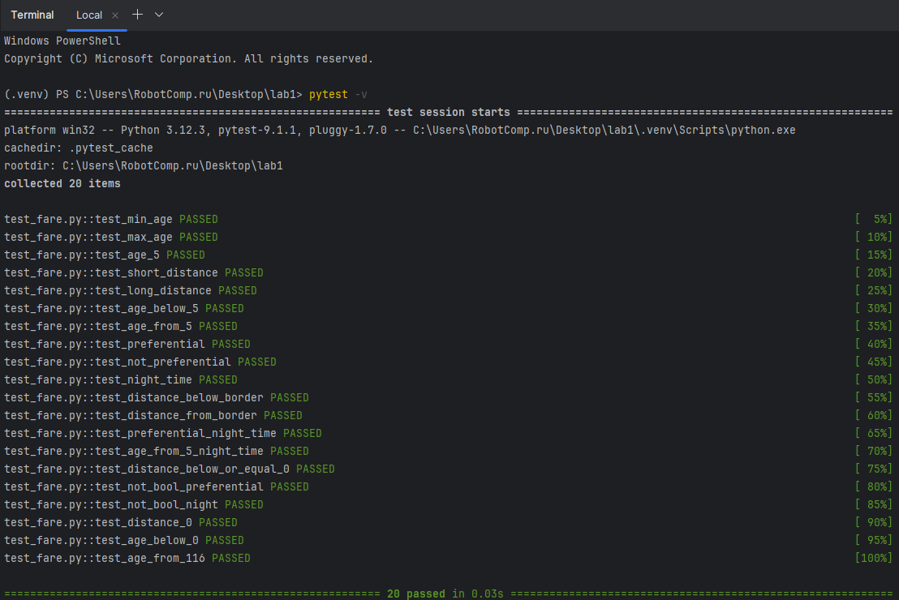

# Лабораторная работа №1 <br> Составление тест-кейсов для готового кода. Качество ПО и место тестирования в жизненном цикле
## Цель работы

Сформировать системное представление о качестве ПО и роли тестирования в жизненном цикле; приобрести практические навыки проектирования тест-кейсов и написания автотестов на основе готового кода.

### **Задачи:**

1. Проанализировать готовый модуль и выделить бизнес-правила, входные и выходные данные, ограничения.
2. Составить набор тест-кейсов: позитивных, негативных, граничных, покрывающих эквивалентные классы.
3. Оформить тест-кейсы по стандартным атрибутам.
4. Реализовать автотесты на Python + pytest.
5. Запустить тесты и зафиксировать результаты.
6. Сделать вывод о связи тестирования, качества ПО и жизненного цикла.

## Задание:

1. Изучить исходный код и выписать все бизнес-правила.
2. Определить:
   - входные параметры;
   - выходной параметр;
   - допустимые и недопустимые значения;
   - граничные значения.
3. Составить **не менее 10 тест-кейсов**:
   - позитивные;
   - негативные;
   - граничные;
   - проверяющие скидку для premium-пользователей;
   - проверяющие бесплатную доставку.
4. Написать автотесты на `pytest`.
5. Запустить тесты командой `pytest -v`.
6. Сделать вывод: какие ветви кода покрыты, какие риски остались, почему тестирование важно для качества.

## Выполнение
### 1. Анализ исходного кода
Функция: `count_fare(distance_km: float, age: int, is_preferential: bool, is_night: bool) -> int`

Бизнес-правила:

1. ValueError, если выполняется одно из условий:
   - distance_km <= 0 
   - age < 0 
   - age > 116  
   - is_preferential или is_night не булевые значения
2. Если distance_km <= 2.49 — стоимость проезда = 25
3. Иначе - стоимость проезда = 25 + (distance_km - 2.49) * 2.5
4. Если is_night — fare = fare * 1.2
5. Если льготный проезд - проезд всегда бесплатный
6. Если возраст < 5 - проезд всегда бесплатный

### 2. Определение параметров

Входные параметры:

| Параметр        | Тип   | Допустимые значения | Недопустимые значения |
|-----------------|-------|---------------------|-----------------------|
| distance_km     | float | \> 0                | <= 0                  |
| age             | int   | 0...116             | < 0 или > 116         |
| is_preferential | bool  | True / False        | не True / False       |
| is_night        | bool  | True / False        | не True / False       |
Выходной параметр int — стоимость проезда.

### 3. Составление тест-кейсов
| ID | Описание                    | Тип                         | Входные параметры                                                                       | Выходной параметр |
|----|-----------------------------|-----------------------------|-----------------------------------------------------------------------------------------|-------------------|
| 1  | Расстояние меньше нуля      | Негативный                  | distance_km = -2.3 <br/> age = 26 <br/> is_preferential = False <br/> is_night = False  | ValueError        |
| 2  | Значение льготы не булевое  | Негативный                  | distance_km = 10.0 <br/> age = 26 <br/> is_preferential = 3 <br/> is_night = False      | ValueError        |
| 3  | Значение ночи не булевое    | Негативный                  | distance_km = 10.0 <br/> age = 26 <br/> is_preferential = False <br/> is_night = ''     | ValueError        |
| 4  | Расстояние равно нулю       | Негативный, <br/> граничный | distance_km = 0.0 <br/> age = 26 <br/> is_preferential = False <br/> is_night = False   | ValueError        |
| 5  | Возраст < 0                 | Негативный, <br/> граничный | distance_km = 23.2 <br/> age = -3 <br/> is_preferential = False <br/> is_night = False  | ValueError        |
| 6  | Возраст > 116               | Негативный, <br/> граничный | distance_km = 23.2 <br/> age = 148 <br/> is_preferential = False <br/> is_night = False | ValueError        |
| 7  | Возраст = 0                 | Граничный                   | distance_km = 23.2 <br/> age = 0 <br/> is_preferential = False <br/> is_night = False   | 0                 |
| 8  | Возраст = 116               | Граничный                   | distance_km = 34.0 <br/> age = 116 <br/> is_preferential = False <br/> is_night = False | 104               |
| 9  | Возраст = 5                 | Граничный                   | distance_km = 23.2 <br/> age = 5 <br/> is_preferential = False <br/> is_night = False   | 77                |
| 10 | Расстояние = 2.49           | Граничный                   | distance_km = 2.49 <br/> age = 7 <br/> is_preferential = False <br/> is_night = False   | 25                |
| 11 | Расстояние = 2.5            | Граничный                   | distance_km = 2.5 <br/> age = 7 <br/> is_preferential = False <br/> is_night = False    | 25                |
| 12 | Возраст < 5                 | Позитивный                  | distance_km = 23.2 <br/> age = 4 <br/> is_preferential = False <br/> is_night = False   | 0                 |
| 13 | Возраст от 5 до 116         | Позитивный                  | distance_km = 19.3 <br/> age = 37 <br/> is_preferential = False <br/> is_night = False  | 67                |
| 14 | Льготный проезд             | Позитивный                  | distance_km = 23.2 <br/> age = 26 <br/> is_preferential = True <br/> is_night = False   | 0                 |
| 15 | Не льготный проезд          | Позитивный                  | distance_km = 23.2 <br/> age = 26 <br/> is_preferential = False <br/> is_night = False  | 77                |
| 16 | Ночной проезд               | Позитивный                  | distance_km = 17.4 <br/> age = 26 <br/> is_preferential = False <br/> is_night = True   | 75                |
| 17 | Расстояние < 2.49           | Позитивный                  | distance_km = 1.4 <br/> age = 26 <br/> is_preferential = False <br/> is_night = False   | 25                |
| 18 | Расстояние > 2.49           | Позитивный                  | distance_km = 45.7 <br/> age = 26 <br/> is_preferential = False <br/> is_night = False  | 133               |
| 19 | Льготный и ночной проезд    | Позитивный                  | distance_km = 23.2 <br/> age = 26 <br/> is_preferential = True <br/> is_night = True    | 0                 |
| 20 | Возраст < 5 и ночной проезд | Позитивный                  | distance_km = 23.2 <br/> age = 2 <br/> is_preferential = False <br/> is_night = True    | 0                 |

### 4. Исходный код
```python
# fare.py

def count_fare(distance_km: float, age: int, is_preferential: bool, is_night: bool) -> int:
	"""
	Расчет стоимости проезда.

	Бизнес-правила:
	1. Если  distance_km <= 0 или age < 0 или age > 116 или is_preferential и is_night не булевые значения - ValueError
 	2. Если distance_km <= 2.49 - стоимость проезда = 25
 	3. Иначе
 	   - стоимость проезда = 25 + (distance_km - 2.49) * 2.5
 	4. Если is_night - fare = fare * 1.2
 	5. Если льготный проезд - проезд бесплатный
 	6. Если возраст < 5 - проезд бесплатный
	"""
	if distance_km <= 0:
		raise ValueError('distance must be > 0')
	if age < 0:
		raise ValueError('Age must be >= 0')
	if age > 116:
		raise ValueError('Age must be <= 116')
	if not isinstance(is_preferential, bool):
		raise ValueError('is_preferential  must be bool')
	if not isinstance(is_night, bool):
		raise ValueError('is_night must be bool')

	if age < 5 or is_preferential:
		return 0
	if distance_km <= 2.49:
		fare = 25
	else:
		fare = 25 + (distance_km - 2.49) * 2.5
	if is_night:
		fare = fare * 1.2
	return round(fare)
```

### 5. Реализация автотестов
```python
# test_fare.py

import pytest
from fare import count_fare

# Позитивные и граничные тесты
def test_min_age():
    # Минимально возможный возраст 0
    assert count_fare(23.2, 0, False, False) == 0

def test_max_age():
    # Максимально возможный возраст 116
    assert count_fare(34.0, 116, False, False) == 104

def test_age_5():
    # В 5 проезд платный
    assert count_fare(23.2, 5, False, False) == 77

def test_short_distance():
    # От 0(не вкл) до 2.49км цена 25руб
    assert count_fare(2.49, 7, False, False) == 25

def test_long_distance():
    # От 2.5км цена - 25 + 2.5 за каждый км после 2.49км
    assert count_fare(2.5, 7, False, False) == 25

def test_age_below_5():
    # От 0 до 5 лет проезд бесплатный
    assert count_fare(23.2, 4, False, False) == 0

def test_age_from_5():
    # C 5 до 116 лет проезд платный
    assert count_fare(19.3, 37, False, False) == 67

def test_preferential():
    # Льготный проезд бесплатный
    assert count_fare(19.3, 26, True, False) == 0

def test_not_preferential():
    # Не льготный проезд платный
    assert count_fare(23.2, 26, False, False) == 77

def test_night_time():
    # Ночью проезд на 20% больше
    assert count_fare(17.4, 26, False, True) == 75

def test_distance_below_border():
    # От 0(не вкл) до 2.49км цена 25руб
    assert count_fare(1.4, 26, False, False) == 25

def test_distance_from_border():
    # От 2.5км цена - 25 + 2.5 за каждый км
    assert count_fare(45.7, 26, False, False) == 133

def test_preferential_night_time():
    # Льготный проезд в ночное время. Льготный проезд преобладает
    assert count_fare(23.2, 26, True, True) == 0

def test_age_from_5_night_time():
    # От 5 до 116 лет и ночное время. Возраст преобладает
    assert count_fare(23.2, 2, False, True) == 0

# Негативные тесты
def test_distance_below_or_equal_0():
    # Расстояние меньше или равное 0 — ошибка
    with pytest.raises(ValueError):
        count_fare(-2.3, 26, False, False)

def test_not_bool_preferential():
    # Льгота не булевое значение — ошибка
    with pytest.raises(ValueError):
        count_fare(10.0, 26, 3, False)

def test_not_bool_night():
    # Ночное время не булевое значение — ошибка
    with pytest.raises(ValueError):
        count_fare(10.0, 26, False, '')

def test_distance_0():
    # Расстояние меньше или равное 0 — ошибка
    with pytest.raises(ValueError):
        count_fare(0.0, 26, False, False)

def test_age_below_0():
    # Возраст меньше 0 — ошибка
    with pytest.raises(ValueError):
        count_fare(23.2, -3, False, False)

def test_age_from_116():
    # Возраст больше 116 — ошибка
    with pytest.raises(ValueError):
        count_fare(23.2, 148, False, False)
```

### 6. Запуск тестов командой pytest -v


## Вывод
В ходе выполнения лабораторнй работы были приобритены практические навыки 
проектирования тест-кейсов и написания автотестов на основе готового кода. 
Тестирование покрывает все ветви функции count_fare, включая позитивные, 
негативные и граничные. Все тесты успешно пройдены.
