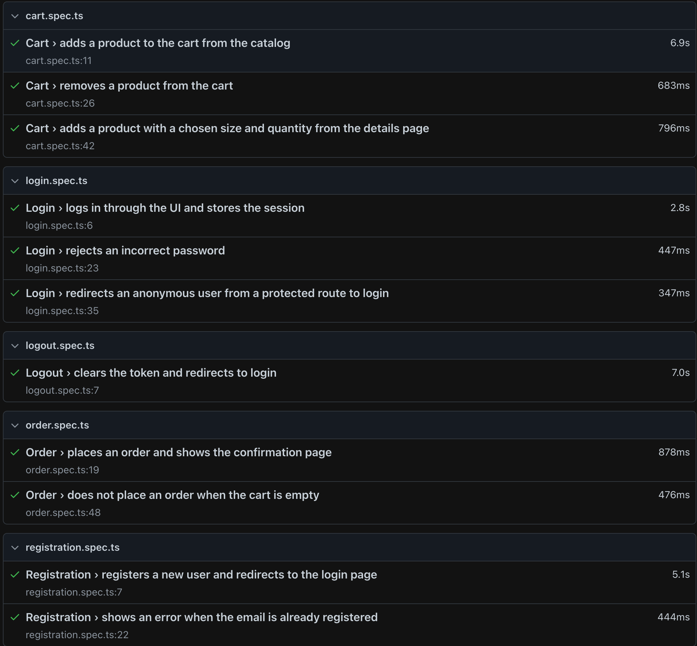
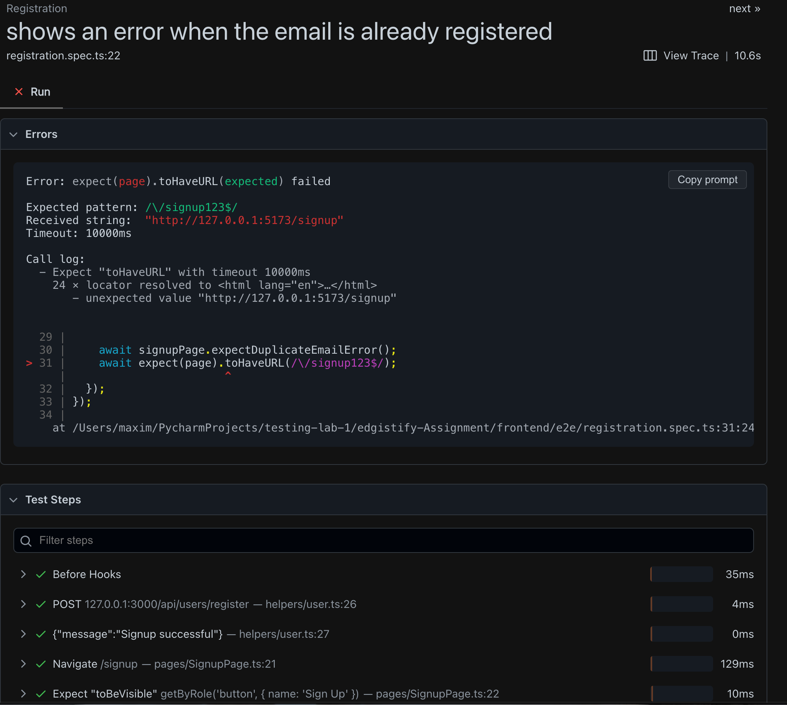
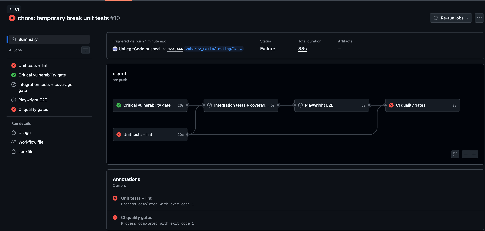
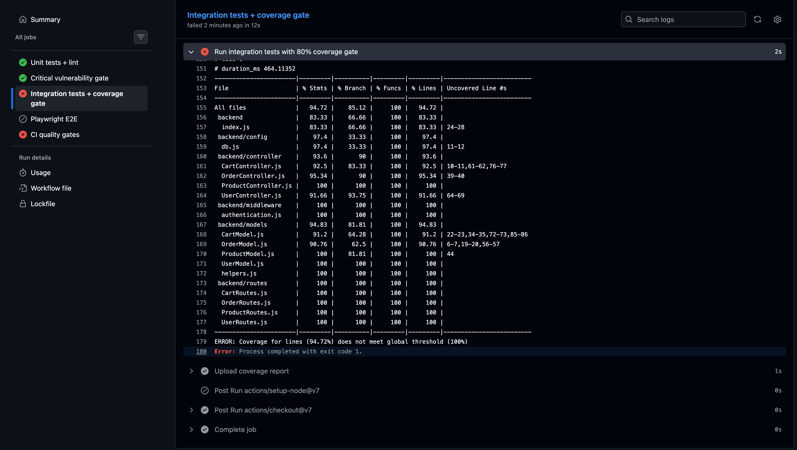
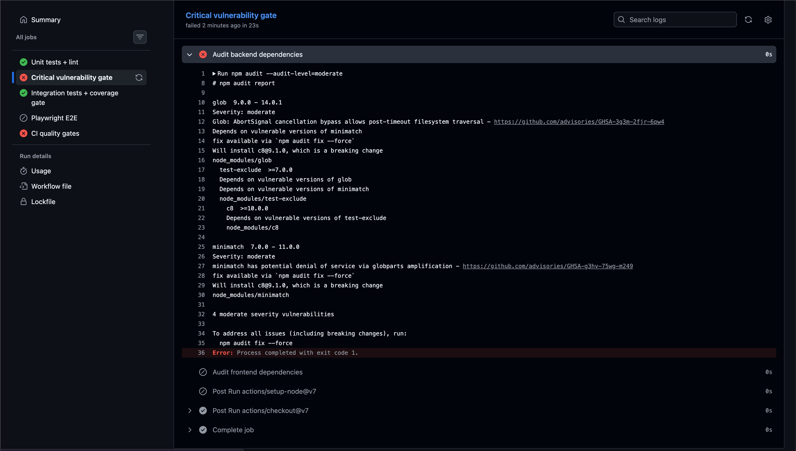

# Отчёт по лабораторной работе № 3

## «Автоматизация UI-тестов и построение CI/CD-пайплайна с блокирующими quality gates»

**Студент:** Максим Зубарев

**Группа:** ПВ-232

**Инструменты:** Playwright 1.65, Node.js test runner, c8, ESLint 10, npm audit, GitHub Actions

---

## 1. Часть 1. UI-автоматизация

### 1.1. Объект тестирования

Тестируется интернет-магазин Clothify из `edgistify-Assignment/`: React 19 + Vite на клиенте, Express + SQLite на сервере.

Покрытые пользовательские сценарии:

- регистрация пользователя (`/signup`);
- вход в систему (`/login`);
- добавление товара в корзину из каталога и из карточки товара;
- оформление заказа (`/cart` → `/checkout` → `/placed`);
- выход из системы через navbar;
- дополнительные негативные проверки: дублирующийся email, неверный пароль, пустая корзина, редирект с защищённого маршрута.

Сценарий поиска товара из задания не реализован: в приложении нет ни поля поиска, ни endpoint поиска. По согласованию этот сценарий исключён из прогона; тесты не эмулируют несуществующий функционал.

### 1.2. Организация кода: паттерн Page Object

Тесты находятся в `edgistify-Assignment/frontend/e2e/`. Конфигурация — `edgistify-Assignment/frontend/playwright.config.ts`.

| Слой | Файл | Назначение |
|---|---|---|
| Конфигурация | `playwright.config.ts:20`, `playwright.config.ts:40` | `testDir: ./e2e`, два `webServer`: бэкенд и Vite |
| Базовый объект | `e2e/pages/BasePage.ts:3` | общее хранилище `Page` для всех страниц |
| Компонент | `e2e/pages/NavbarComponent.ts:3` | навигация, кнопка `Logout` |
| Страница | `e2e/pages/SignupPage.ts:4` | поля регистрации, submit, сообщения об ошибках |
| Страница | `e2e/pages/LoginPage.ts:4` | поля логина, submit, сообщения |
| Страница | `e2e/pages/ProductsPage.ts:4` | карточки товаров, размер, кнопка `Add Cart` |
| Страница | `e2e/pages/ProductDetailsPage.ts:4` | размер, количество, `Add to Cart` |
| Страница | `e2e/pages/CartPage.ts:4` | проверка товара, удаление, переход в checkout |
| Страница | `e2e/pages/CheckoutPage.ts:13` | адрес доставки, сумма, `Place Order` |
| Страница | `e2e/pages/PlacedOrderPage.ts:4` | подтверждение заказа и его детали |
| Фикстуры данных | `e2e/helpers/user.ts` | генерация уникального пользователя, register/login через API, запись токена в `localStorage` |

Page Object инкапсулирует локаторы и действия: `.spec`-файлы не содержат прямых обращений к DOM, а работают через методы страниц (`register()`, `addToCart()`, `fillShippingAddress()`, `placeOrder()` и т. д.).

### 1.3. Состав тестового набора

| Spec-файл | Сценарии | Кол-во тестов |
|---|---|---:|
| `e2e/registration.spec.ts:6` | успешная регистрация с последующим логином; ошибка при занятом email | 2 |
| `e2e/login.spec.ts:5` | вход через UI и сохранение `token`/`userId`; неверный пароль; редирект с `/cart` | 3 |
| `e2e/cart.spec.ts:10` | добавление из каталога; удаление; добавление с размером `M` и количеством 3 | 3 |
| `e2e/order.spec.ts:18` | оформление заказа и проверка `/placed`; блокировка заказа при пустой корзине | 2 |
| `e2e/logout.spec.ts:6` | очистка токена, редирект на `/login`, повторный редирект с `/cart` | 1 |
| **Итого** |  | **11** |

### 1.4. Изоляция и запуск

- `playwright.config.ts:7` создаёт временный путь SQLite (`DB_PATH`) и удаляет старые файлы БД перед прогоном.
- `playwright.config.ts:40` поднимает бэкенд (`npm run seed && npm start`, порт 3000) и Vite (порт 5173).
- `JWT_SECRET` задаётся переменной окружения; dotenv из `.env` не переопределяет уже установленные значения.
- Браузер: Chromium, viewport 1440×900, `trace: retain-on-failure`, screenshot и video только при падении.
- Локальный запуск: `cd edgistify-Assignment/frontend && npm run test:e2e`.

Результат локального прогона: **11 passed, 0 failed**.



*Скриншот 1. Успешный прогон E2E-тестов (11 passed).*



*Скриншот 2. Упавший E2E-тест: красный результат в терминале/отчёте Playwright

---

## 2. Часть 2. Пирамида тестирования

```text
              E2E — 11 тестов (38%)
        Integration — 13 тестов (45%)
             Unit — 5 тестов (17%)
```

| Уровень | Кол-во | Что проверяет | Почему столько |
|---|---:|---|---|
| Unit | 5 | Чистые функции `toId`, `normalizeImages`, `parseJsonArray` (`backend/tests/unit/helpers.test.js`) | Самые быстрые и дешёвые тесты. Хелперы используются всеми моделями, поэтому они покрываются исчерпывающе: граничные значения, невалидный JSON, пустые массивы. |
| Integration | 13 | Все HTTP-эндпоинты, JWT, валидация, SQLite, маппинг моделей (`backend/tests/integration/api.test.js`) | Основная бизнес-логика сосредоточена в API: авторизация, корзина, заказы. Тесты в процессе (`supertest`) с БД `:memory:` дают высокую гарантию без запуска браузера. |
| E2E | 11 | Критические пользовательские сценарии через реальный UI | Медленные и хрупкие, поэтому только ключевые сценарии: регистрация, логин, корзина, заказ, logout. Не дублируют каждую комбинацию валидаций API. |

Обоснование пропорции: чем ниже уровень, тем быстрее обратная связь и дешевле поддержка. Unit-тесты запускаются на каждом push/PR, integration-тесты дают точную локализацию ошибок в контрактах API, E2E подтверждают, что приложение работает как единая система перед релизом.

---

## 3. Часть 3. CI/CD-пайплайн

Конфигурация: `.github/workflows/ci.yml`. Триггеры: `push` и `pull_request` (`.github/workflows/ci.yml:4`). `concurrency` отменяет устаревшие прогоны одного ref (`.github/workflows/ci.yml:8`).

### 3.1. Стадии и блокировка

| Job | Имя в UI | Зависит от | Что делает | Блокирует следующие стадии |
|---|---|---|---|---|
| `unit` | Unit tests + lint | — | ESLint, `tsc -b && vite build`, backend unit tests | Да: `integration` не запустится |
| `integration` | Integration tests + coverage gate | `unit` | integration-тесты + c8 с порогом 80% | Да: `e2e` не запустится |
| `security` | Critical vulnerability gate | — | `npm audit --audit-level=critical` для backend и frontend | Да: `e2e` не запустится |
| `e2e` | Playwright E2E | `integration`, `security` | установка Chromium, прогон 11 тестов | Да: итоговый `ci` станет red |
| `ci` | CI quality gates | все выше | агрегирует результаты; единственный обязательный check для branch protection | — |

Падение `unit` → `integration` и `e2e` получают статус `skipped`. Падение `integration` или `security` → `e2e` пропускается. Итоговый job `ci` (`ci.yml:137`) завершается ошибкой, если любой check не `success`.

### 3.2. Quality gates

| Gate | Реализация | Порог / условие | Действие при нарушении |
|---|---|---|---|
| Линтер и типы | `npm run lint`, `npm run build` (`ci.yml:35`, `ci.yml:38`) | 0 ошибок ESLint, успешная сборка | job `unit` red → дальше не идём |
| Unit-тесты | `npm run test:unit` (`backend/package.json:8`) | 0 падений | job `unit` red |
| Coverage | `c8 ... --check-coverage --lines 80 --functions 80 --branches 80 --statements 80` (`backend/package.json:11`) | минимум 80% по четырём метрикам | job `integration` red, E2E пропущен |
| Критические уязвимости | `npm audit --audit-level=critical` (`ci.yml:88`, `ci.yml:91`) | 0 critical; moderate не блокируют | job `security` red, E2E пропущен |
| E2E | `npm run test:e2e` (`frontend/package.json:11`) | 11/11 passed | job `e2e` red, итоговый check red |
| Branch protection | настройка репозитория | обязательный check `CI quality gates` перед merge в `main` | merge заблокирован GitHub |

Фактический coverage после прогона: **94.72% statements, 84.42% branches, 100% functions, 94.72% lines** — порог 80% пройден с запасом.

### 3.3. Отчёты и артефакты

| Артефакт | Job | Содержимое |
|---|---|---|
| `coverage-lcov` | `integration` | `backend/coverage/lcov.info` и HTML-отчёт c8 |
| `playwright-report` | `e2e` | HTML-отчёт Playwright со скриншотами и трассировками |
| `playwright-test-results` | `e2e` | `test-results/junit.xml` и артефакты упавших тестов |

Badge статуса пайплана размещён в заголовке этого README и указывает на ветку `zubarev_maxim/testing/lab-3`.

---

## 4. Подтверждение работы quality gates

### 4.1. Падение unit-теста блокирует сборку

При падении unit-теста job `Unit tests + lint` стал красным, job `Integration tests + coverage gate` (роль `build` в этой схеме) и `Playwright E2E` получили статус `skipped`, итоговый `CI quality gates` — red.



*Скриншот 3. Падение unit-теста: `integration` и `e2e` имеют статус skipped.*

### 4.2. Coverage ниже 80% валит пайплайн

При покрытии ниже порога в логе job `integration` появилось сообщение `ERROR: Coverage for lines ... does not meet global threshold (80%)`: job красный, `e2e` пропущен.



*Скриншот 4. Quality gate coverage: падение при покрытии ниже порога.*

### 4.3. Критическая уязвимость валит пайплайн

При обнаружении critical-уязвимости `npm audit --audit-level=critical` job `Critical vulnerability gate` стал красным, `Playwright E2E` пропущен, итоговый check red.



*Скриншот 5. Quality gate безопасности: critical-уязвимость блокирует релиз.*

---

## 5. Контрольные вопросы

**1. Что такое пирамида тестирования и почему она важна?**

Это распределение тестов по уровням: много быстрых unit, меньше integration, ещё меньше медленных E2E. Оно важно для баланса скорости, стоимости и уверенности: большинство дефектов ловится дёшево на нижних уровнях, а E2E остаются как финальная проверка ключевых сценариев.

**2. Какие паттерны автоматизации UI вы знаете?**

Page Object (использован здесь), Screenplay, Test Data Builder/Factory, Fixture и Repository для тестовых данных, Factory Method для создания пользователей, явные ожидания вместо `sleep` (в тестах используются `expect(...).toBeVisible()` и ожидание URL).

**3. Что такое quality gates и зачем они нужны?**

Это автоматические проверки, которые не просто информируют, а блокируют дальнейшее продвижение кода: lint, coverage, безопасность, падение тестов. Они нужны, чтобы некачественная сборка не попала в main и не была выпущена.

**4. Почему unit-тесты запускаются на каждый коммит, integration — после сборки, а E2E — перед релизом?**

Unit быстрые и дешёвые, их можно гнать на каждом push/PR. Integration требуют собранного приложения/схемы БД, но всё ещё быстрые и дают точную локализацию. E2E самые медленные и чувствительные к окружению, поэтому их запускают после зелёных предыдущих гейтов, непосредственно перед релизом.

---

## 6. Выводы

Автоматизация замкнула контур обратной связи: любой push или PR инициирует проверки, а блокирующие гейты не дают выполнить merge с красным CI. Разделение на unit/integration/E2E позволяет быстро находить причину падения: чистая функция, контракт API или пользовательский сценарий. Публикация lcov, JUnit и Playwright HTML-отчётов артефактами делает результат проверки воспроизводимым, а badge в README — видимым индикатором качества ветки. Обязательный check `CI quality gates` в branch protection для `main` замыкает схему: сборка с красным CI не попадает в основную ветку.
