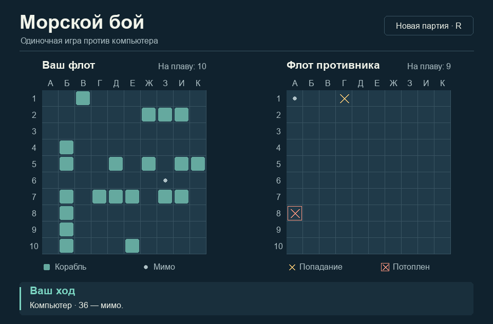

# Лабораторная работа № 1 по спецификации ПО

**Выполнил Письменный Антон, группа ПВ-232.**

**Тема** — критерии качества ПО, сложность, корректность, надёжность, трудоёмкость. Оценка качества ПО.

**Цель** — освоить практические методы оценки качества и метрик программного обеспечения.

[Задание лабораторной работы](https://github.com/d26dodenko/PV-232/blob/bb38d870c19d5f2a9365dd053ae4bdd09defeb4c/Specification/Laba-1.md)

## Часть 1. Теоретическая

### 1.1. Основные проблемы разработки сложных программных систем

**Управление сложностью.** По мере роста программы увеличивается количество модулей и связей между ними. Изменение одного компонента может повлиять на несколько других. Это затрудняет поиск ошибок и увеличивает трудоёмкость сопровождения. Разделение программы на модули с определёнными обязанностями позволяет проверять и изменять их по отдельности.

**Неполные и изменяющиеся требования.** Неоднозначное описание функции допускает несколько вариантов реализации. Разработчик и пользователь могут по-разному понимать ожидаемый результат. Требования нужно уточнять через конкретные сценарии, а изменения согласовывать до доработки кода. Для проверки корректности каждому требованию задают критерий приёмки.

**Обеспечение надёжности.** Ошибки могут проявляться только при определённом порядке действий, на границах допустимых значений или при взаимодействии компонентов. После изменения кода ранее работающий сценарий может перестать выполняться. Автоматические тесты позволяют повторять такие проверки, а анализ покрытия помогает найти непроверенные участки.

### 1.2. Проблемы, решения и инструменты

| Проблема | Возможное решение | Инструменты и методы |
|---|---|---|
| Рост сложности и связности | Разделить обязанности модулей, сократить функции с большим числом ветвлений | Модульная архитектура, ревью кода, цикломатическая сложность, Radon |
| Неоднозначные и меняющиеся требования | Описать сценарии использования и критерии приёмки, фиксировать изменения | Трекер задач, прототипирование, приёмочные тесты |
| Ошибки и регрессии | Проверять обычные, ошибочные и граничные случаи после изменений | Модульное и интеграционное тестирование, pytest, coverage.py |

## Часть 2. Практическая

### 2.1. Создание проекта на Python

Разработана игра «Морской бой» на Python с интерфейсом Pygame. Игрок сражается с компьютером на двух полях размером 10 × 10 клеток. Флот каждой стороны состоит из одного четырёхпалубного, двух трёхпалубных, трёх двухпалубных и четырёх однопалубных кораблей.

При запуске корабли расставляются автоматически с зазором между ними, включая диагонали. Игрок ходит первым. Попадание сохраняет ход, промах передаёт его сопернику. Повторный выстрел по клетке игнорируется. Компьютер выбирает случайную необстрелянную клетку. Побеждает сторона, потопившая весь флот противника.

| Действие | Управление |
|---|---|
| Выстрел | Левая кнопка мыши по клетке правого поля |
| Новая партия | Кнопка «Новая партия» или клавиша R |
| Выход | Esc или закрытие окна |



*Рисунок 1 — собственный флот и результаты выстрелов по противнику.*

Структура проекта отражает разделение игровой логики и интерфейса.

```text
battleship/
    __init__.py
    __main__.py      — точка входа
    board.py         — расстановка флота и выстрелы по полю
    game.py          — очередность ходов и определение победителя
    app.py           — управление и отрисовка
tests/
    test_board.py    — тесты расстановки и поля
    test_game.py     — тесты правил партии
    test_app.py      — тесты интерфейса
requirements.txt
tasks.org
README.md
```

Для запуска в macOS или Linux из корня проекта используются следующие команды. Требуется Python 3.12.

```sh
python3.12 -m venv .venv
source .venv/bin/activate
python -m pip install -r requirements.txt
python -m battleship
```

В Windows окружение создаётся командой `py -3.12 -m venv .venv` и активируется в PowerShell командой `.\.venv\Scripts\Activate.ps1`. Установка зависимостей и запуск игры выполняются теми же двумя последними командами.

### 2.2. Задачи проекта

Для учёта задач используется Org mode. В каждой задаче записаны состояние, критерии приёмки, дата завершения и ссылки на результат. [Файл задач](tasks.org)

| ID | Задача | Критерий приёмки | Статус |
|---|---|---|---|
| MB-01 | Автоматическая расстановка флота | На каждом поле десять прямых кораблей, соблюдены границы и зазоры | Выполнено |
| MB-02 | Обработка выстрела | Попадание сохраняет ход, промах передаёт его, повторный выстрел ничего не меняет | Выполнено |
| MB-03 | Ход компьютера | Компьютер стреляет по новым клеткам и соблюдает общие правила партии | Выполнено |
| MB-04 | Интерфейс и результат партии | Видны поля и результаты выстрелов, объявляется победитель, работает перезапуск | Выполнено |

### 2.3. Модульные тесты

Для проверки программы используется pytest. Игровая модель проверяется на заданных расстановках. Тесты интерфейса используют виртуальный видеодрайвер SDL и отправляют события в Pygame.

| Файл | Число тестовых случаев | Проверяемое поведение |
|---|---:|---|
| `tests/test_board.py` | 10 | Состав флота, границы, зазоры, отмена неудачного выбора при расстановке, промахи, попадания, потопление и повторные выстрелы |
| `tests/test_game.py` | 6 | Передача хода, попадания компьютера, победа обеих сторон и три полные партии |
| `tests/test_app.py` | 10 | Щелчок по клетке, скрытие чужого флота, отметки выстрелов, задержка хода компьютера, перезапуск и выход |
| **Всего** | **26** | |

Один тест расстановки перебирает 64 начальных значения генератора случайных чисел. Граничные случаи включают корабли у нижнего и правого края поля, выход за границы и выстрел по последней палубе последнего корабля.

```sh
python -m pytest -q
```

Результат контрольного прогона — **26 passed**. [Исходный код тестов](tests/)

### 2.4. Покрытие кода тестами

Покрытие измерено coverage.py с учётом ветвлений по всему пакету `battleship`.

```sh
python -m coverage run --branch --source=battleship -m pytest -q
python -m coverage report -m --precision=2
```

```text
Name                     Stmts   Miss Branch BrPart   Cover   Missing
---------------------------------------------------------------------
battleship/__init__.py       0      0      0      0 100.00%
battleship/__main__.py       3      0      2      1  80.00%   3->exit
battleship/app.py          125      0     40      0 100.00%
battleship/board.py         48      0     14      0 100.00%
battleship/game.py          33      0     10      0 100.00%
---------------------------------------------------------------------
TOTAL                      209      0     66      1  99.64%
```

Выполнены все **209 исполняемых строк** и **65 из 66 ветвей**. Покрытие строк составляет **100%**, ветвей — **98,48%**, общий показатель coverage.py — **99,64%**.

Непройденная ветвь — ложный исход условия `if __name__ == "__main__"` в точке входа. Тест запускает игру как программу, поэтому это условие истинно.

### 2.5. Выбор проекта для оценки качества

Для дальнейших измерений выбран разработанный «Морской бой». Анализ охватывает пять файлов пакета `battleship`. Тесты и документация учитываются отдельно от исходного кода игры.

### 2.6. Размер ПО

Размер определён командой Radon.

```sh
python -m radon raw -s battleship
```

| Файл | LOC | SLOC |
|---|---:|---:|
| `battleship/__init__.py` | 1 | 0 |
| `battleship/__main__.py` | 4 | 3 |
| `battleship/board.py` | 76 | 58 |
| `battleship/game.py` | 44 | 33 |
| `battleship/app.py` | 149 | 130 |
| **Всего** | **274** | **224** |

LOC учитывает все физические строки файлов. SLOC показывает число строк с исходным кодом по Radon. Основная часть программы приходится на интерфейс — 149 из 274 строк.

### 2.7. Цикломатическая сложность

Для расчёта выбран метод `Board.fire`, который проверяет выстрел и определяет его результат.

```python
def fire(self, cell: Cell) -> Shot | None:
    """Вернуть результат нового выстрела. Недопустимый ход ничего не меняет."""
    if cell not in CELLS or cell in self.shots:
        return None
    ship = self.ship_at.get(cell)
    if ship is None:
        self.shots[cell] = Shot.MISS
        return Shot.MISS

    self.shots[cell] = Shot.HIT
    if ship <= self.shots.keys():
        self.shots.update(dict.fromkeys(ship, Shot.SUNK))
        self.afloat -= 1
    return self.shots[cell]
```

В методе три оператора `if`. Логический оператор `or` в первой проверке добавляет ещё одну точку ветвления. С учётом базового пути получаем **V(G) = 1 + 3 + 1 = 5**.

```sh
python -m radon cc -s battleship/board.py
```

Radon подтверждает результат — **`Board.fire - A (5)`**. [Исходный код метода](battleship/board.py)

### 2.8. Оценка дефектности

При проверке были обнаружены следующие замечания.

| № | Дефект или замечание | Исправление | Статус |
|---|---|---|---|
| 1 | Символ потопленного корабля в легенде отображался пустым квадратом на macOS | Легенда и поле используют одну функцию рисования отметки средствами Pygame. Результат проверен по изображению окна | Исправлено |
| 2 | Прямой вызов `pytest -q` не находил пакет игры | Каталог `tests` оформлен как пакет. Оба способа запуска pytest выполняют все 26 тестов | Исправлено |

В коде игры выявлен один дефект интерфейса. Плотность обнаруженных дефектов равна **1 / (274 / 1000) ≈ 3,65 дефекта на KLOC**. Замечание к запуску тестов относится к организации проекта. Открытых подтверждённых дефектов после исправлений — **0**.

### 2.9. Итоговая таблица метрик

Время реакции измерено от отправки щелчка в очередь Pygame до обновления кадра с отметкой выстрела. Условия измерения — Python 3.12.12, Pygame 2.6.1, macOS arm64, SDL `dummy`, ограничение 60 кадров/с. В девяти запусках получены значения 11,53 / 13,16 / 15,99 / 16,08 / 17,24 / 15,95 / 15,78 / 15,90 / 17,27 мс. Медиана составляет **15,95 мс**. Это время обработки события и обновления виртуального окна. Задержки физической мыши и монитора в измерение не входят.

```sh
python -m pytest -q -s tests/test_app.py::test_click_to_frame
```

| Метрика | Значение | Основание |
|---|---|---|
| Размер ПО | 274 LOC, 224 SLOC | Radon, пять файлов игры |
| Цикломатическая сложность | 5, ранг A | Метод `Board.fire`, ручной расчёт и Radon |
| Качество, дефекты | 1 выявлен и исправлен, 0 открытых | Проверка интерфейса |
| Время реакции | 15,95 мс | Медиана девяти запусков, щелчок → кадр |
| Покрытие тестами | 100% строк, 98,48% ветвей | coverage.py, 26 прошедших тестов |

## Вывод

Разработана игра «Морской бой», составлены задачи и выполнено тестирование. Проверены правила расстановки, результаты выстрелов, передача хода и завершение партии. Разделение поля, правил игры и интерфейса позволило проверять игровые ситуации на заданных данных. Измерены размер программы, цикломатическая сложность, покрытие и время реакции. По результатам проверки исправлены дефект отображения легенды и замечание к запуску тестов.
