# Лабораторная работа № 2 (в задании написано как 3)

**«Интеграционное и API-тестирование»**

**Выполнил:** Прядко Богдан Васильевич, группа ПВ-232.

**Цель:** научиться проверять REST API в Postman, автоматизировать проверки и сравнивать ответы сервера с документацией.

## 1. Тестируемый сервис

Я протестировал публичный сервис бронирований **Restful-Booker**: https://restful-booker.herokuapp.com. Ожидания сверял с [документацией API](https://restful-booker.herokuapp.com/apidoc/index.html).

| Метод | Эндпоинт | Назначение |
|---|---|---|
| POST | `/auth` | Получение токена |
| GET | `/booking` | Список бронирований и фильтры |
| GET | `/booking/{id}` | Получение записи |
| POST | `/booking` | Создание записи |
| PUT | `/booking/{id}` | Полное обновление |
| PATCH | `/booking/{id}` | Частичное обновление |
| DELETE | `/booking/{id}` | Удаление записи |
| GET | `/ping` | Проверка доступности |

## 2. Подготовка и автоматизация

В Postman я создал коллекцию **LabAPI_Прядко** с 52 запросами и папками **Auth**, **Booking**, **Health**. В Booking выделил Positive, Negative и Boundary. Для каждого запроса указал цель, входные данные и ожидаемый результат.

| Переменная окружения | Начальное значение | Использование |
|---|---|---|
| baseUrl | https://restful-booker.herokuapp.com | Адрес сервиса |
| token | Пусто | Сохраняю из успешного ответа POST /auth |
| bookingId | Пусто | Сохраняю из поля bookingid при создании записи |

Токен и ID передаются автоматически через `pm.environment.set()` и `pm.environment.get()`. Для PUT, PATCH и DELETE я использовал `Cookie: token={{token}}`. В негативных запросах без авторизации этот заголовок отсутствует; автоматические cookies отключены.

Общие Tests я разместил в Scripts коллекции: они наследуются каждым запросом. Проверяю HTTP-код, время меньше 2000 мс, отсутствие 5xx, формат и содержимое ответа. Дополнительно проверяю типы полей, сохранение переменных, изменения после PUT/PATCH и удаление. На каждый запрос приходится не менее четырёх проверок. Текстовые ответы обрабатываю без обязательного вызова JSON-парсера.

Базовое бронирование:

```json
{
  "firstname": "Bogdan",
  "lastname": "Pryadko",
  "totalprice": 150,
  "depositpaid": true,
  "bookingdates": {"checkin": "2026-12-10", "checkout": "2026-12-20"},
  "additionalneeds": "Breakfast"
}
```

В PUT я меняю имя и фамилию с уникальным суффиксом, цену на 275, depositpaid на false и пожелания на Dinner. В PATCH меняю только цену на 320 и пожелания на Late checkout; остальные поля должны сохраниться. Строки длиной 1001 символ формирую программно через `'Я'.repeat(1001)`.

## 3. Тест-кейсы

Для успешных запросов я использовал коды из примеров документации: создание возвращает 200, удаление и ping — 201. Для ошибочных запросов точные коды в документации не заданы, поэтому 400/401/403/404/405 в таблице являются моими ожиданиями по HTTP. Разницу с фактическими ответами я разобрал в разделе 4.

**Passed** означает, что прошли все проверки сценария. **Failed** означает расхождение хотя бы одной проверки; это не всегда подтверждённый дефект API.

### Позитивные сценарии

| ID | Эндпоинт | Тип | Входные данные | Ожидалось | Получено | Статус |
|---|---|---|---|---|---|---|
| A01 | POST /auth | Позитивный | admin / password123 | 200, токен | 200, токен сохранён | Passed |
| H01 | GET /ping | Позитивный | Без параметров | 201, Created | 201, Created | Passed |
| P01 | GET /booking | Позитивный | Без фильтров | 200, массив ID | 200, массив ID | Passed |
| P02 | POST /booking | Позитивный | Базовый JSON | 200, ID и данные | 200, ID сохранён | Passed |
| P03 | GET /booking/{id} | Позитивный | bookingId | 200, данные P02 | 200, данные совпали | Passed |
| P04 | PUT /booking/{id} | Позитивный | Цена 275, depositpaid=false, новые имя/фамилия, Dinner | 200, все изменения PUT | 200, поля обновлены | Passed |
| P05 | GET /booking/{id} | Позитивный | bookingId после PUT | 200, данные P04 | 200, PUT сохранён | Passed |
| P06 | PATCH /booking/{id} | Позитивный | Цена 320, Late checkout | 200, два поля изменены | 200, два поля обновлены | Passed |
| P07 | GET /booking/{id} | Позитивный | bookingId после PATCH | 200, остальные поля сохранены | 200, остальные поля не изменены | Passed |
| P08 | GET /booking | Позитивный | firstname после PUT | 200, свой ID есть | 200, свой ID есть | Passed |
| P09 | GET /booking | Позитивный | lastname после PUT | 200, свой ID есть | 200, свой ID есть | Passed |
| P10 | GET /booking | Позитивный | checkin=2026-12-10 | 200, свой ID есть | 200, своего ID нет | Failed |
| P11 | GET /booking | Позитивный | checkout=2026-12-19 | 200, свой ID есть | 200, своего ID нет | Failed |
| P12 | GET /booking | Позитивный | checkout=2026-12-21 | 200, своего ID нет | 200, свой ID есть | Failed |
| P13 | GET /booking | Позитивный | Имя после PUT; checkin=2026-12-09; checkout=2026-12-19 | 200, свой ID есть | 200, пустой массив | Failed |
| P14 | DELETE /booking/{id} | Позитивный | Свой ID и токен | 201, удаление | 201, Created | Passed |
| P15 | GET /booking/{id} | Позитивный | Удалённый ID | 404, Not Found | 404, Not Found | Passed |

### Негативные сценарии

| ID | Эндпоинт | Тип | Входные данные | Ожидалось | Получено | Статус |
|---|---|---|---|---|---|---|
| A02 | POST /auth | Негативный | wrong / password123 | 401, токен не выдан | 200, Bad credentials; токена нет | Failed |
| A03 | POST /auth | Негативный | admin / wrong | 401, токен не выдан | 200, Bad credentials; токена нет | Failed |
| A04 | POST /auth | Негативный | Пустой логин | 401, токен не выдан | 200, Bad credentials; токена нет | Failed |
| A05 | POST /auth | Негативный | Пустой пароль | 401, токен не выдан | 200, Bad credentials; токена нет | Failed |
| N00 | POST /booking | Негативный | Базовый JSON | 200, ID и данные | 200, запись создана | Passed |
| N01 | PUT /booking/{id} | Негативный | Базовый JSON, без Cookie | 403, запись не изменена | 403, Forbidden; данные сохранены | Passed |
| N02 | PATCH /booking/{id} | Негативный | JSON PATCH, без Cookie | 403, запись не изменена | 403, Forbidden; данные сохранены | Passed |
| N03 | DELETE /booking/{id} | Негативный | Без Cookie | 403, запись не удалена | 403, Forbidden; запись существует | Passed |
| N04 | PUT /booking/{id} | Негативный | JSON PUT, token=invalid-lab-token | 403, запись не изменена | 403, Forbidden; данные сохранены | Passed |
| N05 | GET /booking/{id} | Негативный | ID своей удалённой записи | 404 | 404, Not Found | Passed |
| N06 | PUT /booking/{id} | Негативный | Удалённый ID, базовый JSON, токен | 404 | 405, Method Not Allowed | Failed |
| N07 | PATCH /booking/{id} | Негативный | Удалённый ID, JSON PATCH, токен | 404 | 405, Method Not Allowed | Failed |
| N08 | DELETE /booking/{id} | Негативный | Удалённый ID, токен | 404 | 405, Method Not Allowed | Failed |
| N09 | POST /booking | Негативный | Незавершённый JSON: {"firstname": | 400, запись не создана | 400, Bad Request | Passed |
| N10 | POST /booking | Негативный | totalprice="not-a-number" | 400, запись не создана | 200, totalprice=null | Failed |
| N11 | POST /booking | Негативный | depositpaid="not-a-boolean" | 400, запись не создана | 200, depositpaid=true | Failed |
| N12 | POST /booking | Негативный | {} | 400 | 500, Internal Server Error | Failed |
| N13 | PUT /booking/{id} | Негативный | {}, валидный токен | 400, запись не изменена | 400, Bad Request; данные сохранены | Passed |
| N14 | POST /booking/{id} | Негативный | POST к существующему ресурсу | 405 | 404, Not Found | Failed |
| N15 | DELETE /booking/{id} | Негативный | Свой ID и токен | 201, удаление | 201, Created | Passed |
| N16 | GET /booking/{id} | Негативный | ID удалённой фикстуры | 404 | 404, Not Found | Passed |

N00 создаёт отдельную запись для негативных проверок, N15–N16 удаляют её и подтверждают очистку.

### Граничные значения

| ID | Эндпоинт | Тип | Входные данные | Ожидалось | Получено | Статус |
|---|---|---|---|---|---|---|
| B01 | POST /booking | Граничный | firstname="" | 400, отказ¹ | 200, пустое имя сохранено | Failed |
| B02 | POST /booking | Граничный | lastname="" | 400, отказ¹ | 200, пустая фамилия сохранена | Failed |
| B03 | POST /booking | Граничный | firstname: 1001 символ | 200, строка сохранена | 200, все 1001 символ сохранены | Passed |
| B04 | POST /booking | Граничный | lastname: 1001 символ | 200, строка сохранена | 200, все 1001 символ сохранены | Passed |
| B05 | POST /booking | Граничный | totalprice=0 | 200, цена 0 | 200, цена 0 сохранена | Passed |
| B06 | POST /booking | Граничный | totalprice=-1 | 400, отказ¹ | 200, цена -1 сохранена | Failed |
| B07 | POST /booking | Граничный | totalprice=2147483647 | 200, число сохранено | 200, число сохранено | Passed |
| B08 | POST /booking | Граничный | totalprice=999999999999 | 200, число сохранено | 200, число сохранено | Passed |
| B09 | POST /booking | Граничный | checkin=2026-12-10, checkout=2026-12-01 | 400, отказ¹ | 200, обратный порядок дат принят | Failed |
| B10 | POST /booking | Граничный | checkin=2026-13-40 | 400, отказ | 200, checkin=0NaN-aN-aN | Failed |
| B11 | POST /booking | Граничный | additionalneeds="" | 200, пустая строка | 200, пустая строка сохранена | Passed |
| B12 | POST /booking | Граничный | Нет bookingdates | 400 | 500, Internal Server Error | Failed |
| B13 | POST /booking | Граничный | Нет checkin | 400 | 500, Internal Server Error | Failed |
| B14 | POST /booking | Граничный | Нет checkout | 400 | 500, Internal Server Error | Failed |

¹ Для пустых имён, отрицательной цены и обратного порядка дат я проверял предполагаемое ограничение 400. Документация явно таких правил не устанавливает. Для длинных строк и больших чисел предела тоже нет, поэтому я проверял сохранение значений без искажения.

После запрещённых операций я дополнительно проверял неизменность записи. Если некорректный POST всё же создавал бронирование, я читал и удалял его, затем проверял 404. Все **15 созданных записей удалены**. Чужие записи я не изменял; для несуществующего ID использовал свою уже удалённую запись.

## 4. Расхождения

| № | Запрос | Ожидалось по REST / документации | Получено | Вывод |
|---|---|---|---|---|
| 1 | H01; P14, N15 | По HTTP обычно 200 для ping и 204 для удаления; в примерах API — 201 | 201 Created | Особенность реализации, совпадает с примерами API |
| 2 | P02, N00 и корректные POST | Часто при создании используют 201; документация задаёт 200 | 200 с ID и данными | Особенность; документированный код соблюдён |
| 3 | A02–A05 | Ориентир 401; код отказа не документирован | 200, `reason: "Bad credentials"`, токена нет | Потенциальный дефект HTTP-кода. Авторизация фактически отклонена |
| 4 | P10 | По документации checkin сравнивается через >=, равная дата включается | Свой ID отсутствует | Дефект BUG-01 |
| 5 | P11–P13 | По документации checkout сравнивается через >= | Более ранний параметр исключает свою запись, более поздний включает; совместный фильтр возвращает [] | Дефект BUG-02 |
| 6 | N06–N08 | 404 для отсутствующей записи | 405 Method Not Allowed | Потенциальный дефект выбора кода; точный ответ ошибки не документирован |
| 7 | N10 | Ориентир 400; в успешном ответе totalprice должен быть Number | 200, totalprice=null | Дефект BUG-03: нарушен тип возвращаемых данных |
| 8 | N11 | Ориентир 400 для строки вместо Boolean | 200, строка преобразована в true | Потенциальный дефект валидации; преобразование не описано |
| 9 | N12, B12–B14 | Ориентир 400 для отсутствующих обязательных полей | 500 Internal Server Error | Потенциальный дефект обработки ошибки клиента |
| 10 | N14 | 405 для неподдерживаемого метода | 404 Not Found | Потенциальный дефект HTTP-кода |
| 11 | B01, B02, B06, B09 | Предполагаемое ограничение: 400 | 200; пустые строки, цена -1 и обратный порядок дат приняты | Потенциальные дефекты бизнес-валидации; нужны уточнения требований |
| 12 | B10 | Ориентир 400; успешный ответ должен содержать действительную дату | 200, checkin=0NaN-aN-aN | Дефект BUG-04 |

**Почему при неверном логине и пароле 200:** сервер сообщает об отказе в теле ответа, а не в статусе. Я проверил отсутствие токена отдельно. В задании прямо требуется фиксировать такие расхождения, поэтому я оставил фактический 200 и не заменял ожидание 401 ради успешного теста. Поскольку код отказа не описан в документации, этот случай я отметил как потенциальный дефект, а не как доказанное нарушение контракта.

## 5. Баг-репорты

### BUG-01. Фильтр checkin исключает равную дату

**Серьёзность:** Medium. **Условие:** создана своя запись с checkin=2026-12-10.

**Шаги:** выполнить P02–P07, затем `GET /booking?checkin=2026-12-10`.

**Ожидалось:** 200, свой ID есть в списке согласно документированному >=. **Получено:** 200, своего ID нет. **Вывод:** условие фильтра не соответствует документации.

### BUG-02. Фильтр checkout работает не по документированному условию

**Серьёзность:** Medium. **Условие:** у своей записи checkout=2026-12-20.

**Шаги:** выполнить GET /booking сначала с checkout=2026-12-19, затем с checkout=2026-12-21; дополнительно проверить P13.

**Ожидалось:** 200; в первом списке свой ID есть, во втором его нет. **Получено:** 200; результаты противоположны, P13 возвращает []. **Вывод:** документированное сравнение >= не выполняется.

### BUG-03. Нечисловая цена сохраняется как null

**Серьёзность:** Medium. **Условие:** остальные поля базового JSON корректны.

**Шаги:** отправить POST /booking с totalprice="not-a-number" (N10), затем получить созданную запись.

**Ожидалось:** ориентир отказа 400; при успехе totalprice обязан иметь тип Number. **Получено:** POST 200 и GET 200, totalprice=null в обоих ответах. **Вывод:** нарушен документированный тип поля. Запись после проверки удалена.

### BUG-04. Невалидная дата сохраняется в повреждённом виде

**Серьёзность:** Medium. **Условие:** остальные поля базового JSON корректны.

**Шаги:** отправить POST /booking с checkin=2026-13-40 (B10), затем получить запись.

**Ожидалось:** ориентир отказа 400; успешный ответ содержит действительную дату. **Получено:** POST 200 и GET 200, checkin=0NaN-aN-aN. **Вывод:** нарушен контракт поля Date. Запись после проверки удалена.

## 6. Результаты Collection Runner

Я запустил всю коллекцию в Postman **02.11.2026 в 22:47:44 (Москва)**, выбрал окружение LabAPI_Прядко и одну итерацию. Токен и ID передавались автоматически; падение проверок не останавливало остальные запросы.

| Показатель | Результат |
|---|---:|
| Запросов в коллекции | 52 |
| Служебных запросов проверки и очистки | 45 |
| Всего HTTP-запросов | 97 |
| Автоматических проверок | 368 |
| Passed / Failed | 332 / 36 |
| Skipped / технических ошибок | 0 / 0 |
| Длительность / среднее время ответа | 22 с 90 мс / 222 мс |
| Подтверждённых дефектов | 4 |

Из 45 служебных запросов 39 относятся к чтению и очистке временных записей, ещё 6 проверяют неизменность записи после ошибочных операций. Все их проверки прошли. Все основные ответы уложились в 2000 мс. Число Failed не равно числу дефектов: одна причина может затронуть несколько проверок, а часть ожиданий основана на предполагаемых ограничениях.

| HTTP-код | Где я получил его |
|---|---|
| 200 | Успешная авторизация и CRUD; также неверные реквизиты и принятые некорректные значения |
| 201 | Ping и удаление |
| 400 | Некорректный JSON и неполный PUT |
| 401 | Не получен: при неверных реквизитах сервер отвечает 200 без токена |
| 403 | Операции без токена и с неверным токеном |
| 404 | Чтение удалённой записи; неподдерживаемый POST к ресурсу |
| 405 | PUT, PATCH и DELETE несуществующей записи |
| 500 | POST без обязательных полей |

## 7. Скриншоты Postman

Полный прогон Collection Runner с результатами 332 Passed и 36 Failed:

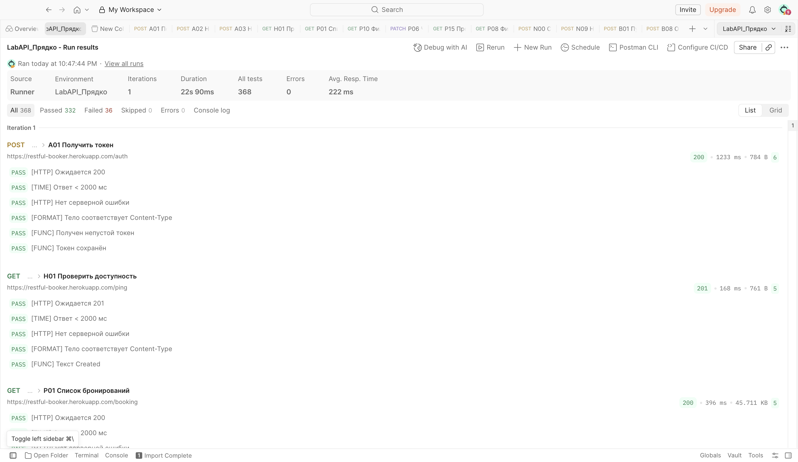

Остальные снимки я сделал при дополнительной ручной проверке запросов. Поэтому время ответа и ID записей на них могут отличаться от основного прогона.

<details>
<summary>Структура коллекции и авторизация</summary>

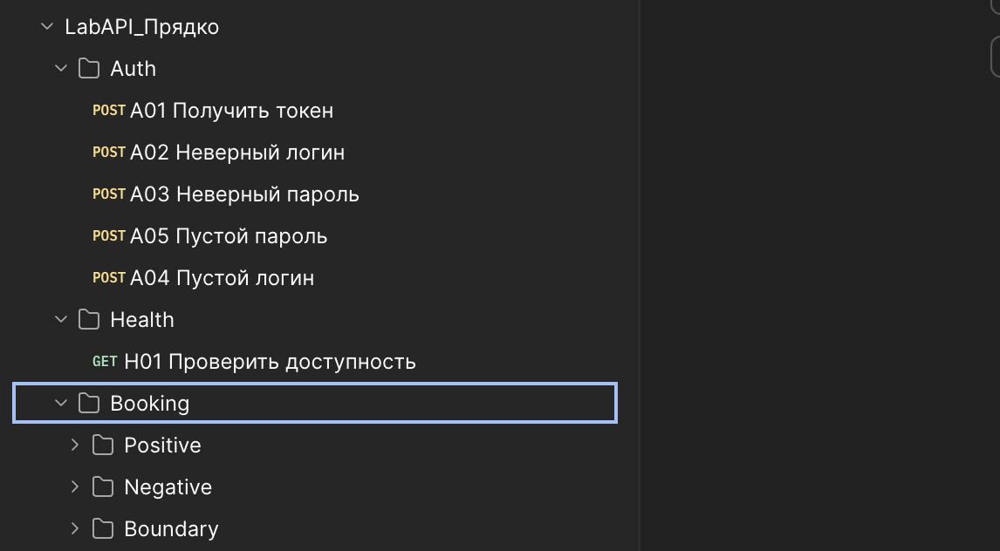

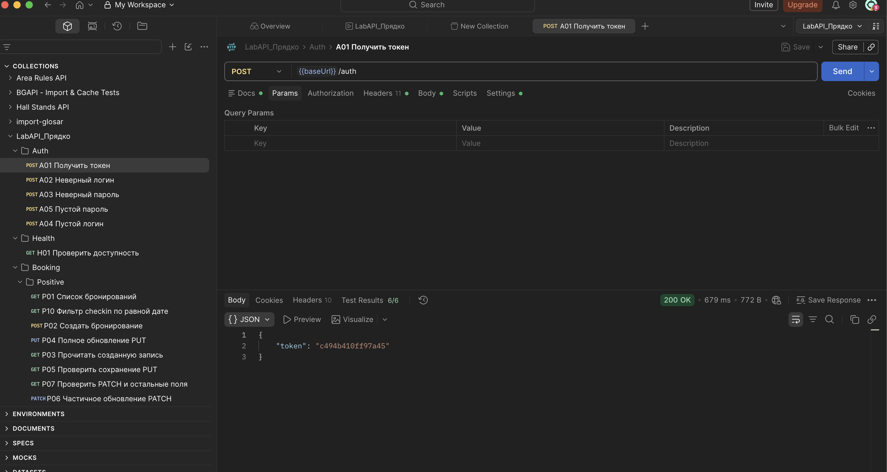

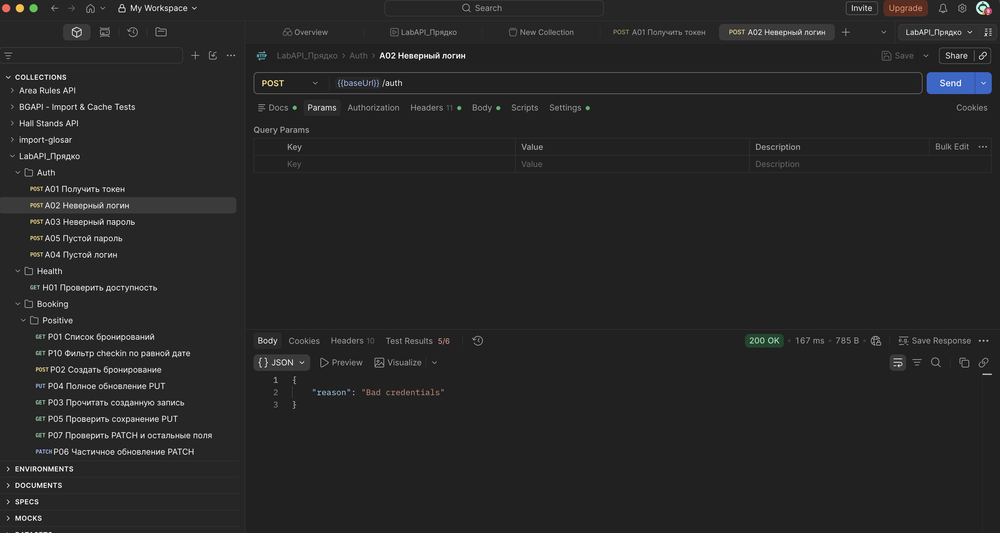

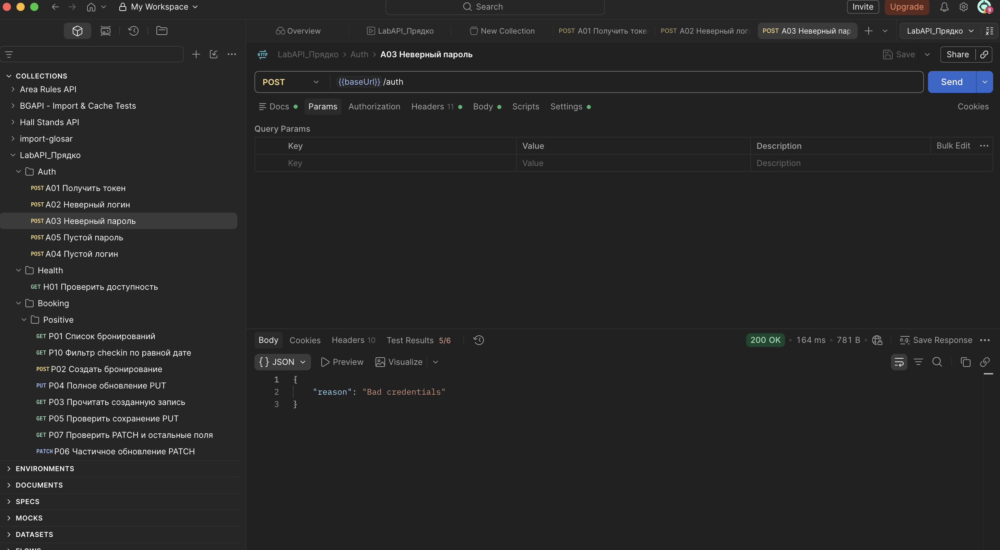

</details>

<details>
<summary>Проверка доступности, списка и создания бронирования</summary>

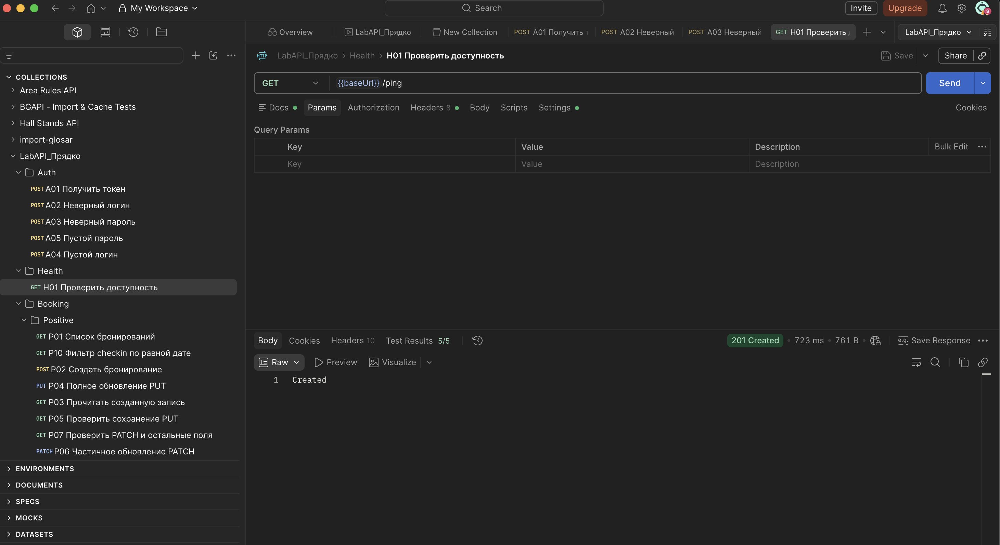

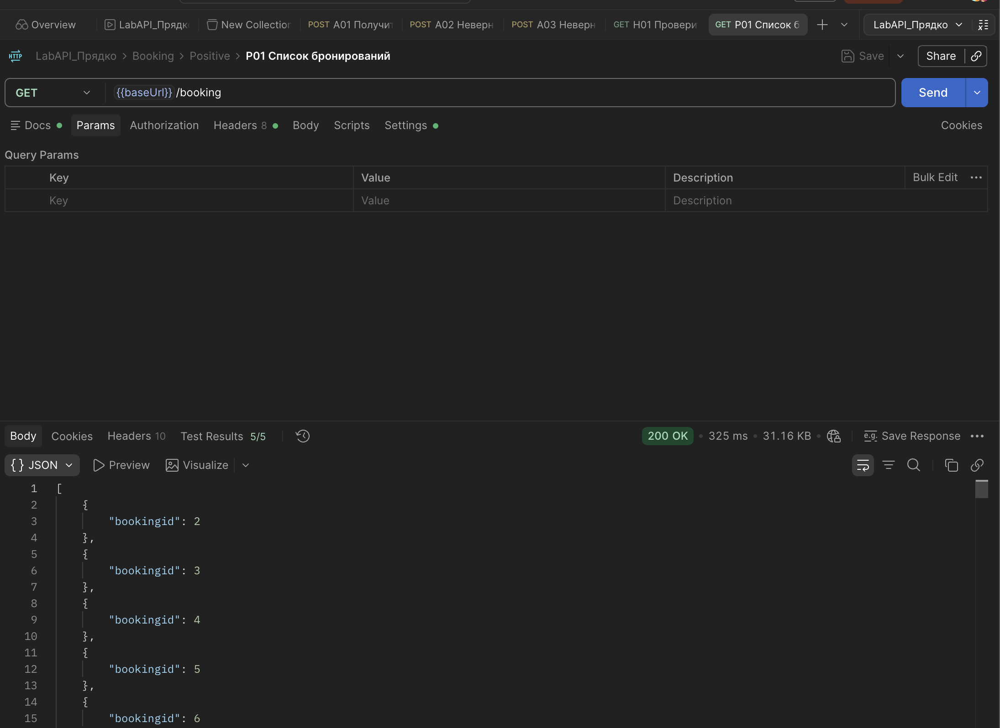

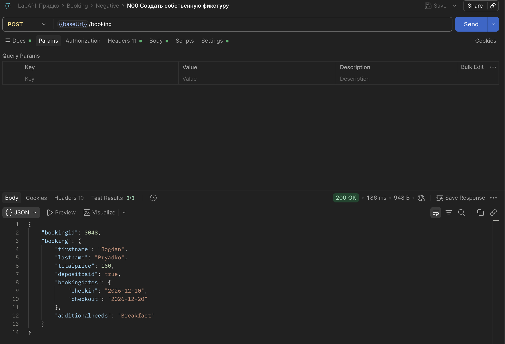

</details>

<details>
<summary>Некорректный JSON и граничные значения</summary>

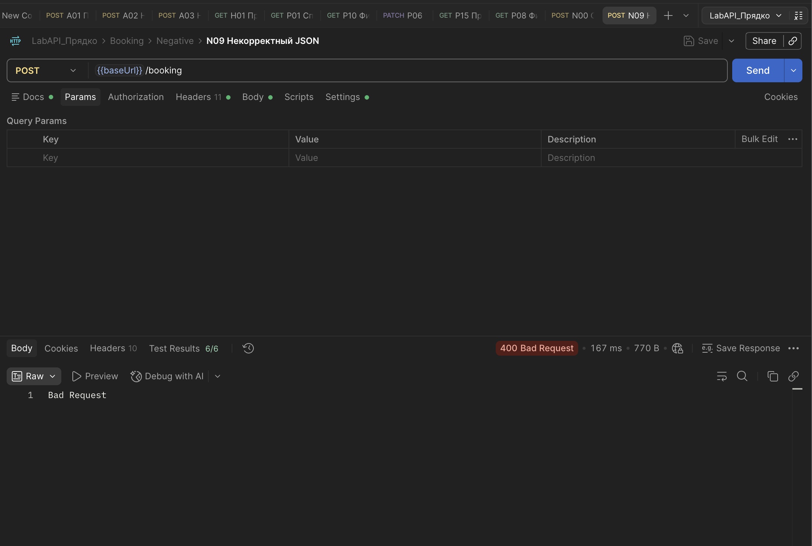

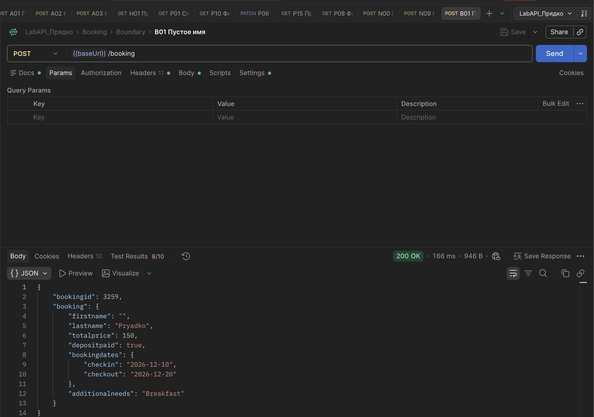

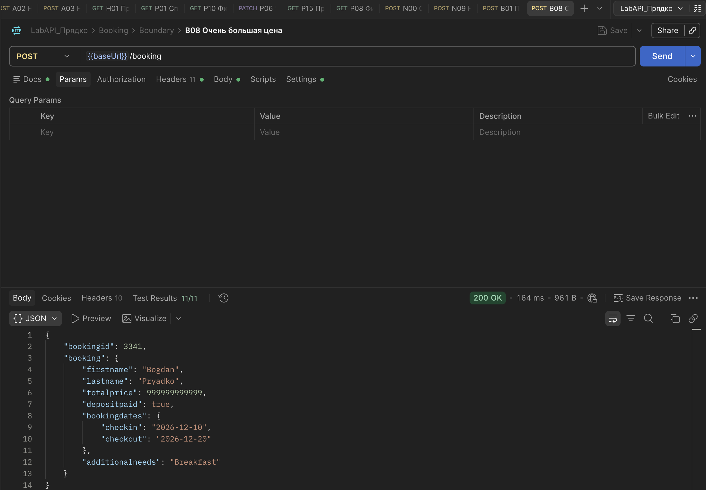

</details>

## 8. Вывод

Я проверил все восемь эндпоинтов Restful-Booker, позитивные и негативные сценарии, фильтры и граничные значения. Настроил автоматическую передачу токена и ID, проверку сохранённых данных и очистку своих записей.

В результате нашёл четыре подтверждённых дефекта: два в фильтрах дат, сохранение null вместо числовой цены и повреждённой даты. Необычные HTTP-коды и неподтверждённые ограничения я отдельно отметил в таблице расхождений. Я научился оценивать не только статус ответа, но и его содержимое, а также отличать успешное выполнение операции от соответствия документации.

## 9. Файлы и повторный запуск

- [Коллекция LabAPI_Прядко](LabAPI_Pryadko/LabAPI_Прядко.postman_collection.json).
- [Окружение LabAPI_Прядко](LabAPI_Pryadko/LabAPI_Прядко.postman_environment.json).

Для повторения я импортирую оба JSON-файла, выбираю окружение и запускаю всю коллекцию через **Run** с одной итерацией. Включаю **Persist responses for a session** и **Run collection without using stored cookies**, отключаю **Stop run if an error occurs**. Результаты смотрю во вкладках All, Passed и Failed; token и bookingId вручную не заполняю.
