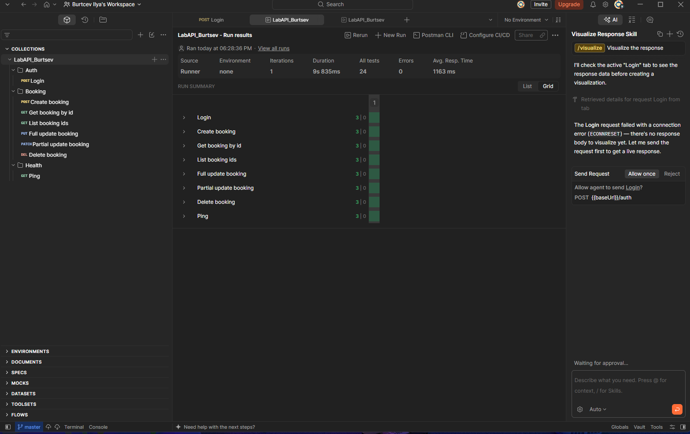

# Отчёт по лабораторной работе № 2

## «Интеграционное и API-тестирование»

**Студент:** Максим Зубарев

**Инструмент:** Postman (Collection Runner)

**Коллекция:** `LabAPI_Zubarev`

---

## 1. Тестируемый сервис

**Restful-Booker** — открытое учебное REST API бронирования отелей: https://restful-booker.herokuapp.com

Документация: https://restful-booker.herokuapp.com/apidoc/index.html

Структура коллекции `LabAPI_Zubarev` (8 запросов, 3 папки по ресурсам):

| Папка   | Запрос в коллекции     | Метод  | Эндпоинт        | Назначение                                                                  |
|---------|------------------------|--------|-----------------|-----------------------------------------------------------------------------|
| Auth    | Login                  | POST   | `/auth`         | получение токена (`admin` / `password123`), сохранение в переменную `token` |
| Booking | Create booking         | POST   | `/booking`      | создание бронирования, сохранение `bookingid` в переменную `bookingId`      |
| Booking | Get booking by id      | GET    | `/booking/{id}` | получение бронирования по идентификатору                                    |
| Booking | List booking ids       | GET    | `/booking`      | список идентификаторов бронирований                                         |
| Booking | Full update booking    | PUT    | `/booking/{id}` | полное обновление (требуется токен)                                         |
| Booking | Partial update booking | PATCH  | `/booking/{id}` | частичное обновление (требуется токен)                                      |
| Booking | Delete booking         | DELETE | `/booking/{id}` | удаление (требуется токен)                                                  |
| Health  | Ping                   | GET    | `/ping`         | проверка работоспособности сервиса                                          |

Переменные: `baseUrl`, `token`, `bookingId`.

---

## 2. Таблица тест-кейсов

Статусы: ✅ пройден · ⬜ не пройден.

### 2.1. Позитивные сценарии

Цепочка: создание → получение → обновление (PUT, PATCH) → удаление → повторное получение.

| ID     | Эндпоинт                             | Тип                            | Входные данные                                   | Ожидаемый результат                        | Фактический результат                                               | Статус |
|--------|--------------------------------------|--------------------------------|--------------------------------------------------|--------------------------------------------|---------------------------------------------------------------------|--------|
| TC-P01 | POST `/auth`                         | Позитивный                     | `admin` / `password123`                          | 200, в теле поле `token`                   | Токен получен и сохранён в `token`; проверки пройдены               | ✅      |
| TC-P02 | POST `/booking`                      | Позитивный                     | корректный JSON бронирования                     | 200, в теле `bookingid` и `booking`        | `bookingid` сохранён в `bookingId`; проверки пройдены               | ✅      |
| TC-P03 | GET `/booking/{id}`                  | Позитивный                     | `id` = `{{bookingId}}`                           | 200, данные бронирования                   | Проверки пройдены                                                   | ✅      |
| TC-P04 | GET `/booking`                       | Позитивный                     | без фильтров                                     | 200, массив объектов с `bookingid`         | 200, 399 мс, 55.474 КБ; массив, каждый элемент содержит `bookingid` | ✅      |
| TC-P05 | PUT `/booking/{id}`                  | Позитивный                     | полный JSON, заголовок `Cookie: token={{token}}` | 200, обновлённые `firstname`, `lastname`   | 200, 182 мс, 928 Б; поля обновлены                                  | ✅      |
| TC-P06 | PATCH `/booking/{id}`                | Позитивный                     | `firstname`, `lastname`, токен                   | 200, обновлённые поля                      | 200, 181 мс, 928 Б; поля обновлены                                  | ✅      |
| TC-P07 | DELETE `/booking/{id}`               | Позитивный                     | `id` = `{{bookingId}}`, токен                    | по REST: 200/204; по документации API: 201 | 201 Created, 180 мс, 761 Б; тело `Created`                          | ✅      |
| TC-P08 | GET `/ping`                          | Позитивный                     | —                                                | по REST: 200                               | 201 Created, 180 мс, 761 Б; тело `Created`                          | ✅      |
| TC-P09 | GET `/booking/{id}` (после удаления) | Позитивный (проверка удаления) | удалённый `id`                                   | 404                                        | 405 Method Not Allowed, 259 мс, 773 Б                               | ⬜      |

### 2.2. Негативные сценарии

| ID     | Эндпоинт               | Тип        | Входные данные                           | Ожидаемый код | Фактический результат                                   | Статус |
|--------|------------------------|------------|------------------------------------------|---------------|---------------------------------------------------------|--------|
| TC-N01 | POST `/auth`           | Негативный | неверный пароль                          | 401 (по REST) | 200 OK, тело `Bad credentials`                          | ⬜      |
| TC-N02 | POST `/auth`           | Негативный | неверный логин                           | 401 (по REST) | 200 OK, тело `Bad credentials`                          | ⬜      |
| TC-N03 | PUT `/booking/{id}`    | Негативный | без токена                               | 403           | 404 Not Found, тело `Not Found`                         | ⬜      |
| TC-N04 | PATCH `/booking/{id}`  | Негативный | некорректный токен                       | 403           | 404 Not Found, тело `Not Found`                         | ⬜      |
| TC-N05 | DELETE `/booking/{id}` | Негативный | без токена                               | 403           | 404 Not Found, тело `Not Found`                         | ⬜      |
| TC-N06 | GET `/booking/{id}`    | Негативный | несуществующий `id` (например, 99999999) | 404           | 404 Not Found, тело `Not Found`                         | ✅      |
| TC-N07 | DELETE `/booking/{id}` | Негативный | несуществующий `id`, валидный токен      | 404 (по REST) | 405 Method Not Allowed, тело `Method Not Allowed`       | ⬜      |
| TC-N08 | POST `/booking`        | Негативный | некорректный JSON (незакрытая скобка)    | 400           | 400 Bad Request, тело `Bad Request`                     | ✅      |
| TC-N09 | POST `/booking`        | Негативный | `totalprice` = `"abc"` (строка)          | 400           | 200 OK, тело `... "totalprice": null ...`               | ⬜      |
| TC-N10 | POST `/booking`        | Негативный | отсутствует `firstname`                  | 400           | 500 Internal Server Error, тело `Internal Server Error` | ⬜      |
| TC-N11 | POST `/booking`        | Негативный | пустое тело запроса                      | 400           | 500 Internal Server Error, тело `Internal Server Error` | ⬜      |
| TC-N12 | PUT `/booking/{id}`    | Негативный | неполный JSON                            | 400           | 403 Forbidden, тело `Forbidden`                         | ⬜      |

### 2.3. Граничные значения

| ID     | Эндпоинт        | Тип       | Входные данные                                 | Ожидаемый результат           | Фактический результат                           | Статус |
|--------|-----------------|-----------|------------------------------------------------|-------------------------------|-------------------------------------------------|--------|
| TC-B01 | POST `/booking` | Граничный | `firstname` = `""`, `lastname` = `""`          | 400 (валидация)               | 200 OK                                          | ⬜      |
| TC-B02 | POST `/booking` | Граничный | `firstname` длиной 1000+ символов              | 400 или 200 без потери данных | 200 OK                                          | ✅      |
| TC-B03 | POST `/booking` | Граничный | `totalprice` = 0                               | 200                           | 200 OK                                          | ✅      |
| TC-B04 | POST `/booking` | Граничный | `totalprice` = -100                            | 400                           | 200 OK                                          | ✅      |
| TC-B05 | POST `/booking` | Граничный | `totalprice` = 99999999999                     | 400 или 200                   | 200 OK                                          | ✅      |
| TC-B06 | POST `/booking` | Граничный | `checkout` раньше `checkin`                    | 400                           | 200 OK                                          | ⬜      |
| TC-B07 | POST `/booking` | Граничный | `checkin` = `"31-31-2026"` (невалидный формат) | 400                           | 200 OK, тело `... "checkin": "0NaN-aN-aN", ...` | ⬜      |

### 2.4. Проверка кодов ответов

| Код | Где получен                                                                  | Статус |
|-----|------------------------------------------------------------------------------|--------|
| 200 | TC-P01…P06, TC-N01, TC-N02 (`Bad credentials`), TC-N09, TC-B01…B07           | ✅      |
| 201 | TC-P07 (DELETE), TC-P08 (`/ping`): нестандартное использование, см. раздел 3 | ✅      |
| 400 | TC-N08                                                                       | ✅      |
| 403 | TC-N12                                                                       | ✅      |
| 404 | TC-N03…N06 (для N03…N05 см. п. 5 таблицы расхождений)                        | ✅      |
| 405 | TC-P09, TC-N07                                                               | ✅      |
| 500 | TC-N10, TC-N11                                                               | ✅      |

Код 401 в ходе тестирования не получен: сервис не использует его ни для ошибок аутентификации (вместо него 200 с телом
`Bad credentials`), ни для запросов без токена.

### 2.5. Автоматические проверки (вкладка Tests)

В каждом запросе по 3 проверки (всего 24 на 8 запросов). Примеры из прогона:

| Запрос                                   | Проверки                                                                                    |
|------------------------------------------|---------------------------------------------------------------------------------------------|
| List booking ids                         | Status code is 200; Response is an array; Each item contains bookingid                      |
| Partial update booking                   | Status code is 200; Response contains updated firstname; Response contains updated lastname |
| Full update booking                      | Status code is 200; Response contains updated firstname; Response contains updated lastname |
| Delete booking                           | Status code is 201; Response body is 'Created'; Response time is less than 2000ms           |
| Ping                                     | Status code is 201; Response body is 'Created'; Response time is less than 2000ms           |
| Login, Create booking, Get booking by id | по 3 проверки (код ответа, наличие ключевых полей, время ответа)                            |

---

## 3. Расхождения с документацией и дефекты

### 3.1. Таблица расхождений

| №  | Запрос                                                                              | Ожидалось (по REST/документации)   | Получено                                     | Вывод (дефект / особенность)                                                                                                                                                                                       |
|----|-------------------------------------------------------------------------------------|------------------------------------|----------------------------------------------|--------------------------------------------------------------------------------------------------------------------------------------------------------------------------------------------------------------------|
| 1  | DELETE `/booking/{id}` (TC-P07)                                                     | 200 OK или 204 No Content          | **201 Created**, тело `Created`              | Особенность API / нарушение семантики REST: код 201 означает создание ресурса, а не удаление                                                                                                                       |
| 2  | GET `/ping` (TC-P08)                                                                | 200 OK                             | **201 Created**, тело `Created`              | Особенность API / нарушение семантики REST: проверка доступности не создаёт ресурс                                                                                                                                 |
| 3  | GET `/booking/{id}` после удаления (TC-P09)                                         | 404 Not Found                      | **405 Method Not Allowed**                   | Дефект: для удалённого ресурса возвращается 405, хотя метод GET поддерживается. Поведение непоследовательно: для несуществующего `id` (TC-N06) возвращается корректный 404                                         |
| 4  | POST `/auth` с неверным паролем или логином (TC-N01, TC-N02)                        | 401 Unauthorized                   | **200 OK**, тело `Bad credentials`           | Дефект: ошибка аутентификации сообщается с кодом успеха, клиент вынужден разбирать тело ответа                                                                                                                     |
| 5  | PUT / PATCH / DELETE без токена или с некорректным токеном (TC-N03, TC-N04, TC-N05) | 401 Unauthorized или 403 Forbidden | **404 Not Found**, тело `Not Found`          | Дефект: вместо отказа в доступе возвращается «ресурс не найден», что вводит в заблуждение. Для сравнения, PUT с неполным JSON (TC-N12) вернул 403 Forbidden, то есть реакция на отсутствие авторизации нестабильна |
| 6  | DELETE `/booking/{id}` для несуществующего `id` с валидным токеном (TC-N07)         | 404 Not Found                      | **405 Method Not Allowed**                   | Дефект: некорректный код ошибки для отсутствующего ресурса (в TC-N06 для GET возвращается 404)                                                                                                                     |
| 7  | POST `/booking` без поля `firstname` (TC-N10)                                       | 400 Bad Request                    | **500 Internal Server Error**                | Дефект: ошибка клиента (неполные данные) обрабатывается как ошибка сервера, нет валидации обязательных полей                                                                                                       |
| 8  | POST `/booking` с пустым телом (TC-N11)                                             | 400 Bad Request                    | **500 Internal Server Error**                | Дефект: аналогично п. 7, нет обработки пустого запроса                                                                                                                                                             |
| 9  | POST `/booking`, `totalprice` = `"abc"` (TC-N09)                                    | 400 Bad Request                    | **200 OK**, в теле `"totalprice": null`      | Дефект (высокая значимость среди найденных): нет проверки типа данных, невалидное значение молча заменяется на `null`, данные искажаются                                                                           |
| 10 | POST `/booking`, пустые `firstname` и `lastname` (TC-B01)                           | 400 Bad Request (валидация)        | **200 OK**                                   | Дефект: бронирование создаётся с пустыми обязательными строками                                                                                                                                                    |
| 11 | POST `/booking`, `totalprice` = -100 (TC-B04)                                       | 400 Bad Request                    | **200 OK**                                   | Дефект: допускается отрицательная стоимость бронирования, нет проверки диапазона                                                                                                                                   |
| 12 | POST `/booking`, `checkout` раньше `checkin` (TC-B06)                               | 400 Bad Request                    | **200 OK**                                   | Дефект: нет проверки логической согласованности дат                                                                                                                                                                |
| 13 | POST `/booking`, `checkin` = `"31-31-2026"` (TC-B07)                                | 400 Bad Request                    | **200 OK**, в теле `"checkin": "0NaN-aN-aN"` | Дефект: нет проверки формата даты, в базу сохраняется повреждённое значение                                                                                                                                        |

Остальные тест-кейсы совпали с ожиданиями и в таблицу не включены: несуществующий `id` при GET даёт 404 (TC-N06),
некорректный JSON даёт 400 (TC-N08), а `totalprice` = 0, очень длинная строка и очень большое число принимаются с кодом
200 (TC-B02, TC-B03, TC-B05). Расхождения 1–2 подтверждены прогоном в Collection Runner (см. раздел 4), остальные
получены при выполнении негативных и граничных тест-кейсов из раздела 2.

### 3.2. Баг-репорты

Во всех баг-репортах ниже «валидное тело» означает следующий JSON, в котором меняется только указанное поле:

```json
{
  "firstname": "Ivan",
  "lastname": "Petrov",
  "totalprice": 100,
  "depositpaid": true,
  "bookingdates": {
    "checkin": "2026-11-10",
    "checkout": "2026-11-15"
  },
  "additionalneeds": "Breakfast"
}
```

Заголовки для POST/PUT/PATCH: `Content-Type: application/json`, `Accept: application/json`. Для PUT/PATCH/DELETE
дополнительно `Cookie: token=<token>`, токен получают запросом `POST /auth` с `admin` / `password123`.

#### BUG-01. DELETE `/booking/{id}` возвращает 201 Created

- **Шаги:**
    1. Выполнить `POST /auth`, получить `token`.
    2. Выполнить `POST /booking` с валидным телом, получить `bookingid`.
    3. Выполнить `DELETE /booking/{bookingid}` с заголовком `Cookie: token=<token>`.
- **Ожидаемый результат:** 200 OK или 204 No Content.
- **Фактический результат:** 201 Created, тело ответа `Created`.
- **Серьёзность:** низкая (Minor). Функционально удаление работает, нарушена семантика кодов HTTP, клиенты,
  ориентирующиеся на стандарт, могут обрабатывать ответ неверно.

#### BUG-02. GET `/ping` возвращает 201 Created

- **Шаги:** выполнить `GET /ping`.
- **Ожидаемый результат:** 200 OK.
- **Фактический результат:** 201 Created, тело ответа `Created`.
- **Серьёзность:** низкая (Minor). Мониторинг, проверяющий код 200, будет считать сервис недоступным.

#### BUG-03. POST `/auth` с неверными учётными данными возвращает 200 OK

- **Шаги:**
    1. Выполнить `POST /auth` с телом `{"username": "admin", "password": "wrong"}`.
    2. Повторить с телом `{"username": "wrong", "password": "password123"}`.
- **Ожидаемый результат:** 401 Unauthorized.
- **Фактический результат:** 200 OK, тело `Bad credentials` (TC-N01, TC-N02).
- **Серьёзность:** средняя (Major). Ошибка аутентификации сообщается кодом успеха, клиент вынужден разбирать тело
  ответа; автоматические проверки по коду статуса пропускают ошибку.

#### BUG-04. 405 Method Not Allowed вместо 404 для отсутствующего ресурса

- **Шаги (вариант A):**
    1. Создать бронирование и удалить его (`POST /booking`, затем `DELETE /booking/{id}` с токеном).
    2. Выполнить `GET /booking/{id}` для удалённого `id`.
- **Шаги (вариант B):** выполнить `DELETE /booking/{id}` с токеном для несуществующего `id`.
- **Ожидаемый результат:** 404 Not Found.
- **Фактический результат:** 405 Method Not Allowed (TC-P09, TC-N07). При этом `GET /booking/99999999` для никогда не
  существовавшего `id` возвращает корректный 404 (TC-N06), то есть поведение непоследовательно.
- **Серьёзность:** низкая (Minor). Код вводит в заблуждение: метод поддерживается, проблема в отсутствии ресурса.

#### BUG-05. PUT/PATCH/DELETE без токена или с некорректным токеном возвращают 404

- **Шаги:**
    1. Выполнить `PUT /booking/{id}` с валидным телом без заголовка `Cookie`.
    2. Выполнить `PATCH /booking/{id}` с телом `{"firstname": "Test"}` и `Cookie: token=invalid`.
    3. Выполнить `DELETE /booking/{id}` без заголовка `Cookie`.
- **Ожидаемый результат:** 401 Unauthorized или 403 Forbidden.
- **Фактический результат:** 404 Not Found, тело `Not Found` (TC-N03, TC-N04, TC-N05). При этом PUT с неполным
  JSON (TC-N12) вернул 403 Forbidden, то есть реакция на отсутствие авторизации нестабильна.
- **Серьёзность:** средняя (Major). Вместо отказа в доступе клиент получает «ресурс не найден».
- **Примечание:** результат получен при использовании `id`, который мог быть уже удалён. Для окончательного вывода
  повторить шаги с `id` существующего бронирования.

#### BUG-06. POST `/booking` с неполными данными возвращает 500 Internal Server Error

- **Шаги:**
    1. Выполнить `POST /booking` с валидным телом без поля `firstname`.
    2. Выполнить `POST /booking` с пустым телом.
- **Ожидаемый результат:** 400 Bad Request с описанием ошибки валидации.
- **Фактический результат:** 500 Internal Server Error, тело `Internal Server Error` (TC-N10, TC-N11).
- **Серьёзность:** средняя (Major). Ошибка клиента обрабатывается как ошибка сервера, нет валидации обязательных
  полей. При этом некорректный JSON даёт корректный 400 (TC-N08).

#### BUG-07. POST `/booking` принимает строку в `totalprice` и сохраняет `null`

- **Шаги:** выполнить `POST /booking` с валидным телом, в котором `"totalprice": "abc"`.
- **Ожидаемый результат:** 400 Bad Request.
- **Фактический результат:** 200 OK, в теле ответа `"totalprice": null` (TC-N09).
- **Серьёзность:** высокая (Critical для учебной оценки качества данных). Нет проверки типа, невалидное значение молча
  заменяется на `null`, искажается финансовое поле.

#### BUG-08. POST `/booking` принимает пустые `firstname` и `lastname`

- **Шаги:** выполнить `POST /booking` с валидным телом, в котором `"firstname": ""` и `"lastname": ""`.
- **Ожидаемый результат:** 400 Bad Request.
- **Фактический результат:** 200 OK, бронирование создано (TC-B01).
- **Серьёзность:** низкая (Minor). Нет проверки обязательных строковых полей на пустое значение.

#### BUG-09. POST `/booking` принимает отрицательный `totalprice`

- **Шаги:** выполнить `POST /booking` с валидным телом, в котором `"totalprice": -100`.
- **Ожидаемый результат:** 400 Bad Request.
- **Фактический результат:** 200 OK, бронирование создано (TC-B04).
- **Серьёзность:** средняя (Major). Нет проверки диапазона, допускается отрицательная стоимость.

#### BUG-10. POST `/booking` принимает `checkout` раньше `checkin`

- **Шаги:** выполнить `POST /booking` с валидным телом, в котором `"checkin": "2026-11-15"`,
  `"checkout": "2026-11-10"`.
- **Ожидаемый результат:** 400 Bad Request.
- **Фактический результат:** 200 OK, бронирование создано (TC-B06).
- **Серьёзность:** средняя (Major). Нет проверки логической согласованности дат.

#### BUG-11. POST `/booking` принимает невалидный формат даты и сохраняет повреждённое значение

- **Шаги:** выполнить `POST /booking` с валидным телом, в котором `"checkin": "31-31-2026"`.
- **Ожидаемый результат:** 400 Bad Request.
- **Фактический результат:** 200 OK, в теле ответа `"checkin": "0NaN-aN-aN"` (TC-B07).
- **Серьёзность:** высокая (Critical для учебной оценки качества данных). Нет проверки формата даты, в хранилище
  попадает
  некорректное значение.

#### Сводка по дефектам

| ID     | Кратко                                       | Серьёзность |
|--------|----------------------------------------------|-------------|
| BUG-01 | DELETE возвращает 201 вместо 200/204         | Низкая      |
| BUG-02 | `/ping` возвращает 201 вместо 200            | Низкая      |
| BUG-03 | Неверный логин или пароль: 200 вместо 401    | Средняя     |
| BUG-04 | 405 вместо 404 для отсутствующего ресурса    | Низкая      |
| BUG-05 | Нет токена: 404 вместо 401/403               | Средняя     |
| BUG-06 | Неполные данные: 500 вместо 400              | Средняя     |
| BUG-07 | Строка в `totalprice` превращается в `null`  | Высокая     |
| BUG-08 | Принимаются пустые `firstname` и `lastname`  | Низкая      |
| BUG-09 | Принимается отрицательный `totalprice`       | Средняя     |
| BUG-10 | Принимается `checkout` раньше `checkin`      | Средняя     |
| BUG-11 | Невалидная дата сохраняется как `0NaN-aN-aN` | Высокая     |

---

## 4. Прогон коллекции в Collection Runner



| Параметр             | Значение       |
|----------------------|----------------|
| Коллекция            | LabAPI_Zubarev |
| Источник             | Runner         |
| Окружение            | none           |
| Итераций             | 1              |
| Время запуска        | 17:09:20       |
| Длительность         | 2 с 505 мс     |
| Всего проверок       | 24             |
| Пройдено             | 24             |
| Провалено            | 0              |
| Пропущено            | 0              |
| Ошибок               | 0              |
| Среднее время ответа | 273 мс         |

Результаты по запросам, видимым на скриншоте:

| Запрос                 | Эндпоинт        | Код | Время  | Размер    | Проверки |
|------------------------|-----------------|-----|--------|-----------|----------|
| List booking ids       | `/booking`      | 200 | 399 мс | 55.474 КБ | 3/3      |
| Partial update booking | `/booking/4249` | 200 | 181 мс | 928 Б     | 3/3      |
| Full update booking    | `/booking/4249` | 200 | 182 мс | 928 Б     | 3/3      |
| Delete booking         | `/booking/4249` | 201 | 180 мс | 761 Б     | 3/3      |
| Ping                   | `/ping`         | 201 | 180 мс | 761 Б     | 3/3      |

Цепочка сценариев выполняется без ручного вмешательства: `token` и `bookingId` передаются через переменные, во всех
запросах PATCH, PUT и DELETE использован один и тот же `id` (4249).

---

## 5. Экспортированные файлы

- `LabAPI_Zubarev.postman_collection.json` — коллекция запросов (с переменными).

---

## 6. Выводы

В работе освоено тестирование REST API в Postman на примере Restful-Booker: создана коллекция с папками по ресурсам,
покрыты все 8 эндпоинтов, настроена автоматическая передача `token` и `bookingId` между запросами. Полный прогон в
Collection Runner завершился успешно: 24 проверки из 24 пройдены, ошибок нет, среднее время ответа 273 мс, что
укладывается в порог 2000 мс.

Сравнение с принятыми REST-практиками выявило нестандартное поведение API: DELETE и `/ping` возвращают 201 Created. Это
не мешает работе сервиса, но нарушает семантику HTTP-кодов, поэтому такие случаи оформлены как особенности API низкой
серьёзности. Для надёжной клиентской интеграции необходимо опираться на фактическое поведение, а не на ожидания по
стандарту.

Автоматические проверки статуса, структуры ответа и времени ответа позволяют повторно запускать сценарий после любых
изменений сервиса и быстро находить регрессии.