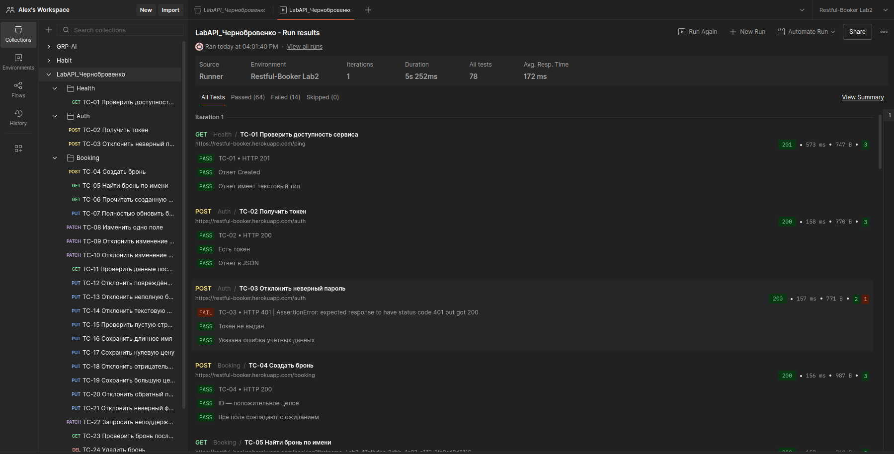
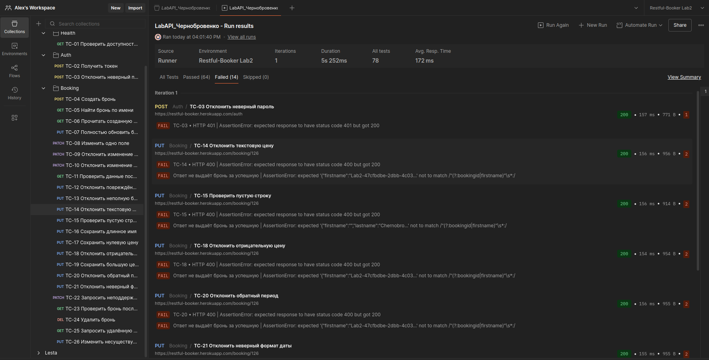

# Лабораторная работа № 2 по тестированию ПС Чернобровенко Александра. Интеграционное и API-тестирование Restful-Booker

Цель работы — освоить тестирование REST API в Postman. Для этого нужно составить коллекцию запросов к Restful-Booker, написать автоматические проверки и сопоставить фактические ответы сервиса с его документацией. [Задание из ветки main](https://github.com/d26dodenko/PV-232/blob/bb38d870c19d5f2a9365dd053ae4bdd09defeb4c/TestingPS/Laba-2.md)

Restful-Booker — учебный REST API для бронирования отелей. [Документация API](https://restful-booker.herokuapp.com/apidoc/index.html)

[Коллекция Postman](postman/collection.json) · [Окружение](postman/environment.json)

## Тестируемые эндпоинты

| Метод и путь | Назначение | Тесты |
| --- | --- | --- |
| `GET /ping` | Проверить доступность | TC-01 |
| `POST /auth` | Получить токен и проверить отказ в авторизации | TC-02, TC-03 |
| `POST /booking` | Создать бронь и получить её ID | TC-04 |
| `GET /booking` | Найти созданную бронь по фильтру firstname | TC-05 |
| `GET /booking/{id}` | Прочитать бронь, проверить последствия отказов и удаления | TC-06, TC-11, TC-23, TC-25 |
| `PUT /booking/{id}` | Полностью заменить бронь, проверить ошибки и границы | TC-07, TC-12–TC-21, TC-26 |
| `PATCH /booking/{id}` | Изменить одно поле, проверить доступ и выбор формата | TC-08–TC-10, TC-22 |
| `DELETE /booking/{id}` | Удалить созданную бронь по токену | TC-24 |

## Тест-кейсы

В каждом запросе три автоматические проверки. Статус PASS означает, что прошли все три. При статусе FAIL дробь показывает, сколько проверок прошло. Для граничных случаев приняты три правила бронирования. Имя гостя должно быть заполнено, цена должна быть неотрицательной, а дата выезда должна совпадать с датой заезда или следовать за ней. Документация API не задаёт этих ограничений явно.

| ID | Эндпоинт | Тип | Входные данные | Ожидалось | Получено | Статус |
| --- | --- | --- | --- | --- | --- | --- |
| TC-01 | `GET /ping` | Позитивный | Без параметров | 201 · Сервис доступен, тело Created | 201 · Created, текстовый ответ | PASS 3/3 |
| TC-02 | `POST /auth` | Позитивный | Учебная пара admin / password123 | 200 · Получен непустой токен для защищённых запросов | 200 · Получен непустой токен | PASS 3/3 |
| TC-03 | `POST /auth` | Негативный | admin / wrong-password | 401 · Доступ отклонён, токен не выдан, указана причина | 200 · Bad credentials, токена нет | FAIL 2/3 |
| TC-04 | `POST /booking` | Позитивный | Уникальное имя, цена 120, даты 10–12 декабря | 200 · Возвращены новый bookingid и исходные данные | 200 · Возвращён числовой bookingid, поля совпали | PASS 3/3 |
| TC-05 | `GET /booking?firstname=…` | Позитивный | Фильтр firstname по уникальному имени | 200 · Массив содержит ID созданной брони | 200 · Массив содержит bookingid из TC-04 | PASS 3/3 |
| TC-06 | `GET /booking/{id}` | Позитивный | ID из TC-04 | 200 · Все поля совпадают с отправленными | 200 · Все поля совпали с созданными | PASS 3/3 |
| TC-07 | `PUT /booking/{id}` | Позитивный | Все поля, новая фамилия, цена 245, даты 14–16 декабря | 200 · Все поля заменены переданными значениями | 200 · Новая фамилия LabTwo, цена 245, даты заменены | PASS 3/3 |
| TC-08 | `PATCH /booking/{id}` | Позитивный | Только additionalneeds = WiFi | 200 · Изменились пожелания, остальные поля сохранились | 200 · WiFi, остальные поля сохранились | PASS 3/3 |
| TC-09 | `PATCH /booking/{id}` | Негативный | Cookie отсутствует | 403 · Доступ запрещён, данные брони не выдаются | 403 · Forbidden | PASS 3/3 |
| TC-10 | `PATCH /booking/{id}` | Негативный | Cookie с заведомо неверным токеном | 403 · Доступ запрещён, данные брони не выдаются | 403 · Forbidden | PASS 3/3 |
| TC-11 | `GET /booking/{id}` | Позитивный | Прочитать ID после TC-09 и TC-10 | 200 · Бронь осталась в состоянии после разрешённого PATCH | 200 · Сохранились WiFi и все поля после PUT | PASS 3/3 |
| TC-12 | `PUT /booking/{id}` | Негативный | Незакрытый JSON-объект с полем firstname | 400 · Сервер отклонил синтаксически неверное тело | 400 · Bad Request | PASS 3/3 |
| TC-13 | `PUT /booking/{id}` | Негативный | Удалено обязательное поле bookingdates | 400 · Сообщение об ошибке клиентского запроса | 400 · Bad Request | PASS 3/3 |
| TC-14 | `PUT /booking/{id}` | Негативный | totalprice = "abc" | 400 · Невалидный ввод отклонён | 200 · API вернул totalprice = null | FAIL 1/3 |
| TC-15 | `PUT /booking/{id}` | Граничный | firstname = "" | 400 · Невалидный ввод отклонён | 200 · API вернул пустое имя | FAIL 1/3 |
| TC-16 | `PUT /booking/{id}` | Граничный | firstname из 1100 букв A | 200 · Значение принято без искажения | 200 · Возвращены все 1100 букв A | PASS 3/3 |
| TC-17 | `PUT /booking/{id}` | Граничный | totalprice = 0 | 200 · Значение принято без искажения | 200 · Цена 0 | PASS 3/3 |
| TC-18 | `PUT /booking/{id}` | Граничный | totalprice = -1 | 400 · Невалидный ввод отклонён | 200 · API вернул цену −1 | FAIL 1/3 |
| TC-19 | `PUT /booking/{id}` | Граничный | totalprice = 1000000000 | 200 · Значение принято без искажения | 200 · Цена 1000000000 без потери точности | PASS 3/3 |
| TC-20 | `PUT /booking/{id}` | Граничный | checkin 2026-12-10, checkout 2026-12-09 | 400 · Невалидный ввод отклонён | 200 · Возвращён выезд 9 декабря при заезде 10 декабря | FAIL 1/3 |
| TC-21 | `PUT /booking/{id}` | Граничный | checkin = "not-a-date" | 400 · Невалидный ввод отклонён | 200 · API вернул checkin = 0NaN-aN-aN | FAIL 1/3 |
| TC-22 | `PATCH /booking/{id}` | Негативный | Accept: image/png, additionalneeds = After-406 | 406 · В согласовании формата отказано | 500 · Internal Server Error | FAIL 2/3 |
| TC-23 | `GET /booking/{id}` | Негативный | Прочитать additionalneeds после отклонённого PATCH | 200 · У брони сохранилось прежнее пожелание Breakfast | 200 · В брони записано After-406 | FAIL 2/3 |
| TC-24 | `DELETE /booking/{id}` | Позитивный | Свой ID и валидный токен | 201 · Бронь удалена, текст Created согласно документации | 201 · Created | PASS 3/3 |
| TC-25 | `GET /booking/{id}` | Негативный | ID, удалённый в TC-24 | 404 · Бронь отсутствует | 404 · Not Found | PASS 3/3 |
| TC-26 | `PUT /booking/{id}` | Негативный | Удалённый ID, корректное тело и токен | 404 · Бронь отсутствует, обновление отклонено | 405 · Method Not Allowed | FAIL 2/3 |

## Расхождения с ожидаемым поведением

| № | Запрос | Ожидалось | Получено | Вывод |
| --- | --- | --- | --- | --- |
| 1 | TC-01, TC-04, TC-24 | По распространённому соглашению проверка здоровья даёт 200, создание ресурса — 201, удаление без тела — 204 | 201, 200 и 201 соответственно | Особенность контракта. Все три ответа соответствуют примерам в документации и успешно проверены. |
| 2 | TC-03, неверный пароль | 401, токен отсутствует | 200, `Bad credentials`, токен отсутствует | Особенность аутентификации. Клиенту приходится проверять тело даже при успешном HTTP-статусе. |
| 3 | TC-14, цена строкой | 400, поле должно быть числом | 200, цена стала `null` | Дефект проверки типа, BR-01. |
| 4 | TC-15 и TC-18, пустое имя и отрицательная цена | 400 по принятым бизнес-правилам | Оба запроса дали 200 и вернули переданные значения | Пробел в спецификации. Ограничения имени и цены требуют согласования. |
| 5 | TC-20, выезд раньше заезда | 400, период отклонён | 200, обратный период принят | Нарушено принятое правило бронирования, BR-02. |
| 6 | TC-21, невалидная дата | 400 | 200, значение `0NaN-aN-aN` | Дефект обработки даты, BR-03. |
| 7 | TC-22 и TC-23, неподдерживаемый формат ответа | 406, прежнее значение сохранено | 500, затем GET 200 с изменённым полем | Изменение применено вопреки ответу об ошибке, BR-04. |
| 8 | TC-26, обновление удалённой брони | 404 для отсутствующего ресурса | 405 `Method Not Allowed` | Особенность обработки отсутствующего ID. Этот же метод успешно работал до удаления. |

## Баг-репорты

Предусловия для всех четырёх случаев — токен из TC-02 и бронь из TC-04. Запросы на изменение используют её ID и заголовок `Cookie: token={{token}}`.

| ID | Шаги | Ожидаемый результат | Фактический результат | Серьёзность и влияние |
| --- | --- | --- | --- | --- |
| BR-01 | Выполнить TC-14 с полным телом PUT и `totalprice: "abc"`. | 400, цена должна быть числом. | 200, ответ содержит `totalprice: null`. | Высокая. Клиент получает бронь без числовой стоимости. |
| BR-02 | Выполнить TC-20 с заездом 10 декабря и выездом 9 декабря. | 400 по принятому правилу периода проживания. | 200, обе даты возвращены в обратном порядке. | Средняя. Длительность проживания отрицательна. Требование к порядку дат стоит закрепить в контракте. |
| BR-03 | Выполнить TC-21 с `checkin: "not-a-date"`. | 400, некорректная дата отклонена. | 200, вместо даты получено `0NaN-aN-aN`. | Высокая. Значение нельзя использовать как дату. |
| BR-04 | Создать бронь с пожеланием Breakfast. Выполнить TC-22 с `Accept: image/png` и новым пожеланием After-406. Прочитать бронь через TC-23 с `Accept: application/json`. | 406 и прежнее значение Breakfast. | PATCH вернул 500, GET вернул 200 и After-406. | Высокая. Клиент видит ошибку и может повторить уже выполненную операцию. |

## Результаты Collection Runner

## Вывод

Создание, чтение, полное и частичное обновление, а затем удаление прошли с автоматически полученными токеном и ID. Запросы без токена и с неверным токеном вернули 403 и сохранили прежние данные. При этом сервис принял текстовую цену и некорректную дату. В случае с неподдерживаемым форматом ответа PATCH вернул 500, но последующий GET показал, что пожелания гостя изменились.
