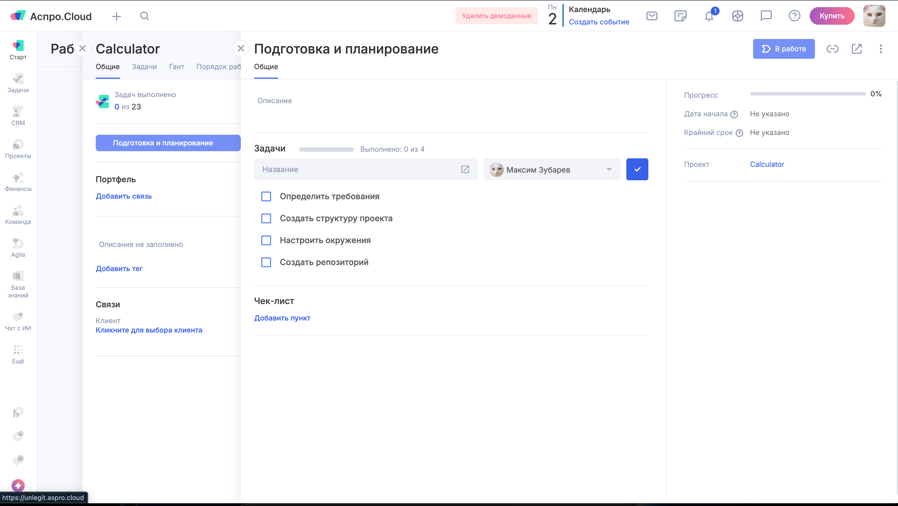
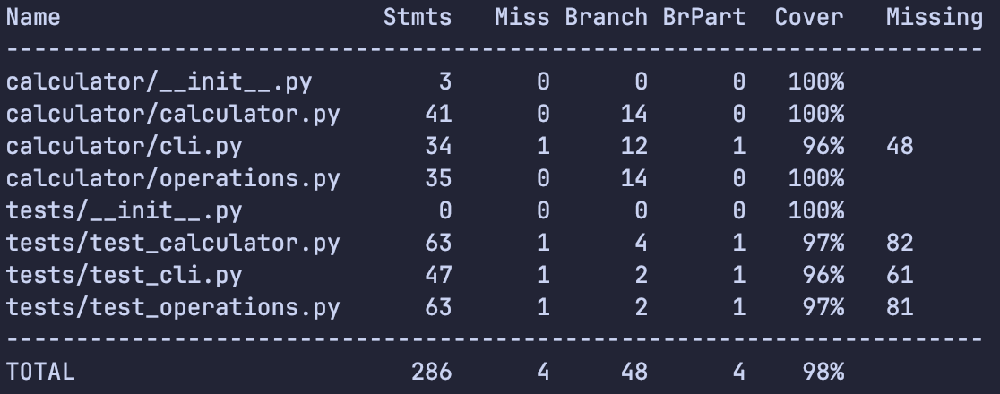
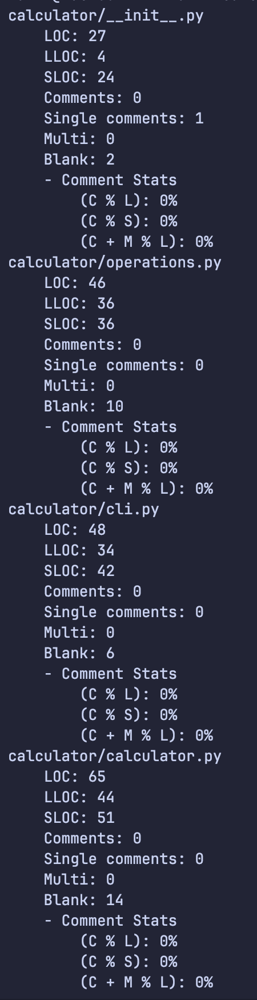
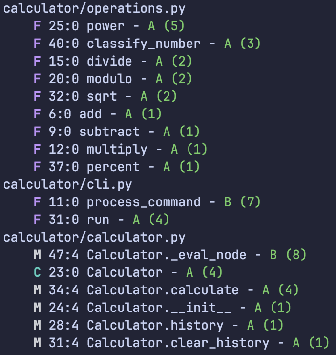

# Отчёт по лабораторной работе

**Тема:** Критерии качества ПО: сложность, корректность, надёжность, трудоёмкость. Оценка качества ПО.

**Цель:** Освоить практические методы оценки качества и метрик программного обеспечения.

---

## 1. Три наиболее значимые проблемы при разработке сложных программных систем

### 1.1. Управление сложностью системы

Сложная программная система состоит из сотен и тысяч модулей, десятков подсистем и множества связей между ними. Ф. Брукс
в работе «Серебряной пули нет» выделяет *существенную* сложность ПО: она определяется самой решаемой задачей и не
устраняется средствами разработки. Количество возможных состояний системы растёт нелинейно, поэтому:

- ни один разработчик не способен удерживать в голове систему целиком;
- растёт число скрытых зависимостей, и изменение в одном месте неожиданно ломает другое;
- затрудняются понимание кода, его сопровождение и вхождение новых людей в проект;
- растут метрики сложности (цикломатическая сложность, связность модулей), а вместе с ними и вероятность дефектов.

Следствие: архитектура «размывается», накапливается технический долг, а трудоёмкость сопровождения растёт быстрее, чем
размер кодовой базы.

### 1.2. Неполные и изменчивые требования

Требования к крупной системе почти никогда не фиксируются полностью в начале проекта. Заказчик часто не может точно
сформулировать, что ему нужно, пока не увидит работающий прототип; бизнес-условия, законодательство и технологии
меняются во время разработки. Основные последствия:

- доработки на поздних этапах стоят в разы дороже, чем исправление ошибок на этапе анализа;
- расхождение между ожиданиями заказчика и реализацией (низкая *корректность* в смысле соответствия требованиям);
- срыв сроков и бюджета, «ползучее» расширение объёма (scope creep);
- противоречия между функциональными и нефункциональными требованиями (производительность, безопасность, удобство).

### 1.3. Обеспечение качества, корректности и надёжности

Доказать корректность сложной системы формально, как правило, невозможно, а полное тестирование недостижимо из-за
комбинаторного взрыва входных данных и состояний. Поэтому в готовом ПО неизбежно остаются дефекты. Дополнительные
сложности:

- ошибки, обнаруженные поздно (в эксплуатации), обходятся дороже всего;
- трудно воспроизводимые дефекты: гонки потоков, сбои интеграции, зависимость от окружения;
- необходимость обеспечивать надёжность (отказоустойчивость, среднее время наработки на отказ) при постоянных изменениях
  кода;
- сложность оценки трудоёмкости и сроков тестирования и исправления дефектов.

---

## 2. Таблица «Проблема → Возможное решение → Инструменты/методы»

| № | Проблема                                                       | Возможное решение                                                                                                                                                      | Инструменты / методы                                                                                                                                                                                       |
|---|----------------------------------------------------------------|------------------------------------------------------------------------------------------------------------------------------------------------------------------------|------------------------------------------------------------------------------------------------------------------------------------------------------------------------------------------------------------|
| 1 | Высокая сложность системы, трудность понимания и сопровождения | Декомпозиция на модули с низкой связностью и высокой сцепленностью; абстракция и инкапсуляция; единые архитектурные правила; регулярный рефакторинг                    | Модульная/слоистая/микросервисная архитектура, принципы SOLID, паттерны проектирования, UML-диаграммы, статический анализ и метрики сложности (radon, SonarQube, pylint), code review                      |
| 2 | Неполные и меняющиеся требования                               | Итеративная разработка с короткими циклами обратной связи; постоянная работа с заказчиком; управление изменениями и приоритизация требований; прототипирование         | Scrum, Kanban, user stories и критерии приёмки, backlog в трекере задач (Аспро, Jira, YouTrack), прототипы (Figma), матрица трассируемости требований                                                      |
| 3 | Дефекты, низкая корректность и надёжность                      | Многоуровневое тестирование; ранний поиск ошибок (shift-left); автоматизация проверок на каждое изменение; измерение покрытия и дефектности; мониторинг в эксплуатации | Unit-, интеграционное, системное и приёмочное тестирование, TDD, CI/CD (GitHub Actions, GitLab CI), coverage.py, pytest, баг-трекер, анализ дефектности (число дефектов на KLOC), мониторинг и логирование |
| 4 | Неточная оценка трудоёмкости и сроков                          | Оценка по нескольким методам; декомпозиция работ; учёт исторических данных команды; пересмотр оценок по ходу проекта                                                   | Метод Дельфи, Planning Poker, story points, функциональные точки, модель COCOMO, учёт скорости команды (velocity)                                                                                          |
| 5 | Сложность командной работы и коммуникаций                      | Чёткое распределение ролей и ответственности; единые стандарты кода; прозрачность статуса задач; автоматизация рутины                                                  | Git и ветвление (Git Flow, trunk-based), pull/merge request, документация (Wiki, README, ADR), стандарты оформления кода (PEP 8, линтеры), ежедневные синхронизации                                        |
| 6 | Накопление технического долга                                  | Выделять время на рефакторинг в каждой итерации; отслеживать долг как отдельные задачи; контроль качества на входе                                                     | SonarQube (оценка технического долга), линтеры, рефакторинг с опорой на тесты, quality gates в CI                                                                                                          |

---

## 3. Связь проблем с критериями качества ПО

| Критерий качества | Какая проблема на него влияет | Как оценивается                                                                |
|-------------------|-------------------------------|--------------------------------------------------------------------------------|
| Сложность         | Проблема 1                    | Цикломатическая сложность V(G), связность и сцепленность модулей, LOC          |
| Корректность      | Проблемы 2 и 3                | Соответствие требованиям, число найденных дефектов, процент пройденных тестов  |
| Надёжность        | Проблема 3                    | Плотность дефектов, среднее время наработки на отказ, процент покрытия тестами |
| Трудоёмкость      | Проблемы 1, 4, 5              | Человеко-часы, функциональные точки, COCOMO, скорость команды                  |

---

## 4. Практическая часть

### 4.1. Тестовый проект

В качестве объекта исследования создан консольный калькулятор на Python 3. Проект небольшой, но содержит ветвления,
обработку ошибок и несколько уровней вызовов, поэтому на нём удобно показать работу метрик.

**Структура проекта:**

```
calculator_project/
├── calculator/
│   ├── __init__.py
│   ├── operations.py     # базовые операции и функция classify_number
│   ├── calculator.py     # класс Calculator: разбор выражений, история
│   └── cli.py            # консольный интерфейс
├── tests/
│   ├── test_operations.py
│   ├── test_calculator.py
│   └── test_cli.py
├── main.py
└── requirements.txt
```

**Функциональность:**

- операции: сложение, вычитание, умножение, деление, остаток от деления, возведение в степень, квадратный корень,
  процент от числа;
- вычисление выражений со скобками, приоритетом операций и унарными знаками, например `2 + 3 * (4 - 1)`;
- история вычислений (просмотр и очистка);
- консольный интерфейс с командами `help`, `history`, `clear`, `exit`;
- обработка ошибочных ситуаций: деление на ноль, корень из отрицательного числа, некорректное выражение.

**Проектные решения, влияющие на качество:**

- выражения разбираются через модуль `ast`, а не через `eval()`, поэтому выполнить произвольный код через ввод
  невозможно (защита от инъекций);
- логика отделена от ввода-вывода: функция `process_command` и цикл `run` принимают функции ввода и вывода как
  параметры, что позволяет тестировать интерфейс без реального ввода с клавиатуры;
- все ошибки пользователя обрабатываются явно и выводятся как сообщения, а не как падение программы.

### 4.2. Задачи в системе трекинга (Аспро)

Работа над проектом велась в системе Аспро: https://unlegit.aspro.cloud/_module/st/view/project/24

Задачи сгруппированы по этапам жизненного цикла:

| Этап                         | Содержание                                                    | Количество задач | Плановая трудоёмкость, ч |
|------------------------------|---------------------------------------------------------------|------------------|--------------------------|
| 1. Подготовка и планирование | требования, структура проекта, окружение, репозиторий         | 4                | 2,5                      |
| 2. Разработка                | операции, класс `Calculator`, история, консольный интерфейс   | 7                | 6,25                     |
| 3. Тестирование              | unit-тесты трёх модулей, прогон тестов, замер покрытия        | 5                | 4,75                     |
| 4. Оценка качества и метрики | LOC, цикломатическая сложность, дефектность, итоговая таблица | 5                | 3,0                      |
| 5. Документация и сдача      | README, отчёт, защита                                         | 2                | 2                        |
| **Итого**                    |                                                               | **24**           | **19,0**                 |

Между задачами заданы зависимости (например, тесты модуля нельзя завершить до завершения его разработки, а итоговая
таблица метрик зависит от замеров покрытия, размера и сложности). Задачи, найденные при тестировании как дефекты,
заводились отдельным типом «Ошибка».



*Рисунок 1 — Доска задач проекта в Аспро (скриншот добавить в `images/aspro_board.png`).*

### 4.3. Unit-тесты

Тесты написаны на стандартном модуле `unittest` и запускаются через `pytest`:

```bash
python -m pytest -v
```

Всего реализовано **38 тестов**:

| Файл                 | Тестов | Что проверяется                                                                                                                                                                                                                                                                                       |
|----------------------|--------|-------------------------------------------------------------------------------------------------------------------------------------------------------------------------------------------------------------------------------------------------------------------------------------------------------|
| `test_operations.py` | 16     | каждая операция на обычных значениях, отрицательных числах, нуле и дробных числах; исключения при делении на ноль, корне из отрицательного числа, нуле в отрицательной степени, отрицательном основании с дробной степенью; три ветки `classify_number`                                               |
| `test_calculator.py` | 14     | простые выражения и приоритет операций, скобки, унарные знаки, дробные числа, пробелы; пустое и синтаксически неверное выражение; неподдерживаемые конструкции (вызов функций, переменные, строки, `True`, `//`, `~`); попытка инъекции кода; запись в историю, неизменяемость копии истории, очистка |
| `test_cli.py`        | 8      | команды `exit`/`quit`, `help`, `history`, `clear`; вывод ошибок; сессия целиком с подменой ввода и вывода; завершение по концу ввода (`EOF`)                                                                                                                                                          |

В тестах использованы три группы проверок: штатные сценарии, граничные значения и ошибочные ситуации (проверка того, что
нужное исключение действительно выбрасывается).

### 4.4. Покрытие кода тестами

Покрытие измерялось с помощью `coverage.py` с учётом ветвлений:

```bash
coverage run --branch -m pytest
coverage report -m
```



*Рисунок 2 — Отчёт `coverage report -m`.*

| Модуль                     | Операторов | Пропущено | Ветвлений | Частично покрыто | Покрытие | Непокрытые строки |
|----------------------------|------------|-----------|-----------|------------------|----------|-------------------|
| `calculator/__init__.py`   | 3          | 0         | 0         | 0                | 100%     | —                 |
| `calculator/calculator.py` | 41         | 0         | 14        | 0                | 100%     | —                 |
| `calculator/cli.py`        | 34         | 1         | 12        | 1                | 96%      | 48                |
| `calculator/operations.py` | 35         | 0         | 14        | 0                | 100%     | —                 |
| `tests/__init__.py`        | 0          | 0         | 0         | 0                | 100%     | —                 |
| `tests/test_calculator.py` | 63         | 1         | 4         | 1                | 97%      | 82                |
| `tests/test_cli.py`        | 47         | 1         | 2         | 1                | 96%      | 61                |
| `tests/test_operations.py` | 63         | 1         | 2         | 1                | 97%      | 81                |
| **Итого**                  | **286**    | **4**     | **48**    | **4**            | **98%**  |                   |

**Анализ:**

- Суммарное покрытие составляет **98%**. Три модуля пакета `calculator` из четырёх покрыты полностью, включая все
  ветвления.
- Единственная непокрытая строка рабочего кода — строка 48 в `cli.py`. Это вызов `main()` в служебном блоке
  `if __name__ == "__main__":`, который выполняется только при прямом запуске модуля и не вызывается из тестов.
  Бизнес-логика интерфейса (`process_command`, `run`) покрыта целиком.
- Аналогично в файлах тестов не выполняются по одной строке (81, 82, 61): это блоки запуска тестов при прямом вызове
  файла.
- В общий отчёт попали и сами файлы тестов. Для оценки покрытия именно рабочего кода корректнее запускать
  `coverage run --source=calculator --branch -m pytest`; при этом показатель определяется модулями пакета, где
  единственный пропуск — та же строка 48.
- Высокий процент покрытия означает, что тесты выполняют код, но не гарантирует отсутствия дефектов: он не показывает,
  насколько хорошо проверены результаты. Поэтому в тестах применены граничные значения и проверки исключений.

### 4.5. Размер ПО (LOC)

Размер измерен утилитой `radon`:

```bash
radon raw calculator
```



*Рисунок 3 — Вывод `radon raw calculator`.*

| Модуль                     | LOC     | LLOC    | SLOC    | Пустых строк | Комментарии |
|----------------------------|---------|---------|---------|--------------|-------------|
| `calculator/__init__.py`   | 27      | 4       | 24      | 2            | 0           |
| `calculator/operations.py` | 46      | 36      | 36      | 10           | 0           |
| `calculator/cli.py`        | 48      | 34      | 42      | 6            | 0           |
| `calculator/calculator.py` | 65      | 44      | 51      | 14           | 0           |
| **Итого**                  | **186** | **118** | **153** | **32**       | **0**       |

Обозначения: LOC — все физические строки файла; LLOC — логические строки (операторы); SLOC — строки с исходным кодом (
без пустых и комментариев).

**Анализ:**

- Размер пакета — 186 строк (0,186 KLOC), по SLOC — 153. Это очень небольшой проект.
- Самый крупный модуль — `calculator.py` (65 строк), он содержит разбор выражений и историю; самый маленький по
  содержанию — `__init__.py`, где только реэкспорт имён.
- Доля комментариев равна 0%. Для учебного проекта это допустимо, но для поддерживаемого кода стоит добавить
  docstring-описания хотя бы для публичных функций и классов.
- Размер измерен только для рабочего кода пакета, без тестов.

### 4.6. Цикломатическая сложность

Цикломатическая сложность измерена утилитой `radon`:

```bash
radon cc -s calculator
```



*Рисунок 4 — Вывод `radon cc -s calculator`.*

| Модуль          | Функция / метод                                   | V(G) | Ранг |
|-----------------|---------------------------------------------------|------|------|
| `operations.py` | `power`                                           | 5    | A    |
| `operations.py` | `classify_number`                                 | 3    | A    |
| `operations.py` | `divide`                                          | 2    | A    |
| `operations.py` | `modulo`                                          | 2    | A    |
| `operations.py` | `sqrt`                                            | 2    | A    |
| `operations.py` | `add`, `subtract`, `multiply`, `percent`          | 1    | A    |
| `cli.py`        | `process_command`                                 | 7    | B    |
| `cli.py`        | `run`                                             | 4    | A    |
| `calculator.py` | `Calculator._eval_node`                           | 8    | B    |
| `calculator.py` | `Calculator.calculate`                            | 4    | A    |
| `calculator.py` | `Calculator.__init__`, `history`, `clear_history` | 1    | A    |
| `calculator.py` | класс `Calculator`                                | 4    | A    |

Шкала рангов `radon`: A — 1–5 (простой код), B — 6–10 (умеренная сложность), C — 11–20, D — 21–30, E — 31–40, F — 41 и
выше.

**Сводные показатели** (по 16 функциям и методам, без учёта класса, по данным таблицы):

- максимальная сложность — 8 (`Calculator._eval_node`), ранг B;
- суммарная сложность — 44, средняя — около 2,75 (ранг A);
- 14 функций и методов имеют ранг A, 2 — ранг B, функций с рангом C и выше нет.

#### Ручной расчёт для функции `classify_number`

```python
def classify_number(x):
    if x > 0:
        return "Positive"
    elif x == 0:
        return "Zero"
    else:
        return "Negative"
```

*Через количество условий:* условий два (`x > 0` и `x == 0`), поэтому

$$V(G) = 2 + 1 = 3.$$

*Через граф потока управления.* Узлы: A — проверка `x > 0`; B — `return "Positive"`; C — проверка `x == 0`; D —
`return "Zero"`; E — `return "Negative"`; X — выход из функции. Рёбра: A→B, A→C, B→X, C→D, C→E, D→X, E→X. Получаем N =
6, E = 7, P = 1:

$$V(G) = E - N + 2P = 7 - 6 + 2 \cdot 1 = 3.$$

Оба способа дают 3, что совпадает с результатом `radon` (`classify_number - A (3)`). Три независимых пути соответствуют
трём тестам (положительное число, ноль, отрицательное число), то есть набор тестов полностью покрывает базисное
множество путей.

#### Проверка расчётов `radon` для других функций

Radon прибавляет единицу к базовому значению за каждое ветвление (`if`, `elif`, `for`, `while`, `except`, тернарный
оператор) и за каждый логический оператор `and` / `or`.

- `power`: два оператора `if`, каждый с условием из двух частей (`and`) — 1 + 2 + 2 = **5**.
- `process_command`: четыре `if` (команды `exit`/`quit`, `help`, `history`, `clear`), один тернарный оператор (
  `... if history else ...`) и один `except` — 1 + 4 + 1 + 1 = **7**.
- `Calculator._eval_node`: пять `if` верхнего уровня и вложенные проверки — тип узла (`Constant`, `BinOp`, `UnaryOp`),
  проверка `op_func is None`, проверка `unary_func is None`, проверка типа константы с оператором `or` — итого **8**.

**Анализ:**

- Сложность проекта низкая: весь код укладывается в ранги A и B, критических функций нет.
- Наиболее сложные места — `_eval_node` (8) и `process_command` (7): они содержат больше всего ветвлений. Для них тестов
  написано больше, и они покрыты полностью.
- Если проект будет расти, эти функции — первые кандидаты на рефакторинг: например, заменить цепочку `if` в
  `process_command` словарём команд, а в `_eval_node` вынести обработку каждого типа узла в отдельный метод.
- Для функции с V(G) = 8 минимальное число тестов для покрытия всех независимых путей — 8; фактически таких проверок в
  тестах больше (в частности, `test_unsupported_constructs` перебирает шесть неподдерживаемых выражений).

### 4.7. Оценка дефектности

Автоматические проверки дефектов не выявили: все 38 тестов проходят, а ошибочные ситуации (деление на ноль, некорректный
ввод, попытка инъекции) обрабатываются явно.

### 4.8. Итоговая таблица метрик проекта

| Группа метрик | Метрика                                                  | Значение                            |
|---------------|----------------------------------------------------------|-------------------------------------|
| Размер        | LOC (физические строки, пакет `calculator`)              | 186                                 |
|               | SLOC (строки исходного кода)                             | 153                                 |
|               | LLOC (логические строки)                                 | 118                                 |
|               | Количество модулей / функций и методов                   | 4 / 16                              |
|               | Доля комментариев                                        | 0%                                  |
| Сложность     | Максимальная цикломатическая сложность                   | 8 (`Calculator._eval_node`, ранг B) |
|               | Средняя цикломатическая сложность                        | ≈ 2,75 (ранг A)                     |
|               | Распределение по рангам                                  | A — 14, B — 2, C и выше — 0         |
|               | V(G) функции `classify_number` (ручной расчёт и `radon`) | 3                                   |
| Качество      | Количество дефектов                                      | 0                                   |
|               | Плотность дефектов, дефектов/KLOC                        | 0                                   |
|               | Количество unit-тестов                                   | 38, все проходят                    |
| Время реакции | Среднее время реакции на дефект                          | 0                                   |
| Покрытие      | Покрытие тестами (строки и ветвления), итого             | 98%                                 |
|               | Покрытие модулей пакета `calculator`                     | 100% (3 из 4), `cli.py` — 96%       |
| Трудоёмкость  | Плановая трудоёмкость по задачам Аспро                   | 19 ч                                |
|               | Фактическая трудоёмкость                                 | 19 ч                                |

## 5. Выводы

1. Создан и протестирован учебный проект — консольный калькулятор на Python. Задачи проекта оформлены в Аспро и
   сгруппированы в пять этапов, что позволило оценить трудоёмкость и отслеживать ход работы.
2. Размер программы небольшой (186 строк, 153 строки исходного кода), поэтому проект легко охватить целиком и
   сопровождать.
3. Сложность низкая: средняя цикломатическая сложность около 2,75, максимальная — 8, функций с рангом выше B нет. Ручной
   расчёт для `classify_number` (V(G) = 3) совпал с результатом `radon`, что подтвердило корректность применения формул.
4. Корректность и надёжность подтверждены 38 unit-тестами с покрытием 98% (строки и ветвления). Не покрыта одна
   служебная строка запуска в `cli.py`.
5. Измеримые метрики помогают объективно оценивать качество: по ним видно слабые места проекта — отсутствие комментариев
   и две функции с наибольшей сложностью (`_eval_node`, `process_command`). Их стоит улучшать в первую очередь при
   развитии проекта.
6. Практическая часть подтверждает выводы теоретической: управление сложностью (декомпозиция на модули, малые функции),
   измерение покрытия и дефектности и работа через трекер задач снижают риски, связанные с ростом и изменением
   программной системы.
