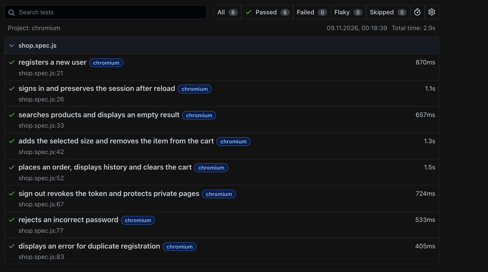
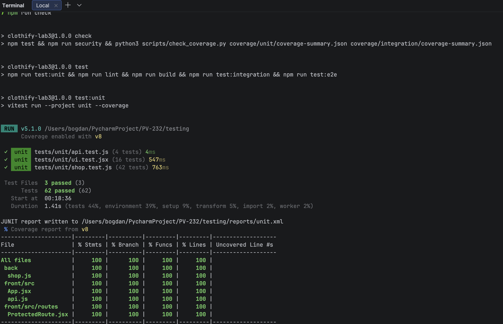
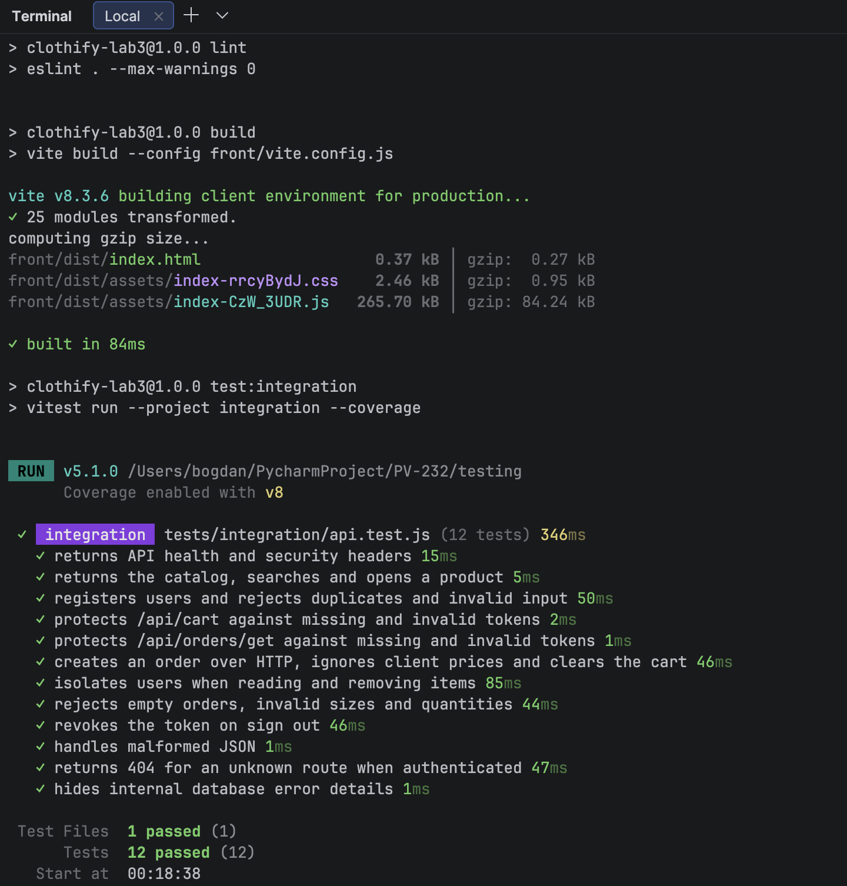
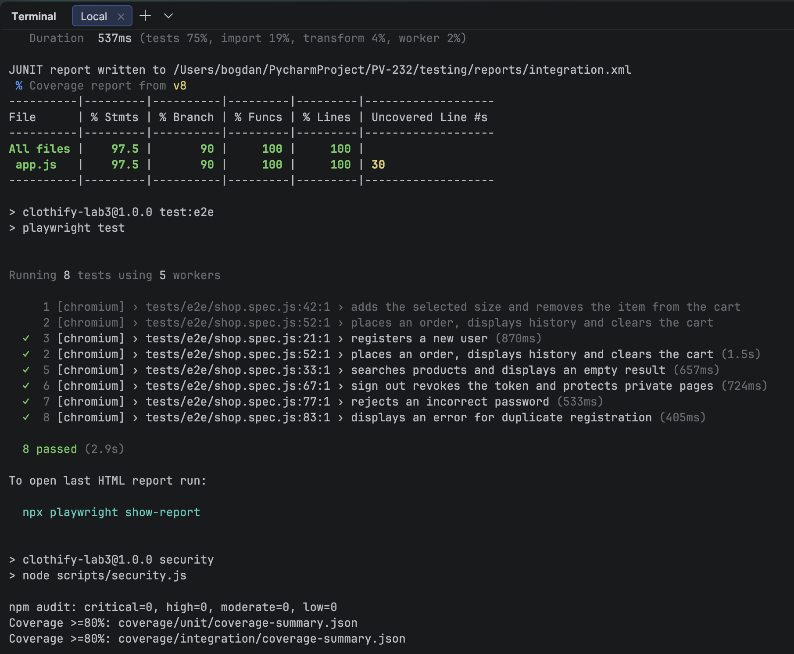
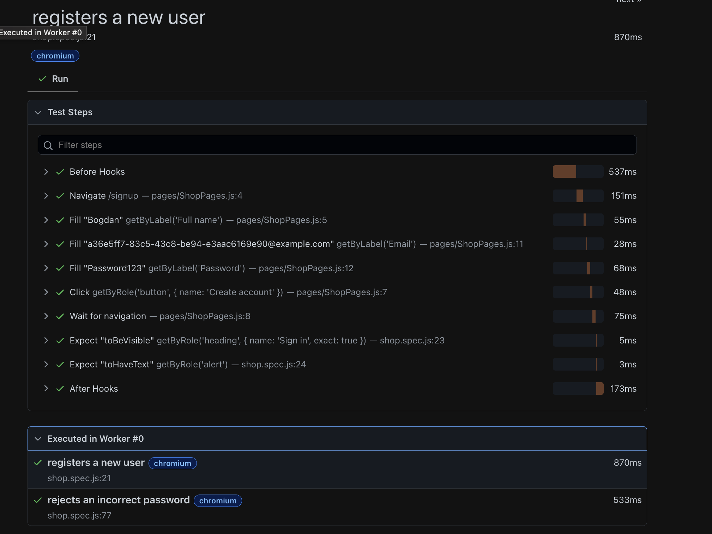
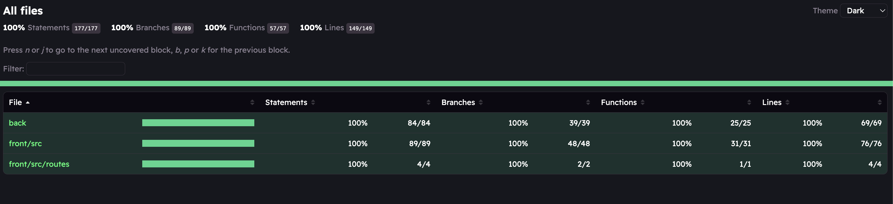
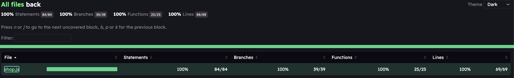
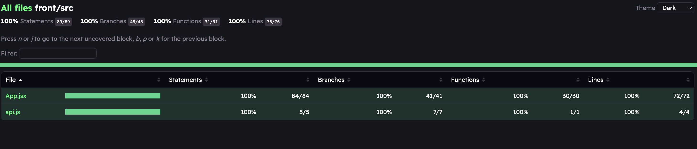
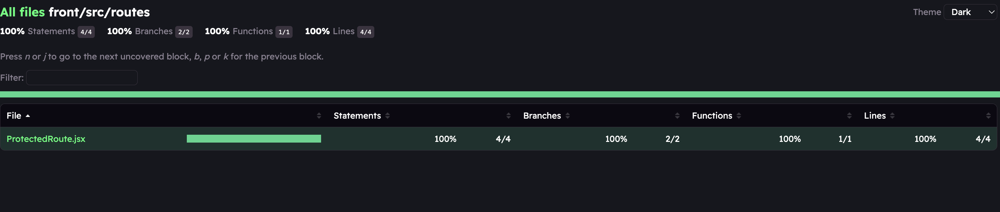
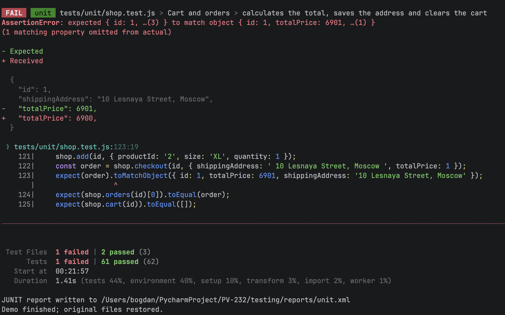

# Лабораторная работа №3 — UI-тестирование и CI/CD

**Прядко Богдан, ПВ-232.** [Задание](Laba-3.md).

## Цель работы

Написать автотесты интернет-магазина и настроить последовательный CI: ошибки тестов, недостаточное покрытие и критические уязвимости должны блокировать следующие стадии.

## Что реализовано

В интернет-магазине реализованы регистрация, вход, поиск товаров, работа с корзиной, оформление заказа и выход из аккаунта. Покупатель может выбрать размер, удалить товар из корзины и посмотреть историю заказов. Интерфейс работает на React, сервер — на Express, данные хранятся в SQLite. Оплата — при получении.

Сервер рассчитывает сумму заказа и очищает корзину после покупки. Пароли хранятся в виде хешей. После выхода старый токен больше не даёт доступа к аккаунту. Данные сохраняются в `back/data/shop.sqlite`, для тестов создаются отдельные базы.

```text
front/                     интерфейс магазина
back/                      API и SQLite
tests/unit/                правила, компоненты и API-клиент
tests/integration/         HTTP-запросы к серверу
tests/e2e/                 Playwright и Page Object
screenshots/               снимки результатов
scripts/                   запуск и проверки качества
.github/workflows/ci.yml    CI
```

## Тесты и Page Object

В [ShopPages.js](tests/e2e/pages/ShopPages.js) классы `AuthPage`, `CatalogPage`, `CartPage` и `CheckoutPage` содержат локаторы и действия. Проверки находятся в [shop.spec.js](tests/e2e/shop.spec.js). Пример входа:

```javascript
async login(user) {
  await this.page.goto('/login');
  await this.fill(user);
  await this.page.getByRole('button', { name: 'Sign in', exact: true }).click();
}
```

Элементы страницы находятся по роли и подписи поля. Тест ожидает появления нужного элемента или перехода на страницу. Для каждого сценария создаётся пользователь с новым email, чтобы параллельные запуски не мешали друг другу.

| Сценарий E2E | Проверяемый результат |
|---|---|
| Регистрация | Сообщение об успехе и переход на вход |
| Вход | Сессия сохраняется после обновления страницы |
| Поиск | Нужный товар и пустая выдача |
| Корзина | Размер, сумма и удаление позиции |
| Оформление заказа | Адрес, сумма, история и очистка корзины |
| Выход | Закрытие защищённых страниц и отзыв токена |
| Неверный пароль | Вход отклонён |
| Повторная регистрация | Ошибка занятого email |

### Пирамида тестирования

| Уровень | Количество | Содержание |
|---|---:|---|
| Unit / component / service | 62 | 42 проверки правил и сервиса, 16 — React-компонентов, 4 — API-клиента |
| Integration | 12 | HTTP-запросы, middleware, сервис и SQLite, статусы ответов и изоляция пользователей |
| E2E | 8 | Действия покупателя в Chromium на готовой сборке |

Большинство тестов проверяет расчёты, ввод и ошибки без запуска браузера. Их больше, потому что они выполняются быстро и позволяют сразу найти ошибку в конкретном правиле. Часть сервисных тестов работает с SQLite и относится к component-тестам. Для взаимодействия API с базой достаточно 12 integration-тестов, для основных действий покупателя — 8 E2E. Каждый вариант параметризованного теста учитывается отдельно.

## Запуск

Нужны Node.js 24.x, npm и Python 3.9+. Все команды выполняются из корня проекта.

```bash
npm ci
npx playwright install --with-deps chromium
npm run dev
```

Магазин: `http://127.0.0.1:5173`. Playwright поддерживает Windows, macOS и Linux; установка описана в [документации](https://playwright.dev/docs/intro).

Перед тестированием остановить приложение через **Ctrl+C**: Playwright сам запускает backend и собранный frontend на портах 3001 и 4173.

```bash
npm run check
```

Выполняются тесты, линтер, сборка, аудит и проверка покрытия. По отдельности:

```bash
npm run test:unit
npm run lint
npm run build
npm run test:integration
npm run test:e2e
npm run security
```

Просмотр отчётов:

```bash
npx playwright show-report
python3 -m http.server 8000 --directory coverage
```

Покрытие: `http://localhost:8000/unit/index.html` и `/integration/index.html`. Остановка — Ctrl+C. Автоматические отчёты исключены из Git.

## CI/CD и quality gates

В [ci.yml](.github/workflows/ci.yml) настроены запуски на `push`, `pull_request` и вручную. Зависимости между стадиями заданы через `needs`.

| Проверка | Условие блокировки |
|---|---|
| Unit, integration, E2E | Любой упавший тест |
| ESLint | Ошибка или предупреждение |
| Coverage | Менее 80% строк, выражений, функций или ветвей в любом проверяемом файле |
| npm audit | Уязвимость HIGH/CRITICAL либо ошибка получения отчёта |
| Bandit | HIGH в Python-скрипте проверки покрытия |
| Итоговый quality-gate | Любая обязательная стадия упала или пропущена |

Если падает unit-тест, сборка получает статус `skipped`. Если падает integration, E2E не запускаются. Браузерные тесты скачивают готовую сборку из предыдущей стадии и проверяют её вместе с сервером.

Покрытие измеряется для правил магазина, React-компонентов, API-клиента, ProtectedRoute и HTTP-слоя. Файлы запуска приложения, CSS и служебные скрипты в расчёт не входят. CI сохраняет отчёты coverage, JUnit, Playwright и безопасности, в том числе при падении тестов.

Bandit проверяет Python-скрипт `check_coverage.py`. Safety предназначен для зависимостей Python, которых у приложения нет, поэтому в его отчёте стоит `not_applicable`. Зависимости JavaScript проверяет npm audit.

Чтобы запретить merge при упавшем CI, в **Settings — Branches / Rulesets** для `main` нужно включить изменения через PR и выбрать `quality-gate` обязательной проверкой.

## Результаты

При запуске `npm run check` прошли **82 теста**, линтер и сборка. npm audit не обнаружил уязвимостей, Bandit — проблем уровня HIGH. Результаты запуска от 09.11.2026 приведены ниже.

Отчёт Playwright: все восемь сценариев прошли.



<details>
<summary>Логи unit, integration, E2E, сборки и аудита</summary>

62 unit/component-теста:



Линтер, сборка и 12 integration-тестов:



E2E, npm audit и проверка порога покрытия:



</details>

<details>
<summary>Шаги регистрации через Page Object</summary>



</details>

Покрытие unit/component-тестов — 100% по четырём метрикам. Для HTTP-слоя: statements — 97,5%, branches — 90%, functions и lines — 100%.



<details>
<summary>Покрытие отдельных модулей</summary>

Сервис backend:



Компоненты frontend и API-клиент:



Защищённый маршрут:



</details>

## Проверка блокировок

Для проверки блокировок используются четыре команды. Каждая создаёт отдельную причину падения и завершается с кодом 1.

| Команда | Причина падения |
|---|---|
| `npm run demo:unit` | Ожидаемая сумма 6901 вместо фактической 6900: 1 failed, 61 passed |
| `npm run demo:coverage` | Добавленный непокрытый модуль снижает покрытие строк примерно до 71% |
| `npm run demo:security` | Аудит временного lockfile с lodash 4.17.4 обнаруживает critical |
| `npm run demo:e2e` | Ожидаемая сумма 4501 вместо 4500: 1 failed, 7 passed |

Перед E2E нужно выполнить `npm run build`. В отчёте `npx playwright show-report` можно посмотреть ошибку, снимок страницы, видео и trace. После проверки падений обычный набор запускается командой `npm run check`.

В проверке суммы вместо 6900 указано ожидание 6901. Тест показывает расхождение: одна проверка упала, остальные 61 прошли.



Для такой же проверки в GitHub Actions нужно открыть **Actions — CI — Run workflow**, выбрать ветку и режим `unit`, `coverage`, `security` или `e2e`. Обычный запуск — `none`. Если ручной запуск недоступен, режим задаётся через `CI_DEMO` в `ci.yml`, после чего запускается push в свою ветку. После проверки значение возвращается в `none`.

## Выводы

В ходе работы я научился писать E2E-тесты на Playwright, применять Page Object и распределять проверки между unit-, integration- и E2E-уровнями. Также освоил настройку CI с проверками покрытия и безопасности зависимостей. Эти навыки полезны для автоматического обнаружения ошибок после изменений в коде, сокращения ручных проверок и блокировки сборки при нарушении требований качества.

## Контрольные вопросы

**1. Что такое пирамида тестирования и почему она важна?**

Пирамида тестирования — модель распределения автоматизированных тестов: много модульных, меньше интеграционных и небольшое число сквозных. При переходе к более высоким уровням обычно растут время выполнения и стоимость сопровождения. Такое распределение позволяет быстрее обнаруживать и локализовать дефекты, сохраняя проверку системы в целом.

**2. Какие паттерны автоматизации UI вы знаете?**

Page Object объединяет локаторы и операции со страницей в отдельном классе. Page Component выделяет повторяющиеся элементы интерфейса, например меню или карточку товара. Screenplay строит тесты вокруг участников, выполняемых ими задач и проверок результата. В работе использован Page Object для уменьшения дублирования и упрощения изменения локаторов.

**3. Что такое quality gates и зачем они нужны?**

Quality gates — набор обязательных критериев качества, определяющих возможность перехода к следующей стадии CI/CD. Критериями могут быть успешное прохождение тестов, минимальное покрытие и отсутствие критических уязвимостей. Нарушение хотя бы одного условия блокирует дальнейшее выполнение пайплайна и предотвращает выпуск изменения, не соответствующего требованиям.

**4. Почему unit запускаются на каждый коммит, integration после сборки, а E2E перед релизом?**

Такой порядок учитывает время выполнения и область проверки. Модульные тесты обычно выполняются быстрее и позволяют обнаружить ошибки до запуска затратных стадий. Интеграционные тесты проверяют совместную работу компонентов после сборки. Сквозные тесты проверяют систему целиком, требуют более сложного окружения и обычно выполняются дольше, поэтому их запускают после успешного завершения предыдущих проверок. Это сокращает затраты времени на изменения с уже выявленными дефектами.
