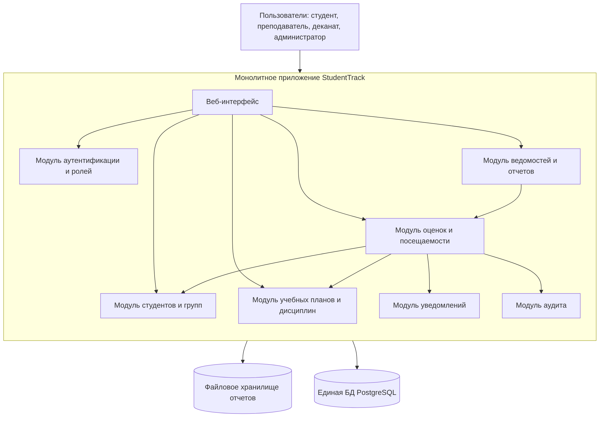
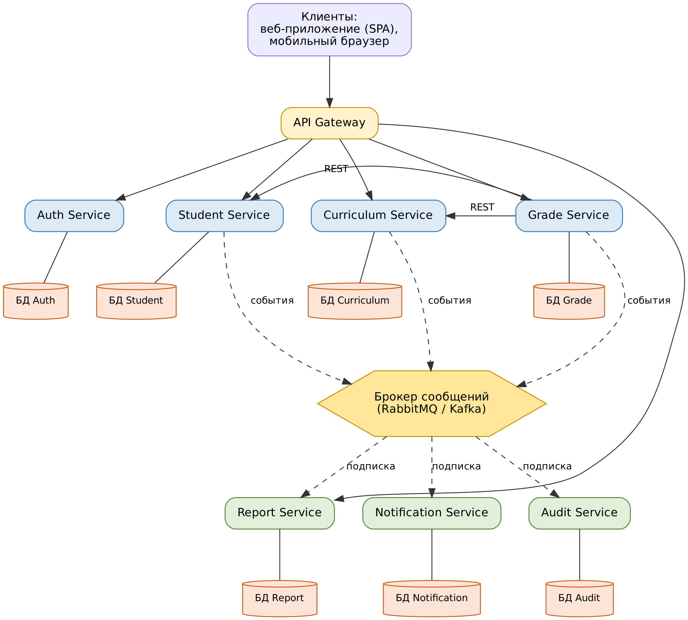
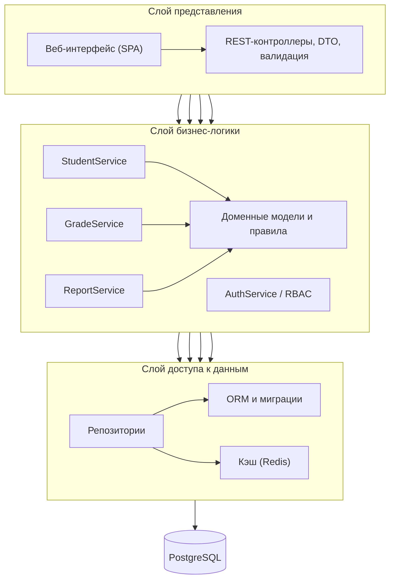
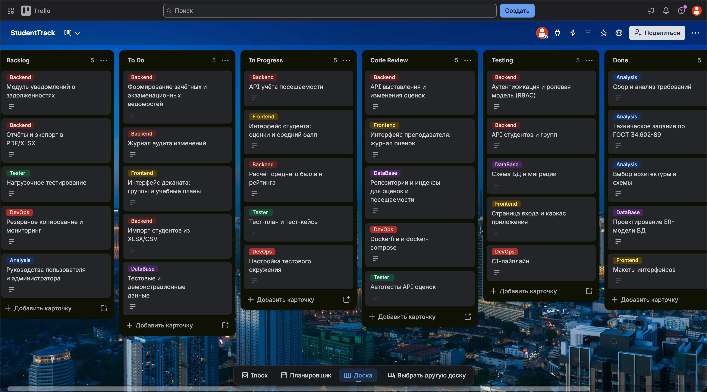

# ОТЧЕТ ПО ЛАБОРАТОРНОЙ РАБОТЕ

**по дисциплине «Архитектура, проектирование и ППС»**

**Тема:** Анализ требований, выбор архитектуры программного обеспечения и организация командной разработки

**Проект:** Система учета студентов и успеваемости

|               |                         |
|---------------|-------------------------|
| **Выполнил:** | студент группы ПВ-232   |
|               | Зубарев Максим Игоревич |
| **Проверил:** | Доденко Олег Павлович   |

---

## 1. Цель работы

Получить практические навыки анализа требований к программному обеспечению, проектирования архитектуры информационной
системы, формирования команды разработки и распределения задач между участниками проекта на примере системы учета
студентов и успеваемости.

---

## 2. Описание выбранного проекта

### 2.1. Название проекта

**«StudentTrack» — информационная система учета студентов и успеваемости.**

### 2.2. Назначение системы

Система предназначена для централизованного хранения данных о студентах, учебных группах, дисциплинах и учебных планах,
а также для учета оценок, посещаемости и промежуточной аттестации. Она автоматизирует формирование ведомостей, отчетов
об успеваемости и информирование участников образовательного процесса.

### 2.3. Целевая аудитория

| Категория                             | Как использует систему                                                               |
|---------------------------------------|--------------------------------------------------------------------------------------|
| Студенты                              | Просмотр оценок, посещаемости, расписания, уведомлений, личной статистики            |
| Преподаватели                         | Выставление оценок и отметок о посещаемости, ведение ведомостей по своим дисциплинам |
| Сотрудники деканата / учебного отдела | Ведение контингента, групп, учебных планов, формирование отчетов                     |
| Заведующие кафедрами, руководство     | Анализ успеваемости по группам, кафедрам, потокам                                    |
| Администратор системы                 | Управление пользователями, ролями, справочниками, настройками                        |

### 2.4. Основные проблемы, которые решает система

1. Разрозненность данных: бумажные журналы, таблицы Excel у разных преподавателей.
2. Ошибки и дублирование при ручном переносе оценок в ведомости.
3. Отсутствие оперативного доступа студентов к своим результатам.
4. Трудоемкое формирование отчетности (по группам, курсам, кафедрам, задолженностям).
5. Позднее выявление отстающих студентов и студентов с риском отчисления.
6. Слабый контроль доступа к персональным данным и отсутствие журнала изменений оценок.

### 2.5. Основные функции системы

- Ведение реестра студентов, групп, направлений, преподавателей.
- Ведение справочника дисциплин и учебных планов.
- Выставление и редактирование оценок, учет посещаемости.
- Формирование экзаменационных и зачетных ведомостей.
- Расчет среднего балла и рейтинга студентов.
- Выявление академических задолженностей и уведомление о них.
- Формирование отчетов и экспорт (PDF, XLSX).
- Разграничение прав доступа по ролям, журнал аудита.
- Уведомления (e-mail / в интерфейсе).

### 2.6. Предполагаемые условия эксплуатации

- Доступ через веб-браузер (ПК, планшет, смартфон) из локальной сети вуза и из интернета.
- Работа в учебные периоды с пиковой нагрузкой в сессию (массовое выставление оценок и просмотр результатов).
- Режим работы 24/7 с плановыми технологическими окнами обслуживания.
- Количество пользователей: до 5 000 студентов, до 400 преподавателей, до 50 сотрудников деканатов (масштаб среднего
  вуза).
- Размещение на серверах вуза или в облаке на территории РФ (требование хранения персональных данных).
- Пользователи не обязаны иметь специальную подготовку; требуется краткая инструкция.

---

## 3. Функциональные и нефункциональные требования

### 3.1. Функциональные требования

| ID    | Название                                   | Описание                                                                                          | Пользователь                      | Ожидаемый результат                                        |
|-------|--------------------------------------------|---------------------------------------------------------------------------------------------------|-----------------------------------|------------------------------------------------------------|
| FR-01 | Аутентификация и авторизация               | Вход по логину и паролю (или через SSO вуза), определение роли и прав доступа                     | Все пользователи                  | Пользователь получает доступ только к разрешенным разделам |
| FR-02 | Управление пользователями и ролями         | Создание, блокировка, редактирование учетных записей, назначение ролей                            | Администратор                     | Учетная запись создана/изменена, права применены           |
| FR-03 | Ведение реестра студентов                  | Добавление, редактирование, перевод, отчисление, восстановление студентов; хранение личных данных | Сотрудник деканата                | Актуальная карточка студента в системе                     |
| FR-04 | Управление учебными группами               | Создание групп, зачисление студентов, назначение куратора                                         | Сотрудник деканата                | Сформирован состав группы                                  |
| FR-05 | Управление дисциплинами и учебными планами | Ведение справочника дисциплин, семестровых планов, форм контроля (экзамен, зачет, КР)             | Сотрудник деканата                | Утвержден учебный план направления                         |
| FR-06 | Назначение преподавателей на дисциплины    | Закрепление преподавателей за дисциплинами и группами в семестре                                  | Сотрудник деканата                | Преподаватель видит свои группы и дисциплины               |
| FR-07 | Выставление оценок                         | Ввод и изменение оценок за занятия, контрольные точки, экзамены                                   | Преподаватель                     | Оценка сохранена, пересчитан итоговый балл                 |
| FR-08 | Учет посещаемости                          | Отметка присутствия/отсутствия на занятиях, указание причины пропуска                             | Преподаватель                     | Данные о посещаемости сохранены                            |
| FR-09 | Просмотр успеваемости                      | Просмотр оценок, посещаемости, среднего балла, задолженностей                                     | Студент                           | Студент видит актуальные данные только о себе              |
| FR-10 | Формирование ведомостей                    | Автоматическое формирование зачетных и экзаменационных ведомостей, закрытие ведомости             | Преподаватель, сотрудник деканата | Готовая ведомость, экспорт в PDF/XLSX                      |
| FR-11 | Расчет рейтинга и среднего балла           | Автоматический расчет по заданным правилам за семестр и весь период                               | Система (по запросу пользователя) | Рейтинг группы/потока актуален                             |
| FR-12 | Контроль задолженностей                    | Выявление студентов с задолженностями и риском отчисления                                         | Сотрудник деканата, преподаватель | Список должников; уведомления отправлены                   |
| FR-13 | Формирование отчетов                       | Отчеты по успеваемости, посещаемости, группам, кафедрам, периодам                                 | Деканат, руководство              | Отчет отображен и выгружен в файл                          |
| FR-14 | Уведомления                                | Рассылка уведомлений о новых оценках, задолженностях, закрытии ведомостей                         | Система → все роли                | Пользователь получил уведомление                           |
| FR-15 | Журнал аудита                              | Фиксация, кто и когда создал или изменил оценку и ключевые данные                                 | Администратор                     | Доступна история изменений с возможностью фильтрации       |
| FR-16 | Импорт и экспорт данных                    | Загрузка списков студентов из XLSX/CSV, выгрузка данных                                           | Сотрудник деканата                | Данные загружены без дублей, ошибки показаны в отчете      |

### 3.2. Нефункциональные требования

#### Надежность

| ID     | Требование                                                                                                                                                |
|--------|-----------------------------------------------------------------------------------------------------------------------------------------------------------|
| NFR-R1 | Доступность системы не менее 99,5 % в месяц (без учета плановых работ).                                                                                   |
| NFR-R2 | Ежедневное резервное копирование БД, хранение копий не менее 30 дней; время восстановления (RTO) не более 4 часов, потеря данных (RPO) не более 24 часов. |
| NFR-R3 | При сбое операции ввод оценки не должен приводить к частично сохраненным данным (транзакционность).                                                       |
| NFR-R4 | Все критичные ошибки журналируются; предусмотрен мониторинг состояния сервисов.                                                                           |

#### Производительность

| ID     | Требование                                                                                              |
|--------|---------------------------------------------------------------------------------------------------------|
| NFR-P1 | Время отклика на типовые операции (просмотр оценок, ввод оценки) — не более 2 секунд при 95 % запросов. |
| NFR-P2 | Формирование отчета по группе — не более 10 секунд; по факультету — не более 60 секунд.                 |
| NFR-P3 | Система выдерживает не менее 500 одновременных пользователей в пике сессии.                             |

#### Безопасность

| ID     | Требование                                                                                                        |
|--------|-------------------------------------------------------------------------------------------------------------------|
| NFR-S1 | Соответствие требованиям Федерального закона № 152-ФЗ «О персональных данных».                                    |
| NFR-S2 | Ролевая модель доступа (RBAC): студент видит только свои данные, преподаватель — только свои дисциплины и группы. |
| NFR-S3 | Передача данных только по HTTPS (TLS 1.2+); пароли хранятся в виде хэша (bcrypt/Argon2).                          |
| NFR-S4 | Защита от типовых уязвимостей OWASP Top 10 (SQL-инъекции, XSS, CSRF).                                             |
| NFR-S5 | Журнал аудита изменений оценок неизменяем для пользователей и доступен администратору.                            |
| NFR-S6 | Блокировка учетной записи после серии неудачных попыток входа.                                                    |

#### Масштабируемость

| ID      | Требование                                                                                                                     |
|---------|--------------------------------------------------------------------------------------------------------------------------------|
| NFR-SC1 | Возможность увеличения числа пользователей минимум в 3 раза без переработки архитектуры.                                       |
| NFR-SC2 | Возможность горизонтального масштабирования прикладной части (несколько экземпляров за балансировщиком).                       |
| NFR-SC3 | Модульная структура, позволяющая добавлять новые функции (например, электронное портфолио) без изменения существующих модулей. |

#### Условия эксплуатации

| ID     | Требование                                                                              |
|--------|-----------------------------------------------------------------------------------------|
| NFR-E1 | Поддержка современных браузеров (Chrome, Firefox, Edge, Safari — две последние версии). |
| NFR-E2 | Адаптивный интерфейс для экранов от 360 px.                                             |
| NFR-E3 | Интерфейс на русском языке; архитектурная возможность добавления других языков.         |
| NFR-E4 | Развертывание в контейнерах (Docker); серверная ОС — Linux.                             |
| NFR-E5 | Наличие эксплуатационной документации и инструкции для пользователей каждой роли.       |

---

## 4. Описание монолитной архитектуры

### 4.1. Основные компоненты

Вся система разрабатывается как **единое приложение**, содержащее модули:

- модуль аутентификации и управления пользователями;
- модуль студентов и групп;
- модуль учебных планов и дисциплин;
- модуль оценок и посещаемости;
- модуль ведомостей и отчетов;
- модуль уведомлений;
- модуль аудита;
- веб-интерфейс (шаблоны страниц или SPA, отдаваемая тем же приложением).

### 4.2. Принцип взаимодействия компонентов

Модули находятся в одном процессе и взаимодействуют **прямыми вызовами методов/функций**. Все модули используют общий
контекст приложения и общую транзакцию БД.

### 4.3. Способ хранения данных

Единая реляционная СУБД (PostgreSQL) с общей схемой данных. Связи между сущностями (студент — группа — дисциплина —
оценка) обеспечиваются внешними ключами. Отчетные файлы хранятся на файловой системе сервера или в объектном хранилище.

### 4.4. Особенности развертывания

Приложение собирается в один артефакт (контейнер/JAR/пакет) и разворачивается целиком на одном сервере либо в нескольких
экземплярах за балансировщиком. Одна БД. Любое изменение требует пересборки и развертывания всего приложения.

### 4.5. Схема

### 4.6. Преимущества и недостатки

| Преимущества                                                          | Недостатки                                               |
|-----------------------------------------------------------------------|----------------------------------------------------------|
| Простота разработки и отладки: один репозиторий, один процесс         | Рост сложности кодовой базы при развитии проекта         |
| Простое развертывание и эксплуатация                                  | Масштабирование только всего приложения целиком          |
| Прямые вызовы — высокая скорость, нет сетевых задержек между модулями | Сильная связанность модулей, риск «большого комка грязи» |
| Единые транзакции ACID, целостность данных                            | Ошибка в одном модуле может уронить всю систему          |
| Низкие затраты на инфраструктуру и DevOps                             | Привязка ко всему стеку технологий, сложность его смены  |
| Хорошо подходит для небольшой команды                                 | Любое обновление требует полного развертывания           |

---

## 5. Описание микросервисной архитектуры

Система делится на независимые сервисы, каждый из которых отвечает за свою предметную область, имеет собственную БД и
развертывается отдельно. Внешние клиенты работают через **API Gateway**.

### 5.1. Описание сервисов

| Сервис                   | Назначение                   | Основные функции                                                        | Данные                                                                     | Взаимодействие                                                                            |
|--------------------------|------------------------------|-------------------------------------------------------------------------|----------------------------------------------------------------------------|-------------------------------------------------------------------------------------------|
| **Auth Service**         | Аутентификация и авторизация | Вход, выдача и проверка JWT-токенов, управление пользователями и ролями | Пользователи, роли, права, токены                                          | Вызывается API Gateway и другими сервисами (REST, проверка токена)                        |
| **Student Service**      | Реестр студентов и групп     | CRUD студентов, групп, переводы, отчисления, импорт списков             | Студенты, группы, направления                                              | REST для Gateway; события `StudentEnrolled`, `StudentExpelled` в брокер                   |
| **Curriculum Service**   | Учебные планы и дисциплины   | Ведение дисциплин, планов, форм контроля, назначение преподавателей     | Дисциплины, учебные планы, нагрузка преподавателей                         | REST; публикует события об изменении планов                                               |
| **Grade Service**        | Оценки и посещаемость        | Ввод/изменение оценок, посещаемость, расчет итоговых баллов и рейтинга  | Оценки, посещаемость, контрольные точки                                    | REST; публикует `GradeChanged`, `DebtDetected`; запрашивает данные у Student и Curriculum |
| **Report Service**       | Ведомости и отчеты           | Формирование ведомостей, отчетов, экспорт в PDF/XLSX                    | Шаблоны отчетов, сформированные файлы, агрегированные данные (read-модель) | Подписан на события Grade/Student; REST для Gateway                                       |
| **Notification Service** | Уведомления                  | Рассылка e-mail и внутренних уведомлений                                | Шаблоны, история уведомлений, настройки подписок                           | Асинхронно получает события из брокера                                                    |
| **Audit Service**        | Журнал аудита                | Запись и поиск истории изменений                                        | События аудита                                                             | Асинхронно получает события из брокера                                                    |

### 5.2. Способы взаимодействия

- **Синхронное:** REST/HTTP (JSON) через API Gateway и между сервисами для запросов, требующих немедленного ответа.
- **Асинхронное:** брокер сообщений (RabbitMQ или Kafka) для событий (`GradeChanged`, `StudentExpelled`,
  `DebtDetected`).
- Каждый сервис имеет **собственную БД** (database per service); прямой доступ к чужой БД запрещен.

### 5.3. Схема

### 5.4. Преимущества и недостатки

| Преимущества                                                                            | Недостатки                                                                  |
|-----------------------------------------------------------------------------------------|-----------------------------------------------------------------------------|
| Независимое развертывание и масштабирование сервисов (например, Grade Service в сессию) | Высокая сложность проектирования и эксплуатации                             |
| Изоляция сбоев: падение Notification не останавливает ввод оценок                       | Распределенные транзакции, необходимость согласованности «в конечном счете» |
| Возможность использовать разные технологии для разных сервисов                          | Сетевые задержки, необходимость отказоустойчивости (retry, circuit breaker) |
| Независимая работа команд над сервисами                                                 | Сложное тестирование и отладка, трассировка запросов                        |
| Четкие границы ответственности                                                          | Повышенные затраты на инфраструктуру (брокер, оркестрация, мониторинг)      |

---

## 6. Описание многослойной архитектуры

Система делится на логические слои. Каждый слой зависит только от нижележащего, что снижает связанность и упрощает
тестирование и замену компонентов.

### 6.1. Слои и их назначение

#### Слой представления (Presentation Layer)

**Назначение:** взаимодействие с пользователем и внешними клиентами.

**Компоненты:**

- веб-интерфейс (SPA на React/Vue либо серверные шаблоны): страницы студента, преподавателя, деканата, администратора;
- REST API-контроллеры (приём HTTP-запросов, валидация формата данных, преобразование в DTO);
- компоненты авторизации на стороне клиента, обработка ошибок.

**Взаимодействие:** вызывает слой бизнес-логики; не содержит бизнес-правил и не обращается к БД напрямую.

#### Слой бизнес-логики (Business Logic Layer)

**Назначение:** реализация правил предметной области.

**Компоненты:**

- сервисы: `StudentService`, `GradeService`, `AttendanceService`, `ReportService`, `AuthService`, `NotificationService`;
- доменные модели (Student, Group, Subject, Grade, Attendance, Statement);
- правила: расчет среднего балла и рейтинга, проверка допустимости оценки, закрытие ведомости, выявление задолженностей;
- проверка прав доступа (RBAC) на уровне операций.

**Взаимодействие:** получает запросы от слоя представления, обращается к слою доступа к данным через интерфейсы
репозиториев.

#### Слой доступа к данным (Data Access Layer)

**Назначение:** хранение и извлечение данных, изоляция остального кода от СУБД.

**Компоненты:**

- репозитории (`StudentRepository`, `GradeRepository` и др.);
- ORM-модели и маппинг сущностей;
- миграции схемы БД;
- кэш (Redis) для справочников и часто читаемых данных;
- СУБД PostgreSQL.

**Взаимодействие:** вызывается только слоем бизнес-логики; возвращает доменные объекты.

### 6.2. Схема

### 6.3. Преимущества и недостатки

| Преимущества                                                    | Недостатки                                     |
|-----------------------------------------------------------------|------------------------------------------------|
| Четкое разделение ответственности                               | Возможны лишние «сквозные» вызовы между слоями |
| Простота тестирования каждого слоя                              | Изменение сущности затрагивает все слои        |
| Возможность замены UI или СУБД без переписывания логики         | Без дисциплины слои «протекают» друг в друга   |
| Удобное распределение задач в команде (frontend / backend / БД) | Масштабирование — как у монолита, целиком      |

---

## 7. Сравнение архитектур и выбор подхода

| Критерий                 | Монолитная     | Микросервисная                   | Многослойная   |
|--------------------------|----------------|----------------------------------|----------------|
| Сложность разработки     | Низкая         | Высокая                          | Средняя        |
| Сложность развертывания  | Низкая         | Высокая                          | Низкая         |
| Масштабируемость         | Ограниченная   | Высокая                          | Ограниченная   |
| Отказоустойчивость       | Низкая         | Высокая                          | Низкая         |
| Требуемый размер команды | 2–5            | 8 и более                        | 3–7            |
| Стоимость инфраструктуры | Низкая         | Высокая                          | Низкая         |
| Целостность данных       | Высокая (ACID) | Согласованность в конечном счете | Высокая (ACID) |

**Выбор для проекта.** Масштаб системы (до 5 000 студентов, 500 одновременных пользователей), ограниченная команда и
необходимость строгой целостности данных об оценках делают оптимальным вариантом **многослойный модульный монолит**:
логическая структура задается слоями (раздел 6), а внутри слоя бизнес-логики код делится на модули по предметным
областям. При росте нагрузки модули `Grade` и `Report` можно выделить в отдельные сервисы, перейдя к микросервисной
архитектуре (раздел 5). Состав команды (раздел 9) сформирован с учетом этого выбора.

---

## 8. Техническое задание

*Структура составлена в соответствии с ГОСТ 34.602-89 «Информационная технология. Комплекс стандартов на
автоматизированные системы. Техническое задание на создание автоматизированной системы».*

### 1. Введение

**Наименование системы:** «StudentTrack» — информационная система учета студентов и успеваемости.

**Назначение:** автоматизация учета контингента студентов, учебных планов, оценок, посещаемости, формирования ведомостей
и отчетов об успеваемости в образовательной организации.

**Краткое описание:** веб-приложение с ролевым доступом для студентов, преподавателей, сотрудников деканата и
администраторов. Система хранит данные в единой базе, обеспечивает ввод и просмотр оценок, расчет рейтингов,
формирование отчетов и уведомлений.

### 2. Основания для разработки

- Учебное задание лабораторной работы по дисциплине «Архитектура, проектирование и ППС».
- Задание на выполнение: анализ требований, проектирование архитектуры, формирование команды.
- **Исполнитель:** Зубарев Максим Игоревич, группа ПВ-232.
- **Заказчик:** преподаватель дисциплины (условный заказчик — деканат образовательной организации).
- Требования заказчика: наличие не менее 5 функциональных требований, взаимодействие пользователя с системой,
  разграничение прав доступа, формирование отчетности.

### 3. Назначение и цели создания системы

**Назначение:** система предназначена для оперативного и достоверного учета данных о студентах и их успеваемости,
предоставления этих данных участникам образовательного процесса.

**Цели создания:**

1. Заменить бумажные журналы и разрозненные таблицы единой информационной системой.
2. Сократить время формирования ведомостей и отчетов.
3. Обеспечить студентам и преподавателям оперативный доступ к актуальным данным.
4. Своевременно выявлять академические задолженности.
5. Обеспечить защиту персональных данных и прозрачность изменений оценок (аудит).

### 4. Требования к системе

#### 4.1. Функциональные требования

Система должна обеспечивать выполнение функций, описанных в разделе 3.1 отчета (FR-01 — FR-16), в том числе:

1. аутентификацию и разграничение доступа по ролям (студент, преподаватель, сотрудник деканата, руководство,
   администратор);
2. ведение реестра студентов, групп, дисциплин и учебных планов;
3. выставление оценок и учет посещаемости;
4. формирование зачетных и экзаменационных ведомостей;
5. расчет среднего балла и рейтинга;
6. выявление задолженностей и отправку уведомлений;
7. формирование отчетов с экспортом в PDF и XLSX;
8. ведение журнала аудита;
9. импорт и экспорт данных.

#### 4.2. Требования к надежности

- Доступность не менее 99,5 % в месяц.
- Ежедневное резервное копирование; хранение копий не менее 30 дней; RTO ≤ 4 часа, RPO ≤ 24 часа.
- Транзакционность операций изменения данных.
- Журналирование ошибок и мониторинг состояния системы.
- Корректная обработка ошибок ввода с понятными сообщениями пользователю.

#### 4.3. Требования к производительности

- Отклик на типовые операции ≤ 2 с (для 95 % запросов).
- Формирование отчета по группе ≤ 10 с, по факультету ≤ 60 с.
- Поддержка не менее 500 одновременных пользователей.

#### 4.4. Требования к безопасности

- Соответствие 152-ФЗ «О персональных данных».
- Ролевая модель доступа, принцип наименьших привилегий.
- Шифрование канала (HTTPS, TLS 1.2+); хранение паролей в виде хэшей.
- Защита от уязвимостей OWASP Top 10.
- Журнал аудита изменений оценок и персональных данных.
- Блокировка учетных записей при подборе пароля.

#### 4.5. Требования к условиям эксплуатации

- Доступ через современные браузеры, адаптивный интерфейс.
- Серверная часть — Linux, контейнеризация (Docker); БД — PostgreSQL.
- Круглосуточная работа с плановыми окнами обслуживания.
- Размещение серверов на территории РФ.
- Персонал: администратор системы (обслуживание), пользователи без специальной подготовки.

### 5. Состав и содержание работ

| Этап                               | Основные работы                                                                         | Ожидаемый результат                                            |
|------------------------------------|-----------------------------------------------------------------------------------------|----------------------------------------------------------------|
| 1. Анализ и планирование           | Сбор и анализ требований, интервью, определение границ проекта, план работ              | Документ с требованиями, план проекта                          |
| 2. Проектирование                  | Выбор архитектуры, проектирование БД, API и интерфейсов, прототипы экранов              | Архитектурное описание, ER-диаграмма, спецификация API, макеты |
| 3. Разработка БД и серверной части | Создание схемы БД, миграций, реализация бизнес-логики и REST API                        | Работающий backend, БД с тестовыми данными                     |
| 4. Разработка клиентской части     | Реализация интерфейсов по ролям, интеграция с API                                       | Рабочий веб-интерфейс                                          |
| 5. Настройка инфраструктуры        | Контейнеризация, CI/CD, настройка тестового и рабочего окружений, резервное копирование | Автоматизированная сборка и развертывание                      |
| 6. Тестирование                    | Модульные, интеграционные, функциональные, нагрузочные тесты, проверка безопасности     | Протоколы тестирования, список исправленных дефектов           |
| 7. Внедрение и обучение            | Развертывание, загрузка данных, подготовка инструкций                                   | Система введена в опытную эксплуатацию                         |
| 8. Приемка                         | Демонстрация, проверка по критериям приемки                                             | Акт приемки                                                    |

### 6. Порядок контроля и приемки

**Способы проверки:**

- модульное и интеграционное тестирование (покрытие бизнес-логики не менее 70 %);
- функциональное тестирование по сценариям для каждой роли;
- нагрузочное тестирование (500 одновременных пользователей);
- проверка безопасности (авторизация, проверка основных уязвимостей);
- проверка по чек-листу функциональных и нефункциональных требований.

**Критерии приемки:**

1. Реализованы все функциональные требования FR-01 — FR-16.
2. Нет открытых критических и блокирующих дефектов.
3. Выполнены показатели производительности и надежности из раздела 4.
4. Разграничение прав доступа работает корректно для всех ролей.
5. Подготовлена документация согласно разделу 7.

**Порядок демонстрации:** демонстрация на тестовых данных по сценариям: вход под разными ролями → ввод оценок
преподавателем → просмотр студентом → формирование ведомости и отчета → просмотр журнала аудита; затем ответы на вопросы
преподавателя и подписание акта приемки.

### 7. Требования к составу и содержанию документации

1. Техническое задание.
2. Описание требований (функциональных и нефункциональных).
3. Архитектурное описание (схемы, обоснование выбора).
4. Описание базы данных (ER-диаграмма, словарь данных).
5. Спецификация REST API.
6. Программа и методика испытаний (тест-план, тест-кейсы).
7. Протоколы тестирования.
8. Руководство пользователя (по ролям).
9. Руководство администратора (развертывание, резервное копирование, мониторинг).
10. Акт приемки.

### 8. Источники разработки

1. ГОСТ 34.602-89. Информационная технология. Комплекс стандартов на автоматизированные системы. Техническое задание на
   создание автоматизированной системы.
2. ГОСТ 34.601-90. Автоматизированные системы. Стадии создания.
3. ГОСТ Р ИСО/МЭК 25010-2015. Системная и программная инженерия. Требования и оценка качества систем и программного
   обеспечения (SQuaRE).
4. Федеральный закон от 27.07.2006 № 152-ФЗ «О персональных данных».
5. Федеральный закон от 29.12.2012 № 273-ФЗ «Об образовании в Российской Федерации».
6. Соммервилл И. Инженерия программного обеспечения.
7. Фаулер М. Архитектура корпоративных программных приложений.
8. Ньюмен С. Создание микросервисов.
9. Мартин Р. Чистая архитектура.
10. Задание к лабораторной работе по дисциплине «Архитектура, проектирование и ППС».

---

## 9. Состав команды разработки

С учетом выбранной архитектуры (многослойный модульный монолит) и масштаба проекта формируется команда из **7 человек**,
по одному специалисту на каждую роль. Слои архитектуры естественно соответствуют специализациям: frontend — слою
представления, backend — слою бизнес-логики, разработчик БД — слою доступа к данным.

| № | Роль                    | Соответствие архитектуре                 |
|---|-------------------------|------------------------------------------|
| 1 | Руководитель проекта    | Координация всей разработки              |
| 2 | Системный аналитик      | Требования, моделирование, API-контракты |
| 3 | Frontend-разработчик    | Слой представления                       |
| 4 | Backend-разработчик     | Слой бизнес-логики и REST API            |
| 5 | Разработчик базы данных | Слой доступа к данным                    |
| 6 | Тестировщик             | Контроль качества на всех слоях          |
| 7 | DevOps-инженер          | Развертывание, CI/CD, мониторинг         |

**Если команда меньше:**

- *4 человека:* руководитель + аналитик (одно лицо), frontend, backend + разработчик БД (одно лицо), тестировщик +
  DevOps (одно лицо).
- *При переходе на микросервисы:* команда расширяется (минимум два backend-разработчика, отдельный DevOps для
  инфраструктуры брокера и оркестрации).

---

## 10. Распределение ролей и ответственности

### 10.1. Руководитель проекта

**Основные обязанности:** планирование, контроль сроков и бюджета, управление рисками, коммуникация с заказчиком,
проведение встреч команды.

**Задачи:**

- составление плана проекта и графика работ;
- распределение задач и контроль статусов на доске;
- организация ежедневных и еженедельных встреч;
- управление изменениями требований;
- организация демонстрации и приемки.

**Результат работы:** план проекта, отчеты о ходе работ, управляемое выполнение этапов, акт приемки.

### 10.2. Системный аналитик

**Основные обязанности:** сбор, анализ и документирование требований, моделирование процессов, связь между заказчиком и
разработчиками.

**Задачи:**

- интервью с заинтересованными сторонами (деканат, преподаватели, студенты);
- описание функциональных и нефункциональных требований;
- подготовка ТЗ, пользовательских сценариев, диаграмм (UML, BPMN, ER);
- разработка спецификации REST API совместно с backend-разработчиком;
- сопровождение изменений требований.

**Результат работы:** ТЗ, документ с требованиями, диаграммы вариантов использования и процессов, спецификация API.

### 10.3. Frontend-разработчик

**Основные обязанности:** разработка пользовательского интерфейса и его интеграция с API.

**Задачи:**

- разработка макетов и прототипов (совместно с аналитиком);
- реализация интерфейсов студента, преподавателя, деканата, администратора;
- адаптивная верстка, кроссбраузерность;
- интеграция с REST API, обработка ошибок и валидация форм;
- модульные и UI-тесты клиентской части.

**Результат работы:** рабочий веб-интерфейс по всем ролям, соответствующий макетам и требованиям NFR-E1, NFR-E2.

### 10.4. Backend-разработчик

**Основные обязанности:** реализация бизнес-логики и серверного API.

**Задачи:**

- реализация REST API (контроллеры, сервисы);
- реализация аутентификации, авторизации (RBAC), журнала аудита;
- реализация расчета рейтинга, формирования ведомостей и отчетов, уведомлений;
- обеспечение безопасности серверной части;
- написание модульных и интеграционных тестов;
- участие в код-ревью.

**Результат работы:** серверное приложение с документированным API, покрытое тестами, обеспечивающее выполнение FR-01 —
FR-16.

### 10.5. Разработчик базы данных

**Основные обязанности:** проектирование и реализация хранилища данных.

**Задачи:**

- проектирование ER-модели и схемы БД PostgreSQL;
- создание и сопровождение миграций;
- оптимизация запросов, индексов (производительность отчетов, NFR-P2);
- реализация репозиториев совместно с backend-разработчиком;
- настройка резервного копирования и восстановления совместно с DevOps;
- подготовка тестовых и демонстрационных данных.

**Результат работы:** схема БД, миграции, словарь данных, оптимизированные запросы, тестовые данные.

### 10.6. Тестировщик

**Основные обязанности:** контроль качества продукта.

**Задачи:**

- разработка тест-плана и тест-кейсов по требованиям;
- ручное функциональное тестирование по ролям;
- автоматизация регрессионных тестов (API, UI);
- нагрузочное тестирование (500 одновременных пользователей);
- проверка безопасности (разграничение доступа, базовые проверки OWASP);
- ведение отчетов о дефектах и контроль их исправления.

**Результат работы:** тест-план, тест-кейсы, протоколы тестирования, отчет о дефектах, подтверждение соответствия
критериям приемки.

### 10.7. DevOps-инженер

**Основные обязанности:** инфраструктура, автоматизация сборки, развертывание и эксплуатация.

**Задачи:**

- контейнеризация приложения (Docker, docker-compose);
- настройка CI/CD (сборка, тесты, развертывание);
- создание тестового и рабочего окружений;
- настройка HTTPS, резервного копирования, мониторинга и логирования;
- обеспечение доступности и восстановления (NFR-R1, NFR-R2);
- подготовка руководства администратора.

**Результат работы:** автоматизированный конвейер CI/CD, развернутые окружения, мониторинг, руководство администратора.

### 10.8. Сводная матрица ответственности (RACI)

*R — исполняет, A — отвечает за результат, C — консультирует, I — информируется.*

| Артефакт / работа     | Рук. проекта | Аналитик | Frontend | Backend | БД  | Тестировщик | DevOps |
|-----------------------|--------------|----------|----------|---------|-----|-------------|--------|
| Требования и ТЗ       | A            | R        | C        | C       | C   | C           | I      |
| Макеты интерфейса     | I            | A        | R        | I       | I   | C           | I      |
| Схема БД              | I            | C        | I        | C       | A/R | I           | I      |
| REST API              | I            | C        | C        | A/R     | C   | C           | I      |
| Интерфейс             | I            | C        | A/R      | C       | I   | C           | I      |
| Бизнес-логика         | I            | C        | I        | A/R     | C   | C           | I      |
| Тестирование          | I            | C        | C        | C       | C   | A/R         | C      |
| CI/CD и развертывание | I            | I        | C        | C       | C   | C           | A/R    |
| Документация          | A            | R        | C        | C       | C   | C           | R      |
| Приемка проекта       | A/R          | R        | C        | C       | C   | R           | C      |

---

## 11. Доска задач

### 11.1. Инструмент и доступ

Для управления разработкой проекта «StudentTrack» используется Kanban-доска в сервисе **Trello**.

**Ссылка на доску:**
[StudentTrack — доска задач в Trello](https://trello.com/invite/b/6af046bb22fbee7b55fdd3d7/ATTId23b525031150868e67b1b2524e1732cC411548A/studenttrack)

### 11.2. Структура доски

Доска состоит из шести колонок, отражающих жизненный цикл задачи от планирования до завершения:

| Колонка         | Описание                     | Кол-во задач |
|-----------------|------------------------------|--------------|
| **Backlog**     | все запланированные задачи   | 5            |
| **To Do**       | задачи, готовые к выполнению | 5            |
| **In Progress** | задачи в работе              | 5            |
| **Code Review** | задачи на проверке           | 5            |
| **Testing**     | задачи на тестировании       | 5            |
| **Done**        | завершенные задачи           | 5            |
| **Итого**       |                              | **30**       |

Задачи сгруппированы по ролям команды (раздел 9): Backend, Frontend, БД, DevOps, QA, Аналитика. Для каждой карточки
указаны описание, ссылка на соответствующие требования (FR/NFR) и ответственный.

### 11.3. Скриншот доски

*Рисунок — Kanban-доска проекта в Trello.*

### 11.4. Перечень задач по колонкам

#### Backlog

| № | Задача                                    | Описание                                                                                       | Ответственный                  |
|---|-------------------------------------------|------------------------------------------------------------------------------------------------|--------------------------------|
| 1 | Модуль уведомлений о задолженностях       | Рассылка e-mail и внутренних уведомлений о новых оценках и академических долгах (FR-12, FR-14) | Backend                        |
| 2 | Отчеты и экспорт в PDF/XLSX               | Отчеты по группам, кафедрам и периодам с выгрузкой в файл (FR-13)                              | Backend                        |
| 3 | Нагрузочное тестирование                  | Проверка работы при 500 одновременных пользователях, замер времени отклика (NFR-P1, NFR-P3)    | Тестировщик                    |
| 4 | Резервное копирование и мониторинг        | Ежедневный бэкап БД, хранение 30 дней, настройка логов и алертов (NFR-R2, NFR-R4)              | DevOps                         |
| 5 | Руководства пользователя и администратора | Инструкции по ролям, описание развертывания, сценарий демонстрации                             | Руководитель проекта, аналитик |

#### To Do

| №  | Задача                                             | Описание                                                                             | Ответственный           |
|----|----------------------------------------------------|--------------------------------------------------------------------------------------|-------------------------|
| 6  | Формирование зачетных и экзаменационных ведомостей | Автогенерация ведомости по группе и дисциплине, закрытие ведомости (FR-10)           | Backend                 |
| 7  | Журнал аудита изменений                            | Запись, кто и когда менял оценки и данные студентов, просмотр с фильтрами (FR-15)    | Backend                 |
| 8  | Интерфейс деканата: группы и учебные планы         | Экраны управления группами, дисциплинами, назначением преподавателей (FR-04 — FR-06) | Frontend                |
| 9  | Импорт студентов из XLSX/CSV                       | Загрузка списков с проверкой дублей и отчетом об ошибках (FR-16)                     | Backend, разработчик БД |
| 10 | Тестовые и демонстрационные данные                 | Скрипт наполнения БД: группы, студенты, дисциплины, оценки                           | Разработчик БД          |

#### In Progress

| №  | Задача                                    | Описание                                                          | Ответственный |
|----|-------------------------------------------|-------------------------------------------------------------------|---------------|
| 11 | API учета посещаемости                    | Эндпоинты отметки присутствия и причин пропусков (FR-08)          | Backend       |
| 12 | Интерфейс студента: оценки и средний балл | Личный кабинет с оценками, посещаемостью, задолженностями (FR-09) | Frontend      |
| 13 | Расчет среднего балла и рейтинга          | Бизнес-правила расчета за семестр и весь период (FR-11)           | Backend       |
| 14 | Тест-план и тест-кейсы                    | Тест-кейсы по FR-01 — FR-16 для каждой роли                       | Тестировщик   |
| 15 | Настройка тестового окружения             | Отдельный стенд с БД и HTTPS для проверки сборок                  | DevOps        |

#### Code Review

| №  | Задача                                          | Описание                                                                        | Ответственный  |
|----|-------------------------------------------------|---------------------------------------------------------------------------------|----------------|
| 16 | API выставления и изменения оценок              | Эндпоинты ввода оценок с проверкой прав преподавателя и записью в аудит (FR-07) | Backend        |
| 17 | Интерфейс преподавателя: журнал оценок          | Таблица группы, ввод оценок, отметки посещаемости (FR-07, FR-08)                | Frontend       |
| 18 | Репозитории и индексы для оценок и посещаемости | Запросы доступа к данным, индексы для быстрых отчетов (NFR-P2)                  | Разработчик БД |
| 19 | Dockerfile и docker-compose                     | Контейнеризация приложения, БД и Redis для локального запуска                   | DevOps         |
| 20 | Автотесты API оценок                            | Интеграционные тесты ввода, изменения и просмотра оценок                        | Тестировщик    |

#### Testing

| №  | Задача                                 | Описание                                                                                                   | Ответственный  |
|----|----------------------------------------|------------------------------------------------------------------------------------------------------------|----------------|
| 21 | Аутентификация и ролевая модель (RBAC) | Вход, выдача токенов, разграничение доступа: студент, преподаватель, деканат, администратор (FR-01, FR-02) | Backend        |
| 22 | API студентов и групп                  | CRUD студентов и групп, переводы и отчисления (FR-03, FR-04)                                               | Backend        |
| 23 | Схема БД и миграции                    | Создание таблиц PostgreSQL по ER-модели, скрипты миграций                                                  | Разработчик БД |
| 24 | Страница входа и каркас приложения     | Форма авторизации, навигация по ролям, обработка ошибок, адаптивная верстка                                | Frontend       |
| 25 | CI-пайплайн                            | Автосборка, запуск тестов и проверка кода при каждом коммите                                               | DevOps         |

#### Done

| №  | Задача                                | Описание                                                                        | Ответственный                            |
|----|---------------------------------------|---------------------------------------------------------------------------------|------------------------------------------|
| 26 | Сбор и анализ требований              | Описание FR-01 — FR-16 и нефункциональных требований                            | Системный аналитик                       |
| 27 | Техническое задание по ГОСТ 34.602-89 | Подготовка ТЗ из 8 разделов                                                     | Системный аналитик, руководитель проекта |
| 28 | Выбор архитектуры и схемы             | Сравнение монолитной, микросервисной и многослойной архитектур, построение схем | Системный аналитик, backend              |
| 29 | Проектирование ER-модели БД           | Сущности, связи, словарь данных                                                 | Разработчик БД                           |
| 30 | Макеты интерфейсов                    | Прототипы экранов студента, преподавателя, деканата и администратора            | Frontend, аналитик                       |

### 11.5. Организация работы с доской

- Новые задачи создаются в **Backlog** руководителем проекта и аналитиком.
- Перед началом спринта приоритетные задачи переносятся в **To Do**.
- Исполнитель берет задачу, переносит ее в **In Progress** и создает pull request.
- После завершения разработки задача переходит в **Code Review**; проверку выполняет другой разработчик.
- Проверенная задача передается в **Testing**, где тестировщик проверяет ее по тест-кейсам. При обнаружении дефектов
  задача возвращается в **In Progress**.
- Задача, прошедшая тестирование и соответствующая критериям приемки, переносится в **Done**.

---

## 12. Заключение

В ходе лабораторной работы выполнен анализ требований к информационной системе учета студентов и успеваемости
«StudentTrack». Сформулированы 16 функциональных требований и группы нефункциональных требований (надежность,
производительность, безопасность, масштабируемость, условия эксплуатации).

Для проекта рассмотрены три архитектурные модели: монолитная, микросервисная и многослойная. Для каждой описаны
компоненты, способы взаимодействия и хранения данных, особенности развертывания, преимущества и недостатки, построены
схемы. Сравнительный анализ показал, что для системы среднего масштаба с ограниченной командой оптимальным является
многослойный модульный монолит с возможностью дальнейшего выделения отдельных модулей в микросервисы.

Подготовлено техническое задание, соответствующее структуре ГОСТ 34.602-89. Сформирована команда из семи специалистов,
роли которой соответствуют слоям выбранной архитектуры; определены обязанности, задачи и ожидаемые результаты каждого
участника, составлена матрица ответственности.
Для управления разработкой организована Kanban-доска в Trello из шести колонок (Backlog, To Do, In Progress, Code
Review,
Testing, Done), содержащая 30 задач, распределенных между участниками команды в соответствии с их ролями.

В результате получены практические навыки анализа требований, архитектурного проектирования и организации командной
разработки.