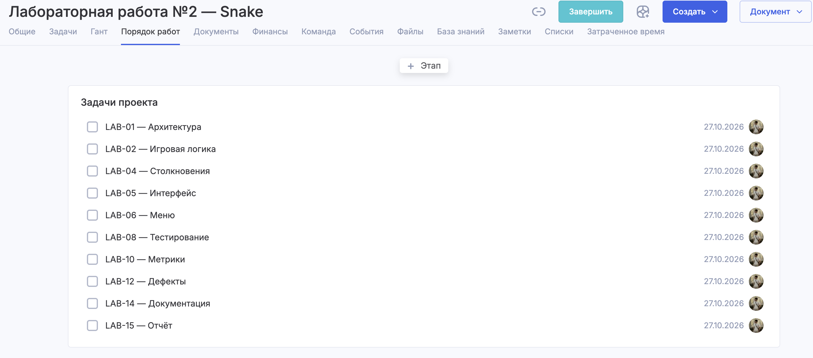

# Лабораторная работа № 1

**Тема:** Критерии качества ПО: сложность, корректность, надёжность, трудоёмкость. Оценка качества ПО.

**Выполнил:** Прядко Б. В., группа ПВ-232.

**Цель:** оценить качество программ с помощью тестов и метрик.

## Теоретическая часть

При разработке сложных систем основные проблемы связаны с изменением требований, усложнением кода и ошибками при взаимодействии компонентов.

| Проблема | Решение | Инструменты и методы |
|---|---|---|
| Изменение требований | Уточнять условия приёмки и приоритеты задач | Backlog, тестовые сценарии |
| Рост сложности кода | Разделять программу на модули и небольшие функции | Ревью, типизация, Radon |
| Ошибки и регрессии | Проверять правила и граничные случаи после изменений | pytest, coverage.py |

## 1. Проект на Python

Разработал [игру «Змейка»](snake/) на Python с использованием Pygame. В игре есть меню, пауза, перезапуск, выбор скорости, счёт и сохранение рекорда. Управление — стрелки или WASD. Игровую логику отделил от интерфейса, чтобы проверять её без создания окна.

Запуск из корня проекта:

```sh
python3 -m venv .venv
.venv/bin/python -m pip install -r snake/requirements-dev.txt
cd snake
../.venv/bin/python -m snake_game
```

Enter — старт, Space — пауза, R — перезапуск, Esc — меню/выход. Скорость выбирается клавишами 1–3 в меню или на паузе.

## 2. Задачи проекта

Задачи проекта оформил в Аспро.Cloud: [список задач](https://bodyapryadko4853.aspro.cloud/_module/st/view/project/24?tab=project_report_list).

| ID | Задача | Описание | Приоритет | Статус | Дата создания |
|---|---|---|---|---|---|
| LAB-01 | Архитектура | Разделить логику, интерфейс и хранение рекорда | Высокий | Выполнено | 26.10.2026 |
| LAB-02 | Игровая логика | Реализовать движение, еду, рост и очки | Высокий | Выполнено | 26.10.2026 |
| LAB-04 | Столкновения | Проверить границы поля и тело змейки | Высокий | Выполнено | 26.10.2026 |
| LAB-05 | Интерфейс | Добавить поле, счёт и настройки скорости | Средний | Выполнено | 26.10.2026 |
| LAB-06 | Меню | Реализовать запуск, паузу и перезапуск | Высокий | Выполнено | 26.10.2026 |
| LAB-08 | Тестирование | Проверить правила и граничные случаи | Высокий | Выполнено | 26.10.2026 |
| LAB-10 | Метрики | Измерить покрытие, размер и сложность | Высокий | Выполнено | 26.10.2026 |
| LAB-12 | Дефекты | Проверить ошибки и исправить замечания к Snake | Высокий | Выполнено | 26.10.2026 |
| LAB-14 | Документация | Описать запуск и управление | Высокий | Выполнено | 26.10.2026 |
| LAB-15 | Отчёт | Сравнить программы и сделать выводы | Высокий | Выполнено | 26.10.2026 |



## 3. Unit-тесты

Написал [47 тестов](snake/tests/), из них 30 проверяют игровую модель. Проверил движение, запрет разворота, генерацию еды, рост, очки, столкновения, паузу и перезапуск. Отдельно проверил заполнение поля, вход в освобождающуюся клетку хвоста, сохранение рекорда и обработку событий интерфейса.

Результат запуска: **47 passed in 0.58s**.

## 4. Покрытие тестами

Для измерения использовал pytest-cov и coverage.py. Команды выполняются из папки `snake/`:

```sh
../.venv/bin/python -m pytest -q --cov=snake_game --cov-branch --cov-report=term-missing
../.venv/bin/python -m coverage report -m
```

| Область | Покрытие строк | Покрытие ветвей |
|---|---:|---:|
| Игровая логика — model.py | 100% (84/84) | 100% (26/26) |
| Весь пакет snake_game | 98,06% (304/310) | 94,12% (96/102) |

Общая оценка coverage.py с учётом строк и ветвей — **97,09%**.

## 5. Сторонний проект

Для сравнения взял [Conway’s Game of Life](https://github.com/laios42/Conway-s-Game-of-Life), версия `5c3c028921530fbb4b628e9689940d1f8a69a88f`. Программа моделирует клеточный автомат и состоит из двух файлов: `grid.py` и `main.py`. Исходники оставил без изменений.

При анализе проверил правила рождения и гибели клеток, устойчивую конфигурацию, осциллятор, границы поля и обработку мыши. Результат независимых проверок: **26 passed, 1 xfailed**. Ожидаемое падение связано с ошибкой клика, описанной в пункте 8. Покрытие этими проверками составило **100% строк и 97,5% ветвей**.

## 6. Размер программ

Размер измерил командой `radon raw`. **LOC** — все физические строки файла, **SLOC** — строки кода без пустых строк и отдельных комментариев. Для Snake учитывал только файлы `snake_game`, для Conway — `grid.py` и `main.py`. Тесты и документация в расчёт не входят.

Команда из корня проекта:

```sh
.venv/bin/python -m radon raw -s snake/snake_game
```

| Программа | LOC | SLOC |
|---|---:|---:|
| Snake | 469 | 408 |
| Conway’s Game of Life | 123 | 87 |

## 7. Цикломатическая сложность

Сложность измерил с помощью Radon:

```sh
.venv/bin/python -m radon cc -s snake/snake_game
```

Для функции `SnakeGame.turn` получил **V(G) = 5**. В ней четыре проверки: состояние игры, наличие ожидающего поворота, противоположное и текущее направление. Ручной расчёт: **V(G) = 4 + 1 = 5**.

Для `Grid.get_neighbours` в Conway получил **V(G) = 3**: два вложенных цикла дают **2 + 1 = 3**. Максимальная сложность метода в Snake — **8**, в Conway — **12**.

## 8. Дефектность

В Snake исправил замечание Ruff E501: строка превышала ограничение в 79 символов. После переноса строки проверка стиля прошла, все 47 тестов завершились успешно.

В Conway подтвердил ошибку обработки мыши: клик в точке **(100, 699)** вызывает `IndexError`. При высоте окна 700 и размере клетки 15 массив содержит 46 строк с индексами 0–45, а координата 699 даёт индекс 46. Для исправления нужно проверять границы индекса перед обращением к массиву.

Плотность подтверждённых функциональных дефектов Conway: **1 / (87 / 1000) = 11,49 дефекта на KLOC**, где размер взят в SLOC. Замечание к оформлению Snake в эту метрику не включал. Время реакции на баг-репорты не измерял.

## 9. Итоговая таблица

| Метрика | Snake | Conway’s Game of Life |
|---|---|---|
| Размер, LOC / SLOC | 469 / 408 | 123 / 87 |
| CC выбранной функции | 5 — turn | 3 — get_neighbours |
| Максимальная CC метода | 8 | 12 |
| Результаты тестов | 47 passed | 26 passed, 1 xfailed |
| Качество: дефекты и замечания | Исправлено замечание E501 | Подтверждён IndexError при клике |
| Время реакции | Не измерялось | Не измерялось |
| Покрытие строк | 98,06%; модель — 100% | 100% независимыми проверками |
| Покрытие ветвей | 94,12%; модель — 100% | 97,5% независимыми проверками |

## Вывод

Выполнил тестирование и сравнил размер, сложность и дефектность двух программ. Snake содержит больше кода из-за интерфейса и дополнительных возможностей, но разделение на модули упрощает её проверку и сопровождение. В Conway правила клеточного автомата прошли проверки, однако ошибка обработки мыши приводит к завершению программы. Этот пример показывает, что высокое покрытие само по себе не гарантирует надёжность.
