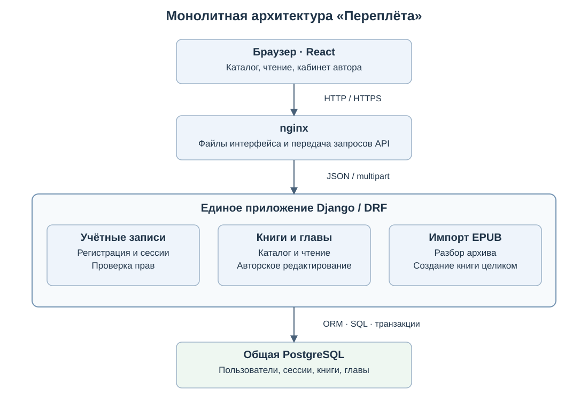
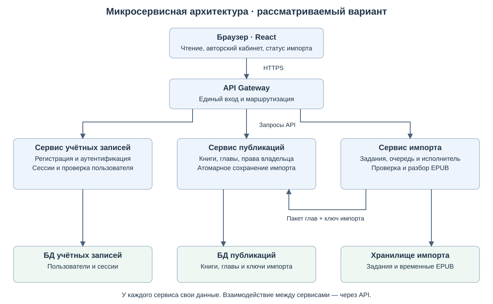
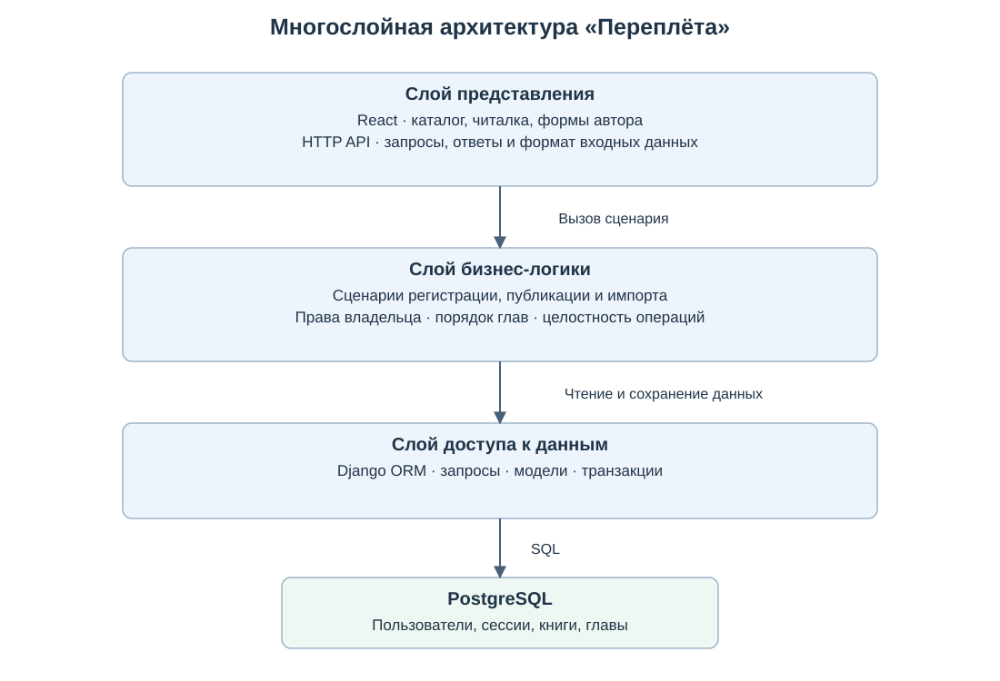
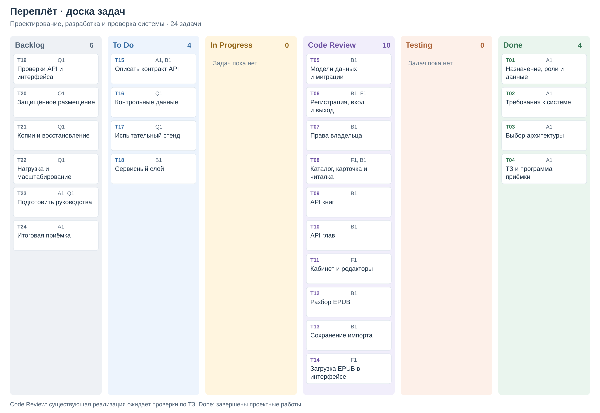

# Отчёт по лабораторной работе № 2

**Дисциплина** — архитектура, проектирование и ППС.

**Тема** — анализ требований, выбор архитектуры программного обеспечения и организация командной разработки.

**Проект** — информационная система публикации и чтения литературных произведений «Переплёт».

**Выполнил:** Письменный Антон.

**Группа:** ПВ-232.

**Год:** 2026.

---

## 1. Цель работы

Сформулировать требования к информационной системе, рассмотреть монолитную, микросервисную и многослойную архитектуры, подготовить техническое задание и распределить работы между участниками проектной команды. [Задание лабораторной работы](https://github.com/d26dodenko/PV-232/blob/bb38d870c19d5f2a9365dd053ae4bdd09defeb4c/Specification/Total.md)

## 2. Описание проекта

### 2.1. Назначение и аудитория

«Переплёт» — веб-приложение для размещения литературных произведений и чтения по главам. Автор создаёт книгу, добавляет главы вручную или импортирует EPUB. Читатель открывает каталог, выбирает произведение и переходит между его главами.

Целевая аудитория — начинающие писатели, участники литературных сообществ и читатели авторских произведений. Система решает задачи упорядоченной публикации текста, удобной навигации по главам и разграничения прав на редактирование.

| Пользователь | Основные действия |
|---|---|
| Гость | Просмотр каталога, описания книги, оглавления и текста глав |
| Автор | Все возможности гостя, создание и изменение собственных книг и глав, импорт EPUB |

Вход под обычной учётной записью даёт возможность стать автором. Владельцем книги считается пользователь, создавший запись или выполнивший импорт. Его отображаемое имя используется в каталоге. Права владельца определяются отдельно для каждой книги; чтение доступно всем посетителям.

### 2.2. Основные функции и данные

Система включает регистрацию и вход, общий каталог, карточку книги, читалку, кабинет автора, редакторы книг и глав, импорт EPUB и серверную проверку прав владельца. Сохранённые книги и главы доступны читателям сразу.

| Сущность | Основные данные | Связи и ограничения |
|---|---|---|
| Пользователь | Идентификатор, уникальный логин, отображаемое имя, хеш пароля | Один пользователь владеет несколькими книгами |
| Книга | Идентификатор, название, описание, владелец, даты создания и изменения | Принадлежит одному пользователю, содержит главы |
| Глава | Идентификатор, книга, номер, название, текст, даты создания и изменения | Пара «книга + номер» уникальна. Удаление книги удаляет её главы |
| Сессия | Ключ сессии, данные входа, срок действия | Обеспечивает авторизацию запросов пользователя |

Название книги и главы содержит от 1 до 160 символов, описание книги — до 2000 символов. Номер главы находится в диапазоне 1–9999, текст содержит от 1 до 100 000 символов и должен включать непробельные знаки. Оглавление сортируется по номеру главы.

### 2.3. Условия эксплуатации

Пользователь работает в браузере компьютера или телефона. Учебная установка запускается на одном компьютере через Docker Compose. Для сетевого размещения предполагаются сервер Linux, HTTPS и постоянное хранение данных PostgreSQL. Резервное копирование и настройка публичного размещения входят в проектируемые эксплуатационные работы.

Основой служит существующий [проект «Переплёт»](https://github.com/noxlight7/WEB): клиент на React, сервер на Django REST Framework и база данных PostgreSQL.

Требования описывают целевую версию системы. Показатели производительности, восстановления и масштабирования подлежат проверке при приёмке.

## 3. Функциональные и нефункциональные требования

### 3.1. Функциональные требования

| ID | Название | Пользователь | Действие системы | Ожидаемый результат |
|---|---|---|---|---|
| FR-01 | Регистрация | Гость | Принять логин, отображаемое имя и пароль, проверить данные, создать учётную запись | Пользователь авторизован. Занятый логин и недопустимый пароль возвращают понятную ошибку |
| FR-02 | Вход и выход | Гость, автор | Проверить учётные данные, открыть или завершить сессию | После входа доступен кабинет. После выхода прежняя сессия не разрешает изменять произведения |
| FR-03 | Каталог | Гость, автор | Показать книги с названием, описанием, именем автора и количеством глав | Можно открыть выбранную книгу. Новые книги отображаются первыми |
| FR-04 | Карточка книги | Гость, автор | Показать описание и главы в порядке их номеров | Читатель выбирает главу из оглавления |
| FR-05 | Чтение | Гость, автор | Показать текст выбранной главы и переходы по оглавлению | Доступны предыдущая и следующая существующие главы. Для отсутствующей главы показана ошибка |
| FR-06 | Кабинет автора | Автор | Выбрать книги, принадлежащие текущему пользователю | В кабинете отображаются собственные произведения и действия редактирования |
| FR-07 | Создание книги | Автор | Сохранить название и описание, назначить владельцем текущего пользователя | Созданная книга видна в каталоге и кабинете автора |
| FR-08 | Изменение и удаление книги | Владелец книги | Сохранить правки или после подтверждения удалить книгу с её главами | Изменения доступны при повторном открытии. Удалённая книга исключена из каталога |
| FR-09 | Добавление главы | Владелец книги | Проверить номер, название и текст, связать главу с книгой | Глава появляется на своём месте в оглавлении. Занятый номер отклоняется |
| FR-10 | Изменение и удаление главы | Владелец книги | Обновить номер, название и текст либо удалить главу после подтверждения | Сохраняются уникальность номера и правильный порядок оглавления |
| FR-11 | Импорт EPUB | Автор | Проверить файл, извлечь название, описание и главы, сохранить книгу целиком | Книга и её главы принадлежат загрузившему пользователю. При ошибке книга не создаётся частично |
| FR-12 | Разграничение прав | Гость, автор | На сервере разрешать создание и импорт книги вошедшему пользователю. Изменять и удалять книгу, добавлять, изменять и удалять её главы может только владелец | Гость не изменяет произведения, автор не редактирует чужие. Владелец новой книги определяется по сессии; переданный клиентом идентификатор владельца не меняет принадлежность книги |

Для FR-01 логин и отображаемое имя обязательны и ограничены 150 символами. Пароль должен содержать от 8 до 128 символов. Стандартные валидаторы Django отклоняют распространённые пароли, пароли из одних цифр и пароли, слишком похожие на данные пользователя.

Для FR-11 максимальный размер загружаемого EPUB составляет **10 МиБ**, количество извлечённых глав — **1000**. Читаемый XML-документ внутри архива ограничен 2 МиБ, суммарный объём читаемых XML-документов — 16 МиБ. Поддерживаются обычные ZIP-методы хранения и Deflate. Текст формируется в порядке чтения EPUB, а внутреннее оглавление используется для выделения разделов. К главам применяются общие ограничения на длину названия и текста. Зашифрованный, повреждённый или пустой по содержанию файл отклоняется.

### 3.2. Нефункциональные требования

Для измерений принят контрольный стенд — 4 виртуальных ядра, 8 ГБ ОЗУ, SSD, сервер и генератор нагрузки в одной локальной сети. Контрольный набор содержит 100 книг и 1000 глав со средним объёмом текста 5000 символов. Эти параметры задают условия приёмки.

| ID | Категория | Проверяемое требование |
|---|---|---|
| NFR-01 | Надёжность: целостность | Создание книги из EPUB выполняется одной транзакцией. Ошибка сохранения любой главы отменяет все изменения этого импорта. При двух корректных одновременных запросах создания главы с одним свободным номером сохраняется ровно одна глава |
| NFR-02 | Надёжность: сохранность | После штатного перезапуска приложения и БД сохраняются все подтверждённые изменения. Данные PostgreSQL находятся в постоянном томе |
| NFR-03 | Надёжность: восстановление | Резервная копия создаётся не реже раза в сутки и хранится вне сервера БД не менее 7 дней. Допустимая потеря данных — до 24 часов, восстановление контрольного набора на подготовленном стенде — до 30 минут |
| NFR-04 | Производительность | При 20 параллельных пользователях время ответа для 95% запросов чтения не превышает 1 с, изменения книги или главы — 2 с. Ошибок сервера на корректных данных — 0 |
| NFR-05 | Импорт | Контрольный EPUB размером до 10 МиБ с 100 главами по 5000 символов обрабатывается не более 15 с на контрольном стенде. Ограничения FR-11 проверяются отдельно на граничных файлах |
| NFR-06 | Безопасность | Запросы регистрации, входа, выхода и изменения произведений защищены CSRF. Регистрация и вход доступны гостю; права на произведения проверяются по FR-12. Пароли хранятся в виде хешей. Сетевое размещение использует HTTPS, cookie сессии с Secure и HttpOnly, CSRF-cookie с Secure; секреты передаются через окружение |
| NFR-07 | Обработка текста | Текст главы отображается как текст. Внешние XML-сущности и сетевые загрузки при импорте запрещены. Неверный EPUB возвращает контролируемую ошибку |
| NFR-08 | Масштабируемость | Два процесса приложения используют общую БД и общие сессии. Последовательные запросы одного пользователя через разные процессы сохраняют вход, принадлежность книги и целостность данных |
| NFR-09 | Условия эксплуатации | Учебная серверная установка воспроизводится через Compose. Интерфейс использует русский язык. Основные сценарии работают в Chrome и Firefox при размерах окна 360 × 800 и 1440 × 900. Версии браузеров записываются в протоколе |
| NFR-10 | Удобство и сопровождаемость | Формы имеют подписи и доступны с клавиатуры, ошибки указаны рядом с действием. Схема БД воспроизводится миграциями, проверки API запускаются одной командой, для установки существует инструкция |

## 4. Монолитная архитектура

*Рисунок 1 — единое серверное приложение с общей базой данных.*

React загружается через nginx и обращается к API. Единое серверное приложение Django выполняет регистрацию, проверку прав, работу с книгами и главами, а также импорт EPUB. Все модули используют общую PostgreSQL. Каталог, редактирование и импорт обновляются вместе с серверным приложением.

| Компонент | Назначение | Данные |
|---|---|---|
| React | Каталог, карточка книги, читалка, формы и кабинет автора | Состояние открытой страницы |
| nginx | Раздача собранного интерфейса и передача запросов API | Статические файлы и настройки маршрутов |
| Django / DRF | Аутентификация, права, операции с произведениями, импорт | Пользователи, сессии, книги и главы через ORM |
| PostgreSQL | Постоянное хранение и ограничения целостности | Общая реляционная база |

Запрос создания главы проходит через обработчик API, проверку владельца, валидацию и транзакцию БД. Уникальность номера обеспечивается также ограничением PostgreSQL. Импорт сначала разбирает файл, затем одной транзакцией сохраняет книгу и главы.

Развёртывание состоит из контейнеров nginx с интерфейсом, Django и PostgreSQL. База использует постоянный том. Для публичного размещения настраиваются TLS, секреты, резервное копирование и режим работы Django для эксплуатации.

**Преимущества.** Простая установка, общие транзакции и единая проверка прав. Для учебного проекта достаточно небольшой команды.

**Недостатки.** Импорт занимает ресурсы того же приложения, что обслуживает читателей. Независимое масштабирование одной функции затруднено, а изменения серверных модулей выпускаются совместно.

## 5. Микросервисная архитектура

*Рисунок 2 — вариант с отдельными сервисами учётных записей, публикаций и импорта.*

В этом варианте API Gateway предоставляет браузеру единый адрес. Он направляет запросы сервисам и передаёт проверенный контекст пользователя по защищённому внутреннему соединению. Каждый сервис дополнительно проверяет необходимые разрешения. Правила работы с книгами и главами проверяет сервис публикаций.

| Сервис | Назначение и функции | Собственные данные | Взаимодействие |
|---|---|---|---|
| Учётные записи | Регистрация, вход, завершение сессий и проверка пользователя | Пользователи, хеши паролей, сессии в собственной БД | API Gateway проверяет сессию через внутренний API сервиса |
| Публикации | Каталог, чтение, кабинет, редактирование, проверка владельца, сохранение результата импорта | Книги, главы и обработанные ключи импорта в собственной БД | Получает запросы Gateway и проверенные пакеты глав от импорта |
| Импорт | Приём EPUB, проверка, очередь заданий, разбор файла и передача результата | Задания в собственной БД, временные файлы в хранилище | Возвращает ID задания, передаёт пакет сервису публикаций, предоставляет статус выполнения |

При импорте браузер получает идентификатор задания и запрашивает его состояние. Исполнитель извлекает главы и передаёт их сервису публикаций вместе с идентификатором владельца и уникальным ключом импорта. Сервис публикаций повторно проверяет данные и одной транзакцией сохраняет книгу, главы и ключ. При потере ответа повтор с тем же ключом возвращает результат первой операции. Временный файл удаляется после подтверждённого завершения или по установленному сроку хранения.

Каждый сервис развёртывается отдельно и владеет своей БД. Исполнители импорта масштабируются независимо от чтения. Сервисы обращаются к данным друг друга через API.

**Преимущества.** Раздельное масштабирование тяжёлого импорта и каталога, самостоятельные выпуски, изоляция части отказов.

**Недостатки.** Появляются сетевые сбои, очередь, согласование контрактов, распределённая диагностика и дополнительные средства развёртывания. Повторы импорта требуют отдельного механизма защиты от дублирования. В этой архитектуре FR-11 включает ожидание фонового задания.

## 6. Многослойная архитектура

*Рисунок 3 — разделение представления, бизнес-логики и доступа к данным.*

| Слой | Компоненты | Ответственность |
|---|---|---|
| Представление | React, HTTP-обработчики, преобразование JSON | Показ страниц, приём действий, проверка формы запроса, ответы пользователю |
| Бизнес-логика | Сценарии публикации, управление сессиями, правила владельца, координация импорта | Решение, разрешено ли действие, проверка предметных ограничений и выполнение операции целиком |
| Доступ к данным | Django ORM, модели, запросы и миграции | Чтение и сохранение сущностей, транзакции, ограничения и постоянное хранение |

Представление вызывает сценарий бизнес-логики, а тот использует слой доступа к данным. Например, при изменении главы сценарий проверяет права текущего пользователя, допустимость номера и текста, после чего сохраняет изменение через ORM. Ограничение уникальности в БД защищает от конкурирующих запросов.

Слои могут размещаться в одном серверном процессе и использовать одну PostgreSQL. Их границы задают направление зависимостей. В существующем коде часть проверок и операций находится прямо в `views.py` и `serializers.py`. Проектируемое разделение предусматривает выделение сценариев в сервисный слой по мере роста приложения.

**Преимущества.** Правила можно проверять отдельно от HTTP и интерфейса. Изменение представления меньше затрагивает хранение данных.

**Недостатки.** Для небольших операций требуется больше промежуточных вызовов. Нужно следить, чтобы обработчики не обходили сценарии бизнес-логики при доступе к БД.

## 7. Сравнение архитектур и выбор подхода

| Критерий | Монолит | Микросервисы | Разделение на слои |
|---|---|---|---|
| Развёртывание | Одно серверное приложение | Независимые приложения | Слои могут размещаться в одном приложении |
| Целостность книги и глав | Общая транзакция | Транзакция в сервисе публикаций и защита от повторного импорта | Транзакция сценария через слой данных |
| Масштабирование | Увеличение ресурсов или числа экземпляров всего приложения | По отдельным сервисам | Зависит от способа развёртывания |
| Организация кода | Модули в одном приложении | Сервисы с отдельными контрактами и данными | Вызовы от представления через бизнес-логику к данным |
| Затраты эксплуатации | Низкие | Выше из-за сети, очереди и нескольких БД | Близки к монолиту при совместном размещении |

Для «Переплёта» выбран **модульный монолит с многослойной организацией кода**. При контрольном объёме данных важны простая установка, проверяемые права и атомарность операций с произведением. Слои упорядочивают код внутри монолита. Выделение импорта в отдельный сервис можно рассматривать при подтверждённом росте нагрузки.

## 8. Техническое задание

### 8.1. Введение

Полное наименование — «Информационная система публикации и чтения литературных произведений “Переплёт”». Краткое наименование — «Переплёт». Система предоставляет веб-интерфейс читателя и автора, API приложения и постоянное хранение произведений.

### 8.2. Основания для разработки

Основание разработки — учебное задание по дисциплине «Архитектура, проектирование и ППС». Условный заказчик — литературное сообщество, которому нужны общий каталог, чтение по главам, самостоятельная публикация произведений и перенос книг из EPUB. Изменять произведение должен только его владелец. Основой разработки служит существующий проект «Переплёт».

### 8.3. Назначение и цели создания системы

Назначение системы — обеспечить самостоятельную публикацию литературных произведений и чтение по главам.

Цели — предоставить единый каталог и оглавление, сократить ручной перенос книги за счёт EPUB, сохранить принадлежность произведений пользователям и обеспечить целостность данных при редактировании. Достижение целей определяется выполнением FR-01–FR-12 и проверок приёмки AT-01–AT-12.

### 8.4. Требования к системе

#### Функциональные требования

Система должна обеспечивать регистрацию и вход, публичный каталог, оглавление и чтение глав, кабинет автора, создание, изменение и удаление собственных произведений, импорт EPUB. Сохранённые книги и главы сразу доступны читателям. Обязательный состав и ожидаемые результаты определены в **FR-01–FR-12** раздела 3.1.

#### Требования к надёжности

Необходимо обеспечить атомарность импорта, уникальность номера главы внутри книги, сохранение подтверждённых изменений после перезапуска и ежедневное резервное копирование. Копии хранятся вне сервера БД не менее 7 дней; допустимая потеря данных — до 24 часов, восстановление — до 30 минут на контрольном стенде (**NFR-01–NFR-03**).

#### Требования к производительности

При 20 параллельных пользователях время ответа для 95% запросов чтения не должно превышать 1 секунду, изменения книги или главы — 2 секунды. Контрольный EPUB должен импортироваться не более 15 секунд. Состав данных и условия измерений приведены в разделе 3.2, **NFR-04–NFR-05**.

#### Требования к безопасности

Гость читает произведения и может зарегистрироваться или войти. Автор создаёт и импортирует книги, редактирует только собственные произведения. Сервер проверяет сессию, CSRF и принадлежность объектов в соответствии с **FR-12 и NFR-06**. Пароли хранятся в виде хешей, передача данных при сетевом размещении защищена HTTPS. Текст глав не исполняется, внешние XML-сущности при импорте отключены (**NFR-07**).

#### Требования к масштабируемости и условиям эксплуатации

Два процесса приложения должны работать с общей БД и сессиями без потери входа и нарушения целостности (**NFR-08**). Установка выполняется через Docker Compose. Основные страницы работают в Chrome и Firefox при размерах окна 360 × 800 и 1440 × 900, формы доступны с клавиатуры, интерфейс использует русский язык (**NFR-09–NFR-10**).

Выбранная структура включает веб-интерфейс React, сервер Django / DRF с разделёнными обязанностями и PostgreSQL. Доступ к изменяющим операциям проверяется на сервере. База обеспечивает внешние ключи, уникальность номера главы в книге и транзакционное сохранение импорта.

Эксплуатационная установка должна запускаться по инструкции из чистой конфигурации. Секреты передаются отдельно от исходников. Миграции выполняются перед запуском новой версии, а резервная копия проверяется восстановлением в отдельную БД.

### 8.5. Состав и содержание работ

| Этап | Основные работы | Результат | Условие перехода |
|---|---|---|---|
| Анализ | Уточнение сценариев, ограничений и критериев приёмки | Перечень FR и NFR | Каждое требование имеет проверяемый результат |
| Проектирование | Сравнение архитектур, описание данных, API и прав | Схемы, ТЗ и модель данных | Согласованы выбранная архитектура и границы модулей |
| Разработка | Учётные записи, книги, главы, чтение и импорт | Рабочие функции и миграции | Реализованы FR-01–FR-12 |
| Подготовка эксплуатации | Испытательный стенд, HTTPS, конфигурация, копирование и восстановление | Воспроизводимая установка и процедуры обслуживания | Подготовлены условия для проверки NFR-03, NFR-06 и NFR-09 |
| Проверка | Модульные, API-, интерфейсные и нагрузочные испытания | Протоколы и исправленные дефекты | Пройдены AT-01–AT-12 |
| Приёмка | Демонстрация сценариев и проверка документов | Итоговый протокол | Система и документация соответствуют ТЗ |

### 8.6. Порядок контроля и приёмки

Проверки выполняются на отдельной испытательной установке. Для прав доступа создаются два обычных пользователя, для чтения используется также анонимный сеанс. В протокол записываются версия приложения, параметры стенда, исходные данные, ожидаемый и фактический результаты, время и обнаруженные дефекты.

| ID | Требования | Проверка | Критерий приёмки |
|---|---|---|---|
| AT-01 | FR-01, FR-02 | Регистрация, повтор логина, слабый пароль, вход с неверными данными, выход | Корректная регистрация создаёт сессию, неверные данные отклоняются, после выхода прежняя сессия не позволяет редактировать |
| AT-02 | FR-03–FR-05 | Открытие каталога, книги, первой и последней глав, переходы и неверный адрес | Правильные данные и порядок, доступное чтение без входа, понятная ошибка отсутствующего объекта |
| AT-03 | FR-06–FR-08 | Создание, изменение и удаление книги владельцем | Книга видна в каталоге и собственном кабинете, правки сохранены, удаление убирает все связанные главы |
| AT-04 | FR-09, FR-10, NFR-01 | Создание и изменение глав, номера 1 и 9999, недопустимые номера, дубликат и два конкурирующих запроса | Разрешённые данные сохраняются, нарушения отклоняются, один номер занят только одной главой |
| AT-05 | FR-11, NFR-01, NFR-07 | Импорт обычного, пустого и повреждённого EPUB, ошибки последней главы, превышение размера и лимитов XML | Правильный порядок и владелец, ограничения соблюдены, при ошибке нет частично созданной книги и сетевого чтения XML |
| AT-06 | FR-12, NFR-06 | Запись в произведения от гостя и чужого автора, подмена владельца, запросы без CSRF, включая регистрацию и вход | Запись без прав и запросы без CSRF отклоняются с HTTP 403. Гость может зарегистрироваться и войти с корректным CSRF. Владелец не меняется из переданного JSON |
| AT-07 | NFR-02 | Сохранение книги и перезапуск приложения и БД | Записи и текст совпадают с сохранёнными значениями |
| AT-08 | NFR-03 | Проверка расписания и хранения копий, восстановление в чистую БД | Последняя копия не старше 24 ч, копии за 7 дней доступны вне сервера БД; восстановление до 30 мин, число записей и контрольные хеши текста совпадают |
| AT-09 | NFR-04, NFR-05 | Нагрузочное чтение и запись, отдельный импорт контрольного файла | Соблюдены целевые p95 и 15 с для импорта, на корректных запросах нет ошибок сервера |
| AT-10 | NFR-06, NFR-07 | Проверка HTTPS, cookie, хешей паролей, отображения HTML-подобного текста | Секреты не раскрываются, cookie защищены, текст не исполняется как код |
| AT-11 | NFR-08 | Чередование запросов между двумя процессами приложения | Вход сохраняется, чтение возвращает сохранённые правки, ограничения БД выполняются |
| AT-12 | NFR-09, NFR-10 | Чистая установка, миграции, запуск тестов, два браузера и два размера экрана, управление клавиатурой | Инструкция воспроизводится, формы и читалка работают, сообщения об ошибках доступны пользователю |

В AT-04 дополнительно проверяются пустые и состоящие из пробелов строки, названия длиной 160 и 161 символ, тексты длиной 100 000 и 100 001 символ. Для AT-05 используются файлы на границе 10 МиБ, 1000 и 1001 извлечённая глава, XML на границах 2 и 16 МиБ. Каждый набор имеет заранее известный ожидаемый результат.

В AT-09 сначала выполняется прогрев 30 с, затем два отдельных трёхминутных прогона с 20 виртуальными пользователями и целевой частотой один запрос в секунду на пользователя. Первый прогон содержит 40% запросов каталога, 40% чтения главы и 20% карточки книги. Во втором изменяются собственные книги и главы в раздельных данных пользователей. Отдельно измеряется контрольный импорт. В протокол вносятся достигнутая частота запросов, p95 и доля ошибок, ожидание в очереди включается во время ответа.

Порядок демонстрации — регистрация автора, создание книги и главы, чтение гостем, попытка чужого редактирования, импорт EPUB, изменение оглавления и удаление собственной книги. Протоколы испытаний подтверждают нефункциональные требования. Приёмка проводится после выполнения обязательных проверок и устранения дефектов, нарушающих FR или NFR. Результаты испытаний и решение о приёмке фиксируются в итоговом протоколе.

### 8.7. Требования к составу и содержанию документации

| Документ | Содержание |
|---|---|
| Техническое задание и описание архитектуры | Назначение системы, требования, компоненты, состав работ и критерии приёмки |
| Руководство пользователя | Регистрация, чтение, редактирование, импорт и обработка ошибок |
| Руководство по установке | Окружение, конфигурация, запуск, миграции, HTTPS и проверка доступности |
| Описание данных и API | Сущности, ограничения, маршруты, права, форматы и коды ошибок |
| Инструкция восстановления | Создание копий, проверка срока хранения и восстановление на отдельном стенде |
| Протокол испытаний | Сценарии AT-01–AT-12, фактические результаты, дефекты и повторные проверки |

### 8.8. Источники разработки

1. [Учебное задание по анализу требований, выбору архитектуры и организации разработки](https://github.com/d26dodenko/PV-232/blob/bb38d870c19d5f2a9365dd053ae4bdd09defeb4c/Specification/Total.md), включая заданную структуру ТЗ со ссылкой на ГОСТ 34.602-89.
2. [Исходный проект «Переплёт»](https://github.com/noxlight7/WEB/tree/2aabeefe769720806f7122616d857069eb73019b): модель данных, интерфейс читателя и автора, API и конфигурация приложения.

## 9. Состав команды разработки

Для развития «Переплёта» предложена команда из четырёх специалистов. Небольшой монолит позволяет совместить руководство с аналитикой, backend с разработкой БД, тестирование с подготовкой окружения. Участники обозначены A1, F1, B1 и Q1.

| Участник | Роли | Основные обязанности и задачи | Результат работы |
|---|---|---|---|
| A1 | Руководитель проекта, системный аналитик | Границы проекта, требования, архитектура, ТЗ, приоритеты и приёмка; T01–T04, T15, T23, T24 | Спецификация, план и решение о готовности системы |
| F1 | Frontend-разработчик | Страницы читателя, формы входа, кабинет и редакторы автора, загрузка EPUB; T06, T08, T11, T14 | Интерфейс, связанный с API, с обработкой ошибок |
| B1 | Backend-разработчик, разработчик БД | API, сессии, права, модели, миграции, транзакции и импорт; T05–T10, T12, T13, T15, T18 | Серверные функции и целостная схема данных |
| Q1 | Тестировщик, DevOps-инженер | Контрольные данные, стенд, проверки, HTTPS, копии и инструкции; T16, T17, T19–T23 | Воспроизводимая установка, протоколы и инструкции эксплуатации |

## 10. Распределение ролей и ответственности

| Направление | Ответственный за результат | Кто участвует в проверке |
|---|---|---|
| Требования, ТЗ и план | A1 | B1 проверяет реализуемость, Q1 — проверяемость требований |
| Архитектура и контракт API | A1 | B1 проверяет структуру модулей и данные, F1 — сценарии интерфейса |
| Backend и база данных | B1 | F1 проверяет интеграцию, Q1 — правила, права и целостность |
| Интерфейс | F1 | B1 проверяет обмен с API, Q1 — пользовательские сценарии |
| Испытания | Q1 | Разработчики воспроизводят дефекты, A1 проверяет полноту протокола |
| Окружение, HTTPS и резервные копии | Q1 | B1 проверяет конфигурацию и участвует в восстановлении |
| Документация и итоговая приёмка | A1 | Все участники демонстрируют результаты своих направлений |

Для совместных задач первый указанный участник отвечает за общий результат. Проверку изменения проводит другой участник с опытом соответствующей части проекта. Совмещение QA и DevOps компенсируется отдельной проверкой эксплуатационных настроек со стороны B1. При обнаружении дефекта задача возвращается исполнителю с шагами воспроизведения и ссылкой на требование.

## 11. Доска задач

### 11.1. Доска проекта

Kanban-доска содержит **24 задачи** по проектированию, разработке и проверке «Переплёта». У каждой задачи указаны исполнители, требования и критерий готовности.

В Done находятся завершённые проектные работы: описание сценариев и данных, требования, выбор архитектуры и ТЗ. В Code Review включена существующая реализация функций, ожидающая проверки по ТЗ. Испытания запланированы; In Progress и Testing пока свободны.

*Рисунок 4 — план проверки и развития существующего проекта. Номера карточек соответствуют таблице задач.*

### 11.2. Этапы и правила перехода

| Этап | Содержание | Количество |
|---|---|---:|
| Backlog | Работы, ожидающие готовности стенда, данных или предыдущих результатов | 6 |
| To Do | Задачи с понятным результатом, готовые к началу работы | 4 |
| In Progress | Задачи, которые выполняются сейчас | 0 |
| Code Review | Подготовленные изменения, ожидающие проверки | 10 |
| Testing | Изменения после ревью, переданные на проверку по сценариям | 0 |
| Done | Задачи с подготовленным и проверенным результатом | 4 |
| **Всего** | | **24** |

Обычный путь карточки: Backlog → To Do → In Progress → Code Review → Testing → Done. Для документа проверяется полнота и согласованность содержания. Для функции нужны ревью и подтверждение её критерия по программе испытаний. Один участник берёт не более двух задач одновременно; обнаруженные дефекты оформляются отдельными карточками.

Проверка функций T19 начинается после подготовки данных и стенда T16–T17 и ревью соответствующего кода. Нагрузочные испытания T22 проводятся после функциональных проверок. Итоговая приёмка T24 требует результатов T19–T23.

### 11.3. Перечень задач

| ID | Задача | Исполнитель | Связь с требованиями | Критерий готовности | Статус |
|---|---|---|---|---|---|
| T01 | Описать назначение, роли и данные | A1 | Описание проекта | Определены сценарии гостя и автора, сущности «книга» и «глава», связи и ограничения данных | Done |
| T02 | Сформулировать требования | A1 | FR-01–FR-12, NFR-01–NFR-10 | Требования имеют идентификаторы и проверяемые результаты | Done |
| T03 | Сравнить архитектуры и выбрать вариант | A1 | Архитектура | Определены модули приложения и их взаимодействие; выбран монолит с общей БД и разделением на слои | Done |
| T04 | Подготовить ТЗ и программу приёмки | A1 | AT-01–AT-12 | Определены функции, ограничения, этапы разработки и критерии приёмки; каждому FR и NFR соответствует проверка | Done |
| T05 | Модели данных и миграции | B1 | NFR-01, NFR-02 | Проверены связи, диапазон и уникальность номера главы, каскадное удаление | Code Review |
| T06 | Регистрация, вход и выход | B1, F1 | FR-01, FR-02 | Проверены API, формы, создание и завершение сессии, ошибки ввода | Code Review |
| T07 | Серверная проверка владельца | B1 | FR-12, NFR-06 | Проверены все операции записи с книгой и главами, подмена владельца исключена | Code Review |
| T08 | Каталог, карточка и читалка | F1, B1 | FR-03–FR-05 | API и страницы согласованы, оглавление упорядочено, переходы учитывают крайние главы | Code Review |
| T09 | Создание и редактирование книг | B1 | FR-07, FR-08 | Проверены валидация, назначение владельца и каскадное удаление | Code Review |
| T10 | Создание и редактирование глав | B1 | FR-09, FR-10 | Проверены ограничения полей и обработка конфликта номеров | Code Review |
| T11 | Кабинет автора и редакторы | F1 | FR-06–FR-10 | Проверены собственные книги, формы, сообщения об ошибках и подтверждение удаления | Code Review |
| T12 | Разбор EPUB | B1 | FR-11, NFR-07 | Проверены порядок чтения, извлечение разделов, лимиты и отказ для недопустимого файла | Code Review |
| T13 | Транзакционное сохранение импорта | B1 | FR-11, NFR-01 | Книга и главы сохраняются целиком с владельцем из сессии, ошибка откатывает операцию | Code Review |
| T14 | Загрузка EPUB в интерфейсе | F1 | FR-11 | Проверены выбор файла, ожидание ответа, переход к книге и вывод ошибки | Code Review |
| T15 | Описать контракт API | A1, B1 | FR-01–FR-12 | Зафиксированы маршруты, данные запросов и ответов, права и коды ошибок | To Do |
| T16 | Подготовить контрольные данные | Q1 | AT-01–AT-12 | Подготовлены два автора, книги, граничные значения и EPUB с известными результатами | To Do |
| T17 | Подготовить испытательный стенд | Q1 | NFR-02, NFR-09, NFR-10 | Установка из чистого окружения воспроизводится по инструкции, версии и параметры записаны | To Do |
| T18 | Выделить сценарии в сервисный слой | B1 | Многослойная архитектура | HTTP-обработчики вызывают сценарии, правила публикации проверяются отдельно от HTTP | To Do |
| T19 | Проверить API и пользовательские сценарии | Q1 | AT-01–AT-07, AT-10, AT-12 | Выполнены функциональные, граничные и интерфейсные проверки; в AT-10 проверена обработка текста, сетевые настройки проверяются в T20 | Backlog |
| T20 | Подготовить защищённое размещение | Q1 | NFR-06, AT-10 | Настроены HTTPS, cookie, секреты и рабочий режим Django; результаты включены в AT-10 | Backlog |
| T21 | Настроить копии и проверить восстановление | Q1 | NFR-03, AT-08 | Настроены расписание и хранение, восстановление контрольного набора выполнено по AT-08 | Backlog |
| T22 | Проверить нагрузку и масштабирование | Q1 | NFR-04, NFR-05, NFR-08 | AT-09 и AT-11 содержат измерения времени и результаты работы двух процессов | Backlog |
| T23 | Подготовить руководства | A1, Q1 | Документация | Руководства пользователя, установки и восстановления соответствуют проверенной версии | Backlog |
| T24 | Провести итоговую приёмку | A1 | FR-01–FR-12, NFR-01–NFR-10 | Все AT подтверждены протоколом, дефекты устранены, документы готовы | Backlog |

## 12. Заключение

Для информационной системы «Переплёт» определены пользователи, данные, 12 функциональных и 10 нефункциональных требований. Рассмотрены три архитектурные модели. Выбран модульный монолит с разделением представления, бизнес-логики и доступа к данным: он подходит для небольшой команды и позволяет сохранять книгу с главами одной транзакцией.

Подготовлено техническое задание из восьми разделов и программа приёмки из 12 проверок. Семь ролей распределены между четырьмя участниками, определены ответственные за результаты и их проверку. Kanban-доска из 24 задач учитывает существующую реализацию, её ревью и дальнейшие работы по подготовке системы к приёмке.
