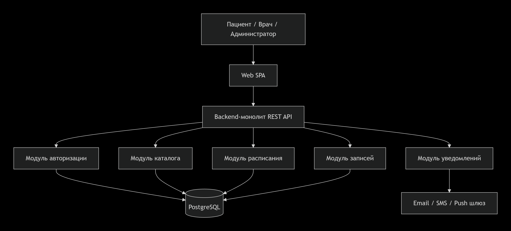
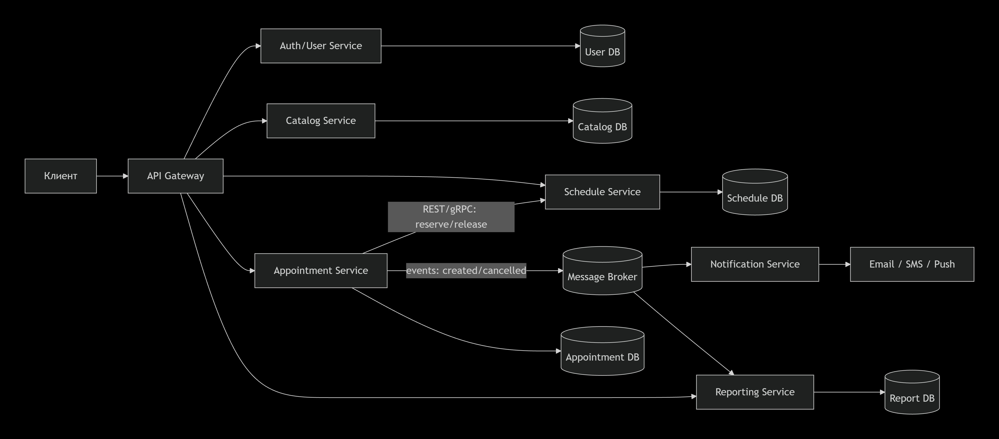
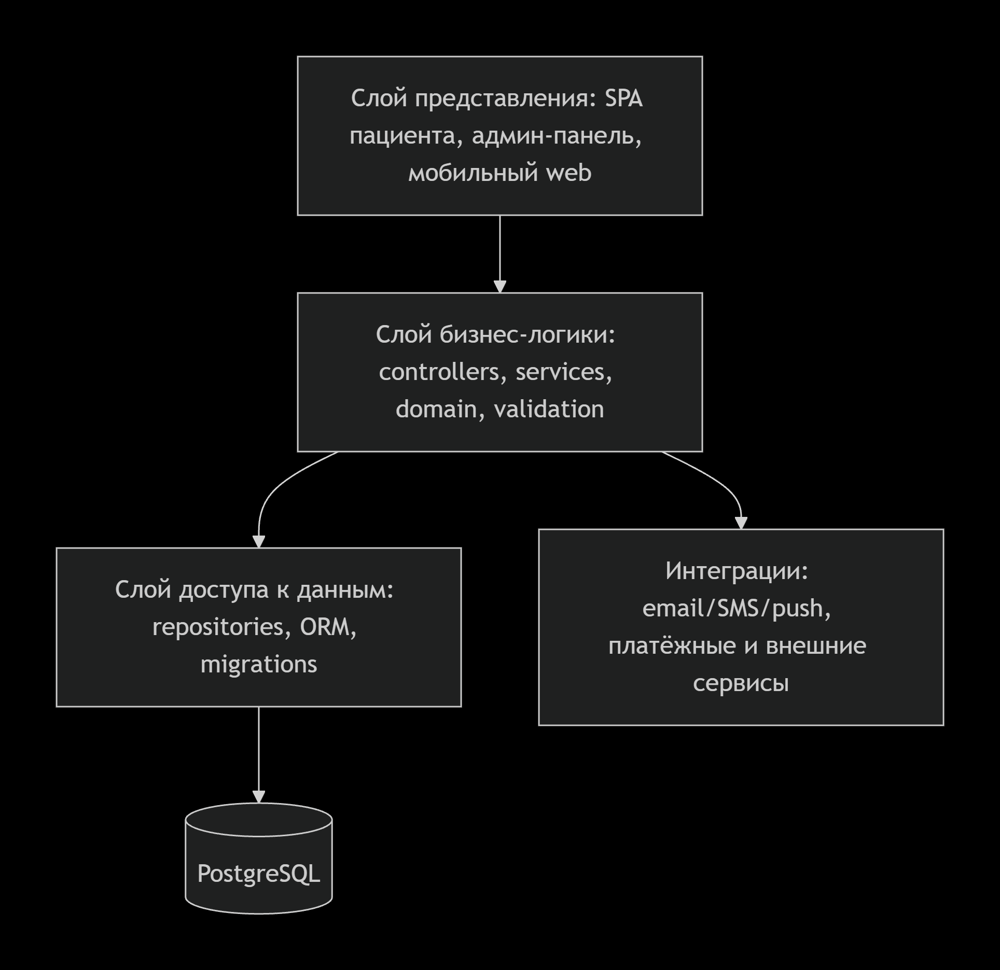
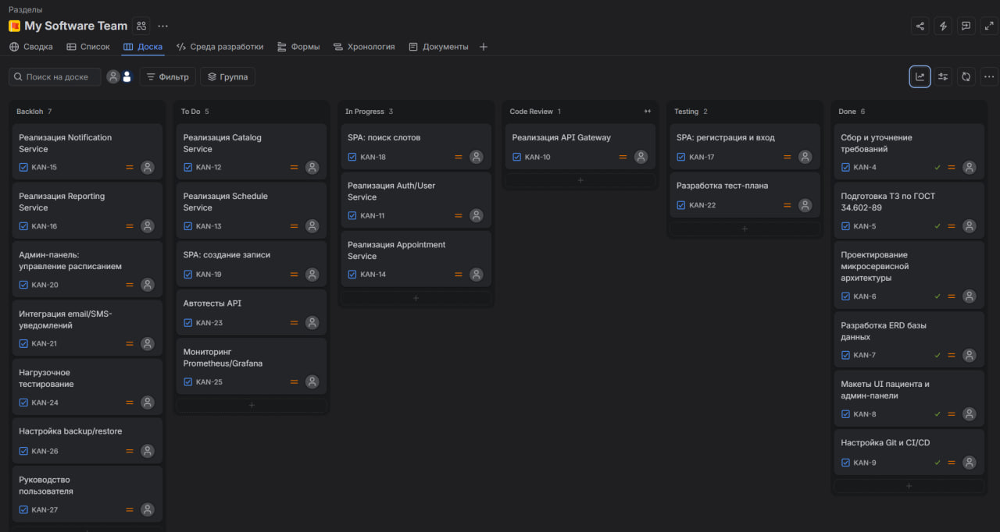

# ЛАБОРАТОРНАЯ РАБОТА 1

**Дисциплина:** Архитектура, проектирование и ППС  
**Тема:** Анализ требований, выбор архитектуры программного обеспечения и организация командной разработки

**Выполнил:** Сауленко Егор Эрастович
**Группа:** ПВ-232 

---

## Цель работы

Получить практические навыки анализа требований к программному обеспечению, проектирования архитектуры информационной системы, формирования команды разработки и распределения задач между участниками проекта.

---

# Задание 1. Описание проекта

1. **Название проекта:** MedSlot - сервис онлайн-записи на приём в клинику.
2. **Назначение системы:** автоматизация записи пациентов на приём к врачам, управление расписанием врачей и уведомление участников записи.
3. **Целевая аудитория:**
   - пациенты;
   - врачи;
   - администраторы клиники;
   - сотрудники регистратуры.
4. **Основные проблемы, которые решает система:**
   - длительное ожидание при записи по телефону;
   - двойные записи на один слот;
   - отсутствие у пациента актуальной информации о свободных слотах;
   - ручное управление расписанием врачей;
   - необходимость напоминаний о приёме;
   - низкая прозрачность загрузки врачей.
5. **Основные функции системы:**
   - регистрация и авторизация пользователей;
   - просмотр каталога клиник, врачей и услуг;
   - поиск свободных слотов;
   - создание, перенос и отмена записи;
   - управление расписанием врача;
   - уведомления пациентам и врачам;
   - просмотр истории записей;
   - формирование отчётов по загрузке.
6. **Предполагаемые условия эксплуатации:**
   - работа через веб-браузер и мобильное веб-устройство;
   - круглосуточный доступ, кроме регламентных работ;
   - развёртывание в облачной или корпоративной среде;
   - хранение персональных данных в соответствии с требованиями безопасности;
   - русскоязычный интерфейс.

---

# Задание 2. Формирование требований

## 2.1. Функциональные требования

| ID | Название | Описание | Пользователь | Ожидаемый результат |
|---|---|---|---|---|
| FR-01 | Регистрация и авторизация | Пользователь создаёт аккаунт и входит в систему | Пациент | Создан аккаунт, открыт личный кабинет |
| FR-02 | Просмотр каталога | Просмотр клиник, врачей, специальностей и услуг | Пациент | Отображается список с фильтрами |
| FR-03 | Поиск свободных слотов | Поиск слотов по врачу, дате и услуге | Пациент | Отображаются доступные слоты |
| FR-04 | Создание записи | Пациент выбирает слот и подтверждает запись | Пациент | Запись создана, слот занят |
| FR-05 | Отмена и перенос записи | Пациент отменяет или переносит запись | Пациент | Статус записи изменён, слот освобождён |
| FR-06 | Управление расписанием | Врач или администратор настраивает рабочие часы и слоты | Врач, администратор | Расписание сохранено |
| FR-07 | Подтверждение записи администратором | Администратор подтверждает или отменяет запись | Администратор | Статус записи обновлён |
| FR-08 | Уведомления | Отправка email/SMS/push-уведомлений о записи | Система | Пользователь получает уведомление |
| FR-09 | История записей | Просмотр активных и завершённых записей | Пациент | Отображается история |
| FR-10 | Отчёт по загрузке | Формирование отчёта по загрузке врачей | Администратор | Отчёт сформирован и выгружен |

## 2.2. Нефункциональные требования

| Категория | Требование |
|---|---|
| Надёжность | Доступность не ниже 99,5%; ежедневное резервное копирование; исключение двойного бронирования; восстановление после сбоя не более 4 часов |
| Производительность | Загрузка страницы не более 2 с; p95 ответа API не более 500 мс; создание записи не более 3 с; поддержка не менее 1000 одновременных пользователей |
| Безопасность | HTTPS/TLS; аутентификация по JWT/OAuth 2.0; ролевая модель доступа; хеширование паролей; журналирование действий; защита персональных данных |
| Масштабируемость | Горизонтальное масштабирование сервисов; stateless-компоненты; репликация БД; использование очередей сообщений |
| Условия эксплуатации | Работа 24/7; поддержка современных браузеров; адаптивный интерфейс; мониторинг и логирование; развёртывание через Docker/Kubernetes |

---

# Задание 3. Проектирование архитектуры

## 3.1. Монолитная архитектура

**Основные компоненты:**
- веб-интерфейс SPA;
- backend-монолит;
- модуль авторизации;
- модуль каталога;
- модуль расписания;
- модуль записей;
- модуль уведомлений;
- БД PostgreSQL;
- внешние шлюзы email/SMS/push.

**Принцип взаимодействия:** SPA обращается к REST API монолита; внутри монолита модули вызывают друг друга напрямую; данные хранятся в единой БД.

**Хранение данных:** единая реляционная БД PostgreSQL.

**Развёртывание:** один backend-контейнер, статические файлы SPA, отдельный контейнер БД.

**Преимущества:** простота разработки, быстрый старт, низкая стоимость инфраструктуры, проще тестировать.  
**Недостатки:** сложнее масштабировать отдельные модули, рост связности, риск долгих релизов.

**Схема монолитной архитектуры:**

## 3.2. Микросервисная архитектура

| Сервис | Назначение | Основные функции | Данные | Взаимодействие |
|---|---|---|---|---|
| API Gateway | Единая точка входа | Маршрутизация, авторизация запросов, rate limiting | Кэш маршрутов, токены | REST к сервисам |
| Auth/User Service | Пользователи и доступ | Регистрация, вход, роли, профиль | Пользователи, роли, сессии | REST/gRPC, JWT |
| Catalog Service | Каталог клиники | Клиники, врачи, услуги, цены | Клиники, врачи, услуги | REST через Gateway |
| Schedule Service | Расписание | Рабочие часы, слоты, блокировки | Расписание, слоты | REST/gRPC с Appointment |
| Appointment Service | Записи | Создание, перенос, отмена записей | Записи, статусы | REST/gRPC к Schedule; события в очередь |
| Notification Service | Уведомления | Шаблоны, отправка, статусы доставки | Шаблоны, outbox, статусы | События из очереди |
| Reporting Service | Отчётность | Отчёты по загрузке, выгрузка | Агрегированные данные | События, read-replica |

**Схема микросервисной архитектуры:**

## 3.3. Многослойная архитектура

**Слой представления:** SPA пациента, админ-панель, адаптивный мобильный интерфейс. Отвечает за отображение и ввод данных.

**Слой бизнес-логики:** REST-контроллеры, сервисы, доменные правила, валидация, проверка занятости слота, управление статусами записи.

**Слой доступа к данным:** репозитории, ORM, миграции, SQL-запросы.

**Взаимодействие:** слой представления вызывает API; контроллеры передают запросы в сервисы; сервисы используют репозитории; репозитории обращаются к БД.

**Схема многослойной архитектуры:**

---

# Задание 4. Техническое задание

## 1. Введение

Настоящее техническое задание определяет требования к разработке информационной системы **«MedSlot - сервис онлайн-записи на приём в клинику»**. Система предназначена для автоматизации записи пациентов, управления расписанием врачей и уведомления участников записи.

## 2. Основания для разработки

Основанием для разработки является учебное задание по дисциплине «Архитектура, проектирование и ППС», а также условные требования заказчика - клиники, которой требуется онлайн-сервис записи на приём.

## 3. Назначение и цели создания системы

**Назначение:** предоставить пациентам возможность онлайн записываться на приём, а сотрудникам клиники - управлять расписанием и записями.

**Цели:**
- снизить нагрузку на регистратуру;
- исключить двойные записи;
- повысить доступность записи;
- автоматизировать уведомления;
- получать отчётность по загрузке врачей.

## 4. Требования к системе

### 4.1. Функциональные требования

Система должна обеспечивать выполнение требований FR-01–FR-10:
- регистрация и авторизация;
- просмотр каталога клиник, врачей и услуг;
- поиск свободных слотов;
- создание записи;
- отмена и перенос записи;
- управление расписанием;
- подтверждение и отмена записи администратором;
- уведомления;
- история записей;
- отчёты по загрузке.

### 4.2. Требования к надёжности

- доступность не ниже 99,5%;
- резервное копирование не реже 1 раза в сутки;
- время восстановления после сбоя - не более 4 часов;
- исключение двойного бронирования;
- журналирование критических операций.

### 4.3. Требования к производительности

- загрузка страницы - не более 2 с;
- p95 ответа API - не более 500 мс;
- создание записи - не более 3 с;
- поддержка не менее 1000 одновременных пользователей.

### 4.4. Требования к безопасности

- передача данных по HTTPS/TLS;
- аутентификация по JWT/OAuth 2.0;
- ролевая модель доступа;
- хеширование паролей;
- защита персональных данных;
- аудит действий пользователей.

### 4.5. Требования к условиям эксплуатации

- работа 24/7;
- поддержка современных браузеров;
- адаптивный интерфейс;
- развёртывание через Docker/Kubernetes;
- мониторинг, логирование и оповещение.

## 5. Состав и содержание работ

| Этап | Основные работы | Ожидаемый результат |
|---|---|---|
| Анализ требований | Сбор и согласование требований | ТЗ, user stories |
| Проектирование | Архитектура, ERD, API | Архитектурная документация, OpenAPI |
| Разработка backend | Сервисы авторизации, каталога, расписания, записей | Работающие API |
| Разработка frontend | SPA пациента и админ-панель | Пользовательский интерфейс |
| Интеграции | Уведомления, внешние шлюзы | Интеграционные модули |
| Тестирование | Функциональное, нагрузочное, безопасности | Тест-отчёты |
| Развёртывание | CI/CD, окружения, мониторинг | Работающий стенд |
| Документирование | Руководства, API, схема БД | Комплект документации |

## 6. Порядок контроля и приёмки

Контроль осуществляется по чек-листам функциональных требований, API-тестам, нагрузочным тестам и UAT. Критерии приёмки:
- все FR-01–FR-10 выполнены;
- критические дефекты отсутствуют;
- производительность соответствует NFR;
- безопасность проверена;
- заказчик подтвердил результат на демонстрации.

## 7. Требования к составу и содержанию документации

Должны быть подготовлены:
- техническое задание;
- архитектурная схема;
- ERD базы данных;
- OpenAPI-спецификация;
- тест-план и тест-кейсы;
- руководство пользователя;
- руководство администратора;
- инструкция по развёртыванию;
- отчёт о тестировании.

## 8. Источники разработки

- ГОСТ 34.602-89;
- учебное задание по дисциплине;
- требования условного заказчика;
- OpenAPI Specification;
- внутренние стандарты команды разработки.

---

# Задание 5. Формирование команды разработки

| Роль | Основные обязанности | Задачи, за которые отвечает | Результат работы |
|---|---|---|---|
| Руководитель проекта | Планирование, контроль сроков, риски, коммуникация | Roadmap, backlog, отчёты, приёмка | План проекта, статус-отчёты |
| Системный аналитик | Сбор требований, описание процессов, API | ТЗ, user stories, OpenAPI, ERD | Согласованные требования и документация |
| Frontend-разработчик | Разработка SPA пациента и админ-панели | Экран регистрации, поиск слотов, запись, админка | Готовый интерфейс |
| Backend-разработчик | Разработка сервисов и API | Auth, Catalog, Schedule, Appointment | Работающие backend-сервисы |
| Разработчик БД | Схема БД, миграции, оптимизация запросов | ERD, индексы, резервное копирование | Схема БД и миграции |
| Тестировщик | Тест-план, тест-кейсы, дефекты | Функциональные и API-тесты | Тест-отчёты, баг-репорты |
| DevOps-инженер | CI/CD, окружения, мониторинг | Docker, Kubernetes, Prometheus/Grafana | Пайплайны и стенды |

Состав команды соответствует микросервисной архитектуре: backend-разработчик отвечает за сервисы, DevOps - за развёртывание и мониторинг, аналитик - за контракты API и требования.

---

# Задание 6. Организация доски задач

## Этапы доски

| Этап | Описание |
|---|---|
| **Backlog** | все запланированные задачи |
| **To Do** | задачи, готовые к выполнению |
| **In Progress** | задачи в работе |
| **Code Review** | задачи на проверке |
| **Testing** | задачи на тестировании |
| **Done** | завершённые задачи |

## Скриншот доски задач

---

# Заключение

В ходе лабораторной работы был выбран проект информационной системы «MedSlot», описаны его назначение, аудитория, проблемы и функции. Сформированы функциональные и нефункциональные требования. Рассмотрены монолитная, микросервисная и многослойная архитектуры, приведены схемы и описания компонентов. Подготовлено техническое задание по структуре ГОСТ 34.602-89. Определён состав команды разработки и распределены роли. Составлена Kanban-доска из 24 задач. Получены практические навыки анализа требований, проектирования архитектуры и организации командной разработки.