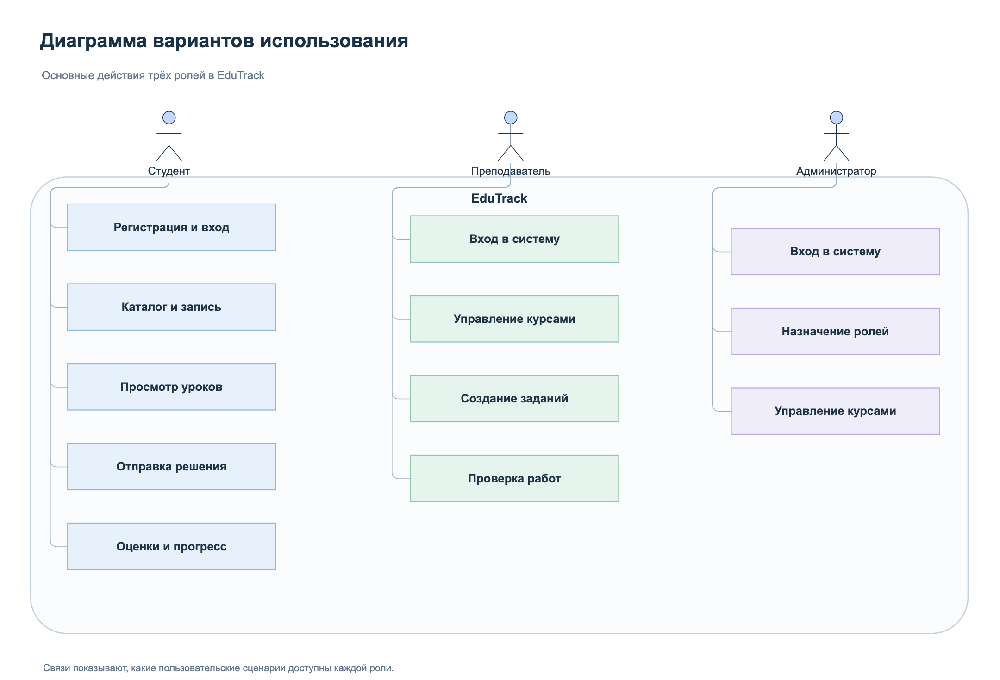
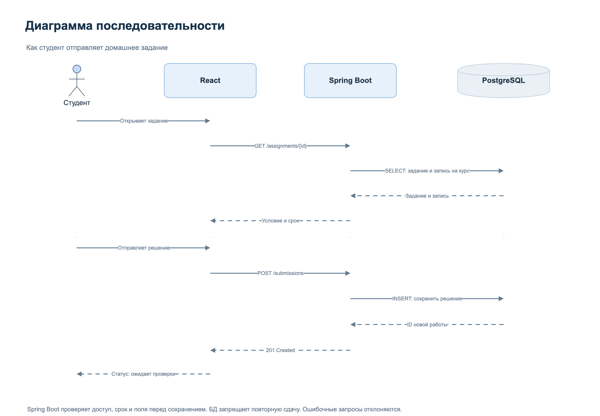
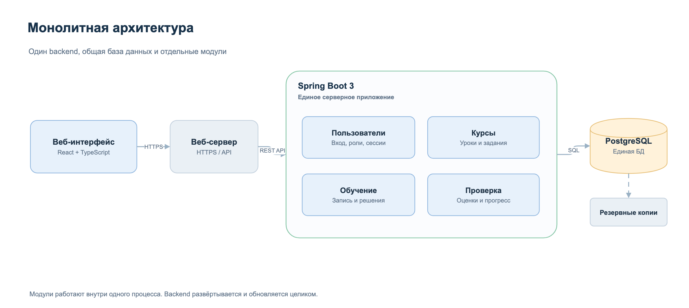
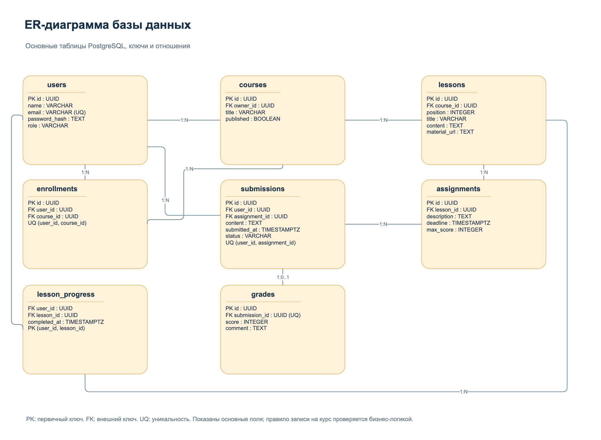
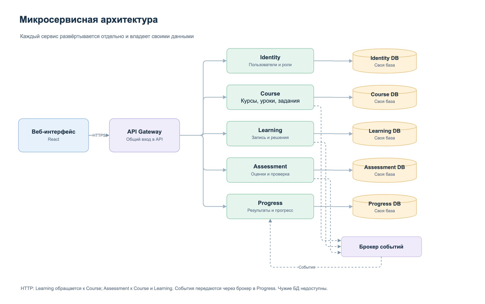
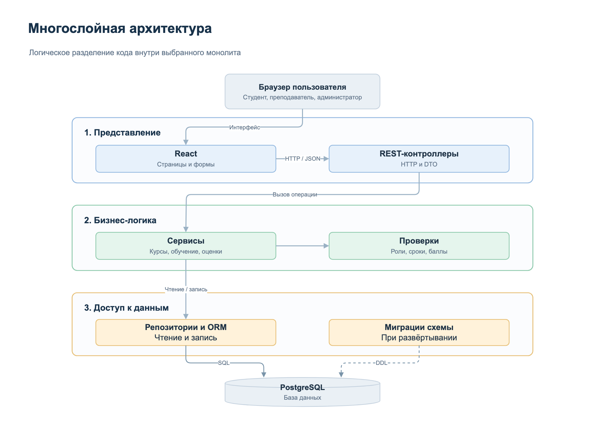
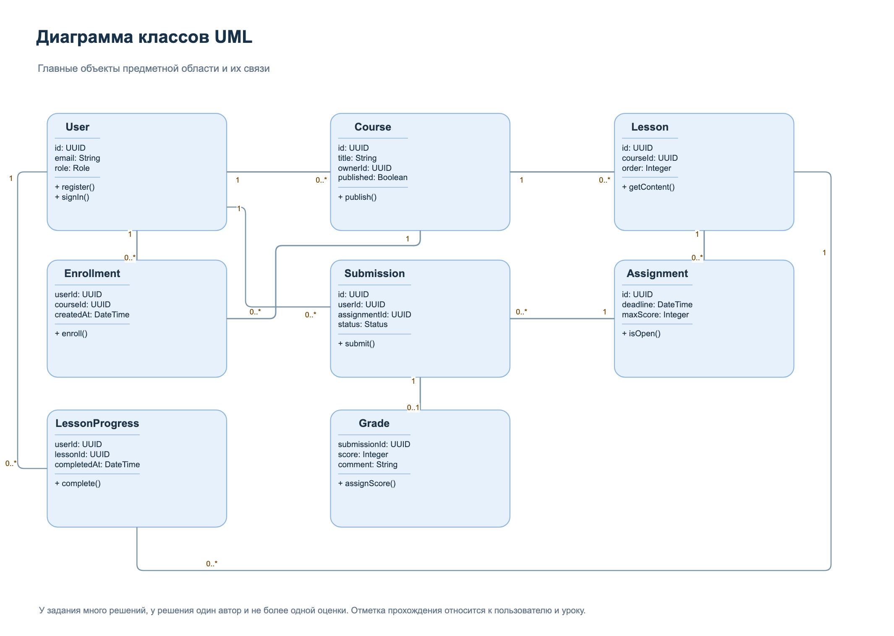
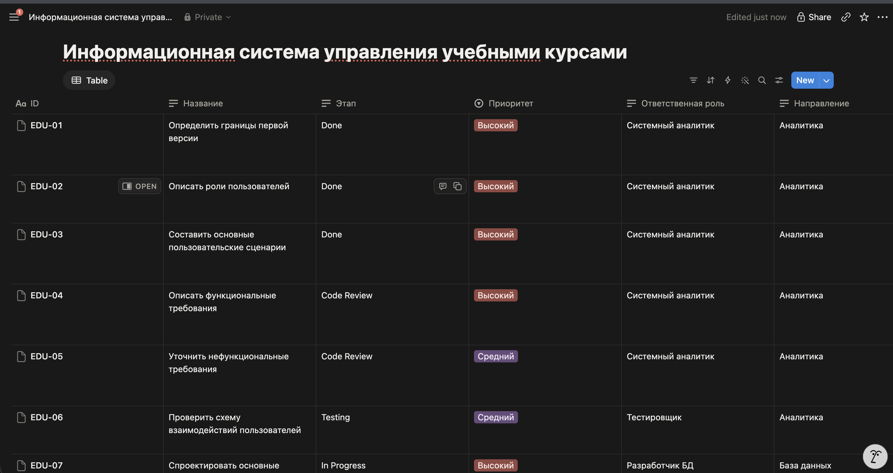
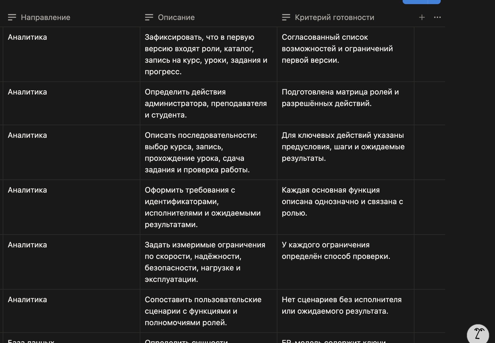
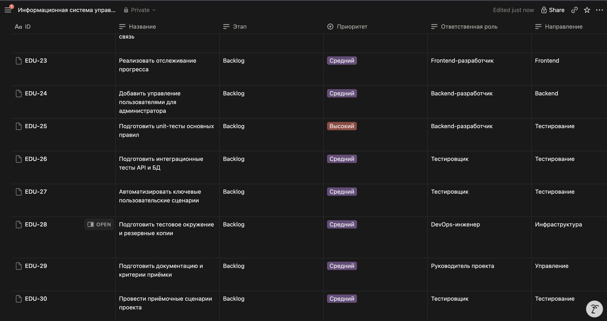

# Лабораторная работа. Проектирование информационной системы EduTrack

**Дисциплина:** Архитектура, проектирование и ППС  
**Тема:** Анализ требований, выбор архитектуры и организация командной разработки  
**Выполнил:** Прядко Б. В., ПВ-232  
**Год:** 2026

## 1. Цель работы

Разобрать требования к учебной платформе, сравнить архитектуры, составить ТЗ и спланировать работу команды.

## 2. Описание проекта

Для работы я выбрал **EduTrack**, систему управления учебными курсами. Сейчас материалы, задания и оценки часто хранятся в разных местах. В EduTrack студент сможет изучать материалы и сдавать задания, а преподаватель проверять их в одном приложении.

Система рассчитана на три роли:

- **Студент** ищет курс, записывается, открывает уроки, отправляет задания и смотрит результаты.
- **Преподаватель** создаёт курсы, публикует материалы, задаёт домашнюю работу и выставляет оценки.
- **Администратор** управляет пользователями, назначает преподавателей и следит за курсами.

Предполагаю использование в небольшой образовательной организации: около 2 000 пользователей, до 200 курсов и до 100 одновременно работающих человек. Доступ будет через браузер на компьютере или телефоне. В первой версии не планирую оплату, видеозвонки и загрузку файлов. Материалы и ответы можно передавать текстом или ссылкой.

Для проекта выбрал **React и TypeScript** на клиенте, **Java 21 и Spring Boot 3** на сервере, **PostgreSQL** для хранения данных. Сервер планирую разместить на Linux, доступ организовать по HTTPS.

*Рисунок 1. Основные действия пользователей.*

## 3. Требования к системе

### 3.1. Функциональные требования

| ID | Функция | Что должно работать | Пользователь | Ожидаемый результат |
|---|---|---|---|---|
| FR-01 | Регистрация | Создать аккаунт по имени, email и паролю | Гость | Аккаунт студента создан, повторный email отклонён |
| FR-02 | Вход и выход | Войти по паролю и завершить сеанс | Все пользователи | Открыт личный кабинет, после выхода доступ закрыт |
| FR-03 | Управление пользователями | Просмотреть пользователей и назначить роль преподавателя | Администратор | Роль сохранена; другим пользователям назначение прав недоступно |
| FR-04 | Управление курсами | Преподаватель создаёт курс; владелец или администратор изменяет и публикует его | Преподаватель, администратор | Черновик скрыт от студентов, опубликованный курс появился в каталоге |
| FR-05 | Каталог и поиск | Открыть описание опубликованного курса, найти курс по части названия | Гость, все пользователи | Показаны подходящие курсы; регистр букв не влияет на поиск |
| FR-06 | Запись на курс | Записаться на опубликованный курс | Студент | Курс появился в личном кабинете без повторной записи |
| FR-07 | Управление уроками | Добавить и изменить текст урока, ссылки и порядок уроков | Преподаватель | Урок сохранён в нужном курсе |
| FR-08 | Прохождение урока | Открыть урок и отметить его изученным | Студент курса | Отметка отражается в прогрессе |
| FR-09 | Домашние задания | Указать условие, срок и максимальный балл | Преподаватель | Задание доступно студентам курса |
| FR-10 | Отправка работы | Сдать непустой текст или ссылку не позднее срока | Студент курса | Сохранена одна работа со статусом «Ожидает проверки» |
| FR-11 | Проверка работ | Поставить оценку и оставить комментарий | Преподаватель | Работа получила статус «Проверено», студент видит балл и комментарий |
| FR-12 | Прогресс | Посмотреть пройденные уроки и оценки | Студент, преподаватель | Отображаются актуальные результаты с учётом прав |

Права проверяются на сервере. Преподаватель управляет своими курсами и видит результаты их студентов; студент открывает уроки после записи и видит только свои работы. Администратор назначает роли и управляет любым курсом. При регистрации создаётся только роль студента. Повторная запись и повторная сдача задания запрещены. Максимум задания положительный; оценка целая, от 0 до максимума.

Прогресс считаю как долю отмеченных уроков от общего числа уроков курса, с округлением до целого процента. Если уроков нет, прогресс равен 0%. Сданные задания и оценки показываются отдельно. Простое открытие урока не считается прохождением.

*Рисунок 2. Как студент отправляет домашнее задание.*

### 3.2. Нефункциональные требования

| ID | Область | Требование | Как проверить |
|---|---|---|---|
| NFR-01 | Надёжность | Доступность не ниже 99,5% за месяц, включая плановые остановки | Мониторинг каждую минуту в течение календарного месяца |
| NFR-02 | Восстановление | Копия БД раз в сутки, хранение 14 дней вне сервера БД; потеря данных не более суток, восстановление за 4 часа | Восстановить копию на отдельном стенде, сверить данные и замерить время |
| NFR-03 | Производительность | При 100 активных пользователях и 20 запросах/с 95% ответов API не дольше 2 с, ошибок 5xx менее 1% | Нагрузочный прогон 30 минут после 5 минут прогрева |
| NFR-04 | Безопасность | HTTPS, bcrypt для паролей, серверная проверка ролей и владельца объекта, CSRF-защита | Проверки входа, чужих ID и запросов без CSRF-токена; осмотр cookie и хешей |
| NFR-05 | Целостность | Нет дублей записей и решений; балл в допустимом диапазоне; связанные изменения атомарны | Одновременные запросы, граничные баллы и принудительный откат транзакции |
| NFR-06 | Масштабируемость | Два экземпляра backend с общей БД и сессиями в PostgreSQL, без изменения правил системы | Переключать запросы одной сессии между экземплярами |
| NFR-07 | Эксплуатация | Linux, секреты вне кода, инструкция запуска и восстановления; две последние стабильные версии Chrome, Firefox, Edge и Safari на дату приёмки | Чистое развёртывание по инструкции и проверки в браузерах |
| NFR-08 | Интерфейс | Русский язык, ширина от 360 px | Проверить вход, каталог, сдачу и оценивание на узком экране |

Для нагрузочной проверки планирую 2 000 пользователей, 200 курсов и 100 000 решений, 80% запросов на чтение и 20% на запись. Базовый стенд: отдельно backend и PostgreSQL, каждому по 4 vCPU и 8 ГБ ОЗУ, БД на SSD. Время нужно измерять со стороны клиента в той же сети; загрузка внешних материалов не учитывается.

## 4. Монолитная архитектура

В монолитном варианте весь backend запускается как одно Spring Boot-приложение. Я разделил его внутри на модули пользователей, курсов, обучения и оценивания. Модули вызывают публичные методы друг друга внутри процесса, а данные хранятся в общей PostgreSQL. React остаётся отдельной клиентской частью.

*Рисунок 3. Монолитная архитектура EduTrack.*

Для развёртывания нужны веб-сервер, приложение и база данных. При обновлении серверной части выпускается одна сборка. Плюсы такого подхода: проще запускать, искать ошибки и работать с общими транзакциями. Минусы: обновлять приходится весь backend, модули нельзя масштабировать отдельно, а сбой процесса может остановить всю систему.

Ниже показал данные, которые понадобятся для курсов, уроков, записей и оценок. В таблицах используются первичные и внешние ключи. Решение связано с автором и заданием, отметка прохождения с пользователем и уроком. Для записи уникальна пара «студент, курс», для решения пара «студент, задание».

*Рисунок 4. ER-диаграмма основных таблиц.*

## 5. Микросервисная архитектура

Для сравнения я рассмотрел разделение приложения на пять сервисов. У каждого будет собственное хранилище и отдельное развёртывание. Запросы от клиента проходят через API Gateway. Для синхронных действий используются HTTP API, для прогресса события через брокер. Сервисы не обращаются к чужим БД.

| Сервис | Назначение и функции | Какие данные хранит | Взаимодействие |
|---|---|---|---|
| Identity | Регистрация, вход, выход, роли | Пользователи, хеши паролей и сеансы | Gateway проверяет сессию через API; сервисы проверяют права на объект |
| Course | Каталог, публикация, уроки и задания | Курсы, владельцы, материалы, задания и сроки | API для Gateway, Learning и Assessment; события состава курса для Progress |
| Learning | Запись, прохождение уроков, сдача работ | Записи, отметки, отправленные решения | API для Gateway и Assessment, запросы к Course; события для Progress |
| Assessment | Проверка и оценивание | Баллы, комментарии, история оценок | API для Gateway, запросы к Course и Learning; события для Progress |
| Progress | Вывод результатов обучения | Копии состава курса, записей, отметок и оценок | Получает события от Course, Learning и Assessment; отвечает Gateway по API |

*Рисунок 5. Вариант с отдельными сервисами.*

Преимущество микросервисов в том, что части системы можно обновлять и масштабировать независимо. Но появляется больше сетевых запросов, сложнее обеспечивать согласованность данных и нужно сопровождать несколько приложений. Gateway, сервисы, брокер и базы развёртываются отдельно, для каждого хранилища нужны копии. События могут задерживаться и повторяться, поэтому нужны обработка дублей и восстановление доставки. В этом варианте прогресс обновляется с задержкой, в монолите читается из общей БД. Для первой версии EduTrack это избыточно.

## 6. Многослойная архитектура

Многослойная архитектура показывает, как организован **код**, а не сколько приложений запущено. Её можно использовать и в монолите.

| Слой | Компоненты | За что отвечает |
|---|---|---|
| Представление | React, формы, REST-контроллеры | Общение с пользователем и приём запросов |
| Бизнес-логика | Сервисы курсов, обучения и оценок | Проверка прав и правил, выполнение операций |
| Доступ к данным | Репозитории, ORM, миграции | Чтение и запись в PostgreSQL |

*Рисунок 6. Три слоя приложения.*

Например, при сдаче работы контроллер принимает запрос, сервис проверяет запись на курс и срок, а репозиторий сохраняет результат. Контроллер не обращается к БД напрямую. Ответ возвращается через сервис и контроллер. Слои упрощают проверку правил и сопровождение, но требуют соблюдать границы; изменение данных иногда затронет все три слоя. Хранение и развёртывание остаются монолитными.

*Рисунок 7. Классы пользователей, курсов и учебных результатов.*

**Мой выбор:** модульный монолит с разделением на три слоя. Для пяти человек и 100 активных пользователей он проще в сопровождении, а общая БД позволяет сохранять записи и оценки транзакционно. Многослойность разделяет обязанности кода. Выделение сервисов рассмотрю, если измерения покажут такую необходимость.

## 7. Состав команды разработки

Для реализации EduTrack я бы собрал команду из пяти человек. Руководство совмещаю с аналитикой, backend с разработкой БД.

| Участник | Роль | Основные обязанности и задачи | Результат работы |
|---|---|---|---|
| У1 | Руководитель проекта, системный аналитик | Планирование, требования, ТЗ, согласование задач EDU-01...05, EDU-29 | Требования, план и документация |
| У2 | Backend-разработчик, разработчик БД | API, логика, таблицы, миграции, задачи EDU-07, 08, 11, 13, 16...18, 20, 22, 24, 25 | Backend, БД, unit-тесты |
| У3 | Frontend-разработчик | Интерфейс всех ролей, задачи EDU-09, 15, 19, 21, 23 | Страницы и интеграция с API |
| У4 | Тестировщик | Сценарии, проверки API и интерфейса, задачи EDU-06, 10, 14, 26, 27, 30 | Тест-кейсы и результаты проверок |
| У5 | DevOps-инженер | CI, тестовый стенд, резервные копии, задачи EDU-12, 28 | Среда запуска и инструкция развёртывания |

## 8. Распределение ответственности

Я распределил основные направления следующим образом. За требования и итоговое согласование отвечает руководитель; за реализацию своего участка отвечает профильный разработчик. QA проверяет результат независимо от автора.

| Направление | Кто отвечает | Кто участвует |
|---|---|---|
| Требования, ТЗ и план | У1 | У2, У3, У4 |
| Архитектура и API | У2 | У1, У3 |
| База данных и backend | У2 | У5, У4 |
| Интерфейс | У3 | У2, У4 |
| Проверка системы | У4 | У2, У3 |
| CI, окружение, копии | У5 | У2, У4 |
| Приёмка | У1 | Вся команда |

Изменение проверяет другой участник: backend смотрит У5 при наличии опыта Java, frontend и инфраструктуру У2. QA проверяет критерии на отдельном стенде. При ошибке задача возвращается в работу. Для EDU-21 и EDU-23 У2 готовит API, У3 отвечает за интерфейс и интеграцию.

## 9. Kanban-доска

Для задач выбрал **Notion**. В CSV подготовлены 30 карточек с описанием, приоритетом, ролью и критерием готовности. Статусы отражают учебный план работ.

**Ссылка на доску Notion:** _не указана._

*Рисунок 8. Задачи, роли и статусы в Notion.*

*Рисунок 9. Описания задач и критерии готовности.*

*Рисунок 10. Заключительная часть списка задач.*

| Этап | Что означает | Задач |
|---|---|---:|
| Backlog | Задачи, которые запланированы на будущее | 13 |
| To Do | Задачи, готовые к началу работы | 5 |
| In Progress | Исполнитель работает над задачей | 3 |
| Code Review | Другой участник проверяет изменение или документ | 3 |
| Testing | Проверяется результат работы | 3 |
| Done | Задача принята по критерию готовности | 3 |

Для доски предусмотрен вид Board с группировкой по свойству «Этап». В работу берётся задача с понятным критерием готовности, в Done она переходит после ревью и проверки. Для документов проверяются полнота и согласованность.

### Задачи EduTrack

Полные описания и критерии готовности доступны в файле [kanban_uchebnye_kursy_notion.csv](kanban_uchebnye_kursy_notion.csv).

| ID | Задача | Ответственный | Статус |
|---|---|---|---|
| EDU-01 | Определить границы первой версии | Системный аналитик | Done |
| EDU-02 | Описать роли пользователей | Системный аналитик | Done |
| EDU-03 | Составить основные пользовательские сценарии | Системный аналитик | Done |
| EDU-04 | Описать функциональные требования | Системный аналитик | Code Review |
| EDU-05 | Уточнить нефункциональные требования | Системный аналитик | Code Review |
| EDU-06 | Проверить схему взаимодействий пользователей | Тестировщик | Testing |
| EDU-07 | Спроектировать основные таблицы базы данных | Разработчик БД | In Progress |
| EDU-08 | Подготовить контракт API авторизации и каталога | Backend-разработчик | In Progress |
| EDU-09 | Сделать прототип основных экранов | Frontend-разработчик | In Progress |
| EDU-10 | Проверить понятность навигации по прототипу | Тестировщик | Testing |
| EDU-11 | Подготовить структуру приложения и настройки сборки | Backend-разработчик | To Do |
| EDU-12 | Настроить CI для проверок изменений | DevOps-инженер | To Do |
| EDU-13 | Реализовать регистрацию и вход | Backend-разработчик | Code Review |
| EDU-14 | Проверить ограничения доступа по ролям | Тестировщик | Testing |
| EDU-15 | Реализовать каталог курсов и фильтры | Frontend-разработчик | To Do |
| EDU-16 | Реализовать управление курсами | Backend-разработчик | To Do |
| EDU-17 | Реализовать запись студента на курс | Backend-разработчик | To Do |
| EDU-18 | Добавить управление уроками и материалами | Backend-разработчик | Backlog |
| EDU-19 | Разработать страницу прохождения урока | Frontend-разработчик | Backlog |
| EDU-20 | Реализовать создание заданий | Backend-разработчик | Backlog |
| EDU-21 | Реализовать отправку решения студентом | Frontend-разработчик | Backlog |
| EDU-22 | Добавить оценивание и обратную связь | Backend-разработчик | Backlog |
| EDU-23 | Реализовать отслеживание прогресса | Frontend-разработчик | Backlog |
| EDU-24 | Добавить управление пользователями для администратора | Backend-разработчик | Backlog |
| EDU-25 | Подготовить unit-тесты основных правил | Backend-разработчик | Backlog |
| EDU-26 | Подготовить интеграционные тесты API и БД | Тестировщик | Backlog |
| EDU-27 | Автоматизировать ключевые пользовательские сценарии | Тестировщик | Backlog |
| EDU-28 | Подготовить тестовое окружение и резервные копии | DevOps-инженер | Backlog |
| EDU-29 | Подготовить документацию и критерии приёмки | Руководитель проекта | Backlog |
| EDU-30 | Провести приёмочные сценарии проекта | Тестировщик | Backlog |

## 10. Техническое задание

Техническое задание на разработку EduTrack составил на основе ГОСТ 34.602-89.

### 10.1. Введение

**Наименование:** информационная система управления учебными курсами EduTrack. Это веб-приложение для публикации курсов, обучения студентов и проверки домашних заданий. Пользователи системы: администратор, преподаватель и студент.

### 10.2. Основания для разработки

Основанием служит учебное задание по дисциплине «Архитектура, проектирование и ППС». В качестве условного заказчика рассматриваю небольшую образовательную организацию. Ей нужны каталог курсов, единое место для заданий и оценок, а также разграничение доступа. Реальный заказчик и договор не определены.

### 10.3. Назначение и цели создания системы

EduTrack должна объединить материалы и результаты студентов, упростить преподавателю проверку работ и дать администратору управление доступом. Главный сценарий: студент находит курс, записывается, проходит урок, сдаёт работу и получает оценку.

### 10.4. Требования к системе

Обязательные функции перечислены в разделе 3.1 (FR-01...FR-12), нефункциональные требования NFR-01...NFR-08 в разделе 3.2. Для первой версии важны также следующие ограничения: студент не должен видеть чужие работы, один пользователь не может дважды записаться на один курс, а балл должен находиться в диапазоне от 0 до максимума задания.

Хранение учебных данных организуется в PostgreSQL, клиент работает с backend по HTTPS. Для первой версии выбрана монолитная реализация с тремя логическими слоями, описанная в разделах 4 и 6.

### 10.5. Состав и содержание работ

| Этап | Работы | Планируемый результат |
|---|---|---|
| 1. Анализ, неделя 1 | Уточнить роли, сценарии и требования | Требования с критериями проверки и ТЗ |
| 2. Проектирование, неделя 2 | Согласовать архитектуру, БД, API и экраны | Схемы, контракт API и прототип |
| 3. Основа, неделя 3 | Настроить сборку, Stage, CI, вход и роли | Каркас приложения и отдельный тестовый стенд |
| 4. Основные функции, недели 4 и 5 | Реализовать курсы, обучение, задания и результаты | Версия с полным пользовательским сценарием |
| 5. Проверки, недели 6 и 7 | Проверить функции, права, нагрузку и восстановление, исправить дефекты | Протоколы и версия для приёмки |
| 6. Приёмка, неделя 8 | Обновить инструкции и провести демонстрацию | Документация и решение о готовности |

План рассчитан на восемь недель. Проверки идут по мере готовности функций.

### 10.6. Порядок контроля и приёмки

Разработчики сначала проверяют свои изменения, затем QA тестирует систему на Stage. Для приёмки планирую следующие проверки:

| Требования | Способ проверки | Критерий приёмки |
|---|---|---|
| FR-01...03: пользователи | API и сценарии трёх ролей: вход, выход, повторный email, смена роли | Сессия завершается, дубли и самостоятельное повышение прав запрещены |
| FR-04...08: обучение | Создать курс и урок, опубликовать, найти курс, записаться и отметить урок | Черновик скрыт, запись одна, без записи урок недоступен, отметка сохраняется |
| FR-09...11: работы | Сдать работу до и после срока, повторить отправку; выставить −1, 0, максимум и максимум + 1 | Сохранено одно допустимое решение; разрешены только баллы в диапазоне |
| FR-12: прогресс | Отметить 3 из 4 уроков и посмотреть оценку от другого студента | Прогресс 75%, чужие результаты недоступны |
| NFR-01...02: надёжность | Месячный мониторинг и восстановление копии с замером времени | Доступность ≥ 99,5%, потеря данных ≤ 24 часов, восстановление ≤ 4 часов |
| NFR-03: нагрузка | Прогон по условиям раздела 3.2 | 95% ответов ≤ 2 с, ошибок 5xx < 1% |
| NFR-04...05: защита и данные | Негативные API-запросы, конкурентная запись, откат транзакции | Нет обхода прав, дублей и частично сохранённых данных |
| NFR-06...08: эксплуатация | Два backend, чистое развёртывание, браузеры и экран 360 px | Сессия сохраняется при смене экземпляра, инструкция воспроизводима, основные формы доступны |

Для правил нужны unit-тесты, для API и БД интеграционные проверки, для полного пути пользователя E2E. QA фиксирует версию, условия, шаги и фактический результат в протоколе. У1 сверяет его с ТЗ. Если для доступности ещё нет данных за полный месяц, этот критерий остаётся неподтверждённым.

На демонстрации администратор назначает преподавателя. Преподаватель публикует курс с уроком и заданием, студент регистрируется, находит курс, записывается и сдаёт работу. Затем преподаватель ставит оценку, студент видит результат. Отдельно показываются запрет чужого доступа и протоколы испытаний. Система принимается после подтверждения всех FR и NFR, готовности документации и устранения критических ошибок: потери данных, обхода прав или невозможности пройти основной сценарий.

### 10.7. Требования к составу и содержанию документации

При разработке понадобятся следующие документы:

| Документ | Содержание |
|---|---|
| ТЗ и архитектура | Требования, модули, взаимодействия и ограничения |
| Модель БД и контракт API | Сущности, связи, поля, запросы, ответы и ошибки |
| Руководство пользователя | Основные действия трёх ролей |
| Инструкция эксплуатации | Запуск, секреты, обновление, резервирование и восстановление |
| Методика и протокол испытаний | Условия, шаги, ожидаемые и фактические результаты, дефекты и решение о приёмке |

### 10.8. Источники разработки

- [Total.md](Total.md), исходное задание лабораторной.
- ГОСТ 34.602-89, стандарт, указанный в задании для оформления ТЗ.
- [CSV задач](kanban_uchebnye_kursy_notion.csv), исходные 30 карточек.
- [Диаграммы EduTrack](edutrack_diagrams/).

## 11. Заключение

При проектировании EduTrack я связал действия трёх ролей в общий процесс: преподаватель публикует курс, студент проходит уроки и сдаёт задания, а результаты проверки отражаются в его прогрессе. Это помогло определить, какие данные нужны системе и где важно проверять права, сроки и допустимые оценки.

Для первой версии выбрал модульный монолит с тремя слоями. Он позволяет сохранить общие транзакции и понятное развёртывание, а разделение на модули и слои помогает распределить работу небольшой команды. Микросервисы дают независимое масштабирование, но для выбранной нагрузки добавляют слишком много задач по обмену данными и сопровождению.

В ходе работы я увидел, как требования влияют на архитектуру и план команды. Диаграммы помогли проверить связи между частями системы, ТЗ закрепило ожидаемое поведение, а 30 задач для Notion разделили проект на конкретные шаги с ответственными и критериями готовности.
