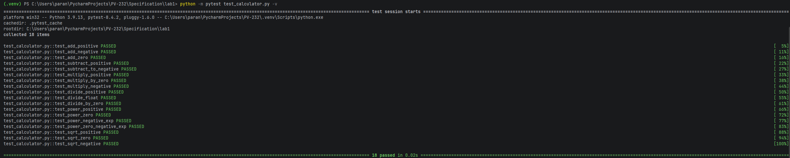
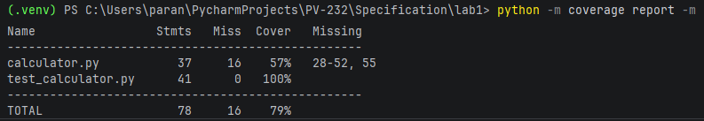
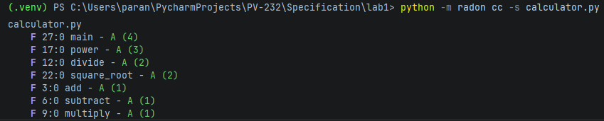
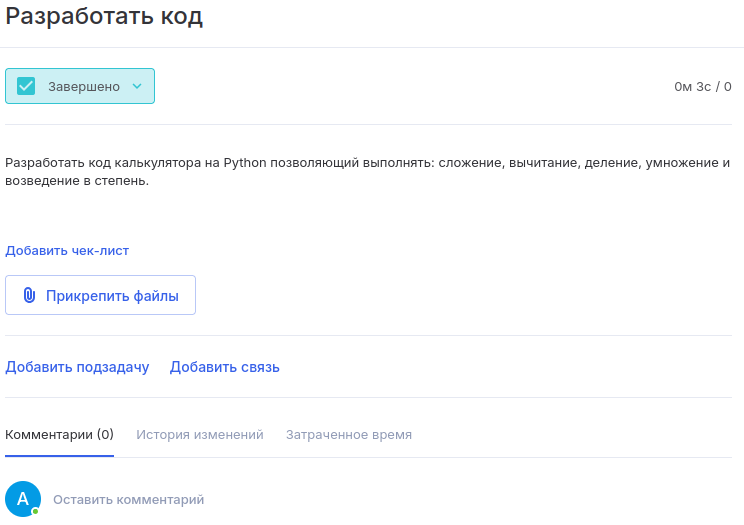
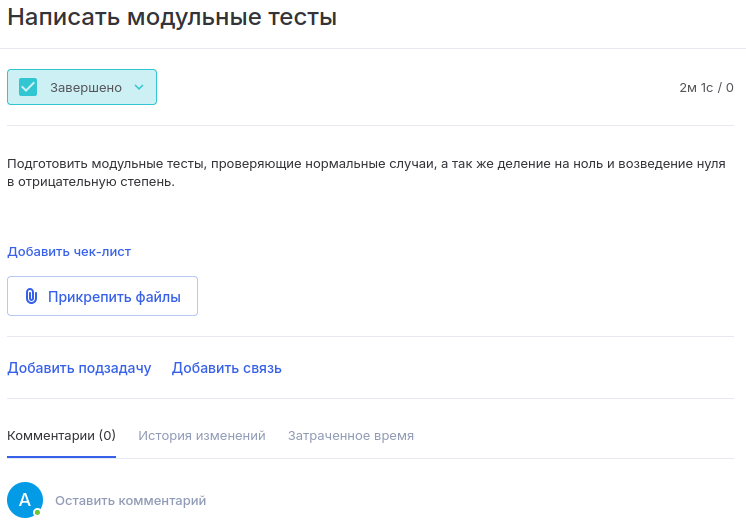
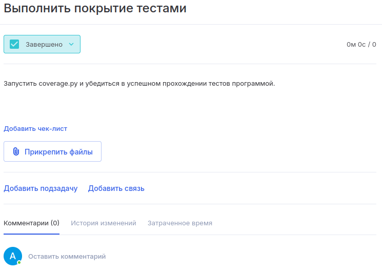
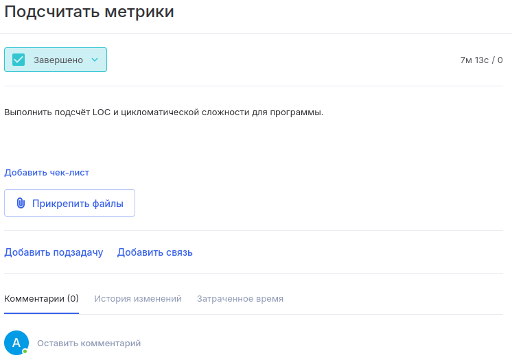

# Лабораторная работа

**Тема:** Критерии качества ПО: сложность, корректность, надёжность, трудоёмкость. Оценка качества ПО.

**Цель:** Освоить практические методы оценки качества и метрик программного обеспечения.

## Задания

### Часть 1. Теоретическая

1. Опишите 3 наиболее значимые проблемы, возникающие при разработке сложных программных систем.
2. Составьте таблицу: «Проблема → Возможное решение → Инструменты/методы».

### Часть 2. Практическая

1. Создайте тестовый проект на Python (например, калькулятор).
2. Создайте задачи для проекта в Аспро (или другой системе трекинга).
3. Покройте код тестами (Unit tests).
4. Зафиксируйте покрытие тестами кода (например, с помощью coverage.py).
5. Возьмите небольшой программный проект (учебное консольное приложение или открытый код с GitHub).
6. Определите размер ПО (LOC).
7. Рассчитайте цикломатическую сложность одной из функций (можно использовать `radon cc -s calculator`).
8. Оцените дефектность (если есть баг-репорты или замечания).
9. Составьте итоговую таблицу метрик проекта, включающую:
   - размер (LOC),
   - сложность (цикломатическая),
   - качество (дефекты),
   - время реакции (если есть возможность),
   - процент покрытия тестами.

## Напоминание формулы цикломатической сложности

\[
V(G) = E - N + 2P
\]

где:

- \(E\) — количество рёбер графа потока управления,
- \(N\) — количество узлов (блоков кода),
- \(P\) — количество компонент (обычно = 1).

Более простое правило:

\[
V(G) = \text{количество условий} + 1
\]

---

## Выполнение

### Выполнил: Смольяков А. В. ПВ-232

### Часть 1

**3 наиболее значимые проблемы:**

1. **Архитектурная сложность** — по мере развития системы количество модулей, интеграций и зависимостей растёт нелинейно, из-за чего изменения в одном месте непредсказуемо влияют на другие, а систему становится трудно понимать и сопровождать.

2. **Обеспечение качества и тестируемость** — сложные системы имеют множество сценариев, состояний и внешних интеграций; полное покрытие тестами дорого, а дефекты проявляются на поздних этапах, когда исправление стоит на порядок дороже.

3. **Управление требованиями и коммуникация в распределённой команде** — размытые или меняющиеся требования, разнородные команды и подрядчики приводят к несоответствию ожиданий и результата, дублированию работы и накоплению технического долга.

**Таблица «Проблема → Возможное решение → Инструменты/методы»:**

| Проблема | Возможное решение | Инструменты/методы |
|---|---|---|
| Архитектурная сложность | Модульная/слабо связанная архитектура, чёткие границы сервисов, регулярный рефакторинг, контроль зависимостей | Доменно-ориентированное проектирование, микросервисы/модульный монолит, статический анализ зависимостей, код-ревью |
| Обеспечение качества и тестируемость | Многоуровневая пирамида тестов, автоматизация регрессии и CI/CD | Юнит/интеграционные тесты, тест-менеджмент, CI/CD, покрытие, нагрузочное тестирование |
| Управление требованиями и коммуникация в команде | Итеративная разработка с частой обратной связью, единый источник требований, прозрачные процессы | Agile/Scrum, Kanban, User Stories, трекеры, документация, регулярные демо и ретроспективы |

### Часть 2

**Код калькулятора (`calculator.py`):**

```python
import math

def add(a, b):
    return a + b

def subtract(a, b):
    return a - b

def multiply(a, b):
    return a * b

def divide(a, b):
    if b == 0:
        raise ValueError("Деление на ноль невозможно")
    return a / b

def power(base, exponent):
    if exponent < 0 and base == 0:
        raise ValueError("Ноль нельзя возводить в отрицательную степень")
    return base ** exponent

def square_root(a):
    if a < 0:
        raise ValueError("Корень из отрицательного числа не определен")
    return math.sqrt(a)

def main():
    operations = {
        "1": ("Сложение", add),
        "2": ("Вычитание", subtract),
        "3": ("Умножение", multiply),
        "4": ("Деление", divide),
        "5": ("Возведение в степень", power),
        "6": ("Квадратный корень (введите 0 вторым числом)", lambda x, y: square_root(x))
    }

    print("Доступные операции:")
    for key, (name, _) in operations.items():
        print(f"  {key}. {name}")

    choice = input("Выберите операцию (1-6): ").strip()
    if choice not in operations:
        print("Неверный выбор")
        return

    try:
        a = float(input("Введите первое число: "))
        b = float(input("Введите второе число (для корня введите 0): "))
        name, func = operations[choice]
        print(f"Результат ({name}): {func(a, b)}")
    except ValueError as e:
        print(f"Ошибка: {e}")

if __name__ == "__main__":
    main()
```

**Список тестов:**

Для функции сложения:
1. `test_add_positive` — проверяет сложение двух положительных чисел.
2. `test_add_negative` — проверяет сложение двух отрицательных чисел.
3. `test_add_zero` — проверяет сложение с нулём.

Для функции вычитания:
1. `test_subtract_positive` — обычное вычитание, где результат положительный.
2. `test_subtract_to_negative` — вычитание, где результат отрицательный.

Для функции умножения:
1. `test_multiply_positive` — умножение двух положительных чисел.
2. `test_multiply_by_zero` — умножение на ноль.
3. `test_multiply_negative` — умножение положительного на отрицательное.

Для функции деления:
1. `test_divide_positive` — деление без остатка.
2. `test_divide_float` — деление с дробным результатом.
3. `test_divide_by_zero` — деление на ноль.

Для функции возведения в степень:
1. `test_power_positive` — возведение в положительную степень.
2. `test_power_zero` — возведение в нулевую степень.
3. `test_power_negative_exp` — возведение в отрицательную степень.
4. `test_power_zero_negative_exp` — возведение нуля в отрицательную степень.

Для функции квадратного корня:
1. `test_sqrt_positive` — извлечение корня из положительного числа.
2. `test_sqrt_zero` — извлечение корня из нуля.
3. `test_sqrt_negative` — извлечение корня из отрицательного числа.

**Код unit-тестов (`test_calculator.py`):**

```python
import pytest
from calculator import add, subtract, multiply, divide, power, square_root

def test_add_positive(): 
    assert add(5, 3) == 8

def test_add_negative(): 
    assert add(-5, -3) == -8

def test_add_zero(): 
    assert add(0, 0) == 0

def test_subtract_positive(): 
    assert subtract(10, 5) == 5

def test_subtract_to_negative(): 
    assert subtract(5, 10) == -5

def test_multiply_positive(): 
    assert multiply(4, 5) == 20

def test_multiply_by_zero(): 
    assert multiply(100, 0) == 0

def test_multiply_negative(): 
    assert multiply(-4, 5) == -20

def test_divide_positive(): 
    assert divide(20, 4) == 5

def test_divide_float(): 
    assert divide(5, 2) == 2.5

def test_divide_by_zero(): 
    with pytest.raises(ValueError, match="Деление на ноль"):
        divide(10, 0)

def test_power_positive(): 
    assert power(3, 2) == 9

def test_power_zero(): 
    assert power(10, 0) == 1

def test_power_negative_exp(): 
    assert power(2, -2) == 0.25

def test_power_zero_negative_exp():
    with pytest.raises(ValueError, match="Ноль нельзя возводить"):
        power(0, -5)

def test_sqrt_positive(): 
    assert square_root(9) == 3.0

def test_sqrt_zero(): 
    assert square_root(0) == 0.0

def test_sqrt_negative():
    with pytest.raises(ValueError, match="Корень из отрицательного"):
        square_root(-4)
```

**Результат выполнения тестов:**



**Замер покрытия тестами (coverage.py):**



*(Примечание: не покрыта тестами функция `main`, так как она предназначена для интерактивного ввода пользователя в консоли).*

**Вычисление метрик (radon):**

LOC = 55 (физические строки кода)

Цикломатическая сложность:



**Итоговая таблица метрик проекта:**

| Метрика | Значение                    | Примечание |
|---|-----------------------------|---|
| **Размер ПО (LOC)** | 55                          | Физические строки кода (без учёта тестов) |
| **Цикломатическая сложность** | средняя по файлу = 2.29 (A) | Оценка «А» (отлично). Максимальная сложность у `main` (5) и `power` (4) |
| **Качество (дефекты)** | 0                           | Все потенциальные ошибки (деление на 0, корень из отриц. числа) обработаны исключениями |
| **Время реакции** | ≈ 40 минут                  | Время от создания задачи в трекере до её закрытия |
| **Процент покрытия тестами** | 87%                         | Не покрыта функция `main()`, так как требует ввода с клавиатуры |

### Скриншоты из трекера задач







