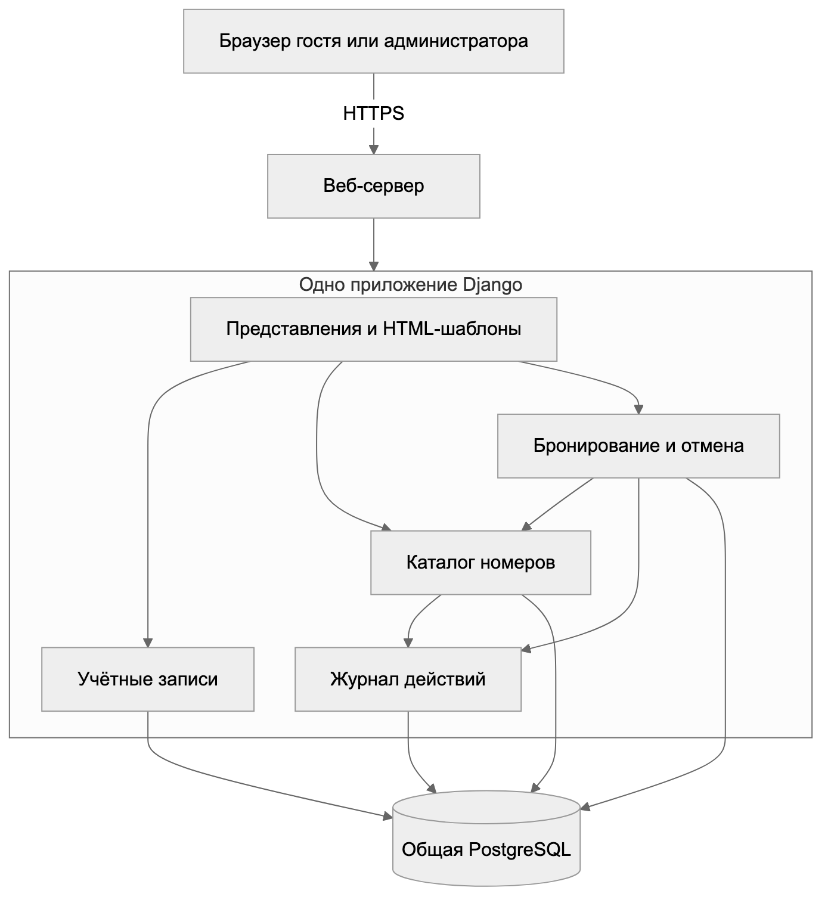
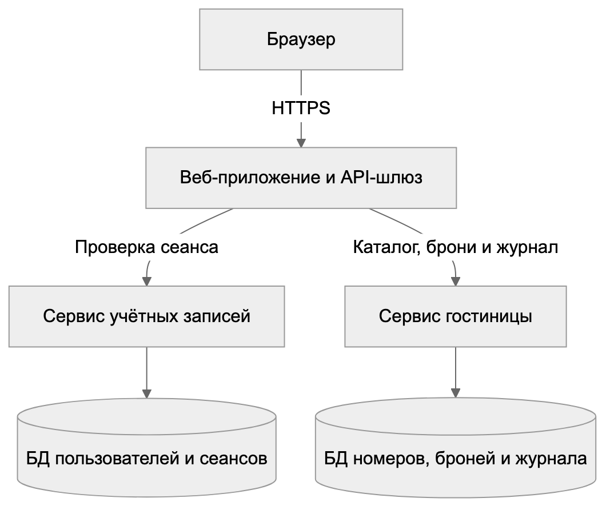
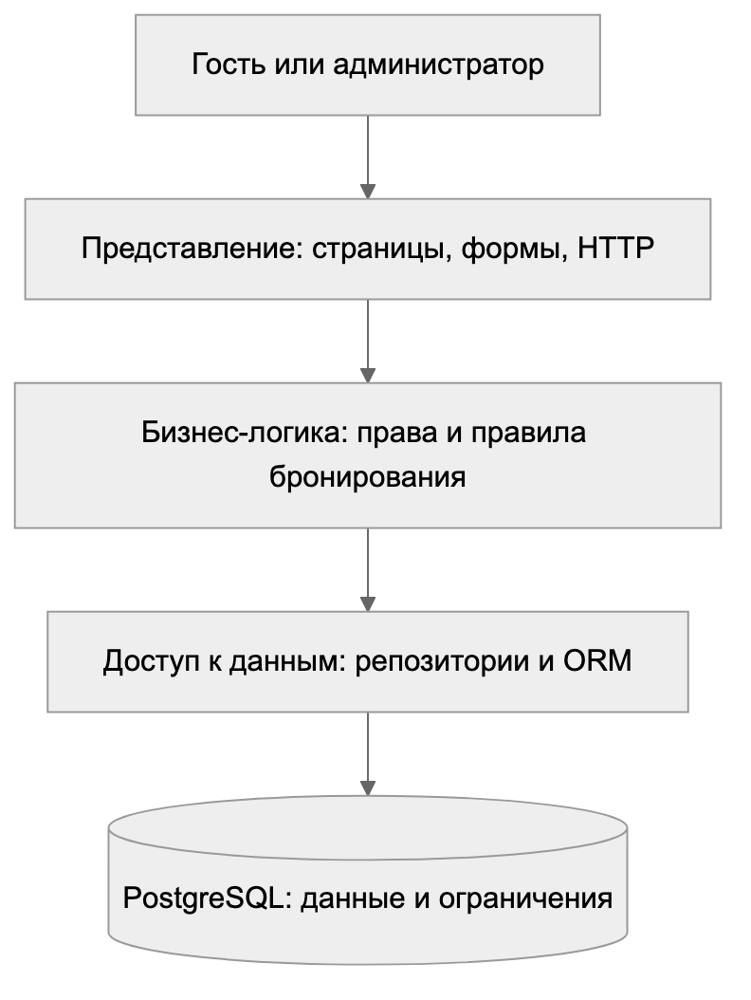

# Лабораторная работа № 2 по спецификации. Проектирование системы HotelBook

**Александр Чернобровенко, ПВ-232**

Дисциплина — «Архитектура, проектирование и ППС». Тема — анализ требований, выбор архитектуры программного обеспечения и организация командной разработки. Год выполнения — 2026.

Цель работы — определить требования к информационной системе, сравнить три архитектурных подхода, составить техническое задание и распределить работу между участниками команды. Для проектирования выбран сервис бронирования номеров HotelBook. [Задание из ветки main](https://github.com/d26dodenko/PV-232/blob/d81e48cfd7775401ff8269d6b4a68be65f1eb013/Specification/Total.md)

## 1. Описание проекта

HotelBook — веб-приложение для одной гостиницы на 40 номеров. Гость выбирает даты и номер, оформляет бронь и отслеживает её в личном кабинете. Администратор гостиницы ведёт каталог номеров и просматривает бронирования.

При учёте заявок в таблицах сотрудник может подтвердить две брони на один номер или продолжить предлагать номер после его снятия с продажи. Система должна проверять доступность при сохранении брони и вести общий список заявок. Гость получает возможность самостоятельно проверить свои даты и отменить поездку до заезда.

| Пользователь | Основные действия |
| --- | --- |
| Посетитель без учётной записи | Просматривает каталог, проверяет свободные номера, регистрируется |
| Гость | Входит в личный кабинет, бронирует номер, просматривает и отменяет свои брони |
| Администратор гостиницы | Изменяет каталог и цены, просматривает все брони и журнал действий |

Начальная нагрузка — до 30 одновременно работающих пользователей и 10 запросов в секунду. Предусматриваются 2 000 учётных записей и 10 000 записей о бронированиях. Клиент работает в браузере, приложение и PostgreSQL размещаются на Linux. Интерфейс русскоязычный, гостиница использует часовой пояс Europe/Moscow.

Первая версия охватывает каталог, бронирование, отмену и административный учёт. Оплата проживания происходит в гостинице.

## 2. Требования к системе

### 2.1. Функциональные требования

| ID | Название | Описание | Пользователь | Ожидаемый результат |
| --- | --- | --- | --- | --- |
| FR-01 | Регистрация | Создать учётную запись по имени, email и паролю. Email уникален без учёта регистра. Новому пользователю назначается роль гостя. | Посетитель | Создана одна учётная запись. Повторный email отклонён. |
| FR-02 | Вход и выход | Открыть сеанс по email и паролю и завершить его по команде пользователя. | Гость, администратор | После входа доступны разрешённые действия. После выхода прежний сеанс больше не действует. |
| FR-03 | Поиск номеров | Указать даты заезда и выезда и число гостей. Показать активные номера достаточной вместимости без пересекающихся подтверждённых броней. | Любой пользователь | Получен список свободных номеров либо сообщение об их отсутствии. |
| FR-04 | Карточка номера | Показать описание, вместимость, стоимость суток и стоимость всего выбранного периода. | Любой пользователь | Пользователь видит характеристики номера и итоговую сумму до подтверждения. |
| FR-05 | Создание брони | Забронировать выбранный номер на заданные даты. Перед записью повторно проверить доступность, вместимость и цену. | Гость | Создана подтверждённая бронь с уникальным ID и зафиксированной суммой либо сообщён конфликт. |
| FR-06 | Мои брони | Показать список и детали бронирований вошедшего пользователя. | Гость | Видны собственные даты, номер, стоимость и статус. Чужие брони недоступны. |
| FR-07 | Отмена брони | Отменить свою подтверждённую бронь до даты заезда. | Гость | Статус изменён на «Отменена», период снова доступен для бронирования. |
| FR-08 | Учёт бронирований | Просмотреть все брони и отфильтровать их по номеру, статусу и пересечению с выбранным периодом. | Администратор | Показаны подходящие записи и их владельцы. |
| FR-09 | Управление каталогом | Создать номер, изменить описание, вместимость и цену, снять номер с продажи. | Администратор | Изменения применяются к новым бронированиям. Уже подтверждённые записи сохраняют свои условия. |
| FR-10 | Журнал действий | Записать создание и отмену брони, изменения каталога. Показать автора, время, объект и изменённые значения. | Администратор | Действия можно проследить по журналу с фильтрами по объекту и дате. |

**Правила бронирования.** Дата заезда не раньше текущей даты гостиницы, дата выезда строго позже заезда. Срок проживания — от 1 до 30 ночей. Период задаётся как полуинтервал `[заезд, выезд)`, поэтому выезд одного гостя и заезд следующего в один день допустимы. Вместимость номера — положительное целое число. Количество гостей — целое число от 1 до вместимости номера.

Цены указаны в рублях, стоимость хранится в целых копейках. Цена суток положительна, итоговая сумма равна цене суток, умноженной на число ночей. Если цена изменилась после открытия карточки, сервер возвращает конфликт и предлагает гостю подтвердить новую сумму. Бронь при этом ещё не создаётся.

Подтверждённая бронь занимает номер на весь свой период. Отмена допустима, пока текущая дата гостиницы меньше даты заезда. Отменённая запись сохраняется в истории. Повторная отмена возвращает её текущее состояние. Администратор может снять номер с продажи, сохранив обслуживание ранее подтверждённых броней.

Форма создания передаёт уникальный ключ операции. Повтор запроса с тем же ключом и данными возвращает ранее созданную бронь. Тот же ключ с другими данными отклоняется. Две одновременные корректные заявки с разными ключами на свободный номер и пересекающиеся даты должны завершиться одной бронью и одним отказом.

### 2.2. Нефункциональные требования

| ID | Область | Требование | Способ проверки |
| --- | --- | --- | --- |
| NFR-01 | Целостность | Проверка доступности, создание брони и запись в журнал выполняются атомарно. Пересечения подтверждённых броней одного номера запрещены ограничением БД. Ключ операции уникален в пределах пользователя. | Одновременно отправить две заявки, повторить запрос с прежним ключом, прервать транзакцию перед завершением. Проверить количество броней и записей журнала. |
| NFR-02 | Надёжность и восстановление | Создавать резервную копию БД ежедневно и хранить 14 последних копий на отдельном сервере. Допустимая потеря данных — до 24 часов, время восстановления — до 2 часов. | Восстановить копию на чистом стенде, сравнить число записей и связи, измерить время. |
| NFR-03 | Производительность | При 30 активных пользователях и 10 запросах/с не менее 95% запросов чтения завершаются за время до 1 с, записи — до 2 с. За 15 минут проверки допускается 0 ответов 5xx. | Прогон после 2 минут прогрева на данных из раздела 1. Соотношение запросов чтения и записи — 80/20. |
| NFR-04 | Безопасность | Использовать HTTPS, хеши паролей с индивидуальной солью, серверную проверку ролей и владельца брони. Cookie сеанса имеют Secure, HttpOnly и SameSite. Изменяющие запросы защищены от CSRF. Пароли и значения сеансов исключены из журналов. | Проверить чужой ID, назначение роли через форму регистрации, запрос без CSRF-токена, завершённый сеанс, настройки cookie и содержимое журналов. |
| NFR-05 | Масштабируемость | Поддержать два экземпляра приложения с общей БД и общим хранилищем сеансов. При 60 пользователях и 20 запросах/с сохранить пороги NFR-03 и правила NFR-01. | Чередовать запросы одного сеанса между экземплярами, провести нагрузочный тест и конкурентное бронирование. |
| NFR-06 | Эксплуатация | Развёртывание на Linux. Поддержка текущей и предыдущей стабильных версий Chrome, Firefox и Edge на дату приёмки. Основные формы доступны при ширине экрана от 360 px. Часовой пояс гостиницы задаётся конфигурацией. | Выполнить установку по документации, проверить браузеры, узкий экран и операции около полуночи по времени гостиницы. |

Базовый стенд для NFR-03 — сервер приложения с 2 vCPU и 4 ГБ ОЗУ и отдельный сервер PostgreSQL с 2 vCPU, 4 ГБ ОЗУ и SSD. В NFR-05 добавляется второй такой же сервер приложения. Время измеряется со стороны клиента в одной сети со стендом. Ответы 400, 403 и 409 в проверках некорректного ввода и конфликтов учитываются отдельно от 5xx.

## 3. Монолитная архитектура

Серверная часть состоит из одного приложения Django. Внутри выделены модули учётных записей, каталога, бронирований и журнала. Они вызывают методы друг друга внутри процесса. Браузер получает HTML-страницы и отправляет формы по HTTPS.

*Рисунок 1. Монолитная архитектура HotelBook.* [Исходник Mermaid](diagrams/01-monolith.mmd)

В PostgreSQL хранятся пользователи, сеансы, номера, брони и журнал. В бронь записываются номер, владелец, даты, число гостей, стоимость и статус. Внешние ключи сохраняют связи, ограничение пересечения периодов защищает номер от двойного бронирования. Сохранение брони и её записи журнала проходит в одной транзакции.

Развёртываются веб-сервер, приложение и БД. Для обновления выпускается одна сборка приложения и выполняются миграции схемы. Перед изменением цены или созданием брони приложение блокирует строку номера в транзакции. Это позволяет проверить актуальную цену и статус номера в том же порядке, в котором сохраняются изменения.

Преимущества — общий механизм транзакций, один процесс для отладки и небольшое число компонентов при установке. Недостатки — обновление всего приложения при изменении одного модуля, общий отказ при падении процесса и масштабирование серверной части целиком.

## 4. Микросервисная архитектура

Альтернативный вариант разделяет систему на два сервиса с независимыми хранилищами и сборками. Веб-приложение формирует страницы, шлюз направляет запросы в нужный сервис.

| Сервис | Назначение и основные функции | Собственные данные | Взаимодействие |
| --- | --- | --- | --- |
| Учётные записи | Регистрация, вход, выход, выдача сведений о пользователе и его роли | Пользователи, хеши паролей, сеансы | Шлюз проверяет сеанс через внутренний HTTP-запрос. |
| Гостиница | Каталог и поиск свободных номеров, создание и отмена броней, административный учёт и аудит | Номера, цены, брони с ID владельцев, ключи операций, зафиксированные условия проживания, журнал | Получает запросы от шлюза по HTTP. Для защищённых действий шлюз передаёт проверенные ID и роль пользователя. |

*Рисунок 2. Микросервисная архитектура HotelBook.* [Исходник Mermaid](diagrams/02-microservices.mmd)

Доступ к сервисам открыт только шлюзу по защищённым внутренним соединениям. Перед защищённым действием шлюз проверяет сеанс в сервисе учётных записей. Сервис гостиницы проверяет полученную роль и владельца брони. Поля роли и владельца из пользовательской формы не используются как основание для доступа. При недоступности сервиса учётных записей защищённые действия временно отклоняются.

Каталог и брони объединены в одном сервисе, поскольку актуальная цена, статус продажи и занятость проверяются при одной операции. Сервис гостиницы блокирует строку номера и сохраняет бронь с записью журнала в одной транзакции своей БД. Ограничение пересечения периодов и ключ операции защищают от двойных заявок и повторной отправки. ID пользователя связывает бронь с учётной записью, прямых запросов к чужой БД нет. Для административного списка шлюз отдельно получает имена владельцев из сервиса учётных записей.

Каждый сервис развёртывается и масштабируется отдельно. Можно увеличить число экземпляров сервиса гостиницы, сохранив прежнее число экземпляров сервиса учётных записей. Цена такого разделения — дополнительные сетевые вызовы, отдельные настройки доступа и зависимость защищённых операций от доступности обоих сервисов. Для гостиницы на 40 номеров эти расходы превышают пользу от независимого выпуска сервисов.

## 5. Многослойная архитектура и выбор решения

Для реализации выбран монолит Django с тремя логическими слоями. Монолит определяет способ развёртывания, а слои задают границы ответственности внутри приложения.

| Слой | Компоненты и ответственность | Взаимодействие |
| --- | --- | --- |
| Представление | HTML-шаблоны, формы, обработчики HTTP. Проверяет формат ввода и показывает результат операции. | Вызывает методы бизнес-логики с ID пользователя и данными формы. |
| Бизнес-логика | Сервисы регистрации, поиска, бронирования, отмены и управления каталогом. Проверяет полномочия, даты, цену и допустимые переходы состояния. | Управляет транзакцией и обращается к слою доступа к данным. |
| Доступ к данным | Репозитории на Django ORM, модели, миграции и ограничения PostgreSQL. | Выполняет запросы, блокировки и запись данных в рамках переданной транзакции. |

*Рисунок 3. Многослойная архитектура HotelBook.* [Исходник Mermaid](diagrams/03-layers.mmd)

Ответ возвращается через те же слои. Например, форма бронирования передаёт параметры сервису. Сервис проверяет права и открывает транзакцию, репозиторий блокирует номер и сохраняет запись, после фиксации транзакции обработчик показывает подтверждение.

Прямой доступ формы к таблице бронирований запрещён соглашением команды. Правила проверяются тестами сервисного слоя, а ограничения и транзакции — интеграционными тестами с PostgreSQL. Такое разделение добавляет несколько классов, но позволяет менять страницы без переноса правил бронирования в обработчики форм.

Для первой версии важнее корректно занять номер одной транзакцией и развернуть приложение небольшой командой. Поэтому выбрана одна серверная сборка с внутренним разделением на слои. При увеличении нагрузки сначала добавляется второй экземпляр приложения согласно NFR-05.

## 6. Команда и распределение ответственности

Для проекта предусмотрена учебная модель команды из четырёх участников. Александр Чернобровенко подготовил проектную документацию. Остальные места обозначают планируемых участников разработки.

| Участник | Роли | Обязанности | Задачи доски | Результат |
| --- | --- | --- | --- | --- |
| Участник 1 — Александр Чернобровенко | Руководитель проекта, системный аналитик | Уточнить сценарии, согласовать требования, выбрать архитектуру, вести приоритеты и комплект документов | HB-01–HB-04, HB-07, HB-25 | Требования, ТЗ, согласованный план, руководство пользователя |
| Участник 2 | Backend-разработчик, разработчик БД | Спроектировать схему, реализовать правила, ограничения, транзакции и проверки на сервере | HB-05, HB-09–HB-11, HB-13, HB-16–HB-20 | Серверные модули, миграции и модульные тесты |
| Участник 3 | Frontend-разработчик | Подготовить макеты, реализовать страницы каталога, форму брони и личный кабинет | HB-06, HB-12, HB-14, HB-15 | Страницы и формы для трёх категорий пользователей |
| Участник 4 | Тестировщик, DevOps-инженер | Подготовить стенды, проверить требования, настроить резервные копии, провести нагрузочные испытания и восстановление | HB-08, HB-21–HB-24, HB-26 | Среда развёртывания, тесты, протоколы испытаний и инструкция восстановления |

Изменения backend проверяет участник 3, изменения frontend — участник 2. Участник 4 проверяет пользовательские сценарии после проверки кода. Настройки развёртывания и резервного копирования дополнительно просматривает участник 2. Руководитель фиксирует результаты приёмки и возвращает задачи на доработку при нарушении критериев.

## 7. Доска задач

Доска ведётся собственной таблицей. После подготовки отчёта завершены HB-01–HB-04. Задачи реализации находятся в плановых состояниях.

| Backlog | To Do | In Progress | Code Review | Testing | Done |
| --- | --- | --- | --- | --- | --- |
| HB-09–HB-26 | HB-05–HB-08 | — | — | — | HB-01–HB-04 |

Задача попадает в To Do после определения результата и зависимостей. Исполнитель переводит её в In Progress, затем отдаёт на Code Review. После проверки кода задача поступает в Testing. В Done она переходит при выполнении критерия готовности. При обнаружении дефекта задача возвращается в In Progress.

| ID | Задача | Требования | Ответственный | Критерий готовности | Состояние |
| --- | --- | --- | --- | --- | --- |
| HB-01 | Описать пользователей и сценарии гостиницы | Раздел 1 | Участник 1 | Указаны роли, назначение и условия эксплуатации | Done |
| HB-02 | Составить проверяемые требования | FR-01–FR-10, NFR-01–NFR-06 | Участник 1 | Для каждого требования определены результат или способ проверки | Done |
| HB-03 | Сравнить архитектуры и выбрать решение | Разделы 3–5 | Участник 1 | Есть три схемы, описание данных и обоснование выбора | Done |
| HB-04 | Подготовить ТЗ и план приёмки | Раздел 8 | Участник 1 | Заполнены восемь разделов ТЗ и критерии приёмки | Done |
| HB-05 | Спроектировать таблицы и связи | FR-01, FR-05, FR-09, FR-10 | Участник 2 | Описаны пользователи, номера, брони, сеансы и журнал | To Do |
| HB-06 | Подготовить макеты основных страниц | FR-01–FR-09, NFR-06 | Участник 3 | Показаны каталог, карточка, кабинет и формы администратора | To Do |
| HB-07 | Описать маршруты, поля форм и ошибки | FR-01–FR-10 | Участник 1 | Для каждого действия заданы вход, ответ и права | To Do |
| HB-08 | Подготовить приложение, тестовый стенд и сборку | NFR-06 | Участник 4 | Стенд запускается из репозитория с отдельной тестовой БД | To Do |
| HB-09 | Реализовать миграции и ограничения | NFR-01 | Участник 2 | БД отклоняет пересечения, дубли email и ключей операций | Backlog |
| HB-10 | Реализовать регистрацию, вход и выход | FR-01, FR-02, NFR-04 | Участник 2 | Сеанс создаётся и завершается, роль гостя назначается сервером | Backlog |
| HB-11 | Реализовать поиск свободных номеров | FR-03, FR-04 | Участник 2 | Учитываются период, вместимость и статус продажи | Backlog |
| HB-12 | Реализовать каталог и карточку номера | FR-03, FR-04 | Участник 3 | До бронирования видны цена суток и общая сумма | Backlog |
| HB-13 | Реализовать транзакционное создание брони | FR-05, NFR-01 | Участник 2 | Повтор операции возвращает тот же ID, конкурентная заявка отклоняется | Backlog |
| HB-14 | Реализовать форму подтверждения | FR-05 | Участник 3 | Форма передаёт ключ операции и показывает изменение цены или занятости | Backlog |
| HB-15 | Реализовать личный кабинет | FR-06 | Участник 3 | Видны список и детали собственных броней | Backlog |
| HB-16 | Реализовать отмену брони | FR-07 | Участник 2 | До заезда бронь отменяется, повторная отмена безопасна | Backlog |
| HB-17 | Реализовать управление номерами | FR-09 | Участник 2 | Администратор меняет каталог без изменения условий прежних броней | Backlog |
| HB-18 | Реализовать журнал бронирований администратора | FR-08 | Участник 2 | Фильтры возвращают подходящие записи и владельцев | Backlog |
| HB-19 | Реализовать аудит действий | FR-10 | Участник 2 | Каждой успешной записи соответствует запись журнала | Backlog |
| HB-20 | Написать модульные тесты правил | FR-03–FR-07, NFR-01 | Участник 2 | Проверены даты, суммы, повторные операции и отмена | Backlog |
| HB-21 | Проверить БД и серверные права | FR-01–FR-10, NFR-01, NFR-04 | Участник 4 | Проверены транзакции, чужие ID, роли и CSRF | Backlog |
| HB-22 | Проверить сценарии в браузерах | FR-01–FR-10, NFR-06 | Участник 4 | Проходят сценарии трёх ролей, включая экран 360 px | Backlog |
| HB-23 | Проверить нагрузку и два экземпляра приложения | NFR-03, NFR-05 | Участник 4 | Зафиксированы задержки, ошибки и отсутствие двойных броней | Backlog |
| HB-24 | Настроить копирование и проверить восстановление | NFR-02 | Участник 4 | Восстановление укладывается в 2 часа, копии хранятся отдельно | Backlog |
| HB-25 | Подготовить инструкции пользователя и администратора | FR-01–FR-10, NFR-06 | Участник 1 | Описаны основные действия, установка и эксплуатация | Backlog |
| HB-26 | Провести приёмку и оформить результаты | Все требования | Участник 4 | Выполнен план приёмки, результаты переданы руководителю | Backlog |

## 8. Техническое задание

Проект технического задания HB-ТЗ, версия 1.0. Восемь основных разделов соответствуют перечню из учебного задания. Общие сведения и характеристика объекта включены во введение, подготовка объекта к вводу — в раздел о приёмке.

### 8.1. Введение

Полное наименование — «Информационная система бронирования гостиничных номеров HotelBook». Сокращённое наименование — HotelBook. Система предназначена для поиска свободного номера, оформления и отмены брони и ведения каталога гостиницы.

Объект автоматизации — приём и учёт бронирований одной гостиницы на 40 номеров. Исходный процесс предполагает раздельный учёт заявок, из-за которого возможны пересечения и устаревшие сведения о доступности.

Учебный заказчик — администрация условной гостиницы. Разработчик — команда из раздела 6. Плановый срок создания системы — шесть недель со дня согласования ТЗ. Работа выполняется как учебный проект, денежный бюджет не определяется. Результаты передаются в репозитории вместе с документацией и протоколом приёмки.

### 8.2. Основания для разработки

Основание — лабораторное задание «Анализ требований, выбор архитектуры программного обеспечения и организация командной разработки» по дисциплине «Архитектура, проектирование и ППС».

В модели заказчика основные потребности — исключить двойное бронирование, предоставить гостю самостоятельный выбор номера и дать сотруднику общий список броней. Эти потребности конкретизированы в FR-03–FR-09. Дополнения к согласованным требованиям оформляются изменением версии ТЗ с указанием причины и затронутых критериев приёмки. [Учебное задание](https://github.com/d26dodenko/PV-232/blob/d81e48cfd7775401ff8269d6b4a68be65f1eb013/Specification/Total.md)

### 8.3. Назначение и цели создания системы

Система автоматизирует поиск, резервирование и отмену номеров. Гость должен проходить путь от поиска до подтверждения без участия сотрудника. Администратор получает актуальный каталог, список бронирований и историю изменений.

Измеримые цели — одна подтверждённая бронь при конкурентных заявках на свободный номер и один период, сохранение условий уже оформленной брони при изменении каталога и восстановление данных в пределах NFR-02. Достижение целей проверяется сценариями из раздела 8.6.

### 8.4. Требования к системе

Обязательные функциональные требования — FR-01–FR-10 из раздела 2.1 вместе с правилами дат, стоимости, отмены и повторных запросов. Обязательные требования к целостности, надёжности, производительности, безопасности, масштабируемости и эксплуатации — NFR-01–NFR-06 из раздела 2.2.

Система реализуется как монолит с разделением на представление, бизнес-логику и доступ к данным. Используются Python, Django, PostgreSQL и HTML-шаблоны. Учётные записи и сеансы хранятся в общей БД, поэтому приложение может обслуживать один сеанс на двух экземплярах.

Границы доступа проверяются сервером. Учётную запись первого администратора создаёт ответственный за развёртывание. Гость не может самостоятельно получить административную роль. Доступ к операциям бронирования требует действующего сеанса, просмотр собственных броней дополнительно проверяет владельца.

Номер и цена фиксируются в брони. Снятие номера с продажи блокирует новые заявки и сохраняет уже оформленные. Ошибки ввода возвращают сообщение с указанием поля, конфликт доступности или цены — HTTP 409. При отказе БД операция не подтверждается пользователю. Повтор создания использует прежний ключ операции.

### 8.5. Состав и содержание работ

| Этап | Срок от начала проекта | Работы | Результат и ответственные |
| --- | --- | --- | --- |
| Анализ и проектирование | Неделя 1 | Согласовать роли, требования, ТЗ, схему БД и макеты; HB-01–HB-07 | Участники 1–3 готовят проектные решения |
| Подготовка основы | Неделя 2 | Настроить стенд, миграции, вход и роли; HB-08–HB-10 | Участники 2 и 4 готовят запускаемую основу системы |
| Каталог и бронирование | Недели 3–4 | Реализовать поиск, страницы, создание, кабинет, отмену и административный учёт; HB-11–HB-19 | Участники 2 и 3 собирают версию с основными сценариями |
| Проверки и исправления | Неделя 5 | Завершить модульные, интеграционные, браузерные и нагрузочные проверки; HB-20–HB-23 | Участники 2 и 4 передают протоколы и исправленную версию |
| Подготовка к эксплуатации и приёмка | Неделя 6 | Проверить восстановление, завершить инструкции, провести демонстрацию; HB-24–HB-26 | Участники 1 и 4 готовят комплект передачи и решение о приёмке |

Модульные проверки создаются вместе с реализацией. Неделя 5 отведена на проверку всей системы и устранение выявленных дефектов.

### 8.6. Порядок контроля и приёмки

**Предварительные испытания.** Разработчики проверяют изменения до передачи на Code Review. Тестировщик проводит проверки на отдельной БД с вымышленными пользователями и номерами. Для каждого сценария фиксируются версия приложения, входные данные, ожидаемый и фактический результат.

**Приёмочные испытания.** Руководитель проекта и тестировщик демонстрируют заказчику следующие сценарии. Значения в столбце результата являются критериями будущей приёмки.

| Требования | Проверка | Критерий приёмки |
| --- | --- | --- |
| FR-01, FR-02 | Регистрация, повтор email с другим регистром, вход, выход и обращение с завершённым сеансом | Создана одна учётная запись гостя; повтор отклонён; завершённый сеанс не даёт доступа |
| FR-03, FR-04 | Поиск по датам и вместимости, открытие карточки | В выдаче только подходящие активные номера; сумма равна цене суток, умноженной на число ночей |
| FR-05, NFR-01 | Две корректные заявки с разными ключами на свободный номер и один период, повтор с тем же ключом, прерывание транзакции | Создана одна бронь; конфликтующая заявка получает 409; повтор успешной операции возвращает её ID; откат не оставляет бронь или запись аудита |
| FR-06, NFR-04 | Открытие кабинета и запрос чужого ID | Пользователь получает только свои записи; чужая бронь недоступна |
| FR-07 | Отмена до заезда, повтор отмены и попытка в дату заезда | До заезда получен статус «Отменена», период освобождён; повтор возвращает тот же статус; отмена в день заезда отклонена |
| FR-08 | Фильтры администратора по номеру, статусу и периоду | Все возвращённые записи отвечают фильтрам и содержат владельцев |
| FR-09 | Изменение цены и снятие номера с продажи между поиском и подтверждением | Новая цена требует подтверждения; снятый номер не бронируется; условия прежних броней сохранены |
| FR-10 | Создание, отмена и изменение каталога | В журнале есть автор, время, объект и изменения каждой успешной операции |
| Правила раздела 2.1 | Периоды 0, 1, 30 и 31 ночь, прошлые даты, соседние брони, превышение вместимости | Разрешены 1–30 ночей и соседние периоды; остальные недопустимые сочетания отклонены |
| NFR-02 | Восстановление последней копии на чистом стенде | Копия не старше 24 часов; восстановление заняло до 2 часов; данные и связи совпали с копией |
| NFR-03, NFR-05 | Нагрузка на один и два экземпляра приложения по условиям раздела 2.2 | Выполнены пороги задержки, ответов 5xx нет; сеансы работают на обоих экземплярах, двойных броней нет |
| NFR-04 | Обход ролей, CSRF, просмотр cookie, хешей и журналов | Роли проверяются сервером; изменяющий запрос без защиты отклонён; секреты в журналах отсутствуют |
| NFR-06 | Чистое развёртывание, браузеры, экран 360 px, граница суток | Установка воспроизводится по документации; основные формы доступны; отмена и даты учитывают время гостиницы |

Приёмка завершается после успешного выполнения всех сценариев. Неустранённое нарушение любого обязательного требования означает возврат на доработку. К протоколу прикладываются результаты проверок и перечень исправлений.

**Подготовка объекта к вводу.** Администратор гостиницы передаёт проверенный список 40 номеров, вместимость и цены. DevOps-инженер настраивает HTTPS, БД, секреты окружения, резервное копирование и часовой пояс. На рабочем стенде создаётся администратор. Сотрудник гостиницы проходит демонстрацию поиска, изменения каталога и просмотра броней. Перед переключением проверяются восстановление копии и доступность основных страниц.

### 8.7. Требования к составу и содержанию документации

| Документ | Содержание | Формат |
| --- | --- | --- |
| Техническое задание | Требования FR и NFR, ограничения и критерии приёмки | Markdown |
| Описание архитектуры и данных | Три схемы, выбранная архитектура, связи таблиц и ограничения | Markdown и схемы |
| Руководство гостя и администратора | Поиск, бронирование, отмена, каталог, фильтры и сообщения об ошибках | Markdown |
| Инструкция развёртывания и восстановления | Зависимости, конфигурация, миграции, создание администратора, копирование и восстановление | Markdown |
| Протокол испытаний | Версия системы, условия, сценарии, фактические результаты и дефекты | Markdown |

Документация передаётся вместе с версией приложения, к которой относится. Названия параметров и действий в инструкциях должны совпадать с интерфейсом и конфигурацией этой версии.

### 8.8. Источники разработки

- Учебное задание «Анализ требований, выбор архитектуры программного обеспечения и организация командной разработки». [Specification/Total.md](https://github.com/d26dodenko/PV-232/blob/d81e48cfd7775401ff8269d6b4a68be65f1eb013/Specification/Total.md)
- ГОСТ 34.602-89 «Техническое задание на создание автоматизированной системы». Для учебной работы использована редакция, указанная преподавателем. [Карточка стандарта](https://protect.gost.ru/gost/details/192a6558-e2c5-49b4-baa6-5dcad1636888)
- Требования и допущения проекта HotelBook, сформулированные в разделах 1 и 2 настоящего отчёта.

## 9. Заключение

Для HotelBook определены десять функций и шесть проверяемых нефункциональных требований. Главный риск — подтверждение двух броней на один номер — учтён в требованиях, устройстве БД и сценарии приёмки. Для первой версии выбран монолит с тремя слоями. Он позволяет выполнить бронирование одной транзакцией и соответствует составу команды из четырёх участников. Доска из 26 задач связывает требования с исполнителями и результатами работ, а ТЗ задаёт порядок разработки и проверки системы.
