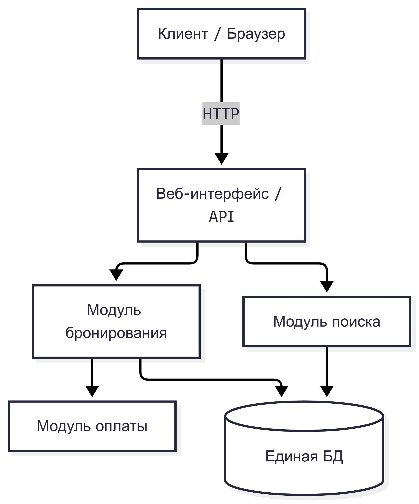
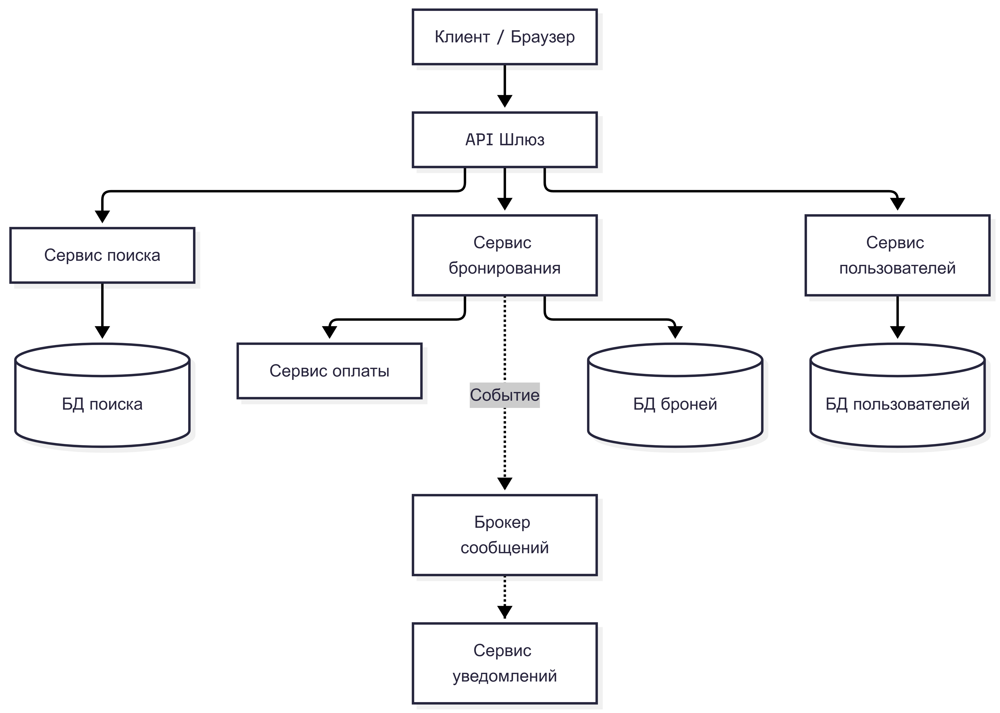
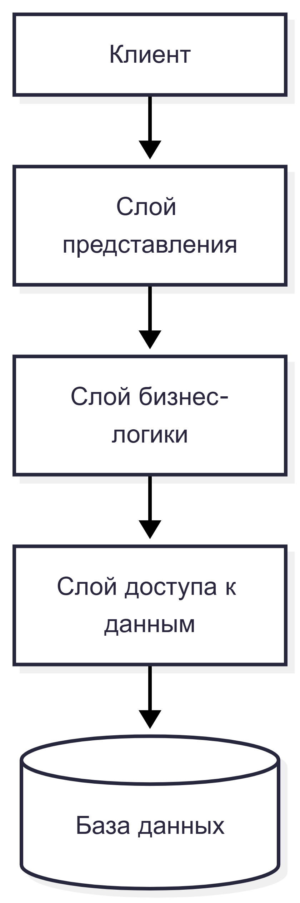
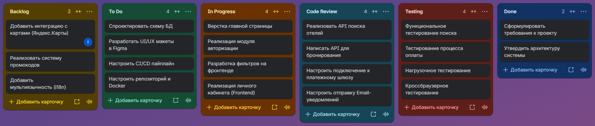

# ЛАБОРАТОРНАЯ РАБОТА

**Дисциплина:** Архитектура, проектирование и ППС

**Тема:** Анализ требований, выбор архитектуры программного обеспечения и организация командной разработки

---

## Цель работы
Получить практические навыки анализа требований к программному обеспечению, проектирования архитектуры информационной системы, формирования команды разработки и распределения задач между участниками проекта.

---

## Выполнение работы

### Выполнил
**Смольяков Артём ПВ-232**

---

### Задание 1. Описание проекта

**Название проекта:** Сервис онлайн-бронирования отелей.

**Назначение системы:** Предоставление пользователям единой платформы для поиска, сравнения и мгновенного бронирования гостиничных номеров по всему миру.

**Целевая аудитория:** Туристы, командировочные сотрудники, путешественники, а также владельцы отелей (партнеры).

**Основные проблемы, которые решает система:** Устраняет необходимость переходить на десятки сайтов разных отелей и агрегаторов. Система централизует информацию о доступности номеров, ценах и отзывах, позволяет мгновенно оплатить бронь и получить подтверждение на почту.

**Основные функции системы:** Поиск отелей по городу и датам; фильтрация по цене, звездности и удобствам; отображение карточек отелей с фото и отзывами; оформление и оплата бронирования; личный кабинет пользователя с историей броней.

**Предполагаемые условия эксплуатации:** Высокая пиковая нагрузка в сезон отпусков; работа в десктопных и мобильных браузерах; интеграция с внешними платежными шлюзами и сервисами карт.

---

### Задание 2. Формирование требований

#### Функциональные требования

1. **FR-SEARCH;**
   - *Название:* Поиск отелей;
   - *Описание:* Ввод города, дат заезда и выезда, количества гостей, нажатие кнопки «Найти»;
   - *Пользователь:* Клиент;
   - *Ожидаемый результат:* Список доступных отелей, соответствующих критериям поиска.
2. **FR-FILTER;**
   - *Название:* Фильтрация и сортировка;
   - *Описание:* Настройка фильтров по цене, звездности, рейтингу, типу питания и удобствам;
   - *Пользователь:* Клиент;
   - *Ожидаемый результат:* Отфильтрованный список отелей.
3. **FR-BOOKING;**
   - *Название:* Оформление бронирования;
   - *Описание:* Выбор конкретного номера, ввод данных гостя, подтверждение брони;
   - *Пользователь:* Клиент;
   - *Ожидаемый результат:* Создана заявка на бронирование в статусе «Ожидает оплаты».
4. **FR-PAYMENT;**
   - *Название:* Онлайн-оплата;
   - *Описание:* Перевод пользователя на платежный шлюз, списание средств, возврат статуса об успешной оплате;
   - *Пользователь:* Клиент, Система;
   - *Ожидаемый результат:* Статус брони меняется на «Оплачено», чек отправляется на email.
5. **FR-USER-CABINET;**
   - *Название:* Личный кабинет;
   - *Описание:* Авторизация, просмотр активных и прошлых бронирований, отмена брони;
   - *Пользователь:* Клиент;
   - *Ожидаемый результат:* Просмотр истории поездок и управление текущими бронями.

#### Нефункциональные требования

1. **Надежность:** Система должна обеспечивать 99.9% времени безотказной работы. Данные о бронированиях не должны теряться при сбоях.
2. **Производительность:** Время поиска и отображения результатов по заданным датам не должно превышать 2 секунд при нагрузке до 1000 RPS.
3. **Безопасность:** Передача персональных данных и данных банковских карт должна осуществляться только по протоколу HTTPS с использованием шифрования. Соответствие требованиям PCI DSS.
4. **Масштабируемость:** Возможность горизонтального масштабирования базы данных и серверов приложений в периоды высокого сезона.
5. **Условия эксплуатации:** Адаптивный интерфейс для десктопных и мобильных браузеров (Chrome, Safari, Firefox, Edge). Круглосуточный режим работы (24/7).

---

### Задание 3. Проектирование архитектуры

#### 3.1. Монолитная архитектура

- **Основные компоненты системы:**
  - Веб-интерфейс (Frontend).
  - API-слой (Контроллеры для обработки запросов).
  - Модуль бизнес-логики (Управление поиском, корзиной, бронированием).
  - Модуль интеграции с платежным шлюзом.
  - Модуль работы с базой данных (ORM).
- **Принцип взаимодействия компонентов:** Все компоненты работают в рамках одного процесса. Вызовы происходят напрямую через методы классов. Запрос от пользователя идет в контроллер, который вызывает сервисы бизнес-логики, а те в свою очередь обращаются к БД.
- **Способ хранения данных:** Единая реляционная база данных (например, PostgreSQL).
- **Особенности развертывания:** Сборка в единый Docker-образ, развертывание на одном сервере (или нескольких с балансировщиком, но с копиями всего приложения целиком).
- **Преимущества:** Простота разработки на начальном этапе, единая кодовая база, отсутствие сетевых задержек между модулями.
- **Недостатки:** Сложность масштабирования отдельных частей (например, при пиковой нагрузке на поиск масштабируется всё приложение), при падении одного модуля падает вся система, долгий CI/CD при росте кодовой базы.

  

#### 3.2. Микросервисная архитектура

Система разбивается на независимые сервисы, взаимодействующие по сети (REST/gRPC) и через брокер сообщений (Kafka/RabbitMQ).

- **Сервисы:**
  1. **API Gateway:** Единая точка входа, маршрутизация, авторизация, rate-limiting.
  2. **Search Service:** Поиск отелей по параметрам, кэширование результатов.
  3. **Hotel Management Service:** Управление карточками отелей, номерами и их доступностью.
  4. **Booking Service:** Оформление бронирований, управление их статусами.
  5. **Payment Service:** Интеграция с платежными шлюзами, обработка транзакций.
  6. **User Service:** Аутентификация, профили пользователей, история.
  7. **Notification Service:** Отправка email и SMS уведомлений о статусе брони.
- **Взаимодействие:** Клиент обращается к API Gateway. При поиске Gateway вызывает Search Service. При бронировании Gateway вызывает Booking Service, который синхронно запрашивает Payment Service и асинхронно отправляет событие в Notification Service.
- **Преимущества:** Независимое масштабирование (например, только Search и Booking в высокий сезон), изоляция отказов.
- **Недостатки:** Сложная инфраструктура, сетевые задержки, сложность обеспечения консистентности данных (распределенные транзакции).

  

#### 3.3. Многослойная архитектура

Система разделена на логические слои, где каждый слой имеет строго определенную ответственность.

- **Слой представления (Presentation Layer):** Отвечает за отображение данных пользователю и обработку ввода. Компоненты: HTML/CSS/JS, компоненты UI (React/Vue), контроллеры отображения.
- **Слой бизнес-логики (Business Logic Layer):** Содержит правила обработки данных. Компоненты: Сервис поиска, Сервис бронирования, Сервис ценообразования, Валидаторы.
- **Слой доступа к данным (Data Access Layer):** Абстракция над базами данных. Компоненты: Репозитории (Repositories), ORM (Object-Relational Mapping), DAO (Data Access Objects).
- **Принцип взаимодействия:** Строго направленный поток данных «сверху вниз». Слой представления вызывает слой бизнес-логики, который, в свою очередь, обращается к слою доступа к данным. Обратный поток — только возврат результатов.
- **Преимущества:** Отличная тестируемость, легкость замены слоев (например, смена БД затрагивает только нижний слой), четкое разделение зон ответственности для разработчиков.
- **Недостатки:** Риск «протекания» бизнес-логики в слой представления, дополнительные накладные расходы на преобразование данных между слоями (DTO).

  

---

### Задание 4. Составление технического задания

#### 1. Введение
**1.1. Наименование системы:** Сервис онлайн-бронирования отелей.
**1.2. Назначение системы:** Предоставление пользователям возможности поиска и бронирования номеров в отелях.
**1.3. Краткое описание:** Веб-приложение, агрегирующее предложения от различных отелей. Пользователь вводит параметры поиска, получает список вариантов, выбирает подходящий, авторизуется и оплачивает бронь онлайн.

#### 2. Основания для разработки
**2.1. Основание выполнения проекта:** Учебное задание в рамках дисциплины «Архитектура, проектирование и ППС».
**2.2. Требования заказчика:** Кроссплатформенность (веб), интуитивно понятный интерфейс, безопасная оплата, высокая скорость поиска, устойчивость к пиковым нагрузкам.

#### 3. Назначение и цели создания системы
**3.1. Назначение системы:** Автоматизация процесса поиска и бронирования гостиничных услуг.
**3.2. Цели создания:**
- Создание единой базы отелей и номеров.
- Интеграция с платежными системами для безопасной оплаты.
- Снижение времени пользователя на поиск и оформление бронирования.

#### 4. Требования к системе
**4.1. Функциональные требования:** *(Скопировать из Задания 2)*
**4.2. Требования к надежности:** Обеспечение целостности данных о бронированиях, 99.9% uptime.
**4.3. Требования к производительности:** Отклик на поисковые запросы до 2 секунд при 1000 одновременных пользователей.
**4.4. Требования к безопасности:** Шифрование персональных данных, защита от SQL-инъекций и XSS, соответствие PCI DSS для платежей.
**4.5. Требования к условиям эксплуатации:** Поддержка современных браузеров (Chrome, Safari, Firefox), адаптивная верстка, работа 24/7.

#### 5. Состав и содержание работ
1. **Этап 1. Анализ и проектирование:** Сбор требований, выбор стека технологий, проектирование схемы БД, макетирование интерфейса. *Результат: ТЗ, архитектурная схема, UI-макеты.*
2. **Этап 2. Backend-разработка:** Реализация REST API, настройка базы данных, написание модулей поиска и бронирования. *Результат: Рабочий серверный API, документация Swagger.*
3. **Этап 3. Frontend-разработка:** Верстка интерфейса, интеграция с API, реализация личного кабинета. *Результат: Готовый веб-интерфейс.*
4. **Этап 4. Интеграция и тестирование:** Интеграция с платежным шлюзом, написание тестов, исправление багов. *Результат: Стабильная версия системы, отчет о тестировании.*
5. **Этап 5. Развертывание:** Настройка CI/CD, развертывание на сервере, написание документации. *Результат: Работающий сервис в сети Интернет.*

#### 6. Порядок контроля и приемки
**6.1. Способы проверки:** Ручное тестирование сценариев бронирования, автотесты API, нагрузочное тестирование (Apache JMeter), проверка безопасности.
**6.2. Критерии приемки:** Выполнение всех функциональных требований, отсутствие критических багов, время отклика API < 2 сек, успешное проведение тестового платежа.
**6.3. Порядок демонстрации:** Онлайн-демонстрация работы сервиса на тестовых данных с полным циклом: от поиска до получения подтверждения оплаты.

#### 7. Требования к составу и содержанию документации
- Техническое задание (ГОСТ 34.602-89).
- Руководство по развертыванию (Docker, Nginx).
- Руководство пользователя.
- Документация API (OpenAPI/Swagger).
- Программа и методика испытаний.

#### 8. Источники разработки
- ГОСТ 34.602-89.
- Документация фреймворков (Spring Boot / Django / Node.js).
- Документация платежных шлюзов (ЮKassa, Tinkoff).
- Научные статьи по проектированию высоконагруженных систем.

---

### Задание 5. Формирование команды разработки

**Выбранная архитектура:** Многослойная (Layered Architecture). 
**Размер команды:** 7 человек.

| Слой архитектуры | Ответственные роли |
|---|---|
| Слой представления | Frontend-разработчик, Тестировщик |
| Слой бизнес-логики | Backend-разработчик, Системный аналитик |
| Слой доступа к данным | Разработчик БД, Backend-разработчик |
| Инфраструктура и развертывание | DevOps-инженер |
| Управление и координация | Руководитель проекта |

#### 1. Руководитель проекта (Project Manager)
- **Обязанности:** Планирование спринтов, распределение задач, контроль сроков, коммуникация с заказчиком.
- **Задачи:** Ведение доски в Jira/Trello, составление отчетов, разрешение конфликтов в команде.
- **Результат:** Соблюдение сроков релиза, сформированные требования, успешная защита проекта.

#### 2. Системный аналитик
- **Обязанности:** Формализация требований, проектирование бизнес-процессов, описание API.
- **Задачи:** Написание ТЗ, составление UML-диаграмм (Use Case, Sequence), постановка задач разработчикам.
- **Результат:** Утвержденное ТЗ, спецификация API, понятные задачи для команды.

#### 3. Frontend-разработчик
- **Обязанности:** Разработка пользовательского интерфейса, интеграция с API, обеспечение адаптивности.
- **Задачи:** Верстка макетов (HTML/CSS), написание логики на JS/React, обработка ошибок API.
- **Результат:** Готовый веб-интерфейс, корректно работающий во всех современных браузерах.

#### 4. Backend-разработчик
- **Обязанности:** Разработка серверной логики, реализация REST API, интеграция с платежными системами.
- **Задачи:** Написание кода бизнес-логики, настройка роутинга, обработка запросов от Frontend, интеграция шлюзов оплаты.
- **Результат:** Рабочий и задокументированный API, стабильная бизнес-логика.

#### 5. Разработчик базы данных (Database Developer)
- **Обязанности:** Проектирование схемы БД, написание SQL-запросов, оптимизация производительности.
- **Задачи:** Создание таблиц, индексов, написание миграций, настройка репликации и бэкапов.
- **Результат:** Оптимальная структура БД, быстрые запросы выборки, сохранность данных.

#### 6. Тестировщик (QA Engineer)
- **Обязанности:** Обеспечение качества продукта, поиск дефектов, проверка соответствия ТЗ.
- **Задачи:** Написание тест-кейсов, ручное тестирование, нагрузочное тестирование, ведение баг-трекера.
- **Результат:** Отчет о тестировании, отсутствие критических багов в релизе.

#### 7. DevOps-инженер
- **Обязанности:** Настройка инфраструктуры, автоматизация развертывания, мониторинг.
- **Задачи:** Настройка Docker, настройка CI/CD пайплайнов (GitHub Actions/GitLab CI), настройка Nginx, SSL.
- **Результат:** Автоматизированный процесс деплоя, настроенный мониторинг (Grafana/Prometheus), работающий сервер.

---

### Задание 6. Организация доски задач

Ниже представлена Kanban-доска для проекта.

---

### Заключение
В ходе выполнения лабораторной работы был проведен анализ требований и спроектирована архитектура информационной системы для сервиса бронирования отелей. Были рассмотрены три архитектурных подхода: монолитный, микросервисный и многослойный. Для реализации в рамках учебного проекта выбрана **многослойная архитектура**, так как она обеспечивает оптимальный баланс между сложностью разработки, тестируемостью и четким разделением зон ответственности в команде из 7 человек. Составлено техническое задание по стандарту ГОСТ, распределены роли, сформирован план работ на Kanban-доске.