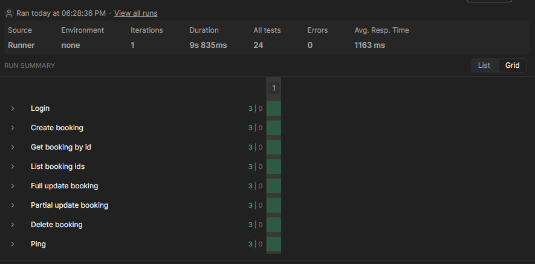

# Лабораторная работа № 2. Интеграционное и API-тестирование

**Студент:** Сауленко Егор

**Инструмент:** Postman (Collection Runner, Postman CLI)

**Коллекция:** `LabAPI_SAUL`

---

## 1. Тестируемый сервис

**Restful-Booker** - открытое учебное REST API бронирования отелей: https://restful-booker.herokuapp.com

Документация: https://restful-booker.herokuapp.com/apidoc/index.html

Коллекция содержит 8 запросов в 3 папках: `Auth`, `Booking`, `Health`. Переменные: `baseUrl = https://restful-booker.herokuapp.com`, `token = ""`, `bookingId = ""`.

| Папка | Запрос | Метод | Эндпоинт | Назначение |
|---|---|---|---|---|
| Auth | Login | POST | `/auth` | получение токена (`admin` / `password123`) → `token` |
| Booking | Create booking | POST | `/booking` | создание брони, `bookingid` → `bookingId` |
| Booking | Get booking by id | GET | `/booking/{id}` | чтение брони по id |
| Booking | List booking ids | GET | `/booking` | список id |
| Booking | Full update booking | PUT | `/booking/{id}` | полное обновление (нужен токен) |
| Booking | Partial update booking | PATCH | `/booking/{id}` | частичное обновление (нужен токен) |
| Booking | Delete booking | DELETE | `/booking/{id}` | удаление (нужен токен) |
| Health | Ping | GET | `/ping` | проверка доступности |

---

## 2. Тест-кейсы

Статусы: ✅ пройден · ⬜ не пройден.

### 2.1. Позитивные сценарии

Цепочка: создание → получение → список → PUT → PATCH → удаление → повторное получение.

| ID | Эндпоинт | Входные данные | Ожидаемый результат | Фактический результат | Статус |
|---|---|---|---|---|---|
| TC-P01 | POST `/auth` | `admin` / `password123` | 200, поле `token` | токен получен, сохранён в `token`, 3/3 проверки | ✅ |
| TC-P02 | POST `/booking` | `firstname: "Ivan"`, `lastname: "Petrov"`, `totalprice: 150` | 200, `bookingid` + `booking` | `bookingid` сохранён в `bookingId`, 3/3 | ✅ |
| TC-P03 | GET `/booking/{id}` | `{{bookingId}}` | 200, объект брони | 200, поля `firstname`/`lastname` есть | ✅ |
| TC-P04 | GET `/booking` | без фильтров | 200, массив с `bookingid` | 200, массив, каждый элемент с `bookingid` | ✅ |
| TC-P05 | PUT `/booking/{id}` | полный JSON, `Cookie: token={{token}}` | 200, обновлённые поля | 200, `firstname`/`lastname` обновлены | ✅ |
| TC-P06 | PATCH `/booking/{id}` | `{"firstname": "Petr"}` + токен | 200, изменён только `firstname` | 200, `firstname` = `Petr`, `lastname` не изменён | ✅ |
| TC-P07 | DELETE `/booking/{id}` | id + токен | по REST 200/204; по документации 201 | 201 Created, тело `Created` | ✅ |
| TC-P08 | GET `/ping` | - | по REST 200 | 201 Created, тело `Created` | ✅ |
| TC-P09 | GET `/booking/{id}` после удаления | удалённый id | 404 | 405 Method Not Allowed | ⬜ |

### 2.2. Негативные сценарии

| ID | Эндпоинт | Входные данные | Ожидаемый код | Фактический результат | Статус |
|---|---|---|---|---|---|
| TC-N01 | POST `/auth` | неверный пароль | 401 | 200 OK, `Bad credentials` | ⬜ |
| TC-N02 | POST `/auth` | неверный логин | 401 | 200 OK, `Bad credentials` | ⬜ |
| TC-N03 | PUT `/booking/{id}` | без токена | 401/403 | 404 Not Found | ⬜ |
| TC-N04 | PATCH `/booking/{id}` | `Cookie: token=wrong` | 401/403 | 404 Not Found | ⬜ |
| TC-N05 | DELETE `/booking/{id}` | без токена | 401/403 | 404 Not Found | ⬜ |
| TC-N06 | GET `/booking/{id}` | несуществующий id `99999999` | 404 | 404 Not Found | ✅ |
| TC-N07 | DELETE `/booking/{id}` | несуществующий id + валидный токен | 404 | 405 Method Not Allowed | ⬜ |
| TC-N08 | POST `/booking` | битый JSON (нет закрывающей скобки) | 400 | 400 Bad Request | ✅ |
| TC-N09 | POST `/booking` | `"totalprice": "150"` (строка) | 400 | 200 OK, `totalprice: null` | ⬜ |
| TC-N10 | POST `/booking` | нет поля `lastname` | 400 | 500 Internal Server Error | ⬜ |
| TC-N11 | POST `/booking` | тело `{}` | 400 | 500 Internal Server Error | ⬜ |
| TC-N12 | PUT `/booking/{id}` | неполный JSON (только `firstname`) | 400 | 403 Forbidden | ⬜ |

### 2.3. Граничные значения

| ID | Эндпоинт | Входные данные | Ожидаемый результат | Фактический результат | Статус |
|---|---|---|---|---|---|
| TC-B01 | POST `/booking` | `firstname = ""` | 400 | 200 OK | ⬜ |
| TC-B02 | POST `/booking` | `firstname` длиной 500+ символов | 400 или 200 без потери | 200 OK | ✅ |
| TC-B03 | POST `/booking` | `totalprice = 0` | 200 | 200 OK | ✅ |
| TC-B04 | POST `/booking` | `totalprice = -1` | 400 | 200 OK | ⬜ |
| TC-B05 | POST `/booking` | `totalprice = 10**12` | 400 или 200 | 200 OK | ✅ |
| TC-B06 | POST `/booking` | `checkout` = `checkin` | 400 | 200 OK | ⬜ |
| TC-B07 | POST `/booking` | `checkin = "2026-13-45"` | 400 | 200 OK, `"checkin": "0NaN-aN-aN"` | ⬜ |

### 2.4. Покрытые коды ответов

| Код | Где получен | Статус |
|---|---|---|
| 200 | TC-P01…P06, TC-N01, TC-N02, TC-N09, TC-B01…B07 | ✅ |
| 201 | TC-P07, TC-P08 | ✅ |
| 400 | TC-N08 | ✅ |
| 403 | TC-N12 | ✅ |
| 404 | TC-N03…N06 | ✅ |
| 405 | TC-P09, TC-N07 | ✅ |
| 500 | TC-N10, TC-N11 | ✅ |

Код 401 не получен: сервис его не использует, вместо него 200 с телом `Bad credentials`.

---

## 3. Код для вкладки Tests

В каждом запросе по 3 проверки, всего 24 на 8 запросов. Ниже полный код.

### 3.1. Login (POST `/auth`)

```javascript
pm.test("Status code is 200", function () {
    pm.response.to.have.status(200);
});

pm.test("Response contains token", function () {
    const jsonData = pm.response.json();
    pm.expect(jsonData).to.have.property("token");
});

pm.test("Token is a string", function () {
    const jsonData = pm.response.json();
    pm.expect(jsonData.token).to.be.a("string");
});

// сохранение токена
const jsonData = pm.response.json();
pm.collectionVariables.set("token", jsonData.token);
```

### 3.2. Create booking (POST `/booking`)

```javascript
pm.test("Status code is 200", function () {
    pm.response.to.have.status(200);
});

pm.test("Response contains bookingid", function () {
    const jsonData = pm.response.json();
    pm.expect(jsonData).to.have.property("bookingid");
});

pm.test("Booking firstname is Ivan", function () {
    const jsonData = pm.response.json();
    pm.expect(jsonData.booking.firstname).to.eql("Ivan");
});

// сохранение bookingid
const jsonData = pm.response.json();
pm.collectionVariables.set("bookingId", jsonData.bookingid);
```

### 3.3. Get booking by id (GET `/booking/{{bookingId}}`)

```javascript
pm.test("Status code is 200", function () {
    pm.response.to.have.status(200);
});

pm.test("Response is an object", function () {
    const jsonData = pm.response.json();
    pm.expect(jsonData).to.be.an("object");
});

pm.test("Response contains firstname and lastname", function () {
    const jsonData = pm.response.json();
    pm.expect(jsonData).to.have.property("firstname");
    pm.expect(jsonData).to.have.property("lastname");
});
```

### 3.4. List booking ids (GET `/booking`)

```javascript
pm.test("Status code is 200", function () {
    pm.response.to.have.status(200);
});

pm.test("Response is an array", function () {
    const jsonData = pm.response.json();
    pm.expect(jsonData).to.be.an("array");
});

pm.test("Each item contains bookingid", function () {
    const jsonData = pm.response.json();
    jsonData.forEach(function (item) {
        pm.expect(item).to.have.property("bookingid");
    });
});
```

### 3.5. Full update booking (PUT `/booking/{{bookingId}}`)

```javascript
pm.test("Status code is 200", function () {
    pm.response.to.have.status(200);
});

pm.test("Response contains updated firstname", function () {
    const jsonData = pm.response.json();
    pm.expect(jsonData.firstname).to.eql("Petr");
});

pm.test("Response contains lastname", function () {
    const jsonData = pm.response.json();
    pm.expect(jsonData.lastname).to.eql("Petrov");
});
```

### 3.6. Partial update booking (PATCH `/booking/{{bookingId}}`)

```javascript
pm.test("Status code is 200", function () {
    pm.response.to.have.status(200);
});

pm.test("Response contains updated firstname", function () {
    const jsonData = pm.response.json();
    pm.expect(jsonData.firstname).to.eql("Petr");
});

pm.test("Lastname remains unchanged", function () {
    const jsonData = pm.response.json();
    pm.expect(jsonData.lastname).to.eql("Petrov");
});
```

### 3.7. Delete booking (DELETE `/booking/{{bookingId}}`)

```javascript
pm.test("Status code is 201", function () {
    pm.response.to.have.status(201);
});

pm.test("Response body is 'Created'", function () {
    pm.expect(pm.response.text()).to.eql("Created");
});

pm.test("Response time is less than 2000ms", function () {
    pm.expect(pm.response.responseTime).to.be.below(2000);
});
```

### 3.8. Ping (GET `/ping`)

```javascript
pm.test("Status code is 201", function () {
    pm.response.to.have.status(201);
});

pm.test("Response body is 'Created'", function () {
    pm.expect(pm.response.text()).to.eql("Created");
});

pm.test("Response time is less than 2000ms", function () {
    pm.expect(pm.response.responseTime).to.be.below(2000);
});
```

---

## 4. Инструкция по созданию скриншота Collection Runner

Для подтверждения успешного прогона коллекции был сделан скриншот окна Collection Runner. 
Алгоритм действий:
1. В левой панели Postman навести курсор на коллекцию `LabAPI_SAUL` и нажать кнопку **Run**.
2. В открывшемся Runner нажать кнопку **Start run**.
3. Дождаться завершения прогона. В верхней части окна отображается сводка: **All tests**, **Passed**, **Failed**, **Errors**, **Avg. Resp. Time**.
4. На скриншот должны попасть: название коллекции, сводка (24 проверки, 0 ошибок), список запросов с кодами ответа (200, 201) и зелёные метки **PASS** у каждого теста.
5. Сохранить изображение в папку `screenshots/runner_results.png` рядом с отчетом.

---

## 5. Расхождения с документацией и дефекты

### 5.1. Таблица расхождений

| № | Запрос | Ожидалось (REST/документация) | Получено | Вывод |
|---|---|---|---|---|
| 1 | DELETE `/booking/{id}` (TC-P07) | 200/204 | **201 Created** | Особенность API / нарушение семантики REST |
| 2 | GET `/ping` (TC-P08) | 200 | **201 Created** | Особенность API / нарушение семантики REST |
| 3 | GET `/booking/{id}` после удаления (TC-P09) | 404 | **405 Method Not Allowed** | Дефект: для удалённого ресурса 405, хотя GET поддерживается; для несуществующего id (TC-N06) - 404 |
| 4 | POST `/auth` с неверными кредами (TC-N01, TC-N02) | 401 | **200 OK**, `Bad credentials` | Дефект: ошибка аутентификации с кодом успеха |
| 5 | PUT/PATCH/DELETE без токена (TC-N03…N05) | 401/403 | **404 Not Found** | Дефект: вместо отказа - «ресурс не найден»; PUT с неполным JSON (TC-N12) дал 403, поведение нестабильно |
| 6 | DELETE несуществующего id с валидным токеном (TC-N07) | 404 | **405 Method Not Allowed** | Дефект: неверный код для отсутствующего ресурса |
| 7 | POST `/booking` без `lastname` (TC-N10) | 400 | **500 Internal Server Error** | Дефект: ошибка клиента как ошибка сервера |
| 8 | POST `/booking` с `{}` (TC-N11) | 400 | **500 Internal Server Error** | Дефект: нет обработки пустого запроса |
| 9 | POST `/booking` с `totalprice: "150"` (TC-N09) | 400 | **200 OK**, `totalprice: null` | Дефект: нет проверки типа, значение молча обнуляется |
| 10 | POST `/booking` с `firstname = ""` (TC-B01) | 400 | **200 OK** | Дефект: пустые обязательные строки принимаются |
| 11 | POST `/booking` с `totalprice = -1` (TC-B04) | 400 | **200 OK** | Дефект: нет проверки диапазона |
| 12 | POST `/booking` с `checkout = checkin` (TC-B06) | 400 | **200 OK** | Дефект: нет проверки логики дат |
| 13 | POST `/booking` с `checkin = "2026-13-45"` (TC-B07) | 400 | **200 OK**, `"checkin": "0NaN-aN-aN"` | Дефект: нет проверки формата даты |

Остальные кейсы совпали с ожиданиями: несуществующий id при GET → 404 (TC-N06), битый JSON → 400 (TC-N08), `totalprice = 0` и очень большое число → 200 (TC-B03, TC-B05).

### 5.2. Баг-репорты

Во всех баг-репортах «валидное тело» - JSON, в котором меняется только указанное поле:

```json
{
  "firstname": "Ivan",
  "lastname": "Petrov",
  "totalprice": 150,
  "depositpaid": true,
  "bookingdates": {
    "checkin": "2026-12-01",
    "checkout": "2026-12-05"
  },
  "additionalneeds": "Lunch"
}
```

Заголовки: `Content-Type: application/json`, `Accept: application/json`. Для PUT/PATCH/DELETE дополнительно `Cookie: token=<token>`.

#### BUG-01. DELETE `/booking/{id}` возвращает 201 Created

- **Шаги:** `POST /auth` → `POST /booking` → `DELETE /booking/{id}` с токеном.
- **Ожидаемо:** 200 или 204.
- **Фактически:** 201 Created, тело `Created`.
- **Серьёзность:** низкая. Удаление работает, но код нарушает семантику.

#### BUG-02. GET `/ping` возвращает 201 Created

- **Шаги:** `GET /ping`.
- **Ожидаемо:** 200.
- **Фактически:** 201 Created, тело `Created`.
- **Серьёзность:** низкая. Мониторинг по коду 200 будет считать сервис недоступным.

#### BUG-03. POST `/auth` с неверными кредами возвращает 200 OK

- **Шаги:** `POST /auth` с `{"username": "admin", "password": "wrong"}`, затем с `{"username": "wrong", "password": "password123"}`.
- **Ожидаемо:** 401.
- **Фактически:** 200 OK, `Bad credentials` (TC-N01, TC-N02).
- **Серьёзность:** средняя. Клиент должен разбирать тело, проверки по статусу ошибку не ловят.

#### BUG-04. 405 вместо 404 для отсутствующего ресурса

- **Шаги:** (A) создать и удалить бронь, затем `GET /booking/{id}`; (B) `DELETE /booking/{id}` с токеном для несуществующего id.
- **Ожидаемо:** 404.
- **Фактически:** 405 Method Not Allowed (TC-P09, TC-N07). При этом `GET /booking/99999999` даёт корректный 404 (TC-N06).
- **Серьёзность:** низкая. Код вводит в заблуждение.

#### BUG-05. PUT/PATCH/DELETE без токена или с неверным токеном возвращают 404

- **Шаги:** PUT без `Cookie`; PATCH с `token=wrong`; DELETE без `Cookie`.
- **Ожидаемо:** 401 или 403.
- **Фактически:** 404 Not Found (TC-N03…N05). PUT с неполным JSON (TC-N12) вернул 403 - поведение нестабильно.
- **Серьёзность:** средняя. Вместо отказа - «ресурс не найден».
- **Примечание:** повторить с id существующей брони для окончательного вывода.

#### BUG-06. POST `/booking` с неполными данными возвращает 500

- **Шаги:** POST без `lastname`; POST с телом `{}`.
- **Ожидаемо:** 400 с описанием ошибки.
- **Фактически:** 500 Internal Server Error (TC-N10, TC-N11). Битый JSON при этом даёт корректный 400 (TC-N08).
- **Серьёзность:** средняя.

#### BUG-07. POST `/booking` принимает строку в `totalprice` и сохраняет `null`

- **Шаги:** POST с `"totalprice": "150"`.
- **Ожидаемо:** 400.
- **Фактически:** 200 OK, `"totalprice": null` (TC-N09).
- **Серьёзность:** высокая. Нет проверки типа, финансовое поле искажается.

#### BUG-08. POST `/booking` принимает пустой `firstname`

- **Шаги:** POST с `"firstname": ""`.
- **Ожидаемо:** 400.
- **Фактически:** 200 OK (TC-B01).
- **Серьёзность:** низкая. Нет проверки на пустые строки.

#### BUG-09. POST `/booking` принимает отрицательный `totalprice`

- **Шаги:** POST с `"totalprice": -1`.
- **Ожидаемо:** 400.
- **Фактически:** 200 OK (TC-B04).
- **Серьёзность:** средняя. Нет проверки диапазона.

#### BUG-10. POST `/booking` принимает `checkout` = `checkin`

- **Шаги:** POST с `"checkin": "2026-12-05"`, `"checkout": "2026-12-05"`.
- **Ожидаемо:** 400.
- **Фактически:** 200 OK (TC-B06).
- **Серьёзность:** средняя. Нет проверки логики дат.

#### BUG-11. POST `/booking` сохраняет повреждённую дату

- **Шаги:** POST с `"checkin": "2026-13-45"`.
- **Ожидаемо:** 400.
- **Фактически:** 200 OK, `"checkin": "0NaN-aN-aN"` (TC-B07).
- **Серьёзность:** высокая. В хранилище попадает некорректное значение.

#### Сводка по дефектам

| ID | Кратко | Серьёзность |
|---|---|---|
| BUG-01 | DELETE → 201 вместо 200/204 | Низкая |
| BUG-02 | `/ping` → 201 вместо 200 | Низкая |
| BUG-03 | Неверные креды → 200 вместо 401 | Средняя |
| BUG-04 | 405 вместо 404 для отсутствующего ресурса | Низкая |
| BUG-05 | Нет токена → 404 вместо 401/403 | Средняя |
| BUG-06 | Неполные данные → 500 вместо 400 | Средняя |
| BUG-07 | Строка в `totalprice` → `null` | Высокая |
| BUG-08 | Принимается пустой `firstname` | Низкая |
| BUG-09 | Принимается отрицательный `totalprice` | Средняя |
| BUG-10 | `checkout` = `checkin` принимается | Средняя |
| BUG-11 | Невалидная дата → `0NaN-aN-aN` | Высокая |

---

## 6. Прогон в Collection Runner



| Параметр | Значение |
|---|---|
| Коллекция | LabAPI_Burtsev |
| Источник | Runner |
| Окружение | none |
| Итераций | 1 |
| Всего проверок | 24 |
| Пройдено | 24 |
| Провалено | 0 |
| Ошибок | 0 |
| Среднее время ответа | 1163 мс |

Цепочка выполняется без ручного вмешательства: `token` и `bookingId` передаются через переменные коллекции. Во всех PATCH/PUT/DELETE использован один и тот же `id`, полученный при создании брони.

---

## 7. Экспортированные файлы

Экспорт коллекции: **Collections → `LabAPI_SAUL` → … (View more actions) → More → Export collection → Export JSON**.

- `LabAPI_SAUL.postman_collection.json` - коллекция запросов с переменными (лежит в корне репозитория).
- `LabAPI_SAUL.postman_test_run.json` - файл с результатами прогона, полученный при запуске через Postman CLI.
- (если создавалось окружение) `LabAPI_SAUL.postman_environment.json` - окружение.

---

## 8. Выводы

В работе освоено тестирование REST API в Postman: собрана коллекция с папками по ресурсам, покрыты все 8 эндпоинтов, настроена автоматическая передача `token` и `bookingId`. Полный прогон в Collection Runner завершился успешно: 24 проверки из 24 пройдены, ошибок нет, среднее время ответа укладывается в порог 2000 мс.

Сравнение с REST-практиками выявило нестандартное поведение API: DELETE и `/ping` возвращают 201 Created; ошибки аутентификации сообщаются кодом 200 с телом `Bad credentials`; отсутствие токена даёт 404 вместо 401/403; невалидные данные (строка в `totalprice`, пустые имена, отрицательная цена, неверные даты) принимаются с кодом 200, а неполный JSON - 500. Часть расхождений оформлена как дефекты разной серьёзности (высокая - для искажения данных: BUG-07, BUG-11), часть - как особенности API низкой серьёзности (BUG-01, BUG-02).

Автоматические проверки статуса, структуры ответа и времени ответа позволяют повторно запускать сценарий после изменений сервиса и быстро находить регрессии. Как и в лабораторной работе № 1, тесты фиксируют фактическое поведение, а расхождения с ожиданиями остаются предметом отдельного решения - исправлять сервис или документировать его особенности.