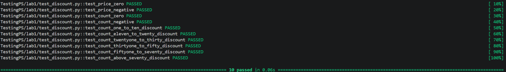

# Лабораторная работа №1 <br> Составление тест-кейсов для готового кода. Качество ПО и место тестирования в жизненном цикле
**Цель работы:** сформировать системное представление о качестве ПО и роли тестирования в жизненном цикле; приобрести практические навыки проектирования тест-кейсов и написания автотестов на основе готового кода.


## Ход работы

**calc_discount** — функция для вычисления скидки в зависимости от количества товаров.

**Бизнес-правила.** Скидка зависит от количества товаров:
  | Количество | Cкидка |
  | -------| --- |
  | 1-10   | 1%  |
  | 11-20  | 2%  |
  | 21-30  | 4%  |
  | 31--50 | 6%  |
  | 51-70  | 8%  |
  | >70    | 9%  |

**Входные параметры:**
  - price (вещественное/целочисленное) — цена товара;
  - count (целочисленное) — количество товаров.

**Возвращаемое значение:** целочисленное — стоимость покупки с учетом скидки.

**Допустимые значения:**
  - цена (price) может быть только положительной;
  - количество товаров (count) может быть только положительным;

## Исходный код

```python
def calc_discount(price, count):
  if price <= 0:
    raise ValueError("error: price must be positive")
  if count < 0:
    raise ValueError("error: count cannot be negative")
  
  discount = 0.0
  
  if 1 <= count <= 10:
      discount += 0.01
  elif 11 <= count <= 20:
      discount += 0.02
  elif 21 <= count <= 30:
      discount += 0.04
  elif 31 <= count <= 50:
      discount += 0.06
  elif 51 <= count <= 70:
      discount += 0.08
  elif count > 70:
      discount += 0.09

  return round(price * (1 - discount))
```

## Автотесты

```python

import pytest
from discount import calc_discount


def test_price_zero():
  with pytest.raises(ValueError):
    calc_discount(0, 5)


def test_price_negative():
  with pytest.raises(ValueError):
    calc_discount(-10, 5)


def test_count_negative():
  with pytest.raises(ValueError):
    calc_discount(100, -1)


def test_count_zero():
  assert calc_discount(100, 0) == 100


def test_count_one_to_ten_discount():
  assert calc_discount(100, 10) == 99


def test_count_eleven_to_twenty_discount():
  assert calc_discount(100, 20) == 98


def test_count_twentyone_to_thirty_discount():
  assert calc_discount(100, 30) == 96


def test_count_thirtyone_to_fifty_discount():
  assert calc_discount(100, 50) == 94


def test_count_fiftyone_to_seventy_discount():
  assert calc_discount(100, 70) == 92


def test_count_above_seventy_discount():
  assert calc_discount(100, 71) == 91
```

**Результат тестирования:**

