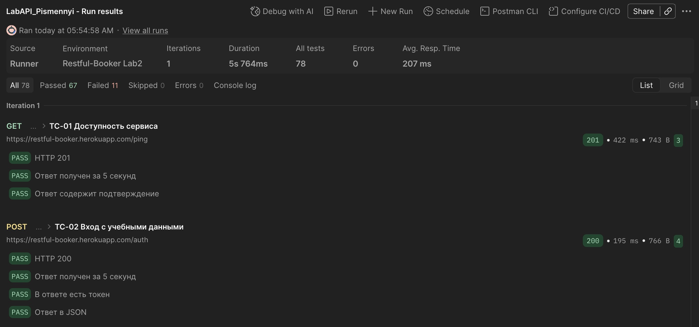
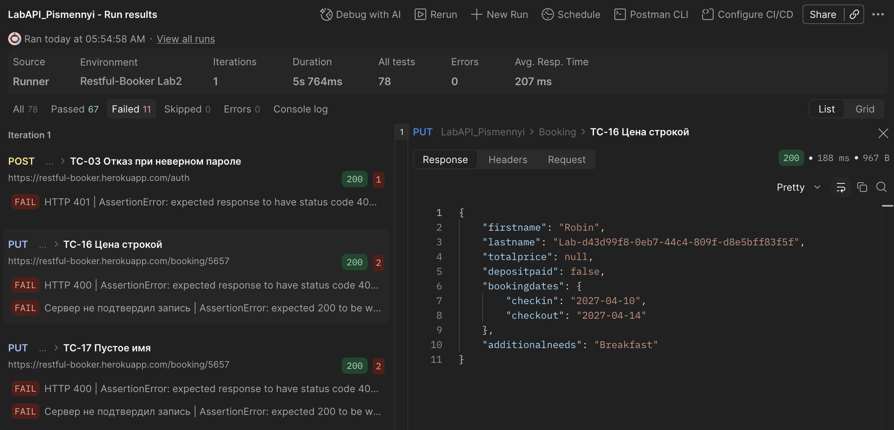
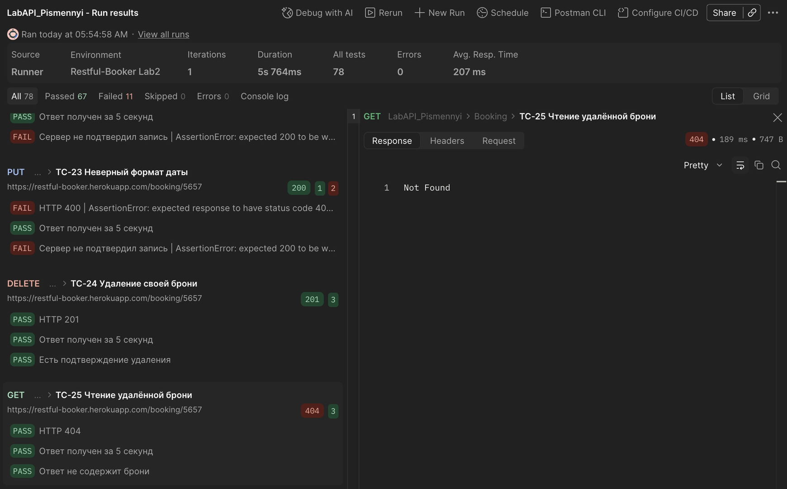

# Лабораторная работа № 2 по тестированию ПС. Интеграционное и API-тестирование Restful-Booker

**Письменный Антон, группа ПВ-232**

Цель работы — проверить в Postman полный цикл бронирования и выяснить, как API обрабатывает некорректные данные. [Задание](https://github.com/d26dodenko/PV-232/blob/bb38d870c19d5f2a9365dd053ae4bdd09defeb4c/TestingPS/Laba-2.md)

Restful-Booker — учебный REST API для бронирования гостиничных номеров. [Документация API](https://restful-booker.herokuapp.com/apidoc/index.html)

[Коллекция LabAPI_Pismennyi](postman/collection.json) · [Окружение Restful-Booker Lab2](postman/environment.json)

## Проверяемые операции

| Папка | Операция | Что проверяется |
|---|---|---|
| Health | `GET /ping` | Доступность сервиса |
| Auth | `POST /auth` | Выдача токена при входе и отказ при неверном пароле |
| Booking | `POST /booking` | Создание брони и получение её ID |
| Booking | `GET /booking` | Поиск созданной брони по уникальной фамилии |
| Booking | `GET /booking/{id}` | Чтение полей, проверка изменений и отсутствия записи после удаления |
| Booking | `PUT /booking/{id}` | Полное обновление и проверка входных значений |
| Booking | `PATCH /booking/{id}` | Изменение одного поля, сохранность остальных и проверка доступа |
| Booking | `DELETE /booking/{id}` | Удаление тестовой брони |

В каждой итерации коллекция получала токен и создавала бронь с уникальной фамилией. Токен и ID передавались через переменные окружения `token` и `bookingId`. Все запросы по ID обращались к этой брони. Проверки доступа выполнялись без сохранённых cookie.

## Тест-кейсы

Для успешных операций ожидаемые коды взяты из документации, в том числе `200` при создании брони и `201` для проверки доступности и удаления. Для проверки неверного пароля принят критерий `401`, для ошибок ввода — `400`. Отрицательная цена, пустое имя и выезд до заезда оцениваются по правилам предметной области. В документации эти ограничения явно не заданы. Допустимое время ответа в условиях прогона — менее 5 секунд для каждого запроса.

В таблице приведены результаты повторного прогона в Collection Runner. В каждой строке указано число успешных автоматических проверок из общего числа. Статус FAIL означает, что хотя бы одно ожидание теста не выполнено.

| ID | Эндпоинт | Тип | Входные данные | Ожидалось | Получено | Статус |
|---|---|---|---|---|---|---|
| TC-01 | `GET /ping` | Позитивный | без параметров | 201 · Сервис вернул подтверждение доступности | 201 · `Created` | PASS 3/3 |
| TC-02 | `POST /auth` | Позитивный | демонстрационная учётная запись из задания | 200 · Получен непустой токен для операций записи | 200 · Выдан токен | PASS 4/4 |
| TC-03 | `POST /auth` | Негативный | учебный логин, неверный пароль | 401 · Токен не выдан, сервер сообщил об отказе | 200 · `Bad credentials`, токен не выдан | FAIL 3/4 |
| TC-04 | `POST /booking` | Позитивный | Robin, уникальная фамилия прогона, цена 125, 10–14 апреля 2027 | 200 · Получен новый ID, все поля совпали с отправленными | 200 · Получены ID и все поля новой брони | PASS 4/4 |
| TC-05 | `GET /booking?lastname={метка}` | Позитивный | фамилия созданной брони | 200 · Список содержит ID брони этого прогона | 200 · Найден один ID, совпадает с созданным | PASS 3/3 |
| TC-06 | `GET /booking/{id}` | Позитивный | ID из TC-04 | 200 · Сервер вернул данные, отправленные при создании брони | 200 · Все поля совпали с данными из TC-04 | PASS 3/3 |
| TC-07 | `PUT /booking/{id}` | Позитивный | цена 180, предоплата внесена, дополнение Breakfast and tea | 200 · Сервер вернул полную обновлённую бронь | 200 · Цена 180, предоплата внесена, дополнение `Breakfast and tea` | PASS 3/3 |
| TC-08 | `GET /booking/{id}` | Позитивный | ID из TC-04 | 200 · Изменения из TC-07 сохранились | 200 · Цена 180, предоплата внесена, дополнение `Breakfast and tea` | PASS 3/3 |
| TC-09 | `PATCH /booking/{id}` | Позитивный | только additionalneeds = Late arrival | 200 · Изменено одно поле, остальные сохранены | 200 · Дополнение изменилось на `Late arrival`, остальные поля совпали с TC-08 | PASS 3/3 |
| TC-10 | `GET /booking/{id}` | Позитивный | ID из TC-04 | 200 · Новое пожелание гостя сохранилось | 200 · Прочитано `Late arrival`, остальные поля совпали с TC-08 | PASS 3/3 |
| TC-11 | `PATCH /booking/{id}` | Негативный | без cookie, собственная бронь | 403 · Изменение отклонено | 403 · `Forbidden` | PASS 3/3 |
| TC-12 | `PATCH /booking/{id}` | Негативный | cookie с недействительным токеном, собственная бронь | 403 · Изменение отклонено | 403 · `Forbidden` | PASS 3/3 |
| TC-13 | `GET /booking/{id}` | Позитивный | ID из TC-04 после двух отказов в доступе | 200 · Отклонённые изменения из TC-11 и TC-12 не затронули бронь | 200 · Все поля совпали с данными из TC-10 | PASS 3/3 |
| TC-14 | `PUT /booking/{id}` | Негативный | незавершённый объект JSON | 400 · Сервер отклонил некорректный документ | 400 · `Bad Request` | PASS 3/3 |
| TC-15 | `PUT /booking/{id}` | Негативный | полный набор без firstname | 400 · Сервер указал на ошибку клиента | 400 · `Bad Request` | PASS 3/3 |
| TC-16 | `PUT /booking/{id}` | Негативный | totalprice = «tea» | 400 · Недопустимые данные отклонены | 200 · В ответе `totalprice: null` | FAIL 1/3 |
| TC-17 | `PUT /booking/{id}` | Граничный | firstname — пустая строка | 400 · Недопустимые данные отклонены | 200 · В ответе пустое `firstname` | FAIL 1/3 |
| TC-18 | `PUT /booking/{id}` | Граничный | имя из 1001 буквы A | 200 · Сохранены все переданные значения | 200 · Получено имя из 1001 буквы A без усечения | PASS 3/3 |
| TC-19 | `PUT /booking/{id}` | Граничный | totalprice = 0 | 200 · Сохранены все переданные значения | 200 · В ответе цена 0 | PASS 3/3 |
| TC-20 | `PUT /booking/{id}` | Граничный | totalprice = −1 | 400 · Недопустимые данные отклонены | 200 · В ответе цена −1 | FAIL 1/3 |
| TC-21 | `PUT /booking/{id}` | Граничный | totalprice = 1000000000 | 200 · Сохранены все переданные значения | 200 · Возвращена точная цена 1 000 000 000 | PASS 3/3 |
| TC-22 | `PUT /booking/{id}` | Граничный | заезд 10 апреля, выезд 9 апреля 2027 | 400 · Недопустимые данные отклонены | 200 · В ответе даты 10 и 9 апреля в обратном порядке | FAIL 1/3 |
| TC-23 | `PUT /booking/{id}` | Граничный | checkin = «april», checkout = 2027-04-14 | 400 · Недопустимые данные отклонены | 200 · В ответе дата `0NaN-aN-aN` | FAIL 1/3 |
| TC-24 | `DELETE /booking/{id}` | Позитивный | ID из TC-04 и действительный токен | 201 · Сервер подтвердил удаление | 201 · `Created` | PASS 3/3 |
| TC-25 | `GET /booking/{id}` | Негативный | ID записи после удаления | 404 · Ресурс отсутствует | 404 · `Not Found` | PASS 3/3 |

## Расхождения

| Тест | Запрос | Ожидалось | Получено | Вывод |
|---|---|---|---|---|
| TC-01, TC-04, TC-24 | `GET /ping`, `POST /booking`, `DELETE /booking/{id}` | Типичные коды для этих операций — 200, 201 и 204 соответственно | 201, 200 и 201 | Особенность API. Все три кода совпали с примерами в документации, поэтому проверки прошли |
| TC-03 | `POST /auth` | Неверный пароль — HTTP 401 | HTTP 200 с причиной отказа, токена нет | Особенность API. Клиенту нужно проверять наличие токена |
| TC-16 | `PUT /booking/{id}` | Ошибка типа цены — HTTP 400 | HTTP 200, цена превратилась в `null` | Нарушен документированный числовой тип, BR-01 |
| TC-17 | `PUT /booking/{id}` | У гостя есть имя | HTTP 200 с пустым именем | Ограничение на непустую строку в документации не задано |
| TC-20 | `PUT /booking/{id}` | Цена неотрицательна | HTTP 200 с ценой −1 | Ограничение на знак цены в документации не задано |
| TC-22 | `PUT /booking/{id}` | Дата выезда не раньше даты заезда | HTTP 200 с обратным интервалом | Расхождение с принятой бизнес-проверкой, BR-02 |
| TC-23 | `PUT /booking/{id}` | Нераспознанная дата отклоняется | HTTP 200, в ответе повреждённое представление даты | В ответе отсутствует корректная дата, BR-03 |

## Баг-репорты

Во всех трёх случаях использовались бронь из TC-04, действительный токен и полное тело запроса `PUT`. Фактические значения ниже получены из ответа на обновление.

| ID | Шаги | Ожидаемый результат | Фактический результат | Серьёзность |
|---|---|---|---|---|
| BR-01. Цена теряет значение | Передать в поле `totalprice` строку `tea` и прочитать цену в ответе (TC-16) | Ошибка 400 с указанием неверного типа | HTTP 200 и `totalprice: null`. Клиент получает подтверждение обновления без числовой цены | Средняя |
| BR-02. Обратный интервал проживания | Отправить заезд 10 апреля и выезд 9 апреля 2027 года (TC-22) | Ошибка 400 по принятому правилу дат | HTTP 200 с интервалом отрицательной длительности | Средняя, по бизнес-правилу лабораторной |
| BR-03. Искажается дата заезда | Передать `april` вместо даты заезда, дату выезда оставить корректной (TC-23) | Ошибка 400, которую можно показать пользователю | HTTP 200, поле `checkin` содержит `0NaN-aN-aN` | Средняя |

## Результаты Collection Runner

В повторном прогоне полностью прошли 19 из 25 сценариев. Из 78 проверок прошли 67, остальные 11 относятся к шести сценариям с расхождениями. Пропусков и ошибок выполнения не было. В первом прогоне дополнительно сработала проверка времени в TC-01. Сервис ответил за 5785 мс при пороге 5000 мс, а при повторе — за 422 мс.

**Проверка цены (TC-16).** Вместо ожидаемой ошибки 400 сервер вернул 200. В теле ответа видно значение `null` в поле `totalprice`.

**Завершение цепочки (TC-24 и TC-25).** Удаление брони вернуло 201. Чтение по тому же ID вернуло 404 и тело `Not Found`.

## Вывод

Сервис создал, обновил и удалил тестовую бронь. После частичного обновления остальные поля сохранились. Обе попытки изменить бронь без действительного токена вернули 403, а последующее чтение подтвердило, что данные остались прежними. При передаче строки вместо цены или некорректной даты сервер вернул 200. В первом случае цена в ответе стала `null`, во втором дата заезда приняла значение `0NaN-aN-aN`.
