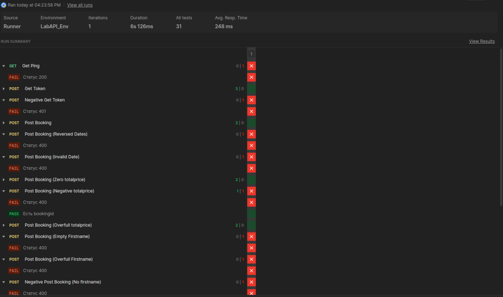
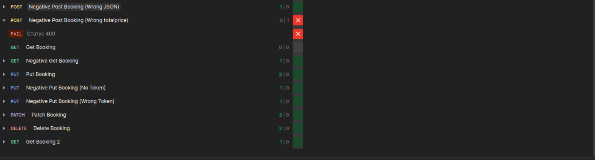

# Лабораторная работа «Интеграционное и API-тестирование»

**Выполнил:** Смольяков Артём ПВ-232
**Тестируемая система:** Restful-Booker (https://restful-booker.herokuapp.com)  
**Инструмент тестирования:** Postman

## 1. Название сервиса и краткое описание тестируемых эндпоинтов

**Restful-Booker** — открытое учебное API для бронирования отелей, предназначенное для практики интеграционного и API-тестирования. 

В ходе работы тестировались следующие эндпоинты:

| Метод | Эндпоинт | Назначение |
|---|---|---|
| POST | `/auth` | Получение токена (логин `admin`, пароль `password123`) |
| GET | `/booking` | Получение списка идентификаторов бронирований (с фильтрами) |
| GET | `/booking/{id}` | Получение конкретного бронирования по ID |
| POST | `/booking` | Создание нового бронирования |
| PUT | `/booking/{id}` | Полное обновление (требует авторизации) |
| PATCH | `/booking/{id}` | Частичное обновление (требует авторизации) |
| DELETE | `/booking/{id}` | Удаление бронирования (требует авторизации) |
| GET | `/ping` | Проверка работоспособности (health-check) |

Была создана коллекция `LabAPI_Smolyakov` с папками `Auth`, `Booking`, `Health`. Настроены переменные окружения `LabAPI_Env`: `baseUrl`, `token` и `bookingId`. В скриптах Tests настроена автоматическая передача токена и `bookingId` между запросами.

## 2. Таблица тест-кейсов

| ID | Endpoint | Type | Входные данные / Условия | Ожидаемый результат (по REST/документации) | Фактический результат (поведение Booker) | Статус |
|---|---|---|---|---|---|---|
| TC-AUTH-01 | POST `/auth` | Позитивный | `{"username":"admin","password":"password123"}` | 200, тело содержит `token` | 200, возвращает `token` | Pass |
| TC-AUTH-02 | POST `/auth` | Негативный | `{"username":"wrong","password":"password123"}` | 401 Unauthorized | **200**, тело `{"reason":"Bad credentials"}` | Fail (расхождение) |
| TC-PING-01 | GET `/ping` | Позитивный | Нет | 200 OK | **201 Created** | Fail (расхождение) |
| TC-BOOK-01 | POST `/booking` | Позитивный | Полные валидные данные | 200, содержит `bookingid` | 200, содержит `bookingid` | Pass |
| TC-BOOK-02 | GET `/booking/{{id}}` | Позитивный | Существующий `bookingId` | 200, данные соответствуют созданным | 200 | Pass |
| TC-BOOK-03 | PUT `/booking/{{id}}` | Позитивный | Cookie `token={{token}}`, полное валидное тело | 200, данные обновлены | 200 | Pass |
| TC-BOOK-04 | PATCH `/booking/{{id}}` | Позитивный | Cookie `token={{token}}`, `{"firstname":"Sidor"}` | 200, часть полей обновлена | 200 | Pass |
| TC-BOOK-05 | DELETE `/booking/{{id}}` | Позитивный | Cookie `token={{token}}` | 204 No Content | **201 Created** | Pass |
| TC-BOOK-06 | GET `/booking/{{id}}` | Позитивный | Повторный запрос после удаления | 404 Not Found | 404 | Pass |
| TC-BOOK-07 | PUT `/booking/{{id}}` | Негативный | Без Cookie токена | 403 Forbidden | **403 Forbidden** | Pass |
| TC-BOOK-08 | PUT `/booking/{{id}}` | Негативный | Неверный токен `Cookie: token=abc` | 403 Forbidden | 403 | Pass |
| TC-BOOK-09 | GET `/booking/999999`| Негативный | Несуществующий ID | 404 Not Found | 404 | Pass |
| TC-BOOK-10 | POST `/booking` | Негативный | Некорректный JSON `{bad json` | 400 Bad Request | 400 | Pass |
| TC-BOOK-11 | POST `/booking` | Негативный | `"totalprice":"abc"` (неверный тип) | 400 Bad Request | 200 | Fail (расхождение) |
| TC-BOOK-12 | POST `/booking` | Негативный | Отсутствует `firstname` | 400 Bad Request | 500 Internal Server Error | Fail (расхождение) |
| TC-BV-01 | POST `/booking` | Граничное | `firstname=""` (пустая строка) | 400 Bad Request | 200, создано с пустой строкой | Fail (расхождение) |
| TC-BV-02 | POST `/booking` | Граничное | `firstname` длиной 1001 символ | 400 Bad Request | 200, сохраняется полностью | Fail (расхождение) |
| TC-BV-03 | POST `/booking` | Граничное | `totalprice=0` | 200 OK | 200, сохраняется как 0 | Pass |
| TC-BV-04 | POST `/booking` | Граничное | `totalprice=-1` | 400 Bad Request | **200**, сохраняется отрицательное число | Fail (расхождение) |
| TC-BV-05 | POST `/booking` | Граничное | `totalprice=999999999` | 200 OK | 200, сохраняется | Pass |
| TC-BV-06 | POST `/booking` | Граничное | `checkout` раньше `checkin` | 400 Bad Request | **200**, даты сохраняются без валидации | Fail (расхождение) |
| TC-BV-07 | POST `/booking` | Граничное | `checkin="2026-13-45"` (невалидная дата) | 400 Bad Request | 200 | Fail (расхождение) |

## 3. Таблица расхождений с документацией и баг-репорты

### Таблица расхождений

| № | Запрос | Ожидалось (по REST/документации) | Получено | Вывод (дефект / особенность) |
|---|---|---|---|---|
| 1 | POST `/auth` (неверный логин) | 401 Unauthorized | **200 OK** + `{"reason":"Bad credentials"}` | **Особенность API**: ошибка аутентификации передаётся в теле ответа при коде 200. Формально дефект семантики HTTP, но для Booker — задокументированное поведение. |
| 2 | GET `/ping` | 200 OK | **201 Created** | **Особенность API**: нестандартный код для health-check. Расхождение с REST-семантикой. |
| 3 | DELETE `/booking/{id}` | 204 No Content | **201 Created** | **Особенность API**: удаление возвращает 201 вместо 204. Функционально объект удаляется, но расхождение с REST-семантикой. |
| 4 | POST `/booking` (`"totalprice":"abc"`) | 400 Bad Request | **200 OK** (создано) | **Дефект валидации**: API принимает строку в числовом поле без ошибки. Риск некорректных данных в хранилище. |
| 5 | POST `/booking` (отсутствует `firstname`) | 400 Bad Request | **500 Internal Server Error** | **Дефект обработки ошибок**: отсутствие обязательного поля приводит к внутренней ошибке сервера вместо клиентской ошибки 400. |
| 6 | POST `/booking` (`firstname=""`) | 400 Bad Request | **200 OK** (создано с пустой строкой) | **Дефект валидации**: пустое значение обязательного поля принимается. |
| 7 | POST `/booking` (`firstname` = 1001 символ) | 400 Bad Request | **200 OK** (сохранено полностью) | **Дефект валидации**: отсутствует ограничение длины поля. |
| 8 | POST `/booking` (`totalprice=-1`) | 400 Bad Request | **200 OK** (сохранено) | **Дефект валидации**: отрицательная цена принимается без проверки. |
| 9 | POST `/booking` (`checkout` раньше `checkin`) | 400 Bad Request | **200 OK** (даты сохранены как есть) | **Дефект бизнес-валидации**: отсутствует проверка логической корректности периода бронирования. |
| 10 | POST `/booking` (`checkin="2026-13-45"`) | 400 Bad Request | **200 OK** | **Дефект валидации**: невалидный формат даты принимается. |

### Баг-репорты

**BUG-01: 500 Internal Server Error при отсутствии обязательного поля**
- **Шаги воспроизведения:**
  1. Выполнить `POST /booking`.
  2. В теле запроса убрать поле `firstname`, остальные поля оставить валидными.
- **Ожидаемый результат:** `400 Bad Request` с описанием ошибки валидации.
- **Фактический результат:** `500 Internal Server Error`.
- **Серьёзность:** Major — серверная ошибка вместо клиентской, усложняет диагностику.

**BUG-02: Принимается неверный тип данных в `totalprice`**
- **Шаги воспроизведения:**
  1. Выполнить `POST /booking`.
  2. Передать `"totalprice": "abc"` (строка вместо числа).
- **Ожидаемый результат:** `400 Bad Request`.
- **Фактический результат:** `200 OK`, бронирование создано.
- **Серьёзность:** Major — нарушение целостности данных.

**BUG-03: Принимается отрицательная цена и некорректный период дат**
- **Шаги воспроизведения:**
  1. Выполнить `POST /booking` с `"totalprice": -1`.
  2. Выполнить `POST /booking` с `checkout` раньше `checkin` (например, `checkin: "2026-11-08"`, `checkout: "2026-10-08"`).
- **Ожидаемый результат:** `400 Bad Request` в обоих случаях.
- **Фактический результат:** `200 OK`, данные сохранены.
- **Серьёзность:** Major — отсутствие бизнес-валидации.

## 4. Скриншоты прогона коллекции в Collection Runner

По результатам прогона в Collection Runner (1 итерация, 6s 126ms, 31 тест, среднее время ответа 248 мс) были выявлены как успешные проверки (зеленые), так и ожидаемые падения (красные), связанные с расхождением фактического поведения API и ожидаемых стандартов.

## 5. Экспортированные файлы коллекции и окружения (JSON)

К отчету прилагаются файлы:
1. `LabAPI_Smolyakov.postman_collection.json` — экспортированная коллекция запросов с папками `Health`, `Auth`, `Booking`, содержащая скрипты автотестов и описания запросов.
2. `LabAPI_Env.postman_environment.json` — файл окружения с переменными `baseUrl`, `token`, `bookingId`.

## 6. Краткие выводы

В ходе лабораторной работы было освоено интеграционное и API-тестирование на примере публичного учебного сервиса Restful-Booker. В Postman была построена коллекция запросов с переменными окружения (`baseUrl`, `token`, `bookingId`), настроена автоматическая передача токена и идентификатора бронирования между запросами, а также написаны автотесты.

В результате прогона были проверены все эндпоинты, включая позитивную цепочку (создание → получение → обновление → удаление), негативные сценарии, граничные значения и различные коды ответов. Основным наблюдением стало существенное расхождение фактического поведения API с REST-стандартом и документацией.

Таким образом, работа показала, что реальное API может значительно отличаться от «идеального» REST как по кодам ответов (например, 201 вместо 204 при DELETE), так и по строгости валидации (принятие отрицательных цен и невалидных дат). Тестирование должно опираться на фактическое поведение сервиса, а расхождения — фиксироваться в отдельной таблице и оформляться баг-репортами. Полученные навыки (построение коллекций, автоматизация переменных, Collection Runner, анализ расхождений) применимы к тестированию любых реальных REST API.