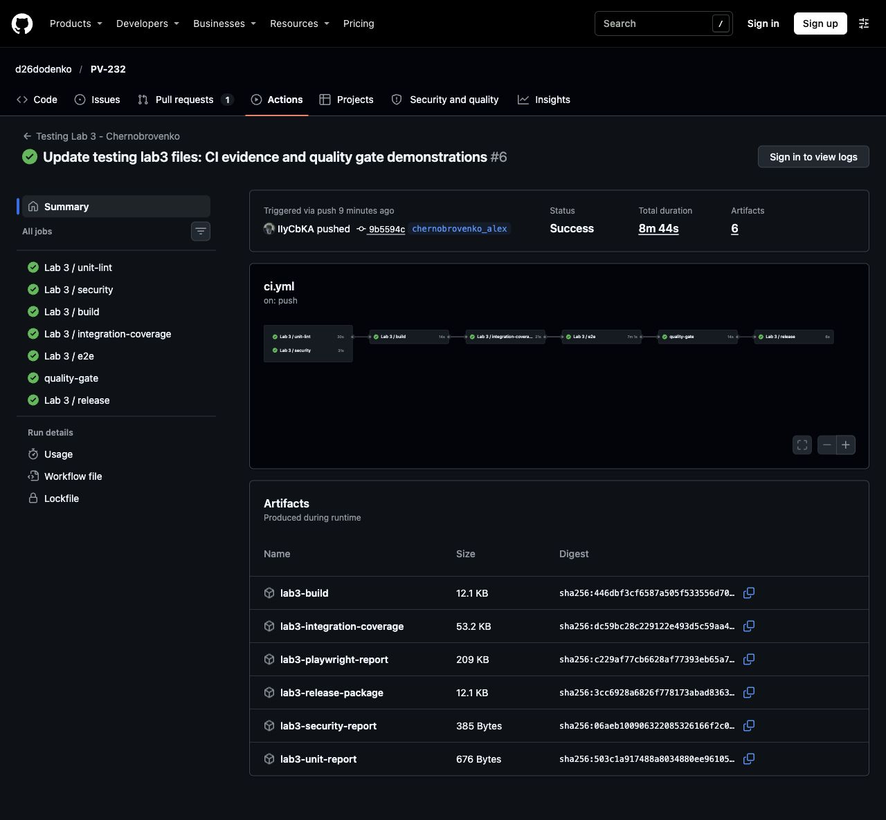
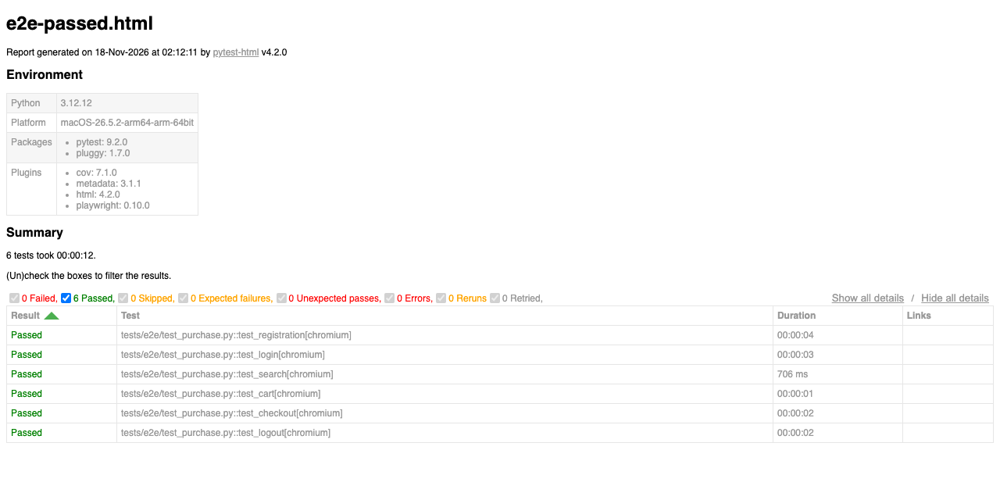
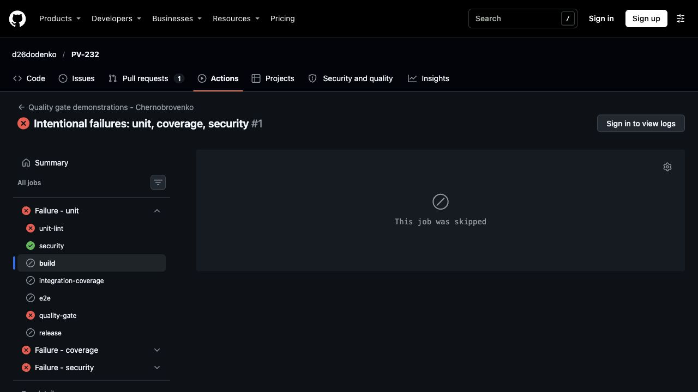
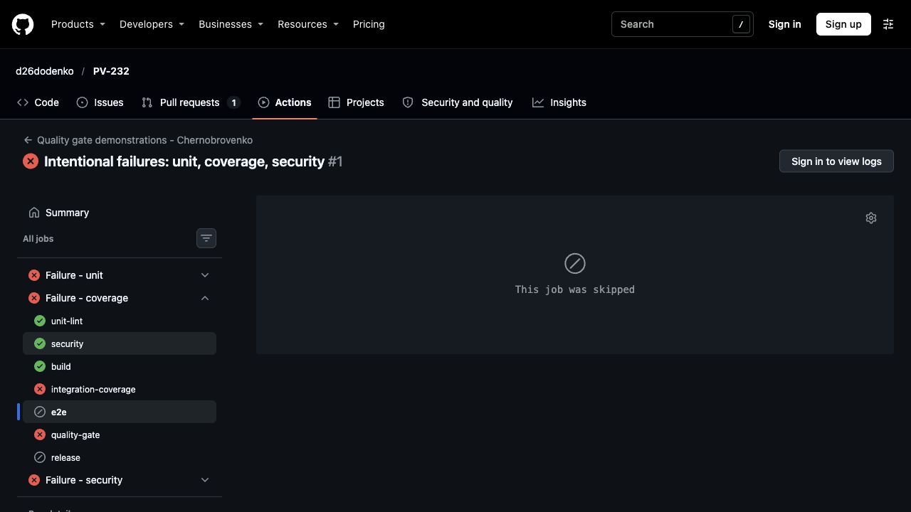
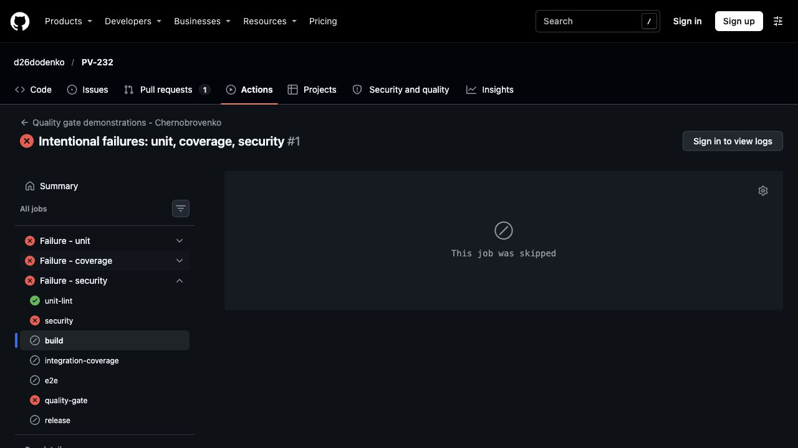
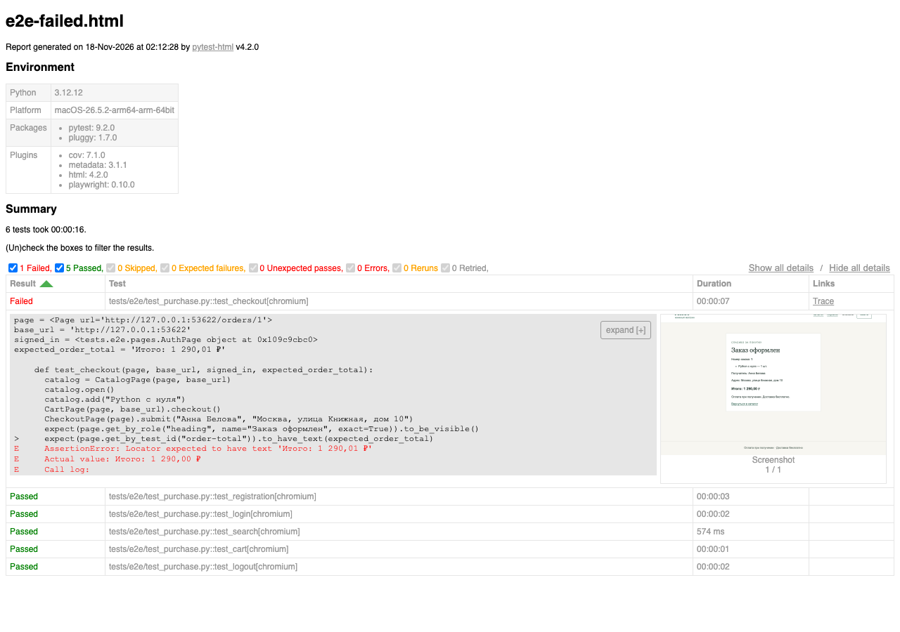

# Лабораторная работа № 3 по тестированию ПС. UI-тестирование и CI/CD

**Александр Чернобровенко, ПВ-232**

Цель работы — автоматизировать пользовательские сценарии интернет-магазина, распределить проверки по уровням пирамиды тестирования и настроить CI/CD с блокировкой сборки и выпуска при ошибках. Для проверки разработан книжный магазин «Лист» на Python и Flask. [Задание из ветки main](https://github.com/d26dodenko/PV-232/blob/d81e48cfd7775401ff8269d6b4a68be65f1eb013/TestingPS/Laba-3.md)

[](https://github.com/d26dodenko/PV-232/actions/workflows/ci.yml?query=branch%3Achernobrovenko_alex)

## 1. Приложение

Покупатель регистрируется, входит в аккаунт, ищет книги по названию или автору, добавляет их в корзину и оформляет заказ с адресом доставки. Оплата предусмотрена при получении. В каталоге четыре учебных товара, доставка бесплатная.

Данные пользователей, сеансов, корзин и заказов сохраняются в SQLite. Пароли хранятся в виде хешей scrypt. Изменяющие запросы защищены CSRF-токеном. После выхода сеанс удаляется из БД, поэтому повторное использование прежнего cookie не открывает защищённые страницы. Пользователь видит только свою корзину и свои заказы.

Цены хранятся в целых копейках, количество одной позиции ограничено диапазоном 1–10 и остатком товара. Сервер рассчитывает сумму самостоятельно. При оформлении повторно проверяется наличие книг. Создание заказа, уменьшение остатков и очистка корзины выполняются в одной транзакции. При ошибке записи все изменения откатываются.

| Файл | Ответственность |
| --- | --- |
| [domain.py](src/bookshop/domain.py) | Проверка email, имени, пароля, адреса и количества, расчёт стоимости |
| [repository.py](src/bookshop/repository.py) | Класс `Repository`, таблицы SQLite и транзакции |
| [service.py](src/bookshop/service.py) | Класс `ShopService`, регистрация, вход, поиск, корзина и заказ |
| [web.py](src/bookshop/web.py) | HTTP-маршруты, авторизация, CSRF и передача данных в шаблоны |
| [templates](src/bookshop/templates/) и [style.css](src/bookshop/static/style.css) | Страницы магазина и оформление |
| [pages.py](tests/e2e/pages.py) | Page Objects страниц регистрации, входа, каталога, корзины и заказа |

### Запуск

Используется Python 3.12. Команды выполняются из `TestingPS/lab3` в отдельном виртуальном окружении.

```sh
python -m venv .venv
```

Активация в Windows PowerShell — `.venv\Scripts\Activate.ps1`, в macOS/Linux — `source .venv/bin/activate`.

```sh
python -m pip install -r requirements.txt
python -m pip install --no-build-isolation --no-deps -e .
python -m bookshop
```

Магазин открывается по адресу `http://127.0.0.1:5000`. БД создаётся в `instance/shop.sqlite`. Путь можно задать переменной `SHOP_DATABASE`, порт — `SHOP_PORT`. `SHOP_SECRET` задаёт ключ подписи cookie. Без него для локального запуска генерируется случайный ключ, и после перезапуска потребуется войти заново. Для работы через HTTPS предусмотрен `SHOP_HTTPS=1`.

## 2. UI-тесты и Page Object

В [test_purchase.py](tests/e2e/test_purchase.py) реализованы шесть сквозных сценариев. Браузер Chromium обращается к настоящему HTTP-серверу Flask. Сервер запускается на свободном локальном порту, для каждого прогона создаётся отдельная БД. Каждый тест использует новый браузерный контекст и собственный email.

| Тест | Действия | Проверяемый результат |
| --- | --- | --- |
| `test_registration` | Заполнить форму и повторить регистрацию с тем же email | Переход на вход после создания аккаунта, повтор отклонён |
| `test_login` | Ввести неверный пароль, затем правильный, обновить страницу | Ошибка при неверном пароле, сеанс сохраняется после успешного входа |
| `test_search` | Найти книгу, затем выполнить поиск без совпадений | Одна подходящая книга, затем сообщение о пустой выдаче |
| `test_cart` | Дважды добавить одну книгу и удалить позицию | Количество объединено, сумма 2 580,00 ₽, после удаления корзина пуста |
| `test_checkout` | Добавить книгу, указать получателя и адрес, подтвердить заказ | Подтверждение заказа, сумма 1 290,00 ₽, правильный адрес и пустая корзина |
| `test_logout` | Выйти и повторно отправить прежние cookie | Сообщение о выходе, доступ к корзине перенаправляет на вход |

Классы `AuthPage`, `CatalogPage`, `CartPage` и `CheckoutPage` содержат локаторы и действия. Проверки ожидаемого результата остаются в тестах. Локаторы используют роли, подписи полей и два идентификатора итоговых сумм. Playwright ожидает доступности элемента и выполнения проверки через `expect`, фиксированных пауз в тестах нет.

```sh
python -m playwright install --only-shell chromium
python -m pytest tests/e2e --browser chromium --tracing retain-on-failure --screenshot only-on-failure --html=reports/e2e.html --self-contained-html --junitxml=reports/e2e.xml
```

Отчёт открывается из `reports/e2e.html`. Скриншоты страниц сохраняются в `reports/screenshots/`, trace упавшего теста — в `test-results/`. Его можно открыть командой `playwright show-trace` с путём к `trace.zip`.

## 3. Пирамида тестирования

| Уровень | Количество | Что проверяется |
| --- | ---: | --- |
| E2E | 6 | Полные действия покупателя в браузере |
| Integration | 18 | HTTP, авторизация, CSRF, сервис, SQLite, изоляция пользователей и откат транзакции |
| Unit | 36 | Нормализация данных, допустимые и граничные значения, расчёт стоимости без HTTP и БД |
| **Всего** | **60** | Уникальные тестовые случаи, включая варианты параметризации |

Модульных тестов больше всего, поскольку у ввода много граничных вариантов и их дешевле проверять без сервера. Интеграционные тесты охватывают соединение HTTP-слоя с БД, права и сохранение данных. Шесть E2E связывают основные функции магазина с реальными формами и переходами. Неверный пароль и повторная регистрация проверяются в соответствующих браузерных сценариях.

```sh
ruff check .
ruff format --check .
python -m pytest tests/unit -q
python -m pytest tests/unit tests/integration --cov=bookshop --cov-branch --cov-fail-under=80 --cov-report=term-missing --cov-report=html:reports/coverage --cov-report=xml:reports/coverage.xml --junitxml=reports/integration.xml
```

## 4. CI/CD и блокирующие проверки

[Конфигурация GitHub Actions](../../.github/workflows/ci.yml) запускается на каждый `push` в `chernobrovenko_alex` и `main`, на `pull_request` в `main`, а также поддерживает `workflow_dispatch` и вызов из другого workflow. Фильтра по изменённым файлам нет.

| Стадия | Выполнение | Условие перехода дальше |
| --- | --- | --- |
| `unit` | Ruff, проверка форматирования и 36 unit-тестов | Нет ошибок линтера и упавших тестов |
| `security` | Bandit проверяет Python-код магазина | Нет находок уровня HIGH |
| `build` | Сборка Python wheel с кодом, шаблонами и CSS | Успешны `unit` и `security` |
| `integration` | Установка wheel, unit- и integration-тесты, измерение покрытия | Все тесты прошли, суммарное покрытие строк и ветвей не ниже 80% |
| `e2e` | Установка того же wheel, запуск шести сценариев Chromium | Успешна `integration`, все E2E прошли |
| `quality-gate` | Проверка результатов пяти обязательных стадий | Каждая стадия завершилась со статусом `success` |
| `release` | Публикация проверенного wheel как артефакта `lab3-release-package` | Успешны `quality-gate` и `build` |

Unit и security могут выполняться параллельно. Зависимости `needs` останавливают последующие стадии при ошибке. Итоговый check `quality-gate` выполняется с `if: always()` и отклоняет также `skipped` и `cancelled`. Это исключает зелёный итог при пропущенных обязательных проверках. Стадия release выдаёт установочный пакет приложения, внешнее развёртывание в этой работе не используется.

Интеграционная стадия проверяет установленную сборку. Unit-тесты на ней повторяются для общего измерения покрытия пакета. Порог относится ко всему Python-коду `bookshop`, включая точку входа. HTML и CSS проверяются через браузерные сценарии и в процент покрытия Python не входят.

Bandit использует категории LOW, MEDIUM и HIGH. HIGH — максимальная категория этого инструмента и блокирующий уровень в данной работе. Это проверка опасных конструкций Python, а не аудит версий зависимостей по CVSS. [Уровни Bandit](https://bandit.readthedocs.io/en/latest/man/bandit.html)

CI публикует JUnit для unit/integration/E2E, HTML и XML покрытия, HTML-отчёт браузерных тестов, скриншоты, trace при падении и отчёт Bandit. Отчёты загружаются с `if: always()`, включая неуспешные прогоны. Артефакты хранятся 30 дней. Badge в начале отчёта показывает состояние ветки.

Защита `main` и обязательные проверки перед merge в репозитории не включены. Проверка `quality-gate` блокирует выпуск пакета внутри CI. Запрет merge при упавших проверках требует отдельной настройки защиты ветки на GitHub.

## 5. Результаты и проверка quality gates

После push коммита `9b5594c` в `chernobrovenko_alex` [запуск GitHub Actions № 6](https://github.com/d26dodenko/PV-232/actions/runs/44207159013) завершился со статусом **Success** за **8 минут 44 секунды**. Все семь стадий прошли. На Ubuntu 24.04, Python 3.12.16 успешно выполнены 36 unit-, 18 integration- и 6 E2E-тестов; покрытие составило **97,13%**. Ruff прошёл, Bandit не обнаружил находок HIGH. Сохранены шесть артефактов, включая отчёты и установочный пакет.



Контрольный локальный прогон выполнен на macOS arm64, Python 3.12.12, с установленной wheel-сборкой магазина. Прошли 36 unit-, 18 integration- и 6 E2E-тестов. Ruff не обнаружил ошибок, Bandit — находок уровня HIGH. [Результат unit/integration](evidence/local-tests.txt), [результат Bandit](evidence/security-passed.txt).

| Метрика покрытия | Результат |
| --- | ---: |
| Исполняемые строки | 262 из 268 — 97,76% |
| Ветви | 43 из 46 — 93,48% |
| Общий показатель coverage.py | 305 из 314 — **97,13%** |
| Обязательный порог | **80%** |

Непокрыты запуск сервера через `__main__` и один вариант настройки фабрики приложения. Сервер для E2E запускается через фабрику, поэтому эти сценарии не увеличивают покрытие unit/integration.



Для проверки отказов предусмотрены режимы `unit`, `coverage`, `security` и `e2e`. Обычный режим — `none`. [demo.py](scripts/demo.py) подготавливает временный тест или модуль для выбранной проверки. Модули демонстрации не входят в исходный код магазина и установочный пакет обычного прогона.

[Отдельный workflow](../../.github/workflows/quality-gate-demos.yml) вызывает тот же CI с режимами `unit`, `coverage` и `security`. Он запускается при изменении собственного файла в ветке `chernobrovenko_alex`. Режимы выполняются независимо, а имена их артефактов различаются. Обычный запуск CI проверяет приложение без внесённых ошибок.

Для коммита `9b5594c` выполнен [контрольный запуск GitHub Actions](https://github.com/d26dodenko/PV-232/actions/runs/44207159120). За **1 минуту 15 секунд** воспроизведены все три отказа. Итоговый статус — **Failure**; сохранены восемь артефактов. В каждом режиме `quality-gate` завершился ошибкой, а `release` получил статус `skipped`.

| Режим | Внесённое расхождение | Результат в GitHub Actions | Заблокированные стадии |
| --- | --- | --- | --- |
| `unit` | В дополнительном тесте ожидается 1 290,01 ₽ вместо 1 290,00 ₽ | [1 failed, 36 passed, код выхода 1](evidence/ci-unit-failed.txt) | `build`, integration, E2E и release — `skipped` |
| `coverage` | В проверяемый пакет добавлен непокрытый модуль | [54 теста прошли, покрытие **73,32%**, код выхода 1](evidence/ci-coverage-failed.txt) | E2E и release — `skipped` |
| `security` | В отдельный модуль добавлен вызов `subprocess.run` с `shell=True` | [Bandit B602, Severity HIGH, код выхода 1](evidence/ci-security-failed.txt) | `build`, integration, E2E и release — `skipped` |



<details>
<summary>Покрытие ниже 80% остановило E2E и выпуск</summary>



</details>

<details>
<summary>Находка Bandit HIGH остановила сборку</summary>



</details>

Те же причины отказа воспроизведены локально: [unit](evidence/unit-failure.txt), [покрытие](evidence/coverage-failure.txt), [Bandit](evidence/security-failure.txt). Опасный вызов в security-примере только анализируется и не исполняется. После локальных проверок временные модули удалены; в CI они создаются в отдельных рабочих окружениях.

Дополнительно локально проверен отказ E2E: в сценарии оформления заказа ожидается 1 290,01 ₽ вместо 1 290,00 ₽. Playwright обнаружил расхождение: **1 failed, 5 passed**, код выхода 1.



## 6. Контрольные вопросы

**Что такое пирамида тестирования и почему она важна?** Большинство проверок выполняется на уровне отдельных правил, меньше — на уровне взаимодействия компонентов, ещё меньше — через интерфейс всей системы. Это сокращает время обратной связи и помогает локализовать причину ошибки. В работе распределение составляет 36 / 18 / 6.

**Какие паттерны автоматизации UI существуют?** Page Object объединяет локаторы и действия страницы, Page Component выделяет повторяющиеся элементы, Screenplay описывает действия участников и проверяемые результаты. Здесь используется Page Object, а подготовка окружения и пользователей вынесена в фикстуры pytest.

**Что такое quality gates?** Это обязательные условия перехода к следующей стадии. В данной работе ими служат успешные тесты и lint, покрытие не ниже 80% и отсутствие находок HIGH у Bandit. Ошибка сохраняется в отчёте и блокирует выпуск пакета.

**Почему unit запускают на каждый коммит, integration — после сборки, а E2E — перед релизом?** Быстрые unit-тесты находят ошибки правил до сборки. Integration проверяют совместную работу компонентов установленного пакета. Более дорогие браузерные проверки выполняются после них и подтверждают, что покупатель может пройти основной сценарий перед выпуском.

## 7. Выводы

Отдельные проверки ввода и расчётов быстро обнаруживают ошибки правил, интеграционные тесты проверяют права и целостность заказа, а E2E связывают серверное поведение с действиями покупателя. Контрольные прогоны GitHub Actions подтвердили блокировку сборки после ошибки unit или находки Bandit HIGH и блокировку E2E при покрытии ниже 80%. Во всех трёх случаях выпуск пакета был пропущен. Локальный браузерный прогон также обнаружил намеренную ошибку в сумме заказа.
