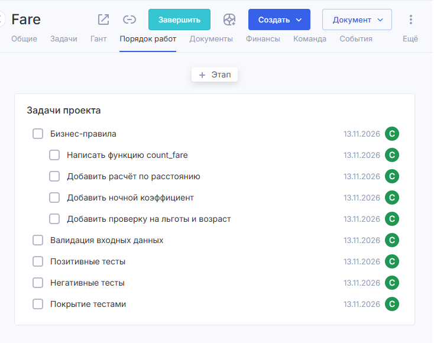
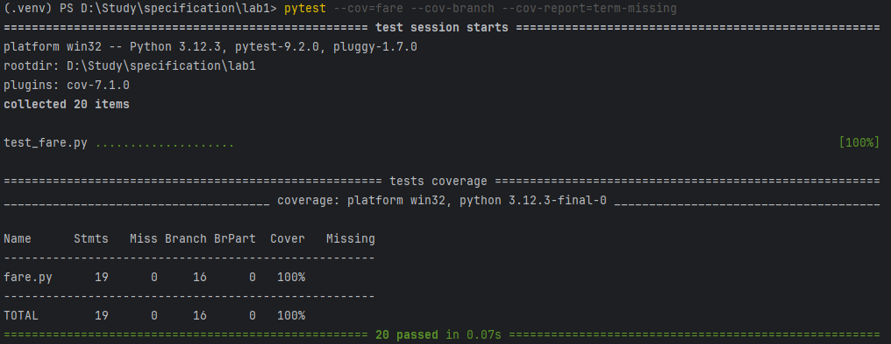
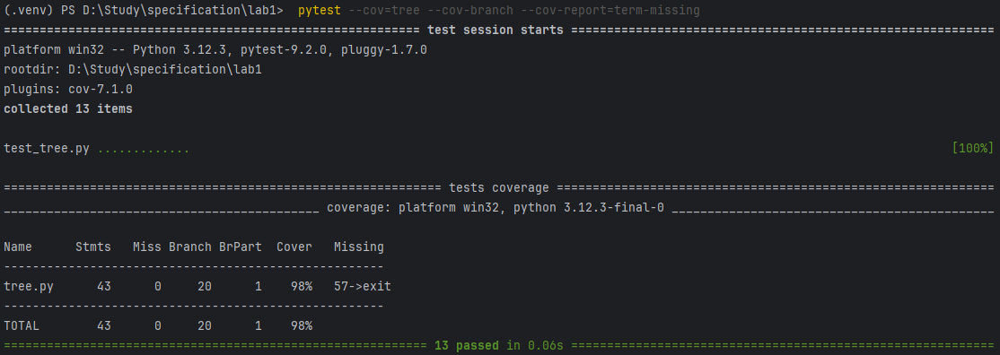

# Лабораторная работа №1 <br> Критерии качества ПО: сложность, корректность, надёжность, трудоёмкость. Оценка качества ПО.
## Цель работы

Освоить практические методы оценки качества и метрик программного обеспечения.

## Задания:

### Часть 1. Теоретическая

1. Опишите 3 наиболее значимые проблемы, возникающие при разработке сложных программных систем.
2. Составьте таблицу: «Проблема → Возможное решение → Инструменты/методы».

### Часть 2. Практическая

1. Создайте тестовый проект на Python (например, калькулятор).
2. Создайте задачи для проекта в Аспро (или другой системе трекинга).
3. Покройте код тестами (Unit tests).
4. Зафиксируйте покрытие тестами кода (например, с помощью coverage.py).
5. Возьмите небольшой программный проект (учебное консольное приложение или открытый код с GitHub).
6. Определите размер ПО (LOC).
7. Рассчитайте цикломатическую сложность одной из функций (можно использовать radon cc -s calculator).
8. Оцените дефектность (если есть баг-репорты или замечания).
9. Составьте итоговую таблицу метрик проекта, включающую:
   - размер (LOC),
   - сложность (цикломатическая),
   - качество (дефекты),
   - время реакции (если есть возможность),
   - процент покрытия тестами.

## Выполнение теоретической части
### 1. 3 наиболее значимые проблемы при разработке сложных программных систем:
1. Рост сложности и связности кода (архитектурная сложность). По мере добавления 
функций код становится трудночитаемым, модули начинают зависеть друг от друга, 
и любое изменение в одном месте ломает работу в другом. Это делает систему неподдерживаемой.
2. Изменение требований (нестабильность ТЗ). В сложных системах требования меняются 
постоянно: заказчик уточняет детали, появляются новые ограничения. Если архитектура 
не готова к изменениям, каждая правка требует переписывания больших кусков кода и 
вызывает регрессии (старые баги возвращаются).
3. Ошибки при взаимодействии компонентов (интеграционные дефекты). Чем больше модулей, 
тем сложнее гарантировать, что они правильно взаимодействуют друг с другом. Ошибки часто 
возникают на стыках: несовпадение форматов данных, гонки при многопоточности, 
некорректная обработка отказов внешних сервисов.

### 2. Таблица: «Проблема → Возможное решение → Инструменты/методы»:
| ПРОБЛЕМА                              | ВОЗМОЖНОЕ РЕШЕНИЕ                                                                                                                          | ИНСТРУМЕНТЫ / МЕТОДЫ                                                                                   |
|---------------------------------------|--------------------------------------------------------------------------------------------------------------------------------------------|--------------------------------------------------------------------------------------------------------|
| Рост сложности и связности кода       | Разделять систему на модули с чёткими интерфейсами; держать функции маленькими и сфокусированными; регулярно проводить ревью и рефакторинг | Принципы SOLID, паттерны проектирования, radon (метрики сложности), ruff/flake8 (линтеры), code review |
| Изменение требований                  | Фиксировать условия приёмки и приоритеты; вести backlog; писать тесты на бизнес-правила, чтобы правки не ломали старое поведение           | Backlog/таск-трекер (Аспро, Jira), тест-сценарии, TDD, регрессионные тесты (pytest)                    |
| Ошибки при взаимодействии компонентов | Явно описывать контракты между модулями; проверять граничные случаи и сценарии отказа; покрывать интеграционные стыки тестами              | pytest (unit + integration), coverage.py, моки/стабы, contract-тесты, логирование и мониторинг         |

## Выполнение практической части
### 1. Создание тестового проекта fare.py

```python
# fare.py

def count_fare(distance_km: float, age: int, is_preferential: bool, is_night: bool) -> int:
	"""
	Расчет стоимости проезда.

	Бизнес-правила:
	1. Если  distance_km <= 0 или age < 0 или age > 116 или is_preferential и is_night не булевые значения - ValueError
 	2. Если distance_km <= 2.49 - стоимость проезда = 25
 	3. Иначе
 	   - стоимость проезда = 25 + (distance_km - 2.49) * 2.5
 	4. Если is_night - fare = fare * 1.2
 	5. Если льготный проезд - проезд бесплатный
 	6. Если возраст < 5 - проезд бесплатный
	"""
	if distance_km <= 0:
		raise ValueError('distance must be > 0')
	if age < 0:
		raise ValueError('Age must be >= 0')
	if age > 116:
		raise ValueError('Age must be <= 116')
	if not isinstance(is_preferential, bool):
		raise ValueError('is_preferential  must be bool')
	if not isinstance(is_night, bool):
		raise ValueError('is_night must be bool')

	if age < 5 or is_preferential:
		return 0
	if distance_km <= 2.49:
		fare = 25
	else:
		fare = 25 + (distance_km - 2.49) * 2.5
	if is_night:
		fare = fare * 1.2
	return round(fare)
```

### 2. Создание задач для проекта в Аспро


### 3. Покрытие кода тестами (Unit tests).
```python
# test_fare.py

import pytest
from fare import count_fare

# Позитивные и граничные тесты
def test_min_age():
    # Минимально возможный возраст 0
    assert count_fare(23.2, 0, False, False) == 0

def test_max_age():
    # Максимально возможный возраст 116
    assert count_fare(34.0, 116, False, False) == 104

def test_age_5():
    # В 5 проезд платный
    assert count_fare(23.2, 5, False, False) == 77

def test_short_distance():
    # От 0(не вкл) до 2.49км цена 25руб
    assert count_fare(2.49, 7, False, False) == 25

def test_long_distance():
    # От 2.5км цена - 25 + 2.5 за каждый км после 2.49км
    assert count_fare(2.5, 7, False, False) == 25

def test_age_below_5():
    # От 0 до 5 лет проезд бесплатный
    assert count_fare(23.2, 4, False, False) == 0

def test_age_from_5():
    # C 5 до 116 лет проезд платный
    assert count_fare(19.3, 37, False, False) == 67

def test_preferential():
    # Льготный проезд бесплатный
    assert count_fare(19.3, 26, True, False) == 0

def test_not_preferential():
    # Не льготный проезд платный
    assert count_fare(23.2, 26, False, False) == 77

def test_night_time():
    # Ночью проезд на 20% больше
    assert count_fare(17.4, 26, False, True) == 75

def test_distance_below_border():
    # От 0(не вкл) до 2.49км цена 25руб
    assert count_fare(1.4, 26, False, False) == 25

def test_distance_from_border():
    # От 2.5км цена - 25 + 2.5 за каждый км
    assert count_fare(45.7, 26, False, False) == 133

def test_preferential_night_time():
    # Льготный проезд в ночное время. Льготный проезд преобладает
    assert count_fare(23.2, 26, True, True) == 0

def test_age_from_5_night_time():
    # От 5 до 116 лет и ночное время. Возраст преобладает
    assert count_fare(23.2, 2, False, True) == 0

# Негативные тесты
def test_distance_below_or_equal_0():
    # Расстояние меньше или равное 0 — ошибка
    with pytest.raises(ValueError):
        count_fare(-2.3, 26, False, False)

def test_not_bool_preferential():
    # Льгота не булевое значение — ошибка
    with pytest.raises(ValueError):
        count_fare(10.0, 26, 3, False)

def test_not_bool_night():
    # Ночное время не булевое значение — ошибка
    with pytest.raises(ValueError):
        count_fare(10.0, 26, False, '')

def test_distance_0():
    # Расстояние меньше или равное 0 — ошибка
    with pytest.raises(ValueError):
        count_fare(0.0, 26, False, False)

def test_age_below_0():
    # Возраст меньше 0 — ошибка
    with pytest.raises(ValueError):
        count_fare(23.2, -3, False, False)

def test_age_from_116():
    # Возраст больше 116 — ошибка
    with pytest.raises(ValueError):
        count_fare(23.2, 148, False, False)
```

### 4. Фиксирование покрытия тестами кода


### 5. Взятие небольшого программного проекта (открытый код с GitHub).
В качестве проекта было взято учебное консольное приложение — реализация бинарного 
дерева поиска (BST) на Python с GitHub по ссылке: https://github.com/ndleah/python-mini-project/tree/main/Binary_tree
и модифицировано для удобства.

Код проекта:
```python
# Class of the nodes
class Node:
    def __init__(self, data):
        self.left = None
        self.right = None
        self.data = data

# Class of tree
class Tree:
    def __init__(self):
        self.root = None

    # Method to obtain the data
    def getRoot(self):
        return self.root

    # Method to add the data
    def add(self, data):
        if self.root is None:
            self.root = Node(data)
        else:
            self._add(data, self.root)

    def _add(self, data, node):
        if data < node.data:
            if node.left is not None:
                self._add(data, node.left)
            else:
                node.left = Node(data)
        else:
            if node.right is not None:
                self._add(data, node.right)
            else:
                node.right = Node(data)

    # Method for find the data
    def find(self, data):
        if self.root is not None:
            return self._find(data, self.root)
        else:
            return None

    def _find(self, data, node):
        if data == node.data:
            return node
        elif (data < node.data and node.left is not None):
            return self._find(data, node.left)
        elif (data > node.data and node.right is not None):
            return self._find(data, node.right)

    # Method for delete tree
    def deleteTree(self):
        self.root = None

    # Method for print tree in terminal
    def printTree(self):
        if self.root is not None:
            self._printTree(self.root)

    def _printTree(self, node):
        if node is not None:
            self._printTree(node.left)
            print(str(node.data) + ' ')
            self._printTree(node.right)
```

### 6. Определение размера ПО (LOC).
Размер был измерен с помощью утилиты radon raw -s tree.py:</br>
LOC (все физические строки): 65 </br>
SLOC (строки кода без пустых строк и комментариев): 48 

### 7. Расчет цикломатической сложности одной из функций (можно использовать radon cc -s calculator).
Сложность была рассчитана с помощью radon cc -s tree.py</br>
В качестве исследуемой функции выбран метод Tree._find (рекурсивный поиск элемента в дереве). Его цикломатическая сложность составляет V(G) = 6 (класс B).

В методе есть 3 условия (data == node.data, data < node.data and ..., data > node.data and ...), плюс проверки на None при рекурсивном спуске. 

Ручной расчёт по правилу «количество условий + 1» даёт: 5 + 1 = 6.
Максимальная сложность среди всех методов также равна 6 (у _find), остальные методы имеют класс A (сложность 1–4).

### 8. Оценка дефектности (если есть баг-репорты или замечания).
В ходе анализа кода tree.py было выявлено одно потенциальное замечание (дефект): отсутствие балансировки дерева. </br>
При добавлении элементов в отсортированном порядке (например, 1, 2, 3, 4, 5) дерево вырождается в связный список, и сложность поиска падает с O(log n) до O(n).

Замечание не является критической ошибкой(программа работает корректно), но влияет на производительность.

### 9. Итоговая таблица метрик проекта:
| МЕТРИКА                     | ЗНАЧЕНИЕ                                           |
|-----------------------------|----------------------------------------------------|
| Размер (LOC)                | 65                                                 |
| Сложность (цикломатическая) | 6                                                  |
| Качество (дефекты)          | 1 замечание (нет балансировки, деградация до O(n)) |
| Время реакции               | Не измерялось                                      |
| Процент покрытия тестами    | 98%                                                |

</br>Для измерения покрытия тестами были написаны Unit тесты.
```python
from tree import Tree

# tests for add, getRoot
def test_empty_tree():
	tree = Tree()
	assert tree.getRoot() is None

def test_add_root():
	tree = Tree()
	tree.add(5)
	assert tree.getRoot() is not None
	assert tree.getRoot().data == 5

def test_add_less_goes_left():
	tree = Tree()
	tree.add(5)
	tree.add(4)
	assert tree.getRoot().left.data == 4
	assert tree.getRoot().right is None

def test_add_more_goes_right():
	tree = Tree()
	tree.add(5)
	tree.add(7)
	assert tree.getRoot().right.data == 7
	assert tree.getRoot().left is None

def test_add_equal_goes_right():
	tree = Tree()
	tree.add(5)
	tree.add(5)
	assert tree.getRoot().right.data == 5
	assert tree.getRoot().left is None

def test_add_deep():
	tree = Tree()
	for i in [10, 5, 15, 20, 0]:
		tree.add(i)

	assert tree.getRoot().left.left.data == 0
	assert tree.getRoot().right.right.data == 20

# tests for find
def test_find_root():
	tree = Tree()
	tree.add(5)
	assert tree.find(5).data == 5

def test_find_left():
	tree = Tree()
	tree.add(5)
	tree.add(3)
	assert tree.find(3).data == 3

def test_find_right():
	tree = Tree()
	tree.add(5)
	tree.add(7)
	assert tree.find(7).data == 7

def test_find_missing():
	tree = Tree()
	tree.add(5)
	tree.add(7)
	assert tree.find(10) is None

def test_find_empty():
	tree = Tree()
	assert tree.find(10) is None

# test for deleteTree
def test_delete_tree():
	tree = Tree()
	tree.add(5)
	tree.add(7)
	tree.deleteTree()
	assert tree.getRoot() is None

# test for printTree
def test_print_tree(capsys):
	tree = Tree()
	for i in [10, 5, 15, 20, 0]:
		tree.add(i)
	tree.printTree()
	captured = capsys.readouterr()
	assert '0' in captured.out
	assert '5' in captured.out
	assert '10' in captured.out
	assert '15' in captured.out
	assert '20' in captured.out
```


## Вывод
В ходе работы освоены методы оценки качества ПО. Для собственного проекта fare.py
написано 20 Unit-тестов, достигнуто 100% покрытие строк и ветвей с помощью coverage.py. 
Для стороннего проекта tree.py с помощью radon определены размер (65 LOC) и сложность 
функции _find (V(G)=6), выявлен дефект — отсутствие балансировки дерева.