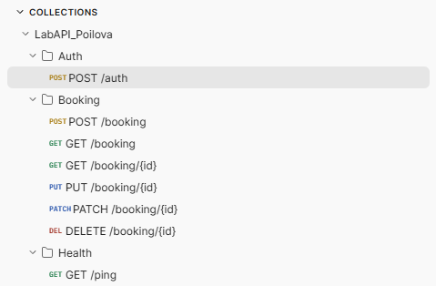
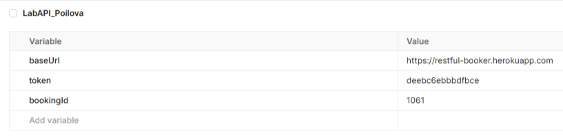
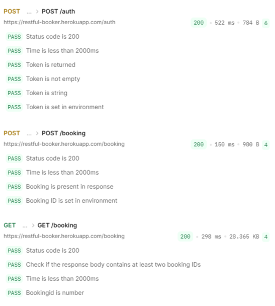
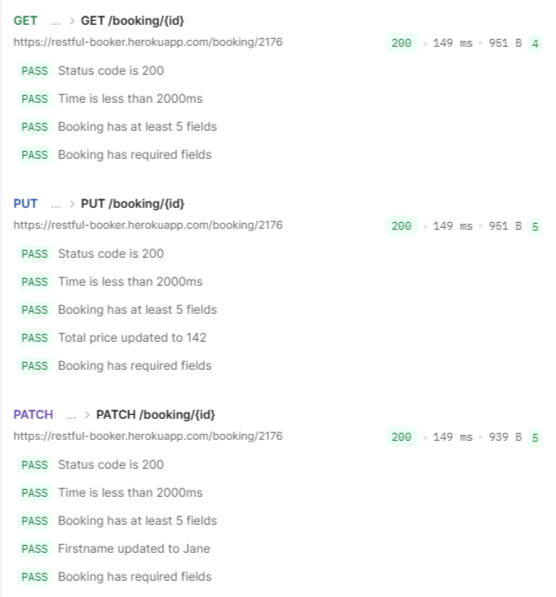
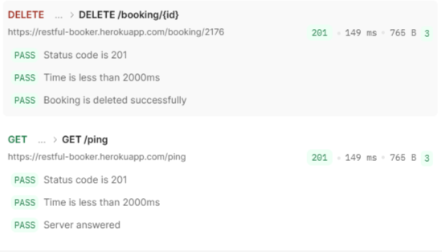

# Лабораторная работа №2 <br> Интеграционное и API-тестирование
## Цель работы

Освоить тестирование REST API на примере открытого публичного сервиса: научиться строить в Postman коллекцию запросов, писать автоматические проверки и анализировать расхождения между документацией и фактическим поведением API.

## Задание:

1. Создайте в Postman коллекцию `LabAPI_<Фамилия>` с переменными окружения (`baseUrl`, `token`, `bookingId`) и папками по ресурсам: `Auth`, `Booking`, `Health`.

2. Добавьте запросы **ко всем эндпоинтам** из таблицы. Для каждого запроса напишите описание: цель, входные данные, ожидаемый результат.

3. Автоматизируйте получение токена. В запросе `POST /auth` скриптом во вкладке Tests сохраните токен в переменную окружения. В запросе создания бронирования сохраните `bookingid`.

4. Составьте и выполните тест-кейсы в каждой категории:

   - **Позитивные**: создание → получение → обновление (PUT и PATCH) → удаление → повторное получение (ожидается 404).
   - **Негативные**: неверный логин или пароль, запрос без токена и с некорректным токеном, несуществующий `id`, некорректный JSON, неверный тип данных (например, строка в `totalprice`), отсутствие обязательных полей.
   - **Граничные значения**: пустые строки, очень длинные строки (1000+ символов), `totalprice` = 0, отрицательное и очень большое число, дата `checkout` раньше `checkin`, невалидный формат даты.
   - **Коды ответов**: для каждого теста явно укажите ожидаемый код (200, 201, 400, 403/401, 404, 405, 500). По возможности вызовите разные коды.

5. Для каждого запроса добавьте во вкладку Tests минимум 3 автоматические проверки, например:

   ```javascript
   pm.test("Статус 200", () => pm.response.to.have.status(200));
   pm.test("Время ответа < 2000 мс", () => pm.expect(pm.response.responseTime).to.be.below(2000));
   pm.test("Есть поле bookingid", () => pm.expect(pm.response.json()).to.have.property("bookingid"));
   ```

6. Запустите всю коллекцию через **Collection Runner** и убедитесь, что цепочка сценариев работает без ручного вмешательства (токен и `id` передаются через переменные).

7. **Фактическое и ожидаемое поведение.** Это публичное учебное API, и его реальное поведение может отличаться от документации и от «правильного» REST (нестандартные коды для ошибок, код ответа для DELETE и т. д.). Оформите таблицу расхождений:

| № | Запрос | Ожидалось (по REST/документации) | Получено | Вывод (дефект / особенность) |
|---|--------|----------------------------------|----------|------------------------------|


## Выполнение
### 1. Создание в Postman коллекции `LabAPI_<Фамилия>` с переменными окружения (`baseUrl`, `token`, `bookingId`) и папками по ресурсам: `Auth`, `Booking`, `Health`.
Коллекция:



Окружение:


### 2. Добавление запросов **ко всем эндпоинтам** из таблицы. Для каждого запроса напишите описание: цель, входные данные, ожидаемый результат.
| Запрос                   | Цель                                  | Входные данные                                                                               | Ожидаемый результат                                |
|--------------------------|---------------------------------------|----------------------------------------------------------------------------------------------|----------------------------------------------------|
| **POST /auth**           | Получение токена для авторизации      | {"username": "admin", "password": "password123"}                                             | 200 OK, в ответе есть token                        |
| **GET /ping**            | Проверка работоспособности сервера    | Нет                                                                                          | 201 Created, тело ответа Created                   |                                                     
| **GET /booking**         | Получение списка всех бронирований    | Нет                                                                                          | 200 OK, массив с bookingid                         |                                      
| **GET /booking/{id}**    | Получение данных конкретной брони     | Переменная {{bookingId}} в URL                                                               | 200 OK, объект с данными брони                     |                               
| **POST /booking**        | Создание новой брони                  | JSON с firstname, lastname, totalprice, depositpaid, bookingdates и возможно additionalneeds | 200 OK, возвращается созданный booking с bookingid |
| **PUT /booking/{id}**    | Полное обновление брони (нужен токен) | Заголовок Cookie: token={{token}}, JSON со всеми полями, {{bookingId}} в URL                 | 200 OK, данные обновлены                           |        
| **PATCH /booking/{id}**  | Частичное обновление (нужен токен)    | Заголовок Cookie: token={{token}}, JSON только с {"firstname": "Jane"}, {{bookingId}} в URL  | 200 OK, изменено только имя                        |
| **DELETE /booking/{id}** | Удаление брони (нужен токен)          | Заголовок Cookie: token={{token}}, {{bookingId}} в URL                                       | 201 Created, тело ответа Created                   |        

### 3. Автоматизация получения токена. В запросе `POST /auth` скриптом во вкладке Tests сохранение токена в переменную окружения. В запросе создания бронирования сохранение `bookingid`.
   POST /auth:
   ``` javascript
   const responseJson = pm.response.json();
   pm.environment.set("token", responseJson.token);
   ```
   POST /booking:
   ``` javascript
   const bookingJson = pm.response.json();
   pm.environment.set("bookingId", bookingJson.bookingid);
   ```
### 4. Составление и выполнение тест-кейсов в каждой категории:

   - **Позитивные**: создание → получение → обновление (PUT и PATCH) → удаление → повторное получение (ожидается 404).
   - **Негативные**: неверный логин или пароль, запрос без токена и с некорректным токеном, несуществующий `id`, некорректный JSON, неверный тип данных (например, строка в `totalprice`), отсутствие обязательных полей.
   - **Граничные значения**: пустые строки, очень длинные строки (1000+ символов), `totalprice` = 0, отрицательное и очень большое число, дата `checkout` раньше `checkin`, невалидный формат даты.
   - **Коды ответов**: для каждого теста явно укажите ожидаемый код (200, 201, 400, 403/401, 404, 405, 500). По возможности вызовите разные коды.

| Запрос                   | Тест                             | Тип        | Входные данные                                      | Ожидаемый результат                           | Полученный результат                            |
|--------------------------|----------------------------------|------------|-----------------------------------------------------|-----------------------------------------------|-------------------------------------------------|
| **POST /auth**           | Успешная авторизация             | Позитивный | `{"username": "admin", "password": "password123"}`  | 200 OK, в ответе есть `token`                 | 200 OK, `token` получен и сохранён в переменную |
| **POST /auth**           | Неверный пароль                  | Негативный | `{"username": "admin", "password": "wrong"}`        | 403 Forbidden, токен не выдан                 | 200 OK, `{"reason": "Bad credentials"} `        |
| **GET /ping**            | Проверка доступности сервера     | Позитивный | Нет                                                 | 200 OK                                        | 201 Created                                     | 
| **GET /booking**         | Получение списка всех броней     | Позитивный | Нет                                                 | 200 OK, массив с `bookingid`                  | 200 OK, массив получен                          |
| **GET /booking/{id}**    | Получение конкретной брони       | Позитивный | `{{bookingId}}` в URL                               | 200 OK, объект брони                          | 200 OK, данные получены                         |
| **GET /booking/{id}**    | Несуществующий ID                | Негативный | `id = 999999`                                       | 404 Not Found                                 | 404 Not Found                                   |
| **POST /booking**        | Создание новой брони             | Позитивный | JSON (имя, цена, даты)                              | 200 OK, возвращается booking json             | 200 OK, `bookingid` сохранён                    |
| **POST /booking**        | Отсутствие обязательного поля    | Негативный | JSON без `firstname`                                | 400 Bad Request                               | 400 Bad Request                                 |
| **PUT /booking/{id}**    | Полное обновление (с токеном)    | Позитивный | Заголовок `Cookie: token={{token}}` + JSON          | 200 OK, данные обновлены                      | 200 OK, `totalprice` изменился на 142           |
| **PUT /booking/{id}**    | Обновление без токена            | Негативный | Заголовок `Cookie` отсутствует                      | 403 Forbidden                                 | 403 Forbidden                                   |
| **PATCH /booking/{id}**  | Частичное обновление (с токеном) | Позитивный | `Cookie: token={{token}}` + `{"firstname": "Jane"}` | 200 OK, имя изменено, остальные поля на месте | 200 OK, имя стало Jane                          |
| **DELETE /booking/{id}** | Удаление существующей брони      | Позитивный | `Cookie: token={{token}}` + `{{bookingId}}`         | 201 Created                                   | 201 Created, тело `Created`                     |
| **DELETE /booking/{id}** | Удаление несуществующей брони    | Негативный | `id = 999999` + токен                               | 404 Not Found                                 | 405 Method Not Allowed                          |
| **POST /booking**        | Отрицательная цена               | Граничный  | `"totalprice": -100`                                | 400 Bad Request                               | 200 OK                                          |
| **POST /booking**        | Дата выезда раньше даты заезда   | Граничный  | `checkin: "2025-10-10"`, `checkout: "2025-10-01"`   | 400 Bad Request                               | 200 OK                                          |

### 5. Тесты
   Post /auth:
   ```javascript
   pm.test("Status code is 200", () => {
       pm.response.to.have.status(200);
   });
   
   pm.test("Time is less than 2000ms", () => {
       pm.expect(pm.response.responseTime).to.be.below(2000);
   });
   
   const responseJson = pm.response.json();
   
   pm.test("Token is returned", () => {
       pm.expect(responseJson).to.have.property("token");
   });
   
   pm.test("Token is not empty", () => {
       pm.expect(responseJson.token).to.not.be.empty;
   });
   
   pm.environment.set("token", responseJson.token);
   
   pm.test("Token is string", () => {
       pm.expect(responseJson.token).to.be.a("string");
   });
   
   pm.test("Token is set in environment", () => {
       pm.expect(pm.environment.get("token")).to.eql(responseJson.token);
   });
   ```

   Post /booking:
   ```javascript
   pm.test("Status code is 200", () => {
       pm.response.to.have.status(200);
   });
   
   pm.test("Time is less than 2000ms", () => {
       pm.expect(pm.response.responseTime).to.be.below(2000);
   });
   
   pm.test("Booking is present in response", () => {
       pm.expect(pm.response.json()).to.not.be.null;
   });
   
   const bookingJson = pm.response.json();
   pm.environment.set("bookingId", bookingJson.bookingid);
   
   pm.test("Booking ID is set in environment", () => {
       pm.expect(pm.environment.get("bookingId")).to.be.a("number");
   });
   ```

   Get /booking:
   ```javascript
   pm.test("Status code is 200", () => {
       pm.response.to.have.status(200);
   });
   
   pm.test("Check if the response body contains at least two booking IDs", () => {
       pm.expect(pm.response.json().length).to.be.at.least(2);
   });
   
   pm.test("Time is less than 2000ms", () => {
       pm.expect(pm.response.responseTime).to.be.below(2000);
   });
   
   pm.test("Bookingid is number", () => {
       pm.expect(pm.response.json()[0].bookingid).to.be.a("number");
   });
   ```

   Get /booking/id:
   ```javascript
   pm.test("Status code is 200", () => {
       pm.response.to.have.status(200);
   });
   
   pm.test("Time is less than 2000ms", () => {
       pm.expect(pm.response.responseTime).to.be.below(2000);
   });
   
   pm.test("Booking has at least 5 fields", () => {
       pm.expect(Object.keys(pm.response.json()).length).to.be.at.least(5);
   });
   
   pm.test("Booking has required fields", () => {
       const jsonData = pm.response.json();
       pm.expect(jsonData).to.have.property("firstname");
       pm.expect(jsonData).to.have.property("lastname");
       pm.expect(jsonData).to.have.property("totalprice");
       pm.expect(jsonData).to.have.property("depositpaid");
       pm.expect(jsonData).to.have.property("bookingdates");
   });
   ```

   Put /booking/id:
   ```javascript
   pm.test("Status code is 200", () => {
       pm.response.to.have.status(200);
   });
   
   pm.test("Time is less than 2000ms", () => {
       pm.expect(pm.response.responseTime).to.be.below(2000);
   });
   
   pm.test("Booking has at least 5 fields", () => {
       pm.expect(Object.keys(pm.response.json()).length).to.be.at.least(5);
   });
   
   pm.test("Total price updated to 142", () => {
       pm.expect(pm.response.json().totalprice).to.equal(142);
   });
   
   pm.test("Booking has required fields", () => {
       const jsonData = pm.response.json();
       pm.expect(jsonData).to.have.property("firstname");
       pm.expect(jsonData).to.have.property("lastname");
       pm.expect(jsonData).to.have.property("totalprice");
       pm.expect(jsonData).to.have.property("depositpaid");
       pm.expect(jsonData).to.have.property("bookingdates");
   });
   ```

   Patch /booking/id:
   ```javascript
   pm.test("Status code is 200", () => {
       pm.response.to.have.status(200);
   });
   
   pm.test("Time is less than 2000ms", () => {
       pm.expect(pm.response.responseTime).to.be.below(2000);
   });
   
   pm.test("Booking has at least 5 fields", () => {
       pm.expect(Object.keys(pm.response.json()).length).to.be.at.least(5);
   });
   
   pm.test("Firstname updated to Jane", () => {
       pm.expect(pm.response.json().firstname).to.eql("Jane");
   });
   
   pm.test("Booking has required fields", () => {
       const jsonData = pm.response.json();
       pm.expect(jsonData).to.have.property("firstname");
       pm.expect(jsonData).to.have.property("lastname");
       pm.expect(jsonData).to.have.property("totalprice");
       pm.expect(jsonData).to.have.property("depositpaid");
       pm.expect(jsonData).to.have.property("bookingdates");
   });
   ```

   Delete /booking/id:
   ```javascript
   pm.test("Status code is 201", () => {
       pm.response.to.have.status(201);
   });
   
   pm.test("Time is less than 2000ms", () => {
       pm.expect(pm.response.responseTime).to.be.below(2000);
   });
   
   pm.test("Booking is deleted successfully", () => {
       pm.expect(pm.response.text()).to.equal("Created");
   });
   ```

   Get /ping:
   ```javascript
   pm.test("Status code is 201", () => {
       pm.response.to.have.status(201);
   });
   
   pm.test("Time is less than 2000ms", () => {
       pm.expect(pm.response.responseTime).to.be.below(2000);
   });
   
   pm.test("Server answered", () => {
       pm.expect(pm.response.text()).to.equal("Created");
   });
   ```

### 6. Запуск  через **Collection Runner**
 



### 7. Таблица расхождений
| Запрос                                             | Ожидалось (по REST/документации) | Получено                               | Вывод (дефект / особенность)                                               |
|----------------------------------------------------|----------------------------------|----------------------------------------|----------------------------------------------------------------------------|
| **GET /ping**                                      | `200 OK`                         | `201 Created`                          | **Особенность:** нестандартный код успеха для GET-запроса                  |
| **DELETE /booking/{id}**                           | `204 No Content`                 | `201 Created`                          | **Особенность:** нестандартный код успеха для удаления                     |
| **DELETE /booking/{id}** (несуществующий ID)       | `404 Not Found`                  | `405 Method Not Allowed`               | **Дефект:** неверный код ошибки для отсутствующего ресурса                 |
| **POST /auth** (неверный пароль)                   | `403 Forbidden`                  | `200 OK` (с телом `"Bad credentials"`) | **Дефект:** возвращается 200 OK вместо кода ошибки при провале авторизации |
| **POST /booking** (`"totalprice": -100`)           | `400 Bad Request`                | `200 OK` (бронь создана)               | **Дефект:** отсутствует валидация отрицательной стоимости                  |
| **POST /booking** (дата выезда раньше даты заезда) | `400 Bad Request`                | `200 OK` (бронь создана)               | **Дефект:** отсутствует валидация логики дат                               |

## Вывод
В ходе лабораторной работы было освоено тестирование REST API сервиса Restful-Booker. С помощью Postman была создана коллекция запросов, настроены переменные окружения (`token`, `bookingId`) и автоматизирована передача данных между запросами. Запуск через Collection Runner показал, что вся цепочка из 8 запросов и 34 проверок работает автономно за 2,6 секунды.

В процессе тестирования были выявлены расхождения с документацией и стандартами REST:
1. Нестандартные коды ответов (201 вместо 200 на `GET /ping` и `DELETE`).
2. Возврат `200 OK` при неверном пароле (вместо `403`), что может ввести в заблуждение клиент.
3. Отсутствие валидации: API принимает отрицательную цену (`totalprice: -100`) и некорректные даты.
4. Возврат `405` вместо `404` при удалении несуществующей брони.
