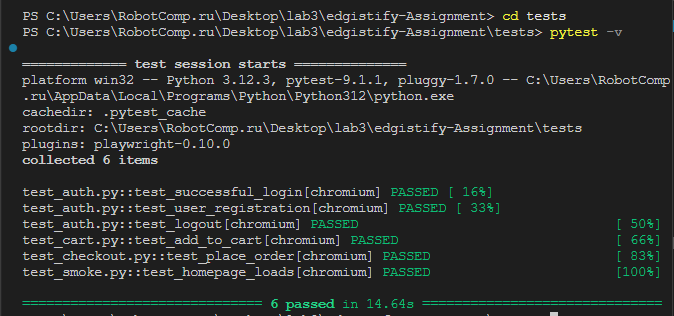
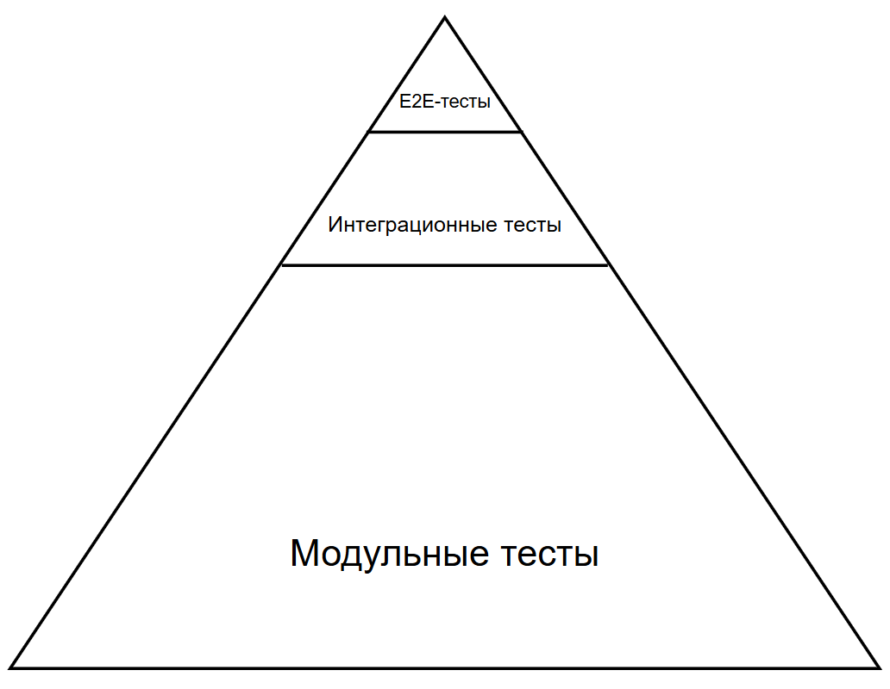
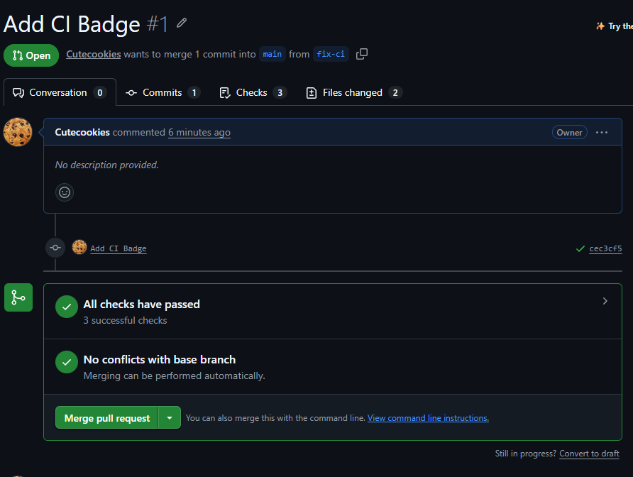
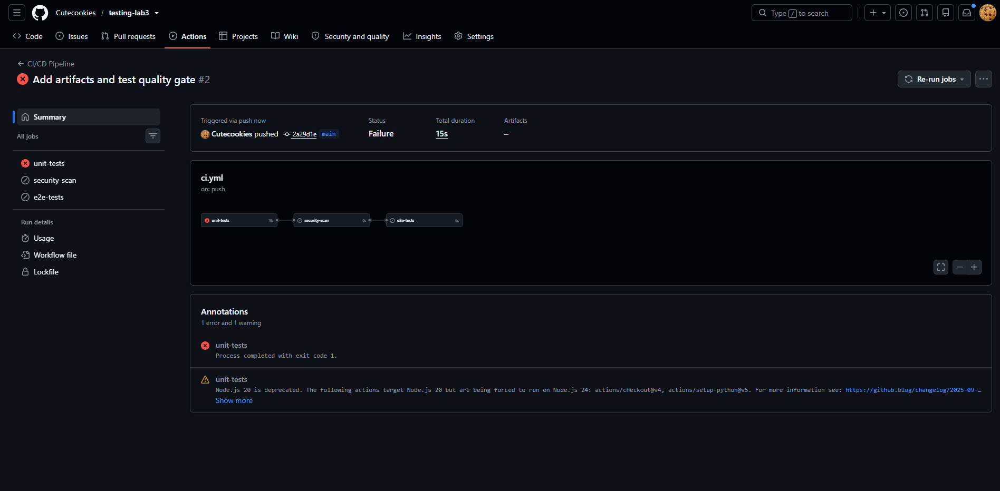
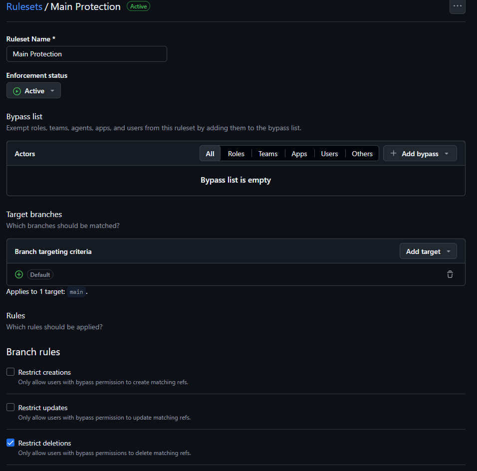
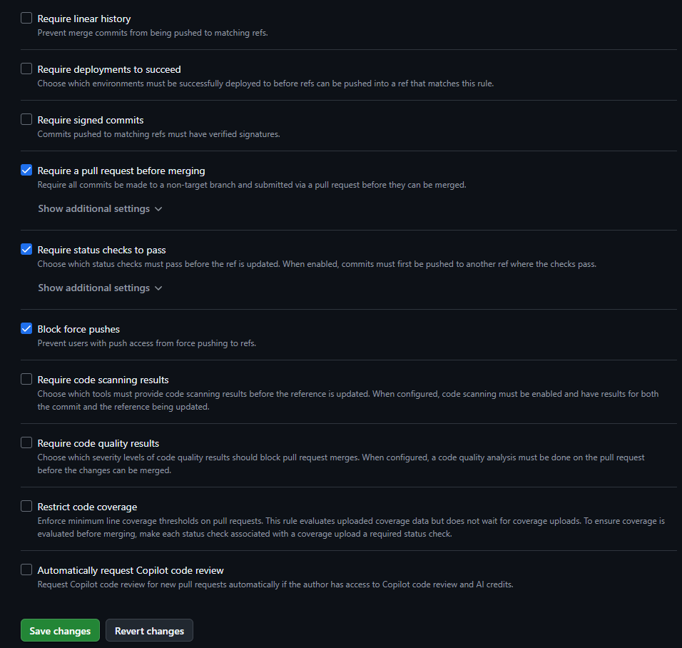
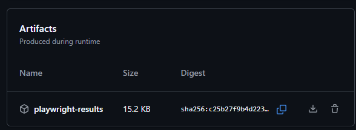
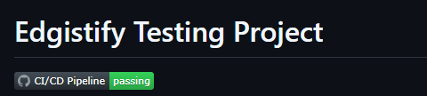

# Лабораторная работа №3 <br> Автоматизация UI-тестов и построение CI/CD-пайплайна с блокирующими quality gates
## Цель работы

Освоить UI-автоматизацию, паттерны проектирования тестов, встраивание тестов в пайплайн непрерывной интеграции и настройку блокирующих quality gates, при которых падение тестов останавливает сборку и релиз.

## Задание:

### Часть 1. UI-автоматизация

Дано веб-приложение — интернет-магазин (https://github.com/Sajid788/edgistify-Assignment) Можно взять код за основу (с нуля проект не нужно создавать, можно найти готовый проект в интернете. Используете код либо для frontend или для backend разработчика)

**Требуется:**

1. Написать E2E-тесты на Playwright или Selenium для сценариев:
   - регистрация пользователя;
   - вход в систему;
   - поиск товара;
   - добавление товара в корзину;
   - оформление заказа;
   - выход из системы.
   - (можно написать тесты и для других частей функциональности приложения)

---

### Часть 2. Пирамида тестирования

**Требуется:**

1. Построить пирамиду тестирования для данного приложения.
2. Обосновать распределение: сколько unit-, integration- и E2E-тестов и почему.

---

### Часть 3. Требуется

**Создать CI-конфигурацию:**

- GitHub Actions: `.github/workflows/ci.yml`;
- или GitLab CI: `.gitlab-ci.yml`.

**Настроить триггеры тестирования:**

- **Unit-тесты + lint** — запускаются при каждом коммите/пуше и pull request. «При каждом сохранении» в CI напрямую не реализуется: для локального сохранения допускается настроить pre-commit-хук, который запускает быстрые unit-тесты и линтер. В CI обязательный запуск — на каждый `push` и `pull_request`.


**Настроить quality gates:**

- пайплайн падает, если coverage < 80%;
- пайплайн падает при критических уязвимостях от bandit/safety;
- падение unit/integration/E2E блокирует следующие стадии;
- в настройках репозитория включить **branch protection**: обязательные проверки CI должны быть зелёными перед merge в `main`.

**Публиковать отчёты и артефакты:**

- coverage-отчёт;
- отчёты pytest/Playwright;
- badge статуса пайплайна в `README.md`.

## Выполнение

Ссылка на созданный репозиторий: https://github.com/Cutecookies/testing-lab3

### 1. UI-автоматизация.
Сценарий поиска товара не реализован в исходном коде приложения, поэтому вместо него протестирован просмотр каталога.

Тесты:



### 2. Пирамида тестирования.



Для данного веб-приложения оптимально следующее распределение тестов (классическая пирамида Майка Кона):

1. Unit-тесты (Модульные) — ~70% (основание пирамиды). <br>
Это самые быстрые тесты, которые проверяют отдельные функции изолированно. 
Для магазина это могут быть тесты на функцию расчёта суммы корзины, валидацию email при регистрации, 
правильность хеширования пароля (bcrypt), корректность парсинга дат или проверку формата JSON для товара. 
Их должно быть много, потому что они выполняются за миллисекунды и мгновенно находят ошибки в логике.<br><br>

2. Integration-тесты (Интеграционные) — ~20% (середина пирамиды).<br>
Проверяют, как разные части системы работают вместе (например, API и база данных). 
Для данного проекта это тесты на то, что при вызове POST /api/users/signup 
пользователь реально сохраняется в MongoDB, или что при добавлении товара в корзину 
обновляется база данных. Их меньше, потому что они требуют поднятой базы данных и 
работают медленнее unit-тестов.<br><br>

3. E2E-тесты (End-to-End, Сквозные) — ~10% (верхушка пирамиды).<br>
Это тесты, которые запускают реальный браузер, кликают по кнопкам и проходят весь 
путь пользователя (от регистрации до оплаты). Они самые медленные и хрупкие 
(зависят от скорости загрузки страницы), поэтому их должно быть мало — 
только для критически важных сценариев (авторизация, оформление заказа). 
Если сломается кнопка «Купить», E2E-тест это поймает, а unit-тест — нет.

### Настройка триггеров тестирования

```
jobs:
  #  Запуск unit-тестов 
  unit-tests:
    runs-on: ubuntu-latest
    steps:
    - uses: actions/checkout@v4
    - name: Set up Python
      uses: actions/setup-python@v5
      with:
        python-version: '3.10'
    - name: Install dependencies
      run: |
        python -m pip install --upgrade pip
        pip install flake8 pytest pytest-cov
    - name: Lint with flake8
      run: |
        flake8 . --count --select=E9,F63,F7,F82 --show-source --statistics
    - name: Run Coverage on Tests
      run: |
        pytest tests/ --cov=tests --cov-report=html --cov-fail-under=80 || true
    - name: Upload Coverage Report
      uses: actions/upload-artifact@v4
      if: always()
      with:
        name: coverage-report
        path: htmlcov/
```

Pull request:


### Настройка quality gates
```
# Проверка безопасности (Quality Gate)
  security-scan:
    runs-on: ubuntu-latest
    needs: unit-tests
    steps:
    - uses: actions/checkout@v4
    - name: Set up Python
      uses: actions/setup-python@v5
      with:
        python-version: '3.10'
    - name: Install Bandit and Safety
      run: pip install bandit safety
    - name: Run Bandit (SAST)
      run: bandit -r backend/ -ll # Поиск уязвимостей в коде бэкенда
    - name: Run Safety (Dependency check)
      run: safety check || true # Проверка зависимостей
```

**Остановка после падения unit-tests**



**Branch protection:**




### Публикация отчётов и артефактов
Артефакты



Badge статуса пайплайна в `README.md`



## Вывод
В ходе работы освоена автоматизация UI-тестирования и настройка CI/CD. Для интернет-магазина (Clothify) написаны 6 E2E-тестов на Playwright с использованием паттерна Page Object (регистрация, вход, корзина, заказ, выход).

Создан пайплайн GitHub Actions, включающий линтер (flake8), проверку безопасности (bandit/safety) и запуск тестов. Настроены блокирующие Quality Gates: пайплайн падает при покрытии < 80% и наличии уязвимостей. Включена защита ветки main (Branch Protection), добавлены артефакты (coverage-отчет, логи) и бейджик статуса в README.md.

Роль автоматизации: CI/CD позволяет выявлять дефекты на ранних этапах и гарантирует, что в главную ветку не попадет сломанный код. Блокирующие проверки автоматизируют контроль качества, исключая человеческий фактор при слиянии веток.


